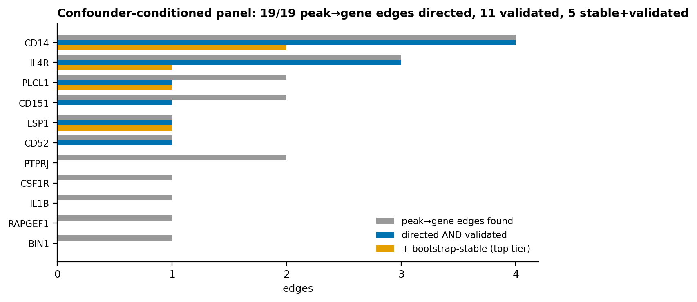
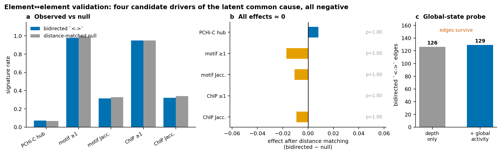
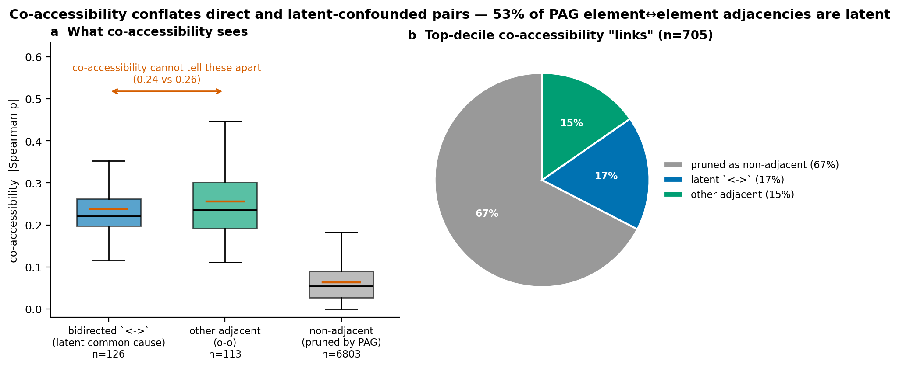

# Project update — monocyte chromatin→expression causal discovery

**Date:** 2026-07-20 · **Since last update:** the evaluation layer was just getting started
(ePerturbDB had been added as a first support source).

**One-line:** the validation layer is now built and has been run to completion — including on the
element↔element edges, which are the novel object. The headline is a **methodological positive** with
an **honest biological negative**, and I think both are publishable. What remains is scale.

Figures regenerate from committed evidence tables via
`Evaluation/scripts/make_summary_figures.py`; every number below comes from
`Evaluation/results/` or `panel_confounder_summary.tsv`.

---

## 1. Where the evaluation layer went

| Then (last update) | Now |
| --- | --- |
| ePerturbDB as first support source | **dropped** — 0 hits for CSF1R/CD14/IL1B; perturbation DBs are a confirmed dead end for our targets |
| single, gene-agnostic support | **3 orthogonal axes**, each cell-type *and* target-gene aware |
| edges "supported" if any interval overlapped | **axis-aware verdict tiers** — overlap alone no longer counts as validation |
| no element↔element validation | **full framework + 5 tests run** |

**The 3-axis triangulation (peak→gene).** An edge counts as validated only under
`region_interval_with_matching_target_gene` — the element must be supported *as a regulator of that
specific gene*:

| axis | source | scale |
| --- | --- | --- |
| prediction | ENCODE-rE2G (monocyte) | 667k links |
| physical | BLUEPRINT PCHi-C (`Mon`, hg19→hg38 lifted) | 86 gene-links for the panel |
| genetics | eQTL Catalogue SuSiE credible sets | 19 variant-links |

**Why the strictness mattered.** rE2G immediately caught that our then-flagship "stable CD14 edge"
peak is the **TMCO6 promoter**, not CD14's. That one catch is why the rule is now target-gene-aware
throughout: *trust no promoter→expression edge without target-gene evidence.*

---

## 2. Two problems found and fixed before any of this could be trusted

These were prerequisites — the validation numbers would have been meaningless without them.

**(a) The graphs were noise-dominated.** A null-calibration test (permute every feature, re-run FCI,
compare edge counts) showed real edge counts sitting *inside* the null band for all three original
genes — edges were tracking α×pairs, not signal. Cause: kNN-averaging reuses cells, so the effective
sample size was far below the row count and the CI tests were badly over-confident.

*Fix:* non-overlapping **metacells** (n=133, each cell used once) + **bootstrap stability selection**.
That fixed calibration (α=0.01 null/expected 3.0× → 1.0×) and cleanly separates signal from noise
(real: 12–57 stable edges; null: 0, max frequency 0.12–0.22).

**(b) Orientation was mostly unresolved.** Most peak→gene edges came back with ambiguous marks.

*Fix:* observed confounders (library depth) as **root nodes** plus a tiered mechanistic prior
(chromatin upstream of expression). Result below.

---

## 3. Current panel result (15 genes, confounder-conditioned)

| metric | count |
| --- | --- |
| peak→gene edges | **19** (across 11 of 15 genes) |
| **directed `chromatin → expression`** | **19 / 19 (100%)** |
| target-aware validated | **11 (58%)** — all directed and multi-algorithm (fci ∩ pc) |
| stable **and** validated (top tier) | **5** |
| peak↔peak edges | 239 — of which **126 bidirected `<->`** |
| confounder edges absorbed by depth roots | 45 |

All three axes yield validated edges (prediction: CD14 ×2, LSP1, CD52, PLCL1 · physical: CD14, LSP1,
CD52, IL4R ×3 · genetics: CD14, CD151). CD14 alone is supported on all three.

Two honesty notes: 4 of 15 genes yield **no** peak→gene edge at all, and database-rich genes don't
automatically validate (PTPRJ: 2 directed edges, 0 validated). Conditioning also *pruned* spurious
edges — PTPRJ dropped 4→2 as depth-driven covariation was reattributed to the confounder roots
rather than fabricating a chromatin→gene link.

---

## 4. The element↔element layer — the novel object

92% of what discovery returns is peak↔peak, and roughly half of it is **bidirected `<->`** — the PAG's
statement that *a latent common cause*, not a direct link, explains the dependence. That is the thing
no existing method reports, so it needed its own validation. There is **no accepted community null**
for element↔element claims, so we built one: a **distance-matched permutation test** (genomic distance
is the dominant confound — nearby peaks share everything by chance — so labels are permuted within
distance bins, 2000 permutations).

Then we asked what the latent actually *is*, and tested four candidates.

| candidate driver | test | result |
| --- | --- | --- |
| shared physical domain | PCHi-C shared bait/hub | negative |
| shared TF (motif) | JASPAR, 150 motifs, 44.5k hits | negative — and **saturated** (90% of *all* pairs share ≥1 motif, so this axis can't discriminate) |
| **shared TF (occupancy)** | **ChIP-Atlas, 515 monocyte TF experiments, 73 TFs** | **negative — decisive** (Jaccard 0.321 vs 0.340 null, unsaturated, so this is a real null, not a power artifact) |
| genome-wide activity state | leave-one-locus-out global-state root (collider-safe by construction) | **negative — edges survive** (126 → 129) |

**All four negative.** The shared-TF hypothesis is falsified for static binding.

### The positive: co-accessibility conflates what the PAG separates

Running Cicero-style co-accessibility on the *same* data:

| PAG edge class | mean co-access \|ρ\| | n |
| --- | --- | --- |
| bidirected `<->` (latent) | **0.238** | 126 |
| other adjacent (o-o) | **0.255** | 113 |
| non-adjacent (pruned) | 0.064 | 6803 |

Co-accessibility gives the latent-confounded and the other adjacent pairs **essentially the same
score** — it cannot separate them. Taking its top decile as "links": **67% are pairs the PAG prunes**,
and **53% of the PAG's element↔element adjacencies are bidirected** — i.e. co-accessibility would
report all 126 latent pairs as regulatory links.

**The robustness caveat, stated up front:** raw co-accessibility doesn't prune indirect paths through
*observed* peaks, and Cicero's graphical-lasso would remove many of that 67%. So the unassailable part
of the contrast is the **latent** class specifically: graphical-lasso removes indirect paths through
observed variables but **cannot** remove a shared *latent* driver. That is the theoretical guarantee
behind the 53%.

### What the four negatives actually buy us

I initially read them as a failure. I now think they are the stronger result:

> The bidirected edges are **robust to every observed proxy we could test** — not a shared TF, not a
> physical domain, not genome-wide state. By elimination the latent common cause is **local to each
> gene's regulatory neighbourhood**. And a local latent is **inherently non-deconfoundable**: the only
> available proxy is the mean of the locus's own peaks, which is a *collider* (a descendant), so
> conditioning on it *induces* edges rather than removing them — we confirmed this empirically in an
> earlier prototype.

**A genuinely unobserved, non-deconfoundable local common cause is exactly what a PAG bidirected edge
is for.** So the elimination doesn't fail to validate the edges — it demonstrates that modelling them
as *latent* is **required**, not stylistic. Biologically this lands on "a gene's elements co-vary as a
locally-coordinated module driven by a latent state," not pairwise enhancer regulation, a shared
master TF, or 3D looping.

---

## 5. What is novel, and what is not

Worth being explicit, because a reviewer will be.

**Not novel — concede up front:** the PAG edge taxonomy (generic FCI); "bidirected = latent common
cause" on genomic data (**MIIC**, Verny 2017 — but gene-level only); enhancer→gene link prediction
(ABC/ENCODE-rE2G — largely solved); causal discovery on scRNA (CausalCell — but assumes causal
sufficiency); co-accessibility between elements (Cicero/JRIM/Ziyani); latent-parent cluster theory
(Squires & Uhler 2022 — the lineage we extend).

**Novel — the combination none of them occupy:**

1. **Domain transfer.** Latent-variable causal discovery (FCI/GFCI → PAG) at the **enhancer/element**
   level on scRNA + histone **CUT&Tag**. Both literatures exist; they have never been joined here.
2. **Resolving the confound the neighbours concede.** Co-accessibility papers explicitly state they
   cannot separate a direct element–element link from a shared hidden driver. We do — and quantify it.
3. **An element↔element validation framework where no accepted null exists** — itself a contribution.
4. **The elimination result**: the latent is real, local, and unmeasured.
5. **A tiered mechanistic prior that makes the PAG orientable here** — 19/19 directed.

---

## 6. Corrections to earlier assumptions

- **Donor is not a usable variable.** RNA was never hashtagged, and the chromatin HTO donors don't
  correspond to RNA donors, so no donor structure is shared across modalities. Consequences:
  donor-block bootstrap is *impossible* (not pending), and **donor-invariance is out as a
  method pillar** — replaced by **cross-cell-type invariance (ICP)**, for which the T-cell suite is
  already built.
- **Follow-on I'd like your read on:** if the modalities don't share donors, then a paired row combines
  expression and chromatin *from different individuals*, aligned on cell state rather than genotype —
  which would mean the **genetics (eQTL) axis cannot recover genotype-driven covariation in
  principle**. It fits an observation we'd logged as a quiet null: eQTL support localises to the CD14
  promoter but never changes a peak→gene verdict. **This is my inference, not an established result**,
  and it affects how we frame the genetics axis.
- **Monocyte vs T-cell:** we built the full T-cell validation suite and ran an identical pipeline. Despite
  ~1.8× more cells and a 3× richer reference suite, T-cell yielded **fewer** validated stable edges
  (4 vs 7). More data and more reference material did not produce more validated causal edges — edge
  recovery is limited by per-gene effect size. Monocyte stays primary.

---

## 7. What remains

| # | Item | Why it matters |
| --- | --- | --- |
| **1** | **Scale the panel** (genome-wide / few hundred genes) | 15 genes is a pilot; every enrichment number needs n. **This is the only item that changes the paper.** |
| 2 | rank-fisherz + RCoT CI tests | flagged as "the biggest lever" for graph quality; current default assumes near-linearity |
| 3 | Degree-matched null; faithful distance-penalized-glasso Cicero | direct answers to the two most obvious reviewer objections |
| 4 | Cross-cell-type invariance (ICP) | now carries the invariance argument that donor used to |
| 5 | peak-node validator (BLUEPRINT ChIP + Roadmap chromHMM) | "is this a real monocyte mark" — the one validator tier never built |

**Target paper shape:** (1) the confounder-conditioned element-level PAG pipeline; (2) the
directed-vs-bidirected distinction, validated where co-accessibility conflates; (3) a prioritized set
of enhancer–enhancer co-regulation hypotheses for CRISPRi follow-up. Scope stays honest:
observational, PAG-not-DAG, hypothesis-generating.

**Question for you:** does the "four negatives ⇒ the latent is real but local and unmeasurable" framing
hold up as a *result* in your view, or does it read as a null finding that needs a positive companion
before it's publishable? That judgement decides whether we scale next or hunt for a positive
element↔element signature first.

---

*Supporting detail:* [`peak_peak_validation_results.md`](../../Evaluation/results/peak_peak_validation_results.md) ·
[`expanded_panel_confounder_results.md`](../../Evaluation/results/expanded_panel_confounder_results.md) ·
[`LIMITATIONS.md`](../LIMITATIONS.md) · [`ROADMAP.md`](../ROADMAP.md) §0.5
