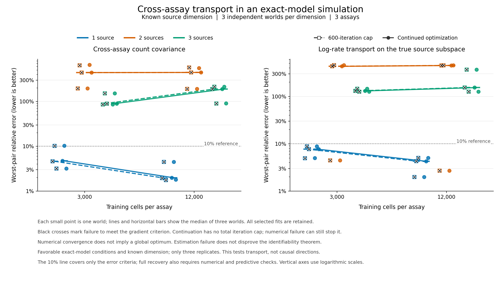

# Exact-model E/E2 simulation and optimization checks

Experiment date: 2026-11-15. This report preserves the initial exact-model
experiment and the separately identified exploratory labeling follow-up.

The later [unbounded count-native source-search experiment](COUNT_TRANSPORT_SOURCE_SEARCH.md)
passes the recovery criteria in all nine calibration-selected worlds. The results below preserve the
preceding estimators and their failures; they are not the latest recovery limit.

**Result of the two experiments below:** the one-source case recovers transport and the count joint
in all three 12,000-cell settings. Two- and three-source recovery remains
unreliable despite exact model specification and convergence-driven fitting.
The exploratory labeling repair improves some fits but leaves demonstrably
suboptimal higher-dimensional stationary points. This is a positive restricted
demonstration and an estimator limitation, not a refutation of the corollary.

## Initial exact-model experiment

The one-source model demonstrates finite-sample recovery under the corollary's
assumptions. All three mechanisms meet the declared recovery criteria at
12,000 unpaired fitting cells per assay. The original optimizer does not
reliably recover higher-dimensional models, even after removing total iteration
and evaluation budgets. Independent checks identify suboptimal stationary
solutions, rather than an observation-model mismatch or an analytic-gradient bug.

### What was matched exactly

For each assay $c$, generate

$$
Z_j=\frac{B_j-p_j}{\sqrt{p_j(1-p_j)}},\quad
B_j\overset{\mathrm{ind}}{\sim}\operatorname{Bernoulli}(p_j),\quad
\log R_c=M_c(Z+\mu),\quad
Y_{c,k}\mid Z\sim\operatorname{Poisson}(R_{c,k}).
$$

Observation noises are independent across all features and assays conditional
on the common source. Probabilities are the dimension-specific prefix of
$(0.12,0.27,0.40)$; source means are the prefix of $(0.6,-0.35,0.25)$.
Sources are independent, non-Gaussian, unit variance and distributionally
distinct. Every assay map has full column rank. All generating parameters lie
inside the fitted parameter domain. The count model includes no private factors,
additional depth variation, zero inflation, nonlinear log-rate mechanisms or
unknown dispersion.

Nine independently seeded mechanisms cover one, two and three sources, with
three replicates at each dimension. RNA, H3K27ac and H3K4me3 have 30, 24 and
18 abstract features. The assay names do not make this favorable mathematical
simulation a biologically realistic model of histone regulation.

Each mechanism has 12,000 fitting and 2,000 calibration cells per assay. Fitting
uses both a nested 3,000-cell prefix and the full 12,000 cells. Assay cells are
disjoint. A separate 4,000-cell paired cohort is evaluator-only. The model
receives raw counts and the correct source dimension, but no true probabilities,
loadings, source realizations, pairing or guidance. There is no PCA or feature
selection. Known dimension is an explicit limitation of this positive control.

### What removing optimization limits meant

All 72 initializations were continued from their original checkpoints until
their projected-gradient norm was at most $10^{-6}$. There was no total iteration
or function-evaluation budget. Numerical bounds and line-search failure checks
remained; the truth is interior to those bounds. All 72 runs converged by this
criterion. Twenty-two exceeded 600 total iterations; the longest used **8,959**.
Fitting all capped/continued pairs took about **237 seconds** on two CPU workers.

Continuation also changed the relative-objective stopping tolerance to zero.
Among the 72 initial checkpoints, 57 stopped on relative-objective tolerance
and 15 exhausted their chunk budget. Every selected checkpoint stopped before
600 iterations. Consequently this is a comparison of stopping rules plus total
budgets, not an isolated experiment on the iteration cap. The one-source
accuracy was already similar at its checkpoint; continuation chiefly supplied
the stricter stationarity check there.

Four starts are a finite search, and a small gradient does not establish a
global optimum. All 144 capped/continued artifacts and all selections were
sealed before evaluation.

### Recovery results before the labeling repair

Recovery requires a numerically accepted fit, relative covariance and restricted
transport errors each at most 10%, a positive nominal95 lower predictive-gain
bound, and conditional prediction within 0.02 nats per target feature of the
oracle. These are declared engineering tolerances, not theorem guarantees.

| Sources | Full recovery at 3,000 cells/assay | Full recovery at 12,000 | Transport within 10% at 12,000 | Covariance within 10% at 12,000 |
| --- | ---: | ---: | ---: | ---: |
| 1 | 2/3 | 3/3 | 3/3 | 3/3 |
| 2 | 0/3 | 0/3 | 1/3 | 0/3 |
| 3 | 0/3 | 0/3 | 0/3 | 0/3 |

For one source at 12,000 cells, each world's worst assay-pair covariance error
is **1.80%–4.48%**, and worst restricted transport error is **1.98%–5.02%**.
The one-source failure at 3,000 cells is close to the chosen tolerance:
worst covariance error is 10.26%, while transport error remains below 10%.

The two-source `d2_rep0` world is a partial success. At 12,000 cells its worst
transport error is 2.70%, and its largest oracle conditional gap is only
0.000288 nats per feature. Its covariance error is nevertheless about 190%.
Correct conditional transport and a well-estimated unconditional joint law
are distinct requirements; source-frequency error can separate them.

The figure retains all three mechanisms at each dimension and reports each
selected fit's worst assay-pair error. The crossed checkpoint markers indicate
failure of the stricter gradient criterion, not necessarily poor predictive
accuracy. The continuation often changes accuracy very little.

### Why higher-dimensional failure does not refute the corollary

After sealing, evaluate the generating parameters on the same training counts.
Those parameters are a known feasible point. Every one of the 48 continued
two- and three-source starts has worse training likelihood than that feasible
point, despite satisfying the gradient criterion. This directly demonstrates
suboptimality. It does not establish whether each stationary point is a local
minimum, a saddle or a constrained boundary solution.

Independent automatic differentiation agrees with the implemented gradients
within $1.2\times10^{-15}$. Independent replay verifies the generator, initial
information boundary, all 144 fitted objectives, 36 selections and 216 selected
directional evaluations. There is no identified arithmetic or gradient error
explaining the failure.

The primary probability parameterization imposed $p_j<0.4474$. Several failures
stop at that boundary. In `d2_rep0`, a coherently reflected source would require
a probability near 0.88; its globally relabeled equivalent has probability near
0.12. The original optimizer cannot traverse that binary-label orientation
directly. This motivates the following targeted parameterization experiment.

## Exploratory labeling follow-up

The [follow-up plan](runs/count_transport_labels_v1/PLAN.md) permits probabilities
on either side of one half during optimization. After fitting, source labels
are canonicalized globally: whenever $p_j>1/2$, replace $p_j$ by $1-p_j$, negate
$\mu_j$, and negate the same loading column in every assay. Complementing the
latent bit preserves the entire joint law. Initialization represents the same
physical distribution as before; no true parameters initialize fitting.

The canonical probability domain also broadens toward zero and one half, so this
changes both the parameterization and feasible domain. The follow-up uses all nine existing
12,000-cell conditions and four starts each. Its results are exploratory because
the mechanisms and assessment cohort have already been inspected. It does not
replace or erase the initial experiment.

All 36 follow-up starts reached the gradient criterion. The calibration-selected
results are:

| Sources | Original continued full recovery at 12,000 | Label-repaired full recovery at 12,000 | Label-repaired mean worst covariance error | Label-repaired mean worst transport error |
| --- | ---: | ---: | ---: | ---: |
| 1 | 3/3 | 3/3 | 2.75% | 3.74% |
| 2 | 0/3 | 0/3 | 357.69% | 348.58% |
| 3 | 0/3 | 0/3 | 121.29% | 149.76% |

The error columns average each world's worst assay-pair error; they are not
pooled pairwise errors or confidence bounds. All nine selected fits pass the
numerical screens, which plainly does not establish accurate recovery.

The repair improves consistency across starts in the one-source case. All 12
one-source follow-up starts have transport errors below about 5.1% and no
suboptimality witness from comparison with the true parameters. Six of the
12 original one-source starts at 12,000 cells had such a witness. Absence of this
witness does not establish global optimality.

Higher-dimensional results remain mixed or poor. All 24 two- and three-source
follow-up starts have worse training likelihood than the feasible truth. The
selected `d3_rep1` fit meets the criteria for RNA/H3K4me3 alone, not for its whole
three-assay joint. The two ordered RNA/H3K4me3 predictions are one association.

`d2_rep0` shows a useful tradeoff: the normalized training-objective gap shrinks
from 0.01794 to 0.00487 and worst covariance error falls from about 190% to 74%.
Yet worst transport error rises from 2.70% to 144%, and the worst oracle
conditional gap rises from 0.000288 to 0.480 nats per feature. Improved marginal
likelihood in a finite, suboptimal fit did not guarantee improved coupling.

The broader domain was active: selected `d3_rep2` has a canonical probability
of about 0.4629, above the old upper bound. Thus the result cannot be attributed
only to crossing a labeling boundary. No further algorithm or initialization
search was performed after this follow-up.

Independent replay verifies all 36 physical initial models and all 36 global
canonicalizations, 108 assay calibration scores, nine selections, 54 selected
directional evaluations and 216,000 paired-row predictions. Independent
automatic differentiation agrees within $1.8\times10^{-15}$. Every retained
failure remains in the reports. The [scientific review](runs/count_transport_labels_v1/REVIEW.md)
and [numerical review](runs/count_transport_labels_v1/NUMERICAL_REVIEW.json)
report no unresolved correctness blocker; bootstrap quantiles were not replayed.

## What these tests can establish

The corollary concerns identification of a shared-state intensity transport and,
with conditionally independent observation noise, a count-joint distribution.
It is a population statement. Finite-sample simulation success supports practical
estimation in the tested family; it is not a proof, a genomic causal-direction
result or evidence that real assays satisfy the model assumptions.

The analytic symmetry countercontrol gives a complementary check. Two sources
with identical probabilities and identical means can be swapped in just one
assay without changing its unpaired marginal count law. In the saved control,
the paired covariance changes by about **88.5%**. This deliberately violates the
no-symmetry premise and shows why that premise matters.

Predictive directions are not causal arrows. Per-cell gains over a fitted target
marginal are symmetric across an assay pair. Bootstrap intervals are nominal95,
condition on fixed fits, and are not familywise guarantees across the grid.
Three replicates per dimension do not establish broad reliability. The paired
cells and true parameters are exclusively evaluation information.

## Records

- [Primary plan](runs/count_transport_matched_v1/PLAN.md), [protocol](runs/count_transport_matched_v1/protocol.json), [generation seal](runs/count_transport_matched_v1/generation_seal.json) and [fit seal](runs/count_transport_matched_v1/fit_seal.json).
- [selected comparisons](runs/count_transport_matched_v1/comparison.tsv), [aggregate results](runs/count_transport_matched_v1/aggregate.tsv) and [evaluation seal](runs/count_transport_matched_v1/evaluation_seal.json).
- [Scientific review](runs/count_transport_matched_v1/REVIEW.md), [independent numerical replay](runs/count_transport_matched_v1/NUMERICAL_REVIEW.json) and [vector figure](runs/count_transport_matched_v1/recovery.svg).
- [Exploratory follow-up protocol](runs/count_transport_labels_v1/protocol.json), [seal for all 36 fits and the selections](runs/count_transport_labels_v1/fit_seal.json), [comparison table](runs/count_transport_labels_v1/comparison.tsv) and [evaluation seal](runs/count_transport_labels_v1/evaluation_seal.json).
- [Generator/runner](count_transport_matched.py), [convergence driver](count_transport_converged.py), [evaluator](count_transport_matched_evaluate.py) and [label optimizer](count_transport_label_optimizer.py).
- [Earlier mismatched-world results](COUNT_TRANSPORT_DEMONSTRATION.md), retained separately.

The combined implementation passed **87 focused tests**. The primary numerical replay checked
274 hashes and 864,000 selected paired-row predictions; bootstrap quantiles were
not independently recomputed. Sources and outputs from earlier experiments were
preserved. The primary and labeling runs produced detailed `evaluation.json` files in their respective run caches. The [matched run guide](runs/count_transport_matched_v1/README.md) and [labeling run guide](runs/count_transport_labels_v1/README.md) identify the records available in a checkout. The [transfer guide](../../../TRANSFER.md) includes a portable matched replay.
