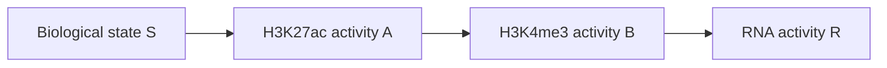

# Integration recoverability

What cross-assay relationships can RNA, H3K27ac and H3K4me3 identify when each assay measures
different cells? The count-source experiments test recovery under an explicit model of the
shared state. The integration benchmark tests whether scGLUE or scMRDR followed by cell matching
can reproduce a reference relationship. These designs score different targets.
[Count-source results](COUNT_TRANSPORT_SOURCE_SEARCH.md) · [Integration results](RESULTS.md)

## Count-informed source search

In the November 15 experiment the latent dimension was supplied, independent asymmetric
Bernoulli sources generated each assay’s log rates through a full-column-rank linear map, and
counts were conditionally independent Poisson measurements. These assumptions restrict which
joint distribution is compatible with the separate assay marginals. Fitting used 12,000 unpaired
cells per assay per world, with four outer starts and selection on unpaired calibration data.
Paired counts were available only to the evaluator.
[Observation model and identification assumptions](../../../project_resources/research/nonlinear_repair_2026_11_15/theory/COMP_TALL_MATRIX_COROLLARY.md)
· [Count-source experiment](runs/count_transport_search_v1/README.md)

| Supplied source dimension | Earlier labeling study | Unbounded fit with original starts | Count-informed source search |
| --- | ---: | ---: | ---: |
| 1 | 3/3 | 3/3 | 3/3 |
| 2 | 0/3 | 2/3 | 3/3 |
| 3 | 0/3 | 0/3 | 3/3 |
| **Worlds passing every assay-pair criterion** | **3/9** | **5/9** | **9/9** |

The criteria cover the map between assays’ shared log-rate subspaces, cross-assay count
covariance, and prediction of one assay’s counts from another. Across nine selected informed
fits the worst-pair relative error ranged from 1.73% to 4.46% for covariance and from 1.97% to
5.02% for transport. Only 5/12 individual three-source informed starts met the continuous-error
and numerical checks. Bootstrap intervals for full recovery were computed for selected fits. All
nine worlds had been assessed previously. Unknown dimension, model mismatch, performance in new
populations and causal direction remain open.
[Per-world results](runs/count_transport_search_v1/comparison.tsv) ·
[Full evaluation criteria](COUNT_TRANSPORT_SOURCE_SEARCH.md)

Two earlier experiments help interpret the improvement. On the exact-model bank the baseline
recovered the one-source cases, while higher-dimensional fits stopped at demonstrably suboptimal
solutions. In the separate demonstration on two cached integration worlds with different
generating mechanisms, the fitted cross-assay predictor performed worse than its own target
marginal and cross-assay covariance error exceeded that of predicting zero. The finite-sample
results depend on both model specification and optimization.
[Exact-model baseline and labeling follow-up](COUNT_TRANSPORT_MATCHED.md) ·
[Mismatched-world demonstration](COUNT_TRANSPORT_DEMONSTRATION.md)

For general disjoint sampling, the observed marginals allow several cross-assay residual
couplings even if shared state is known. Aligning cells by state can recover the between-state
component when the alignment is accurate. State alignment alone leaves the within-state residual
dependence undetermined.
[Identification boundary](../../../project_resources/research/theory/07_unpaired_integration_nonidentifiability.md)
·
[Latent-space aggregation](../../../project_resources/research/theory/06_latent_space_aggregation.md)

## Integration benchmark and follow-ups

| Study | Recorded outcome |
| --- | --- |
| Frozen scGLUE/scMRDR suite | **118/178** completed model fits, comprising all 94 simple/development fits and 24 assessment fits. The assessment stopped with incomplete coverage. The results retain count-calibration, numerical and native-runtime failures. Final world-level synthesis remains pending. [Execution record](IMPLEMENTATION_STATUS.md) · [Observed results](RESULTS.md) |
| Integration-validation supplement | All 16 selection and 16 confirmation fits completed on cached worlds. Low state-matching error could coincide with weak decoder transfer. For one realistic unrestricted-chain world, scMRDR’s state gap ranged from 0.1246 to 1.4446 across two seeds. [Confirmation matrix and diagnostics](INTEGRATION_VALIDATION.md) |
| Full-feature scGLUE encoder | Four fits compared native full-feature inputs with RNA PCA and chromatin LSI on two development worlds at one seed. Worst-pair state gaps improved from 0.1476 to 0.1365 and from 0.1312 to 0.1228. Some decoder directions worsened. The follow-up measured state alignment and decoder transfer. [Count-input comparison](COUNT_INPUT_FOLLOWUP.md) |
| scConfluence pilot | Six fits covered two cached simulation worlds and a separate empirical paired-count reference from scMTR-seq. Sparse count controls exposed false adjacencies under the null. The pilot did not establish reliable causal recovery. [Pilot record](../../../project_resources/research/scconfluence_scmtr_pilot_2026_11_01/README.md) · [Simple benchmark CI audit](SPARSE_CI_AUDIT.md) |

The last three studies have separate fit inventories from the 178 planned baseline fits. A
successful alignment or decoder readout alone does not determine the missing same-cell
dependence or causal graph.

## Reproducing the recorded work

The CPU replay can regenerate the deterministic matched-model inputs, repeat the baseline, and
then run the count-informed search under a fresh run ID. The November 22 clean-checkout
verification reproduced all 46 generator hashes and the full baseline’s aggregate recovery
counts, passed 112 scoped CPU tests, and completed one source-search fit. The full nine-world
search result comes from the November 15 run. The integration-bank check regenerated two world
manifests byte for byte. [Replay guide](../../../TRANSFER.md) ·
[Verification record](../../../reproduce/VERIFICATION.md)

The original suite’s model payloads and full evaluation files reside in its run cache. The
handoff includes a schedule and synthesis protocol, while each count run has a tracked index of
its available evidence.
[Suite schedule](../../../reproduce/records/integration_recoverability/suite/schedule_v1.json) ·
[Synthesis protocol snapshot](../../../reproduce/records/integration_recoverability/suite/synthesis_protocol_v1.json)
· [Demo](runs/count_transport_demo_v1/README.md) ·
[Matched baseline](runs/count_transport_matched_v1/README.md) ·
[Labeling study](runs/count_transport_labels_v1/README.md) ·
[Source search](runs/count_transport_search_v1/README.md)

## What this experiment should answer

The September 23 first-pass protocol below specifies the original integration-plus-matching
test. It starts with a small nonlinear network and measures where dependence changes between
latent biological activities, sparse count measurements, and cell-matched count rows. Six
simple-world fits and the primary development comparisons were subsequently executed. The
broader, frozen assessment is partial as described above.
[Original design discussion](design.md) ·
[Extended benchmark plan](../../../project_resources/research/integration_recoverability_extended_plan.md)
· [Matching diagnostics](SECONDARY_DIAGNOSTICS_PROTOCOL.md) ·
[World-level scoring plan](SUITE_SYNTHESIS_PROTOCOL.md)

| Component | First-pass decision |
| --- | --- |
| Assays | RNA, H3K27ac, H3K4me3 |
| Focal biology | One three-variable chain |
| Nonlinearity | Explicit saturating functions |
| Controls | One biological sentinel per assay |
| Measurements | Realistically sparse integer counts |
| Integration | scGLUE and paper-consistent scMRDR (replacing the local approximation) |
| Readout | One fixed one-to-one matching procedure |
| Aggregation | None |
| Dataset | One cached population of 6,000 cells |
| Repeats | Three integration seeds per method, after technical validation |

## The biological model

Use the following stipulated activity-level network:

This ordering is a simulation hypothesis, not an established universal causal
ordering of these histone marks. A saturating function provides an interpretable
nonlinear mechanism; choosing it does not establish a particular histone
dose-response law.

### Explicit equations

Draw a single continuous state and independent standard-normal innovations:

$$
U_i \sim \operatorname{Beta}(2,5), \qquad
S_i = \frac{U_i-2/7}{\sqrt{10/392}}, \qquad
\epsilon_{iA},\epsilon_{iB},\epsilon_{iR}
\overset{\mathrm{iid}}{\sim}N(0,1).
$$

The activities are

$$
\begin{aligned}
A_i &= S_i + 0.5\epsilon_{iA},\\
B_i &= \tanh(A_i) + 0.5\epsilon_{iB},\\
R_i &= \tanh(B_i) + 0.5\epsilon_{iR}.
\end{aligned}
$$

All innovations are independent of state. Coefficients and noise levels stay
fixed across assays, cells, and integration runs. They are engineering choices
for this diagnostic, not estimates of biological effect sizes.

The chain has two focal edges and no direct $A\to R$ edge. At the activity level,
its diagnostic separation is

$$
A \perp R \mid B.
$$

Unlike the earlier draft, this model has no additional direct $S\to R$ term.
There is therefore no need to condition on $S$ to block a second path in this
particular activity chain.

For each assay $m$, add a sentinel activity
$N_i^{(m)}=0.5\epsilon_{iN_m}$, independent of all other biological variables.
The scored panel contains six variables: three focal activities and three
sentinels. Their roles are evaluator-only information.

### Background features are integration context

Use a realistic-sized background of genes and bins, with state-reporting
features and independent-noise features. A state reporter can have activity
$H_{ij}^{(m)}=w_j^{(m)}S_i+\sigma_j^{(m)}\eta_{ij}^{(m)}$; a biological null
has $w_j^{(m)}=0$.

Freeze background loadings, noise parameters, annotations, and feature roles
before drawing the cached population. Background innovations are independent
of the focal innovations. They must not reveal a focal residual, hidden cell
identity, or planted parent assignment.

The background is not an additional network whose edges we score. Its purpose
is to give integration realistic inputs and information about shared state.

## Measure the activities as realistic counts

Generate biology first, then noisy assay measurements. Do not generate parent
counts and treat them as if they were the biological regulators.

Count equations and the meaning of library exposure

For a feature with biological activity $V_{ij}^{(m)}$, use a positive mean

$$
\mu_{ij}^{(m)}
=L_i^{(m)}\operatorname{softplus}
  \left(\alpha_j^{(m)}+\kappa_j^{(m)}V_{ij}^{(m)}\right),
\qquad
\operatorname{softplus}(x)=\log(1+e^x).
$$

For RNA, use

$$
C_{ij}^{(\mathrm{RNA})}\mid V,L
\sim\operatorname{NB}\left(\mu_{ij}^{(\mathrm{RNA})},\theta_j\right),
\qquad
\operatorname{Var}(C\mid V,L)=\mu+\mu^2/\theta_j.
$$

For each histone assay, use

$$
C_{ij}^{(m)}\mid V,L\sim\operatorname{Poisson}\left(\mu_{ij}^{(m)}\right).
$$

Conditional on the complete activities and exposures, draw count observations
independently across cells, features, and assays. Shared activities and exposures
can still induce marginal count dependence.

Technical exposures $L_i^{(m)}>0$ are independently drawn across assays and
independent of biology in this first model, with distributions calibrated to
the existing assay summaries. Features within an assay share that cell's
exposure. True exposure is evaluator-only; it is not identical to the realized
library total available to the pipeline.

The same measurement process applies to biological sentinels. Their counts
can therefore share technical-depth variation with other counts in the same
assay, despite biological independence.

---

### Calibration uses existing data only

Calibrate to the current processed feature panels, using feature detection,
counts per cell, nonzero count magnitudes, depth variation, and mean–variance
summaries. Keep RNA and the two marks separate. Record source paths, feature
masks, summary definitions, and fitted measurement parameters.

Preserve the distinction between the chromatin encoder's 30,000-bin inputs
and the 15,000-bin reconstruction panels. The existing
[feature-retention audit](../../empirical/data/results/biological_investigation_2026-09-11.md)
reports median detections per cell of 94 then 66 for H3K27ac, and 363 then 250
for H3K4me3, at those two stages. These are detected-bin counts, not read depth
or a measurement of biological information. RNA uses the current processed
gene universe and native feature-selection workflow.

Choose each focal measurement profile from the median-detection nonzero feature
in that assay's retained reconstruction/input panel. Sort by detection rate
and then feature ID, and use the lower middle entry when the number of features
is even. Preserve that feature's associated measurement summaries rather than
combining favorable summaries from different features.

Declare the calibration checks and tolerances before inspecting graph recovery.
If the NB/Poisson observation model cannot reproduce the required summaries,
report a count-model failure before comparing integration methods. Calibration
has now been performed for the first cached worlds; the
[execution record](IMPLEMENTATION_STATUS.md) gives the actual checks. Passing
those checks is not a claim of validated biological realism or discovery power.

Do not increase detection after poor recovery, replace integer counts with
binary detection, force observations into all-zero rows, or use a row-wise
softmax across feature means. Any necessary filtering must be recorded.
Measurement parameters are frozen before the benchmark population is drawn.

## One cached population and two information boundaries

Draw 6,000 cells from the same frozen biological model. Randomly partition them
into three disjoint groups of 2,000 cells. Each group exposes only one assay.
Use independent random streams for population sampling, measurement, assay
assignment, and integration training, and record their seeds in the run manifest.

| Learner-visible | Evaluator-only |
| --- | --- |
| Assigned assay counts | Complete six-variable activity panel |
| Assay and opaque feature/cell IDs | Complete scored count panel for each cell |
| Permitted synthetic annotations | True biological state and exposures |
| Observable count-based QC summaries | Focal/sentinel roles and causal truth |
| Background guidance | Mapping to hidden measurements of the same cell |

The evaluator needs complete counts only for the six scored variables; it need
not materialize a complete background assay for every hidden view.

These hidden measurements are simulation scoring references, not extra measured
data provided to integration. A cell in one visible assay has no true partner
in either other visible assay cohort, so exact partner retrieval is not an
appropriate first-pass metric.

This first pass is **transductive**: each method integrates and matches its
observed cells, rather than being assessed on an independent held-out cohort.
Use the same cached inputs for both methods and every integration seed. Do not
generate a fresh dataset after a disappointing result.

## Integrate, match, and compare

### Keep the native integration workflows

Run the current [scGLUE workflow](../../empirical/integration/methods/scglue/README.md)
with RNA PCA, chromatin LSI, count reconstruction, and a feature guidance graph,
consistent with the upstream training interface.[^1]

Run the [paper-consistent scMRDR adapter](../../empirical/integration/methods/scmrdr/paper_faithful/README.md),
using annotation-derived gene sums, a train-selected gene-feature union,
availability masks, and the authors' unified count model. This supersedes the
planning-stage choice of the local native-feature approximation. The adapter's
audit distinguishes paper equations, released-code defaults, and corrected
training bugs. It is not a numerical reproduction of a published experiment.[^2]

Freeze each method's native configuration and record its exact version and
settings. Do not tune latent dimensions, likelihoods, or training budgets against
this dataset's hidden recovery scores.

Exclude all six scored features from cross-feature guidance, retaining required
self-loops. Construct background guidance without consulting the planted focal
edge list. Focal features remain eligible for ordinary feature selection and
count reconstruction; this is not the extended benchmark's background-only arm.
Record which scored features survive selection.

Begin with training seed 0 for both methods. Once input, output, and numerical
checks pass, repeat with seeds 1 and 2 regardless of whether recovery is good:
six fits total. A failed fit is retained as a failure; it does not trigger a
silent configuration change.

### Use one matching procedure for both methods

For each RNA anchor, assign one H3K27ac cell and one H3K4me3 cell by separate
minimum-total-cost, one-to-one assignments using Euclidean distances in the
method's shared embedding. A mark cell cannot be reused within an assignment.

Read out original focal and sentinel counts from the selected cells. Do not
average cells, use decoder predictions, or replace named variables with latent
coordinates. Record filtering and compare methods on common eligible RNA
anchors and common eligible candidate cell IDs within each histone assay.
If QC leaves unequal assay sizes, use fixed-seed subsets of the smallest common
eligible size, chosen without truth or recovery scores. Reuse these exact pools
and assignment constraints for both methods and all matching references.

### Reference comparisons

| Comparison | Purpose |
| --- | --- |
| True-paired activities | Check the stipulated chain and discovery procedure |
| True-paired counts | Identify changes caused by measurement |
| Random one-to-one matching | Establish a no-alignment reference |
| One-to-one matching by true state | Establish what state correspondence supplies |
| scGLUE matching | Evaluate this integration-plus-readout pipeline |
| Paper-consistent scMRDR matching | Evaluate the other pipeline on the same unpaired counts |

Use the RNA anchors' hidden same-cell panels for the paired references.
Random and oracle-state matching use the same disjoint assay groups, row counts,
and no-reuse constraints as learned matching. Only the evaluator may use state.

For each assignment, also assemble the selected cells' hidden biological
activities and score that tuple. This is an oracle diagnostic of the coupling
created by matching, not a graph inferred from permitted measured inputs.
Graph scores on these different-cell tuples measure agreement with the source
biological skeleton; their PC output is not automatically a discovery of the
original same-cell activity graph.

## Evaluation and interpretation

The evaluator runs PC on unlogged activities and FCI on count measurements using the
causal-learn backend. The recorded simple-world configuration used RCIT with the HBE
approximation, $\alpha=0.01$ and seed 0. The evaluator takes raw integer counts, applies
$\log(1+C)$ once, and uses explicit named variables with no directional prior. It records the
test configuration, individual queries and numerical failures. Sparse-count tests and
feature-dependent matching limit the interpretation of their nominal p-values.[^3]
[Evaluator](evaluate.py) · [Recorded configuration and null behavior](SPARSE_CI_AUDIT.md)

Do not introduce total-count normalization into that readout. Constant features,
too few eligible cells, non-finite tests, and
training failures are explicit failed/undefined outcomes, not empty graphs.

The protocol calls for these readouts.

- Mean absolute state difference for each anchor-to-mark assignment.
- Cross-assay pairwise dependence and its difference from the paired reference,
  separately on the count and evaluator-only activity scales.
- Activity-skeleton precision and recall, including the chain diagnostic
  $A\perp R\mid B$ and the extra mediated-pair adjacency if one is returned.
- Count-graph adjacencies and endpoints, kept separate from activity-graph scores.
- Sentinel associations, distinguishing biological false edges from technical
  dependence through assay depth.
- Results for every training seed, retained cells/features, runtime, and failures.

Interpret the readouts according to the observation model.

1. **Activity and count graphs are different targets.** Noisy count proxies need
   not preserve $A\perp R\mid B$. Do not score every count adjacency against the
   activity DAG as if measurement had left the conditional independences intact.
   Count-level causal scoring requires the appropriate measurement-graph
   reference; paired-count agreement alone is not causal ground truth.
2. **State correspondence is not residual pairing.** Oracle-state matching does
   not restore the missing cell-specific innovations. Resemblance to the
   stipulated graph is not proof that unpaired inputs uniquely identify it.
3. **A readout failure is not a theorem about an embedding.** This experiment
   tests integration plus a fixed matching procedure. It does not prove that
   every possible decoder or downstream method must fail.
4. **Matched rows are not automatically independent samples.** Assignment
   competition and feature-dependent matching affect inference. Treat nominal
   p-values as diagnostics, not guaranteed false-discovery control.
5. **A paired-count failure limits attribution.** If the tested relationship is
   already undetectable in paired counts, the count-level comparison cannot
   cleanly blame integration. Paired raw counts are a reference, not a universal
   performance ceiling for methods that can denoise.
6. **One dataset is not a reliability study.** Training seeds measure optimization
   variability, not variability across biological worlds. Do not bootstrap cells
   or count individual edges as independent world replicates.

Exact direction recovery is an identifiability stress test, not a required
success. A chain's arrows are not established by its skeleton alone. Shared-state
hyperedges and ambiguity-set metrics are deferred, not fabricated from a
clustering or a pairwise graph.

## Repository placement and deferred work

The integration track contains the simulation, integration adapters, evaluation code and reports
for these experiments. The extended design includes held-out assessment, multiple graph
families, neural mechanisms, ambiguity controls and false-positive calibration. The aggregation
and CA-BOSS studies are separate tracks. [Pipeline map](../../README.md) ·
[Extended design](../../../project_resources/research/integration_recoverability_extended_plan.md)
· [Aggregation study](../aggregation_identifiability/README.md) ·
[CA-BOSS](../unpaired_multimodal/README.md)

## References

[^1]: The scGLUE training interface accepts assay inputs and a guidance graph. [scGLUE model training](https://scglue.readthedocs.io/en/latest/training.html)

[^2]: The local adapter documents its deviations from the published implementation. [Authors’ scMRDR repository](https://github.com/sjl-sjtu/scMRDR)

[^3]: The simple benchmark used the local causal-learn implementation. Its version, RCIT settings and sparse-input behavior are documented in the [CI audit](SPARSE_CI_AUDIT.md).
