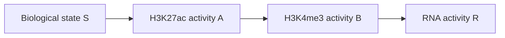

# Integration recoverability

_First-pass protocol, 2026-09-23; implementation active from 2026-10-03_

---

## Count-informed source search, 2026-11-15

The [unbounded source-search comparison](COUNT_TRANSPORT_SOURCE_SEARCH.md) is
complete. Reusing the same nine exact-model worlds, count-based initialization,
multiple starts and unpaired calibration selection meet the shared-state
transport and cross-assay count recovery criteria in **9/9 worlds**, including **3/3 each** with one,
two and three sources. New coordinates and removal of parameter boxes with the
old starting points recover 5/9; the earlier labeling experiment recovered 3/9.
Selected informed fits have worst-pair covariance errors of 1.73%–4.46% and
transport errors of 1.97%–5.02%.

Single starts remain unreliable: only 5/12 three-source informed starts meet
the continuous-error and numerical criteria. The report preserves all attempts,
the 36,134-iteration maximum, 112 passing tests and independent scientific and
numerical audits. This is a positive demonstration with known source dimension
on reused, exactly matched worlds. It does not establish global optimality,
biological realism or causal-direction recovery.

## Exact-model E/E2 test, 2026-11-15

The [matched simulation and optimization experiment](COUNT_TRANSPORT_MATCHED.md)
is the preceding experiment. It generates counts exactly within the corollary's model and fits
without total iteration/evaluation budgets. The one-source case recovers the
target in all three 12,000-cell settings. Higher-dimensional fits converge but
remain demonstrably suboptimal. A separately sealed exploratory change allowing
both Bernoulli label orientations does not establish full higher-dimensional
recovery. The report distinguishes transport, covariance and prediction; it
includes all outcomes, a figure, 87 passing tests and independent numerical and
scientific reviews. This supports a restricted positive example without claiming
general causal recovery or treating estimator failure as a theorem refutation.

## Count-transport demonstration, 2026-11-15

The [E/E2 estimator experiment](COUNT_TRANSPORT_DEMONSTRATION.md) is complete:
96 count-native fits on two cached worlds, with paired cells used only after
selection for evaluation. The strict and affine models improved within-assay
calibration likelihood but worsened cross-assay predictions and covariance recovery. Neither recovered
useful cross-assay dependence; causal recovery remains unestablished. The report
separates this empirical failure from the population corollary, documents model
mismatch and convergence limits, and links all sealed outcomes and independent
reviews. No new worlds or biological data were generated.

## Current priority: establish the identification boundary

The [2026-11-01 theory pivot](../../../project_resources/research/theory/07_unpaired_integration_nonidentifiability.md)
proves a general limitation for original cross-assay structure under strictly
disjoint sampling, even with oracle state. It explicitly preserves restricted
positive cases and distinguishes the shuffled paired-reference design. The
[research record](../../../project_resources/research/integration_identifiability_2026_11_01/README.md)
contains independent reviews and symbolic checks. No new worlds or integration
fits are part of this work. Earlier validation studies remain below.

## Completed integration-validation follow-ups

The [2026-11-01 scConfluence/scMTR-seq pilot](../../../project_resources/research/scconfluence_scmtr_pilot_2026_11_01/README.md)
adds a fixed count-input alternative and independent causal-discovery checks.
It reuses two cached simulation worlds and keeps the newly authorized real-data
pilot separate. All six fits and independent reviews are complete. The reports
distinguish state alignment, count-measurement graph recovery and agreement
with a real paired-count reference, and identify a sparse-count CI calibration
problem. Reliable causal recovery remains unestablished.

The [2026-10-31 count-input follow-up](COUNT_INPUT_FOLLOWUP.md) compares fresh
scGLUE PCA/LSI and native full-feature encoders on two cached development worlds.
All four GPU fits and independent numerical reviews are complete. Full-feature
input reduces the worst-pair state gap from 0.1476 to 0.1365 in the linear world
and from 0.1312 to 0.1228 in the collider world; weakest decoder transfer and
neighbor coverage also improve. Some individual decoder directions worsen.
This is a two-world, one-seed input-pipeline comparison, not evidence of reliable
causal recovery. The follow-up also records the verified CUDA workaround,
alternative integration methods and current-data viability review. It preserves
the earlier validation study and all frozen scientific sources.

The [integration-validation supplement](INTEGRATION_VALIDATION.md), started
2026-10-25, tests a small scGLUE/scMRDR hyperparameter screen on cached
development worlds before any new causal-recovery tests. It reports state
transport error, fixed decoder transfer, within-assay geometry retention and
neighbor hubness separately. Its theoretical bounds concern smooth functions
of shared state and their finite-pool covariance; they do not certify
cross-assay residual coupling.

The original frozen benchmark below remains available as a separate baseline.
It has 118 completed model manifests; its stopped assessment execution, retained
calibration failure, and earlier native CUDA failures are recorded in
[implementation status](IMPLEMENTATION_STATUS.md). All sixteen selection fits
are complete. The independently checked
[two-world selection](INTEGRATION_VALIDATION.md#frozen-two-world-selection)
chooses scGLUE `lam_align=0.2` and scMRDR's recorded baseline. All sixteen
confirmation fits have completed with these fixed settings and passed scoped
independent review. Matching and decoder-transfer diagnostics
remain separate. No new validation worlds or measured datasets are used.

The [completed constrained-chain confirmations](INTEGRATION_VALIDATION.md#informative-constrained-chain-confirmation)
show that low state-matching error can coexist with poor direct decoder
transfer. The report keeps these findings separate and gives an analytic
example of why the diagnostics can disagree.

The [realistic unrestricted-chain comparison](INTEGRATION_VALIDATION.md#realistic-unrestricted-chain-confirmation)
also exposes seed instability: scMRDR's state gap changes from 0.1246 to
1.4446, with the latter worse than expected random matching. Independent
native and numerical reviews confirm this result without finding an audited
input, configuration or calculation mismatch.
The [complete descriptive comparison](INTEGRATION_VALIDATION.md#descriptive-comparison-across-confirmation-conditions)
keeps this failure and the decoder disagreements visible. It does not establish
reliable causal recovery.

The [bounded baseline continuation](INTEGRATION_VALIDATION.md#separate-baseline-continuation)
completed after matrix validation, using its original settings and preserving
the earlier failed attempts. Both count regimes have completed models and
recovery reports with scoped independent scientific and artifact reviews.
The helper exited with code 0 after its two prescribed stages. This
continuation brings the original suite to 118 of 178 completed model fits;
the rest of that benchmark remains unfinished.
The [completion review](../../../project_resources/research/integration_validation_2026_10_25/reviews/objective_completion_final_audit_2026_10_26.md)
reconciles the validation work, research, conditional theory and bounded
simulation continuation. Completion of this task does not establish reliable
cross-assay causal recovery.

## What this experiment should answer

Can our current integration-plus-matching pipelines recover the dependence
pattern of one small nonlinear biological network when the assays observe
different cells from the same population?

Start with a small causal network, realistic assay sparsity, and the two
integration methods we already use. Do not start with a large collection of
worlds or a neural-network simulator. A useful first result identifies whether
the difficulty appears in count measurement, state alignment, or the chosen
matching/readout procedure.

The [extended benchmark](../../../project_resources/research/integration_recoverability_extended_plan.md)
is now also authorized for implementation. Follow the
[execution record](IMPLEMENTATION_STATUS.md) for implemented stages, actual runs,
and remaining work; the protocol below is not itself a results report.
The completed three-seed simple comparison and the primary results for all
six causal development worlds are in [observed results](RESULTS.md). All six simple integrations ran;
one downstream count-CI numerical failure is retained explicitly. Shared-state
alignment improved, but reliable cross-assay causal recovery was not established.
The [chain-world seed and guidance controls](RESULTS.md#development-chain-worlds-seeds-and-guidance-controls)
are complete and independently reviewed. All 94 simple/development model fits
and the shared-state ablation reviews are complete. All declared secondary
development diagnostics have run and their supplementary/synthesis reviews
passed. The phase-E lock and independent post-execution verification are saved;
the frozen serial assessment block was subsequently started. Both count regimes of all three
linear-chain assessment worlds have completed and passed scoped independent
review; the
[partial assessment results](RESULTS.md#first-locked-assessment-condition-linear-chain-1-realistic-counts)
retain weak count recovery and numerical failures explicitly. Final
assessment results and world-level synthesis remain pending; see the dated
execution status above rather than treating this historical paragraph as a
live-process report. The
[secondary matching protocol](SECONDARY_DIAGNOSTICS_PROTOCOL.md) and
[world-level synthesis protocol](SUITE_SYNTHESIS_PROTOCOL.md) document the
additional validation and reporting requirements; their implementation is
not evidence that those analyses are complete.
The earlier [discussion draft](design.md)
remains available as historical context; this README supersedes its first-pass
choices without replacing that draft.
The [latent-space aggregation note](../../../project_resources/research/theory/06_latent_space_aggregation.md)
contains the underlying identifiability discussion.

| Component | First-pass decision |
| --- | --- |
| Assays | RNA, H3K27ac, H3K4me3 |
| Focal biology | One three-variable chain |
| Nonlinearity | Explicit saturating functions |
| Controls | One biological sentinel per assay |
| Measurements | Realistically sparse integer counts |
| Integration | scGLUE and paper-consistent scMRDR (replacing the local approximation) |
| Readout | One fixed one-to-one matching procedure |
| Aggregation | None |
| Dataset | One cached population of 6,000 cells |
| Repeats | Three integration seeds per method, after technical validation |

The initial deliverables were documentation only. Implementation now includes
the frozen simulator, empirical count calibration, native frozen preprocessing,
integration adapters, and truth-aware evaluation. Completion still requires the
declared runs and their stage-specific results. No repository reorganization
is performed by this benchmark implementation.

## The biological model

Use the following stipulated activity-level network:



This ordering is a simulation hypothesis, not an established universal causal
ordering of these histone marks. A saturating function provides an interpretable
nonlinear mechanism; choosing it does not establish a particular histone
dose-response law.

### Explicit equations

Draw a single continuous state and independent standard-normal innovations:

$$
U_i \sim \operatorname{Beta}(2,5), \qquad
S_i = \frac{U_i-2/7}{\sqrt{10/392}}, \qquad
\epsilon_{iA},\epsilon_{iB},\epsilon_{iR}
\overset{\mathrm{iid}}{\sim}N(0,1).
$$

The activities are

$$
\begin{aligned}
A_i &= S_i + 0.5\epsilon_{iA},\\
B_i &= \tanh(A_i) + 0.5\epsilon_{iB},\\
R_i &= \tanh(B_i) + 0.5\epsilon_{iR}.
\end{aligned}
$$

All innovations are independent of state. Coefficients and noise levels stay
fixed across assays, cells, and integration runs. They are engineering choices
for this diagnostic, not estimates of biological effect sizes.

The chain has two focal edges and no direct $A\to R$ edge. At the activity level,
its diagnostic separation is

$$
A \perp R \mid B.
$$

Unlike the earlier draft, this model has no additional direct $S\to R$ term.
There is therefore no need to condition on $S$ to block a second path in this
particular activity chain.

For each assay $m$, add a sentinel activity
$N_i^{(m)}=0.5\epsilon_{iN_m}$, independent of all other biological variables.
The scored panel contains six variables: three focal activities and three
sentinels. Their roles are evaluator-only information.

### Background features are integration context

Use a realistic-sized background of genes and bins, with state-reporting
features and independent-noise features. A state reporter can have activity
$H_{ij}^{(m)}=w_j^{(m)}S_i+\sigma_j^{(m)}\eta_{ij}^{(m)}$; a biological null
has $w_j^{(m)}=0$.

Freeze background loadings, noise parameters, annotations, and feature roles
before drawing the cached population. Background innovations are independent
of the focal innovations. They must not reveal a focal residual, hidden cell
identity, or planted parent assignment.

The background is not an additional network whose edges we score. Its purpose
is to give integration realistic inputs and information about shared state.

## Measure the activities as realistic counts

Generate biology first, then noisy assay measurements. Do not generate parent
counts and treat them as if they were the biological regulators.

<details>
<summary>Count equations and the meaning of library exposure</summary>

For a feature with biological activity $V_{ij}^{(m)}$, use a positive mean

$$
\mu_{ij}^{(m)}
=L_i^{(m)}\operatorname{softplus}
  \left(\alpha_j^{(m)}+\kappa_j^{(m)}V_{ij}^{(m)}\right),
\qquad
\operatorname{softplus}(x)=\log(1+e^x).
$$

For RNA, use

$$
C_{ij}^{(\mathrm{RNA})}\mid V,L
\sim\operatorname{NB}\left(\mu_{ij}^{(\mathrm{RNA})},\theta_j\right),
\qquad
\operatorname{Var}(C\mid V,L)=\mu+\mu^2/\theta_j.
$$

For each histone assay, use

$$
C_{ij}^{(m)}\mid V,L\sim\operatorname{Poisson}\left(\mu_{ij}^{(m)}\right).
$$

Conditional on the complete activities and exposures, draw count observations
independently across cells, features, and assays. Shared activities and exposures
can still induce marginal count dependence.

Technical exposures $L_i^{(m)}>0$ are independently drawn across assays and
independent of biology in this first model, with distributions calibrated to
the existing assay summaries. Features within an assay share that cell's
exposure. True exposure is evaluator-only; it is not identical to the realized
library total available to the pipeline.

The same measurement process applies to biological sentinels. Their counts
can therefore share technical-depth variation with other counts in the same
assay, despite biological independence.

</details>

---

### Calibration uses existing data only

Calibrate to the current processed feature panels, using feature detection,
counts per cell, nonzero count magnitudes, depth variation, and mean–variance
summaries. Keep RNA and the two marks separate. Record source paths, feature
masks, summary definitions, and fitted measurement parameters.

Preserve the distinction between the chromatin encoder's 30,000-bin inputs
and the 15,000-bin reconstruction panels. The existing
[feature-retention audit](../../empirical/data/results/biological_investigation_2026-09-11.md)
reports median detections per cell of 94 then 66 for H3K27ac, and 363 then 250
for H3K4me3, at those two stages. These are detected-bin counts, not read depth
or a measurement of biological information. RNA uses the current processed
gene universe and native feature-selection workflow.

Choose each focal measurement profile from the median-detection nonzero feature
in that assay's retained reconstruction/input panel. Sort by detection rate
and then feature ID, and use the lower middle entry when the number of features
is even. Preserve that feature's associated measurement summaries rather than
combining favorable summaries from different features.

Declare the calibration checks and tolerances before inspecting graph recovery.
If the NB/Poisson observation model cannot reproduce the required summaries,
report a count-model failure before comparing integration methods. Calibration
has now been performed for the first cached worlds; the
[execution record](IMPLEMENTATION_STATUS.md) gives the actual checks. Passing
those checks is not a claim of validated biological realism or discovery power.

Do not increase detection after poor recovery, replace integer counts with
binary detection, force observations into all-zero rows, or use a row-wise
softmax across feature means. Any necessary filtering must be recorded.
Measurement parameters are frozen before the benchmark population is drawn.

## One cached population and two information boundaries

Draw 6,000 cells from the same frozen biological model. Randomly partition them
into three disjoint groups of 2,000 cells. Each group exposes only one assay.
Use independent random streams for population sampling, measurement, assay
assignment, and integration training, and record their seeds in the future
run manifest.

| Learner-visible | Evaluator-only |
| --- | --- |
| Assigned assay counts | Complete six-variable activity panel |
| Assay and opaque feature/cell IDs | Complete scored count panel for each cell |
| Permitted synthetic annotations | True biological state and exposures |
| Observable count-based QC summaries | Focal/sentinel roles and causal truth |
| Background guidance | Mapping to hidden measurements of the same cell |

The evaluator needs complete counts only for the six scored variables; it need
not materialize a complete background assay for every hidden view.

These hidden measurements are simulation scoring references, not extra measured
data provided to integration. A cell in one visible assay has no true partner
in either other visible assay cohort, so exact partner retrieval is not an
appropriate first-pass metric.

This first pass is **transductive**: each method integrates and matches its
observed cells, rather than being assessed on an independent held-out cohort.
Use the same cached inputs for both methods and every integration seed. Do not
generate a fresh dataset after a disappointing result.

## Integrate, match, and compare

### Keep the native integration workflows

Run the current [scGLUE workflow](../../empirical/integration/methods/scglue/README.md)
with RNA PCA, chromatin LSI, count reconstruction, and a feature guidance graph,
consistent with the upstream training interface.[^1]

Run the [paper-consistent scMRDR adapter](../../empirical/integration/methods/scmrdr/paper_faithful/README.md),
using annotation-derived gene sums, a train-selected gene-feature union,
availability masks, and the authors' unified count model. This supersedes the
planning-stage choice of the local native-feature approximation. The adapter's
audit distinguishes paper equations, released-code defaults, and corrected
training bugs. It is not a numerical reproduction of a published experiment.[^2]

Freeze each method's native configuration and record its exact version and
settings. Do not tune latent dimensions, likelihoods, or training budgets against
this dataset's hidden recovery scores.

Exclude all six scored features from cross-feature guidance, retaining required
self-loops. Construct background guidance without consulting the planted focal
edge list. Focal features remain eligible for ordinary feature selection and
count reconstruction; this is not the extended benchmark's background-only arm.
Record which scored features survive selection.

Begin with training seed 0 for both methods. Once input, output, and numerical
checks pass, repeat with seeds 1 and 2 regardless of whether recovery is good:
six fits total. A failed fit is retained as a failure; it does not trigger a
silent configuration change.

### Use one matching procedure for both methods

For each RNA anchor, assign one H3K27ac cell and one H3K4me3 cell by separate
minimum-total-cost, one-to-one assignments using Euclidean distances in the
method's shared embedding. A mark cell cannot be reused within an assignment.

Read out original focal and sentinel counts from the selected cells. Do not
average cells, use decoder predictions, or replace named variables with latent
coordinates. Record filtering and compare methods on common eligible RNA
anchors and common eligible candidate cell IDs within each histone assay.
If QC leaves unequal assay sizes, use fixed-seed subsets of the smallest common
eligible size, chosen without truth or recovery scores. Reuse these exact pools
and assignment constraints for both methods and all matching references.

### Reference comparisons

| Comparison | Purpose |
| --- | --- |
| True-paired activities | Check the stipulated chain and discovery procedure |
| True-paired counts | Identify changes caused by measurement |
| Random one-to-one matching | Establish a no-alignment reference |
| One-to-one matching by true state | Establish what state correspondence supplies |
| scGLUE matching | Evaluate this integration-plus-readout pipeline |
| Paper-consistent scMRDR matching | Evaluate the other pipeline on the same unpaired counts |

Use the RNA anchors' hidden same-cell panels for the paired references.
Random and oracle-state matching use the same disjoint assay groups, row counts,
and no-reuse constraints as learned matching. Only the evaluator may use state.

For each assignment, also assemble the selected cells' hidden biological
activities and score that tuple. This is an oracle diagnostic of the coupling
created by matching, not a graph inferred from permitted measured inputs.
Graph scores on these different-cell tuples measure agreement with the source
biological skeleton; their PC output is not automatically a discovery of the
original same-cell activity graph.

## Evaluation and interpretation

Use PC with nonlinear RCIT for the activity diagnostics and FCI with the same
test for count diagnostics, initially at $\alpha=0.01$. The existing
[discovery command](../../empirical/analysis/scripts/commands/run_pc_causallearn.py)
provides the relevant interfaces. Pin the underlying CI-test implementation,
version, and random seed; record whether its RCIT interface selects an RCoT
variant. Do not silently substitute Fisher-Z or the fallback-enabled FastKCI
wrapper. These tests are diagnostic tools, not a guarantee of valid calibration
for extremely sparse counts.[^3]

Keep raw counts in the saved readout, and use a fixed elementwise $\log(1+C)$
transform for count CI inputs. The future adapter must apply log1p exactly once
and invoke the linked command with `--transform none`, `--indep-test rcit`,
`--alpha 0.01`, `--background-mode none`, `--confounders none`, and an explicit
list of the six scored columns. Activity diagnostics use the unlogged activities
with `--transform none`. Do not inherit the command's default rank-Gaussian
transform or add an expression-sink prior.

Do not introduce total-count normalization into that readout. Constant features,
too few eligible cells, non-finite tests, and
training failures are explicit failed/undefined outcomes, not empty graphs.

The compact report should contain:

- Mean absolute state difference for each anchor-to-mark assignment.
- Cross-assay pairwise dependence and its difference from the paired reference,
  separately on the count and evaluator-only activity scales.
- Activity-skeleton precision and recall, including the chain diagnostic
  $A\perp R\mid B$ and the extra mediated-pair adjacency if one is returned.
- Count-graph adjacencies and endpoints, kept separate from activity-graph scores.
- Sentinel associations, distinguishing biological false edges from technical
  dependence through assay depth.
- Results for every training seed, retained cells/features, runtime, and failures.

Apply these interpretation rules:

1. **Activity and count graphs are different targets.** Noisy count proxies need
   not preserve $A\perp R\mid B$. Do not score every count adjacency against the
   activity DAG as if measurement had left the conditional independences intact.
   Count-level causal scoring requires the appropriate measurement-graph
   reference; paired-count agreement alone is not causal ground truth.
2. **State correspondence is not residual pairing.** Oracle-state matching does
   not restore the missing cell-specific innovations. Resemblance to the
   stipulated graph is not proof that unpaired inputs uniquely identify it.
3. **A readout failure is not a theorem about an embedding.** This experiment
   tests integration plus a fixed matching procedure. It does not prove that
   every possible decoder or downstream method must fail.
4. **Matched rows are not automatically independent samples.** Assignment
   competition and feature-dependent matching affect inference. Treat nominal
   p-values as diagnostics, not guaranteed false-discovery control.
5. **A paired-count failure limits attribution.** If the tested relationship is
   already undetectable in paired counts, the count-level comparison cannot
   cleanly blame integration. Paired raw counts are a reference, not a universal
   performance ceiling for methods that can denoise.
6. **One dataset is not a reliability study.** Training seeds measure optimization
   variability, not variability across biological worlds. Do not bootstrap cells
   or count individual edges as independent world replicates.

Exact direction recovery is an identifiability stress test, not a required
success. A chain's arrows are not established by its skeleton alone. Shared-state
hyperedges and ambiguity-set metrics are deferred, not fabricated from a
clustering or a pairwise graph.

Completion of the eventual first pass means delivering valid controls and a
clear diagnosis, including negative or measurement-limited outcomes. It does
not mean obtaining a predetermined favorable graph.

## Repository placement and deferred work

The organizational layout supplied for this project is:

```text
pipelines/
├── empirical/
│   ├── data/
│   ├── integration/
│   │   ├── methods/
│   │   │   ├── scglue/
│   │   │   └── scmrdr/
│   │   ├── configs/
│   │   ├── manifests/
│   │   ├── runs/<run-id>/
│   │   └── comparisons/
│   ├── analysis/
│   └── evaluation/
└── simulation/
    ├── aggregation_identifiability/
    ├── unpaired_multimodal/
    │   ├── worlds/
    │   ├── discovery/
    │   ├── scoring/
    │   ├── runs/
    │   └── results/
    └── integration_recoverability/

project_resources/
├── research/
├── reports/
└── archive/

envs/
```

The repository reorganization is separate work already present in the worktree.
This documentation change does not move files, create all the illustrated
subdirectories, or retire previous results. Future inputs, configurations, runs,
and results for this experiment belong under this simulation track.

The extended design retains held-out assessment, multiple graph families,
neural mechanisms, exact ambiguity controls, broader false-positive
calibration, and additional information-retention diagnostics. Aggregation
comparisons, population shifts, six-mark expansion, and algorithm tuning do
not enter this first pass.

Independent methodological review informed the separation of biological and
measurement truth, guidance exclusion, and the limitations of state matching.
Implementation and executed-stage evidence are recorded separately in the
[execution record](IMPLEMENTATION_STATUS.md).

## References

[^1]: scGLUE documentation. Stage 2: Model training. https://scglue.readthedocs.io/en/latest/training.html

[^2]: scMRDR authors' implementation. https://github.com/sjl-sjtu/scMRDR . See the linked local comparison for differences from this repository's model.

[^3]: Tetrad manual. Tests and scores by type. https://tetrad-manual.readthedocs.io/en/latest/tests-and-scores-catalog.html . The proposed first-pass command is the local causal-learn interface, not a claim that the two libraries use identical implementations.
