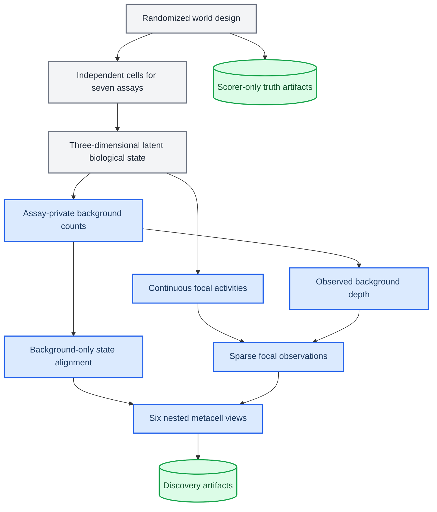
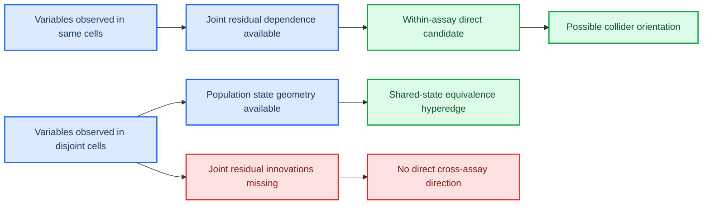
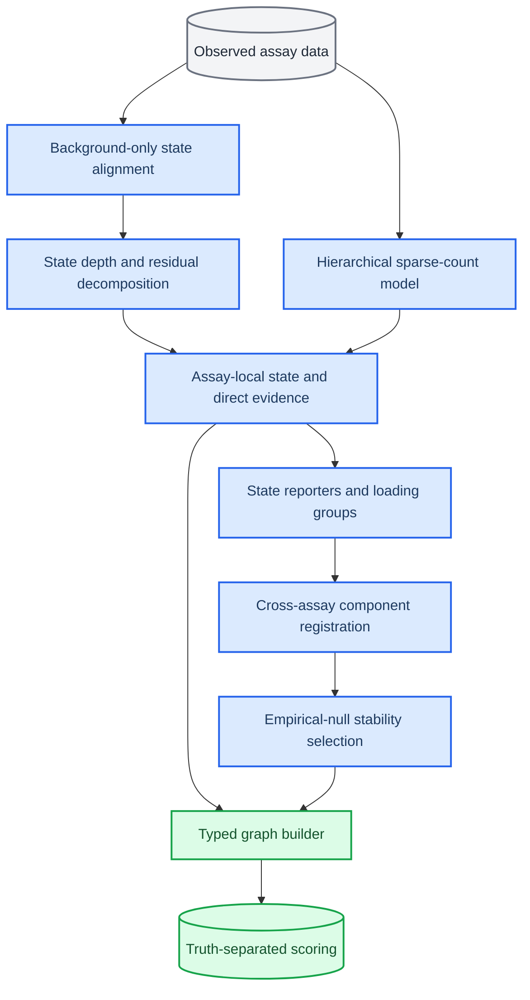

# CA-BOSS v4: Detailed Technical Report on Structure Learning from Unpaired Multimodal Assays

_Simulation construction, scientific estimands, identifiability, algorithm design, development history, current evidence, and next steps_

_Status date: 2026-09-03 · Current recommended cached checkpoint: CA-BOSS v4.58 · Evidence status: retrospective existing-world development, not fresh locked certification_

---

## 🧪 How the simulation worlds are constructed

### Scientific purpose of the simulator

The simulator is designed around the exact information problem encountered when RNA and several chromatin assays are measured in different cells. Its purpose is not merely to produce correlated matrices. It produces a known generative graph, realistic sparse observations, independently sampled assay populations, background features from which biological state must be estimated, and several kinds of truth whose identifiability differs under the observation design.

The central distinction is between two sources of association:

1. **Shared-state association.** Two features can change together because both respond to the same biological-state coordinate. This signal can survive independent sampling because it appears in each assay's population-level distribution.
2. **Cell-specific residual dependence.** One feature can directly affect another through innovations carried by the same cell. This signal is available within an assay, where both features are co-observed, but is severed when the two assays contain different cells.

The current seven-assay simulator is implemented in [`multimodal_simulation_v4.py`](../scripts/multimodal_simulation_v4.py). It is intentionally separated into a discovery domain and a scorer domain so that an algorithm cannot use the planted truth while selecting a graph.

### Modalities and independently sampled cells

Every world contains RNA and six chromatin modalities:

| Assay class | Modalities |
| --- | --- |
| Expression | RNA |
| Chromatin | H3K27ac, H3K27me3, H3K4me1, H3K4me2, H3K4me3, and H3K9me3 |

Cells are sampled independently for every modality. An RNA row and an H3K27ac row therefore do not describe the same cell, and rows from two chromatin assays do not describe the same cell. The simulation never gives discovery a hidden cell pairing. This is the defining constraint of the problem, not an inconvenience that an integration method is allowed to silently remove.

Each assay receives one of the shuffled cell-count multipliers

$$
0.65,\ 0.80,\ 1.00,\ 1.00,\ 1.20,\ 1.35,\ 1.50.
$$

The low and high base sizes are 1,200 and 2,400 cells. The resulting cached worlds contain approximately 780 to 3,600 cells per assay. The assignment of multipliers to assays changes between worlds, so assay identity cannot stand in for sample size.

### Fractional-factorial stress design

Worlds cycle through a $2^{4-1}$ resolution-IV half-fraction. Three independent coded factors, $A$, $B$, and $C$, determine a fourth factor through

$$
D=A B C.
$$

This balances major stressors without requiring every cell of a full $2^4$ design.

| Factor | Low arm | High or stressed arm | What it tests |
| --- | --- | --- | --- |
| $A$: cells | 1,200 base cells | 2,400 base cells | Sampling information |
| $B$: detection | Base focal detection 0.07–0.10 | Three randomly selected marks use 0.035–0.055 | Sparse chromatin observation |
| $C$: population | Common target fraction | Mean-zero assay-specific shifts with magnitude up to 0.15 | Population mismatch between experiments |
| $D$: background observability | State enters background without extra proxy noise | Assay-private Gaussian proxy noise with SD 0.20 | Imperfect state recovery from background features |

Slot-level jitter and clipping produce actual focal detection probabilities between 0.025 and 0.13; the cached pool spans approximately 0.027 to 0.13. Population fractions are centered near 0.60 and, in the cached worlds, span 0.45 to 0.75. Importantly, factor $D$ degrades only the observed background proxy. Focal molecular activities continue to depend on the true state, and the truth topology is unchanged. This lets the benchmark distinguish a hard biological world from a failure of state observability.

The current cache contains 152 worlds across seven source blocks for assay-local analyses. The later cross-assay bridge has the complete required artifacts for 103 of those worlds across five blocks. Current fast iterations select block-balanced random panels from this cache; they do not generate new worlds or fill missing artifacts.

### Latent biological state

Every assay has its own independently sampled cells, but all assays draw from a common family of biological-state distributions. Let $M_i\in\{1,\ldots,6\}$ be a latent mixture mode and $Z_i\in\mathbb R^3$ the continuous state. If $\rho_m$ is the target-population fraction for assay $m$, the six mixture probabilities are

$$
\boldsymbol\pi_m
=
\left(
0.46\rho_m,
0.34\rho_m,
0.20\rho_m,
0.46(1-\rho_m),
0.34(1-\rho_m),
0.20(1-\rho_m)
\right).
$$

After drawing $M_i$, the state is

$$
Z_i=\mu_{M_i}+\epsilon_i,
\qquad
\epsilon_i\sim\mathcal N(0,0.48^2 I_3),
$$

followed by the mild dependence

$$
Z_{i2}\leftarrow Z_{i2}+0.22 Z_{i1}.
$$

The six fixed mixture centers are

$$
\begin{bmatrix}
-1.45 & -0.55 & 0.15\\
-0.25 & 1.35 & -0.35\\
1.25 & 0.20 & 0.75\\
-0.95 & 0.75 & 1.15\\
0.45 & -1.25 & -0.85\\
1.35 & 0.55 & -0.65
\end{bmatrix}.
$$

They provide repeated but non-Gaussian population geometry. The mixture weights differ by assay under population stress, so alignment must tolerate unequal observed state frequencies rather than relying on identical empirical distributions.

### Assay-private held-out background features

Background features are the only variables from which discovery may estimate biological state. Assay $m$ has

$$
p_m^{\mathrm{bg}}=64+(m\bmod 3)
$$

features, producing 64, 65, or 66 assay-private columns. Feature identities are not shared across assays.

For assay $m$, background feature $f$, and cell $i$, a simplified form of the observation model is

$$
B_{imf}\sim\operatorname{Poisson}(\lambda_{imf}),
$$

$$
\lambda_{imf}
=T_{im}\exp\left[
\log b_{mf}
+a_m\widetilde Z_{im}^{\mathsf T}L_{mf}
+\eta_{imf}
\right],
$$

where

$$
T_{im}=\exp(\tau_{im}),
\qquad
\tau_{im}\sim\mathcal N(0,0.34^2),
\qquad
\eta_{imf}\sim\mathcal N(0,0.10^2).
$$

$L_{mf}$ is a random unit loading. The signal scale $a_m$ is 0.42 for RNA and 0.55 for chromatin. Baseline rates are drawn from 3.0–8.0 for RNA and 0.45–2.2 for chromatin. Under background-observability stress,

$$
\widetilde Z_{im}=Z_{im}+\nu_{im},
\qquad
\nu_{im}\sim\mathcal N(0,0.20^2 I_3),
$$

with independent noise for every assay. The observed leave-focal-out depth is

$$
D_{im}^{\mathrm{bg}}=\sum_f B_{imf}.
$$

If a simulated cell has zero background depth, one background event is inserted so that the row is retained. This is a measurement safeguard and is unrelated to its state or truth label.

The background matrices are deliberately assay private. Discovery cannot align assays by matching genes, peaks, column order, genomic coordinates, or a guidance graph. It must use distributional state geometry.

### Randomized focal roles and genomic locations

Every chromatin assay contains six focal slots. Their hidden semantic roles are:

| Role | Meaning |
| --- | --- |
| $P$ | First parent of a same-assay collider; shares a state axis with $S$ |
| $Q$ | Second parent of the collider; responds to another state axis |
| $C$ | Common child in $P\rightarrow C\leftarrow Q$ |
| $S$ | Noncausal state sibling of $P$ |
| $N_1,N_2$ | Independent null features used as sentinels |

Detection probabilities and genomic coordinates are drawn for anonymous slots before these roles are permuted over the slots. Consequently, a method cannot infer that a high-detection feature or a particular coordinate is usually a parent, child, state sibling, or null. The slow mark, fast mark, three pairs of marks, state dimensions, loading signs, coefficients, detection rates, coordinates, and null identities are all randomized between worlds.

The six marks are randomly paired. Pair $j$ receives state dimension $j\bmod3$, and both marks receive the same randomly chosen sign. The second parent uses

$$
q_m=(d_m+1+U_m)\bmod3,
\qquad U_m\in\{0,1\},
$$

with its own random sign. Thus $Q$ always uses one of the two dimensions other than its own mark's primary $P/S$ dimension, while remaining a pure one-axis reporter that may align with another mark pair's primary axis. The mark pairs define the planted cross-assay shared-state relationships.

Each focal coordinate is a 200-base-pair interval. Six starts are sampled without replacement on a 250-base grid inside a mark-specific genomic range before role assignment. Coordinates therefore change between worlds and encode no semantic role.

### Continuous focal causal system

For mark $m$, let $d_m$ be its primary state dimension and $q_m$ the dimension used by the second parent. The continuous molecular activities are

$$
P_{im}=s_m a_m^{P}Z_{im,d_m}+\epsilon^P_{im},
$$

$$
Q_{im}=s_m^Q(0.85)Z_{im,q_m}+\epsilon^Q_{im},
$$

$$
S_{im}=s_m(1.05)Z_{im,d_m}+\epsilon^S_{im},
$$

$$
C_{im}=\beta^P_mP_{im}+\beta^Q_mQ_{im}+\epsilon^C_{im}.
$$

The innovations use

$$
\epsilon^Q\sim\mathcal N(0,0.55^2),
\qquad
\epsilon^S\sim\mathcal N(0,0.38^2),
\qquad
\epsilon^C\sim\mathcal N(0,0.48^2).
$$

The direct coefficients vary by world:

$$
\beta^P_m\sim\mathcal U(0.65,1.00),
\qquad
\beta^Q_m\sim\mathcal U(0.55,0.90).
$$

One randomly rotated **slow mark** has $a_m^P=1.30$ and residual SD 0.25. It is dominated by a population-level state response and is therefore potentially matchable across independently sampled assays. A different **fast mark** has $a_m^P=0.14$ and residual SD 1.15. Its activity is dominated by cell-specific innovation and serves as an intentionally non-identifiable cross-assay challenge. Ordinary marks use loading 0.90 and residual SD 0.52. The null activities $N_1$ and $N_2$ are independent standard normal noise.

### Sparse chromatin observation model

Continuous chromatin activities are converted to binary detections. For a focal role $R\neq C$,

$$
X_{imR}\sim\operatorname{Bernoulli}(p_{imR}),
$$

$$
\operatorname{logit}(p_{imR})
=\alpha_{mR}
+0.78\,z(A_{imR})
+0.16\,z\!\left(\log(1+D_{im}^{\mathrm{bg}})\right).
$$

$\alpha_{mR}$ is numerically calibrated so that the expected detection fraction matches the slot-specific target. For the common child, observed parental detections additionally change the log odds:

$$
\operatorname{logit}(p_{imC})
=\alpha_{mC}
+0.78\,z(C_{im})
+0.16\,z\!\left(\log(1+D_{im}^{\mathrm{bg}})\right)
+\gamma_m^P X_{imP}
+\gamma_m^Q X_{imQ},
$$

with $\gamma_m^P,\gamma_m^Q\sim\mathcal U(1.40,1.80)$. The direct structure is therefore present both in the continuous activity DAG and in the sparse observation mechanism.

### RNA outcome model

The RNA cells have their own counterfactual slow- and fast-mark $P$ activities generated from the RNA population's state. The latent gene activity is

$$
G_i^*
=\beta_{\mathrm{slow}}P_{i,\mathrm{slow}}
+\beta_{\mathrm{fast}}P_{i,\mathrm{fast}}
+0.28Z_{i3}
+\epsilon_i^G,
$$

where

$$
\beta_{\mathrm{slow}}\sim\mathcal U(0.65,0.90),
\qquad
\beta_{\mathrm{fast}}\sim\mathcal U(0.90,1.20),
\qquad
\epsilon_i^G\sim\mathcal N(0,0.65^2).
$$

RNA counts follow a negative-binomial distribution with dispersion 10 and a mean depending on standardized gene activity and observed background depth:

$$
Y_i\sim\operatorname{NB}(\mu_i,\phi=10),
$$

$$
\mu_i
=\exp\left[
1.45+0.48z(G_i^*)+0.10z\!\left(\log(1+D_i^{\mathrm{bg}})\right)
\right].
$$

Discovery receives $\log(1+Y_i)$, not $G_i^*$.

The slow relation is recoverable only as support for a state-loading equivalence class. The fast relation is stronger at the counterfactual cell level but its informative residual is carried by different cells in the chromatin and RNA assays. It is therefore a challenge rather than an expected success target.

### Planted truth objects

The scorer stores several truth types because a single undifferentiated edge list would confuse fundamentally different estimands.

| Truth type | Number per world | Meaning and scoring target |
| --- | ---: | --- |
| `within_assay_direct` | 12 | $P\rightarrow C$ and $Q\rightarrow C$ in each of six chromatin assays |
| `within_assay_shared_state` | 6 | $P$ and $S$ respond to the same state coordinate without a direct $P$–$S$ edge |
| `cross_assay_shared_state` | 3 | Each randomized mark pair shares one latent state axis |
| `slow_peak_gene` | 1 | State-pairable peak-to-gene support; scored as a loading-equivalence support hypothesis |
| `fast_peak_gene_challenge` | 1 | Residual-dominated cell-specific effect; excluded from the reliability gate |
| `sentinel_null` | 15 | Twelve within-assay and three cross-assay detection-matched null relationships |

For cross-assay shared state, the exact planted $S$–$S$ pair is not the only acceptable representation. The truth stores a **latent-loading equivalence set**. It includes pure reporters of the relevant axis: $P$ and $S$, and $Q$ when its assigned dimension happens to equal that axis. $C$ is omitted because it mixes the two parental axes and treating it as an interchangeable state reporter would erase the direct collider estimand.

Within each assay, each $N_1$ and $N_2$ is matched to the nearest non-null feature by its pre-role detection target. Across each planted pair of marks, the closest-detection $N$–$N$ combination becomes a sentinel. These nulls test whether sparsity, depth, or shared state produces false biological structure.

### Discovery–scorer separation

The world writer creates two hard information domains:

| Domain | Available information |
| --- | --- |
| `discovery/` | Observed background matrices, leave-focal-out depth, observed focal tables, background-only embeddings, alignment uncertainty, metacell membership, and nested observed matrices |
| `scorer/` | Role assignments, generative DAG, coefficients, typed truth, true latent states and modes, proxy noise, and counterfactual activities |

Discovery functions explicitly reject paths whose names indicate truth, scorer, oracle, counterfactual, or ground-truth content. Membership readers select only cell, modality, and metacell identifiers even if a richer scorer table exists elsewhere. Phase A writes and hashes predictions before Phase B can open truth. Manifests bind inputs, outputs, schemas, and source files with SHA-256 digests. This does not make retrospective tuning into prospective validation, but it prevents direct target-label leakage within a scored run.

### Background-derived metacells and nested robustness views

The base background alignment supplies matched microstate labels. Within each aligned state stratum, cells are shuffled and partitioned independently for every assay. The number of groups is chosen from the smallest assay and the target cell count. Focal measurements and background depth are averaged within each assay-specific group.

The important semantic point is:

> A common `sample_id` denotes a matched state stratum and group index, not a shared cell or a reconstructed cell pair.

Every cell is used exactly once within a nested run. The six standard views are

$$
\{24,14,8\}\text{ target cells per metacell}
\times
\{0,1\}\text{ aggregation seeds}.
$$

These are correlated robustness views of one biological world, not six independent samples. In the original v4 consensus contract, an adjacency required support in at least four of six views, and an endpoint mark required at least two-thirds agreement among views containing the edge.

### Historical simulations that motivated the current design

The earlier aggregation studies established why the current algorithm separates assay-local and cross-assay evidence.

First, with 133 analysis rows held approximately fixed, causal-versus-confounded separation fell from 1.00 on raw cells to 0.54 at 32 cells per metacell and 0.42 at 64 cells per metacell. The corresponding correlation between a cause and its confounded twin rose from 0.59 to 0.98. Averaging removed the independent within-cell variation that distinguished direct effect from shared state.

Second, at matched cells per variable, same-assay adjacency recall fell from 0.803 when variables shared cells to 0.054 when their cell sets were disjoint. Cross-assay recall under true, state-matched, and permuted pairing was 0.789, 0.325, and 0.005. These results are recorded in [`04_simulation.md`](../../../../project_resources/research/theory/04_simulation.md) and [`simulation_identifiability_results.md`](../../aggregation_identifiability/results/simulation_identifiability_results.md). They are precursor experiments, not v4.58 benchmark numbers, but they demonstrate the observation-design asymmetry the current model is built to respect.

### Integration pilot: oracle, scGLUE, and GAPCA

Before the seven-assay v4 simulator, the RNA-plus-H3K27ac-plus-H3K4me3 pilot compared three integration arms. The oracle arm clustered planted biological state and measured the ceiling after independent sampling and aggregation. The scGLUE arm learned a joint embedding from sparse assay matrices and a synthetic guidance graph. GAPCA, or guidance-aligned PCA, fitted background-only assay embeddings and aligned their loading spaces by orthogonal Procrustes transformation.

Guidance had three diagnostic modes: perfect guidance contained focal planted links, held-out guidance excluded the focal locus, and shuffled guidance linked the target gene to planted nulls. This made integration leakage testable. The one-world runtime check found 36/36 complete oracle metacells but only 23/36 complete scGLUE metacells; state error relative to the oracle floor was 1.04 for oracle and 5.54 for the 40-epoch scGLUE fit. Both recovered the state-dominated gene relation and neither recovered the residual-dominated relation. These were implementation checks, not performance estimates.

GAPCA was fast and leakage safe enough for the repeated v3 benchmark, whereas held-out scGLUE frequently produced too few complete metacells. The seven-assay v4 branch goes further: it removes the cross-assay guidance graph entirely and aligns independently fitted assay-private background geometry. The pilot is documented in [`multimodal_simulation_pilot.md`](multimodal_simulation_pilot.md).

## 🔍 What is and is not identifiable

### Formal definition

An estimand $\psi(\theta)$ is identifiable from the observed distribution in a model class $\Theta$ if

$$
P_{\theta_1}^{\mathrm{obs}}=P_{\theta_2}^{\mathrm{obs}}
\quad\Longrightarrow\quad
\psi(\theta_1)=\psi(\theta_2)
$$

for every $\theta_1,\theta_2\in\Theta$. Identifiability is therefore not the same as high statistical power. If two different causal structures imply exactly the same distribution of the variables we observe, no algorithm can distinguish them with unlimited data.

For independently sampled assays, the observed law consists of assay-specific marginals:

$$
P^{\mathrm{obs}}
=\prod_{m=1}^{M}
P_m\!\left(B^{(m)},D^{(m)},X^{(m)}\right).
$$

There is no same-cell joint distribution

$$
P\!\left(X^{(m)},X^{(n)}\right),\qquad m\ne n,
$$

because $X^{(m)}$ and $X^{(n)}$ were never observed in the same cells. An integration coordinate or matched metacell can align population state, but it does not recreate the missing joint innovations.

### Why cross-assay residual direction is lost

Suppose a cell-level direct effect is

$$
V_i=\beta U_i+\gamma^{\mathsf T}Z_i+\epsilon_i.
$$

If $U$ and $V$ are measured in different cell samples but aggregated within a matched state stratum $c$, then

$$
\bar U_c=\mu_c^U+\xi_c^U,
\qquad
\bar V_c=\mu_c^V+\xi_c^V,
\qquad
\xi_c^U\perp\!\!\!\perp\xi_c^V\mid c.
$$

The observed association can persist through the state means $\mu_c^U$ and $\mu_c^V$, but the residual of the measured $U$ is not the residual that generated the measured $V$. Consequently, the same observed assay marginals can be compatible with $U\rightarrow V$, $V\rightarrow U$, a latent common cause, or other observationally equivalent mechanisms. A direct cross-assay direction is not identified.

This is why CA-BOSS refuses to turn a strong cross-assay residual-looking score into a direct causal edge. Such evidence is typed `unresolved` unless it is supportable as shared-state structure.

### Identifiable or defensible targets under the working assumptions

| Quantity | Status | Necessary interpretation |
| --- | --- | --- |
| State response of a feature within one assay | Estimable under the background measurement model and cross-fitting assumptions | A feature varies with an assay-local latent-state estimate after depth adjustment |
| Assay participation in a common state component | Recoverable as an equivalence or hyperedge hypothesis when distributional geometry is sufficiently distinctive | The assays contain reporters of a common population-level component |
| Same-assay residual adjacency | Potentially identifiable because the two variables are co-observed in the same cells | A direct-structure candidate after state/depth adjustment, not an automatic causal direction |
| Same-assay unshielded collider arrowhead | Orientable under the usual causal Markov, faithfulness, measurement, and no-unmodeled-local-confounding assumptions | The orientation is evidence-supported only within an assay |
| Slow peak–gene relation | Recoverable only as state-loading support | Not an exact cell-specific peak-to-gene direction |
| Gene arrowhead | Available only from the declared sink prior | Explicitly prior constrained and excluded from learned-orientation credit |
| Exact named latent coordinate | Not intrinsically identifiable | Latent axes may be permuted, reflected, rotated, or otherwise reparameterized |
| Exact cell correspondence across assays | Not identifiable and not estimated | No cell transport or pseudopair is claimed |
| Exact peak identity correspondence across assays | Generally not identifiable | Report an ambiguity set when several reporters are observationally equivalent |
| Direct cross-assay residual effect or direction | Not identifiable from these data | Must remain unresolved |
| Fast residual-dominated peak–gene effect | Deliberately non-identifiable challenge | Excluded from the expected-success gate |

The shared-state object is identifiable only relative to a working measurement model: background features must carry a common low-dimensional biological signal, assay-specific transformations must preserve enough distributional geometry, and the component must be distinguishable from depth and null structure. The semantic name, sign, and ordering of a latent axis are not identified. CA-BOSS therefore uses sign-invariant component matching and reports sets rather than claiming that “component 1” has the same absolute meaning in every assay.

### Why equivalence classes and hyperedges are the correct output

If two features in one assay are equally plausible reporters of a latent axis, forcing one point pair creates false precision. CA-BOSS instead returns a candidate set

$$
\mathcal A_h
=\{(x_1,y_1),\ldots,(x_K,y_K)\}
$$

for hypothesis $h$. The claim is that one compatible relationship represented in $\mathcal A_h$ links the indicated shared-state structure; it is not that all $K$ alternatives are true edges. When several assay pairs form one connected conflict, they remain one unexpanded hyperedge.

This representation is influenced by latent measurement models and multi-dataset equivalence reasoning: the observable distribution can identify a measurement structure or equivalence class without identifying one unique underlying DAG.[^silva] Work on overlapping or non-identical variable sets also shows that conclusions depend critically on what overlaps and on added assumptions such as interventions or linear non-Gaussian mechanisms.[^combine] [^cdmini] Those stronger assumptions are not silently imported into CA-BOSS.

## ⚙️ What CA-BOSS v4 does

### What ordinary FCI, BOSS, and CA-BOSS v3 were doing

The project's original production search treated the complete metacell table as one observational data matrix and ran FCI. FCI is a constraint-based causal-discovery procedure intended to return a partial ancestral graph, or PAG, when latent confounding and selection may be present. It repeatedly tests conditional independences, deletes adjacencies supported as absent, identifies collider patterns, and propagates endpoint marks. In a PAG, a tail indicates an ancestral end, an arrowhead excludes ancestry at that end, and a circle represents unresolved orientation. The project's fuller comparison of FCI, BOSS, and related searches is in [`03_algorithms.md`](../../../../project_resources/research/theory/03_algorithms.md).

That framework becomes problematic when a row combines averages from different cell sets. The row looks joint computationally, but the cross-assay residuals are not joint biologically. Conditional-independence tests can consequently mix four effects: common state, within-assay residual structure, aggregation noise, and cross-assay alignment error. No significance threshold can make those four objects scientifically equivalent.

BOSS, or Best Order Score Search, is a score-based alternative that searches variable orders and constructs a high-scoring DAG compatible with each order. The v3 matched-state layer used rank-Gaussian SEM-BIC BOSS with penalty 1, 20 starts, and backward equivalence search. Its within-assay binary layer used BDeu BOSS with sample prior 5 and 20 starts. BOSS improved the search behavior, but it did not by itself solve the observation-design problem: a score calculated on the combined metacell matrix still sees shared state and direct residual dependence as associations in one table.

CA-BOSS v3 therefore added channel awareness around BOSS:

| V3 evidence channel | Data used | Purpose |
| --- | --- | --- |
| Matched-state BOSS | Rank-Gaussian complete metacells after background-depth residualization | Find population-level associations |
| Within-assay BOSS | Sparse variables measured in the same original cells | Recover co-observed local structure |
| Fisher sparse rescue | Same-assay binary detection tables | Recover very sparse pairs missed by BOSS |
| Microstate profiles | Feature detection profiles over 20 embedding-derived clusters | Detect common state response |
| Nested consensus | Three metacell constructions in the v3 benchmark | Retain adjacencies present in at least two runs |

V3 intentionally left most endpoints circular and imposed a gene arrowhead only through a known sink prior. Its weakness was the merge: evidence from these channels eventually entered one adjacency skeleton. Marginal state relationships could therefore inflate graph density, and a Fisher cutoff of $p\le0.25$ was too loose to serve as a reliable sparse-count model.

Version 4 retains the useful idea of channel-aware evidence but changes both the statistical decomposition and the output object. The production assay-local layers currently end at v4.32; the cross-assay registration bridge then evolves through v4.58. Thus “v4.58” is not a replacement fit that discards v4.32. It denotes the current cross-assay completion sitting on top of the frozen assay-local layered representation.

### Why v4 is a new branch rather than another BOSS-FCI tuning pass

CA-BOSS v3 demonstrated that channel-aware evidence could recover a compact focal contract, but it still merged marginal state association and direct structure into a graph averaging 22.725 biological adjacencies per world. Its permissive Fisher rescue for sparse within-assay features used an odds-ratio threshold of 1.5 and $p\le0.25$. Two of the three locked GAPCA failures were missed sparse H3K4me3 direct edges, and the remaining failure contained two sentinel adjacencies.

Version 4 changes the estimand and architecture. It explicitly decomposes state, depth, and residual evidence; fits sparse counts within their actual assay cells; applies empirical-null and stability controls; and returns several typed layers. Ordinary BOSS/FCI is no longer expected to solve the missing-cross-assay-joint-distribution problem by threshold tuning.

### Step 1: estimate state only from held-out background features

The alignment adapter in [`unpaired_state_alignment.py`](../scripts/unpaired_state_alignment.py) accepts only an observed background matrix and leave-focal-out depth vector per assay, plus the assay key. It has no argument for roles, truth, focal values, feature links, cell pairing, or oracle state.

Within each assay, it computes log-depth normalization

$$
\widetilde B_{if}
=\log\left(1+B_{if}\frac{\operatorname{median}(D^{\mathrm{bg}})}{D_i^{\mathrm{bg}}}\right),
$$

standardizes columns, and fits an independent whitened rank-three PCA. It then clusters the scores into up to 24 K-means microstates, subject to at least 20 cells per microstate.

Each microstate is represented by a rotation-invariant signature containing:

- its sorted distances to all other centroids, divided by the median nonzero centroid distance;
- the rank of its prevalence; and
- the rank of its mean log background depth.

For target microstate $k$ and reference microstate $r$, the matching cost has the form

$$
c_{kr}
=\frac{1}{K}\left\|g_k-g_r\right\|_2^2
+0.20\left(u_k-u_r\right)^2
+0.20\left(v_k-v_r\right)^2,
$$

where $g$ is the sorted-distance geometry, $u$ the prevalence rank, and $v$ the depth rank. The Hungarian algorithm finds a one-to-one microstate assignment. A prevalence-weighted similarity transform then estimates rotation, scale, and translation into the reference coordinate system.

Cross-fitting splits background columns independently inside each assay into two disjoint folds. Each fold is aligned separately. The two coordinate systems are related using repeated cells only within the RNA reference assay, after which fold coordinates are averaged. The root-mean-square fold disagreement becomes a per-cell alignment-uncertainty score. No columns or rows are compared across assays.

The method is related in spirit to unpaired multi-domain causal representation learning, manifold alignment, and optimal-transport integration, but the current implementation does not assume a noiseless injective mixing model and does not construct a cell-to-cell coupling.[^sturma] [^mmdma] [^scot]

### Step 2: separate state, technical depth, and residual variation

The core decomposition is implemented in [`channel_aware_boss_v4.py`](../scripts/channel_aware_boss_v4.py). Every nonconstant focal feature is rank-Gaussian transformed:

$$
Y_{if}
=\Phi^{-1}\left(
\frac{\operatorname{rank}(X_{if})-1/2}{n}
\right).
$$

For each feature, the algorithm builds assay-local state coordinates $S_i$ and log background depth. Because depth can contain real state-dependent abundance as well as technical sampling variation, depth is first orthogonalized against state:

$$
D_i^{\perp S}
=D_i-\Pi_S D_i.
$$

Five-fold ridge models then provide out-of-fold state-only, depth-only, and joint predictions:

$$
Y_{if}
=\widehat Y^{\mathrm{state}}_{if}
+\widehat Y^{\mathrm{depth}\perp\mathrm{state}}_{if}
+R_{if}.
$$

The state contribution is not estimated on the same rows used to assess it. A useful conditional measure is partial state $R^2$:

$$
R^2_{f,\mathrm{state}\mid\mathrm{depth}}
=\max\left[
0,
\frac{\operatorname{SSE}_{\mathrm{depth}}-
\operatorname{SSE}_{\mathrm{joint}}}
{\operatorname{SSE}_{\mathrm{depth}}}
\right].
$$

For a pair $(f,g)$, the evidence table records total correlation, state-predicted correlation, depth-predicted correlation, joint nuisance correlation, residual correlation, loading cosine, bootstrap support, and the fraction of covariance explained by state. One state score is

$$
T^{\mathrm{state}}_{fg}
=\left|r\!\left(\widehat Y_f^{\mathrm{state}},
\widehat Y_g^{\mathrm{state}}\right)\right|
\sqrt{R^2_{f,\mathrm{state}\mid\mathrm{depth}}
R^2_{g,\mathrm{state}\mid\mathrm{depth}}}
\left|\cos(\ell_f,\ell_g)\right|,
$$

where $\ell_f$ and $\ell_g$ are conditional state-loading vectors. This makes “both features are marginally correlated” insufficient: both must be explainable by state and have coherent loading geometry.

### Step 3: calibrate residual evidence within state and depth strata

Residual null distributions are generated by permuting one residual within clusters derived from consensus state and background depth. This preserves the main nuisance structure while breaking pair-specific dependence. For each pair, the observed $|r(R_f,R_g)|$ is compared with its empirical null distribution. Benjamini–Hochberg correction is applied within each assay for direct residual tests. Cross-assay residual tests form separate families and cannot dilute the within-assay multiplicity correction.

This separation is essential. Residual dependence becomes a direct candidate only when both variables were measured in the same assay. A cross-assay residual score can be retained for diagnostics, but its type is `unresolved`.

### Step 4: replace the loose sparse rescue with hierarchical Bernoulli evidence

[`hierarchical_sparse_edges.py`](../scripts/hierarchical_sparse_edges.py) models detection rather than applying a permissive Fisher test to very small event counts. Counts are converted to $0/1$ detections. For every feature, a cross-fitted ridge-logistic nuisance model estimates

$$
p_{Xi}
=P(X_i=1\mid \widehat Z_i,K_i,D_i^{\mathrm{bg}}),
$$

using continuous background-derived state, K-means microstate indicators, and log leave-locus-out depth.

For pair $(X,Y)$ in microstate $k$, conditional independence implies the residual interaction score

$$
S_k
=\sum_{i\in k}(X_i-p_{Xi})(Y_i-p_{Yi})
$$

with information

$$
I_k
=\sum_{i\in k}
p_{Xi}(1-p_{Xi})p_{Yi}(1-p_{Yi}).
$$

The one-step local log-odds estimate is

$$
\widehat\theta_k=\frac{S_k}{I_k}.
$$

Its variance is the larger of model-based information and a sandwich score variance. Local estimates are partially pooled with a normal–normal random-effects approximation. The between-microstate variance $\tau^2$ is estimated by a DerSimonian–Laird calculation, and a Hartung-like inflation prevents heterogeneous microstates from appearing overconfident.

Very sparse detections can leave each microstate weak, so the model also fits a symmetric global Bernoulli pseudolikelihood:

$$
\operatorname{logit}P(Y_i=1\mid X_i)
=\operatorname{logit}(p_{Yi})+\theta X_i,
$$

$$
\operatorname{logit}P(X_i=1\mid Y_i)
=\operatorname{logit}(p_{Xi})+\theta Y_i.
$$

The two directions share the same undirected $\theta$ and receive weight 0.5. A weak $\mathcal N(0,2.5^2)$ prior keeps the estimate finite under separation. The MAP and inverse curvature provide a one-dimensional Laplace approximation for probabilities such as

$$
P(\theta>0.20\mid\text{observed evidence}).
$$

The default conservative rule takes the minimum of the microstate and global positive-evidence probabilities. The global likelihood alone had useful power but could mistake stable residual confounding for a direct edge; intersection avoids promoting that failure mode. These are approximate uncertainty scores, not a claim that the full hierarchical model is an exact generative Bayesian posterior.

### Step 5: recover assay-local collider structure

Within each chromatin assay, direct candidates are built from co-observed cell-level residual evidence, sparse Bernoulli evidence, multiple resolution views, state consistency, and empirical-null controls. An unshielded triple $P-C-Q$ can orient arrowheads into $C$ only when the two outer variables remain sufficiently separated. Otherwise the algorithm abstains from orientation.

Later cached-world selection repairs added tightly guarded completion, competition, and rotation actions for sparse motifs. Every displaced or rejected relation remains visible as `unresolved`; it is not silently treated as biological absence. The result is a 12-edge assay-local direct layer per world, rather than a dense union of state and residual associations.

### Step 6: identify state-responsive features without turning them into edges

The state layer uses several additive but separately labeled tiers:

1. A strict feature must pass the upstream hierarchical screen and a synchronized feature-global maxT test.
2. A redundancy-demoted feature can enter a within-assay state-equivalence class if it had passed pre-redundancy selection and retains strong maxT support.
3. Nested empirical-null calibration can admit a feature whose marginal state fit and conditional-Wald excess both exceed held-block null behavior.
4. Familywise multievidence can admit remaining state-supported features only when several residual-evidence routes agree beyond a maximum null.
5. Topology consensus can support a still-unresolved feature only if both marginal and partial state fits are positive and it is independently an endpoint of a direct candidate. Direct topology alone is never sufficient.

This layer describes feature participation in latent state. It does not add a pairwise biological edge for every pair of state-responsive features.

### Step 7: construct assay-local loading equivalence groups

State-responsive features are compared by their conditional loading direction. Later v4 guards require all members to be state supported or, for a bounded rescue, at least one state anchor plus an independently estimated leave-one-group-out cross-assay axis supported by at least two groups and two modalities.

Groups that overlap a complete collider child, contain both parents of the same child, lack sufficient centroid coherence, or do not permit a fair comparison with the competing parent are downgraded to `unresolved`. Version 4.32 then replaces over-specific two-feature point claims with a $2\times2$ structure-equivalence set when the observations cannot distinguish selected versus competing parent and sibling versus child. The four alternatives remain one hypothesis.

### Step 8: register components across assays

Version 4.33 established that assay-local reporter recovery was already high, so the main remaining problem was cross-assay registration. The bridge in [`component_conditioned_cross_assay_equivalence_v4.py`](../scripts/component_conditioned_cross_assay_equivalence_v4.py) associates reporters with assay-local rank-three components after depth residualization, then compares component distributions in the full background fit and both disjoint feature folds.

Early versions used scaled Kolmogorov–Smirnov costs. A pair had to win reciprocal local competition and retain a positive runner-up margin. [`multi_assay_permutation_synchronization_v4.py`](../scripts/multi_assay_permutation_synchronization_v4.py) then exactly enumerates the $3!$ component permutations for each assay and minimizes total pairwise cost in one common permutation frame. Exact enumeration is feasible at rank three. This adapts permutation synchronization and multiway matching without assuming a known correspondence.[^sync] [^multiway]

Version 4.54 adds distribution shape through a sign-invariant two-Wasserstein comparison. For empirical quantiles $q_j^{(m,a)}$ of component $a$ in assay $m$,

$$
d_{W_2}(m,a;n,b)
=\min\left{
\sqrt{\frac{1}{99}\sum_{j=1}^{99}
\left(q_j^{(m,a)}-q_j^{(n,b)}\right)^2},
\sqrt{\frac{1}{99}\sum_{j=1}^{99}
\left(q_j^{(m,a)}+q_{100-j}^{(n,b)}\right)^2}
\right}.
$$

The second term handles the arbitrary sign of an ICA component. Pairwise cost matrices are divided by their median before global synchronization. Sliced-Wasserstein methods motivated the use of one-dimensional distributional projections, but CA-BOSS uses the geometry only as matching evidence rather than as a cell-level variational model.[^sliced]

### Step 9: empirical-null stability selection

Candidate pair scores use favorable empirical ranks rather than a biological label. The v4.54 score combines:

- statistical context support;
- the number of contexts in which the W2 synchronizer coassigns the reporter components;
- negative maximum normalized W2 reporter cost; and
- mean exclusion margin against the best global assignment that forbids the pair.

A proposal must be a strict mutual nearest neighbor of both endpoint assays in every nested calibration fold, exceed other-block null margins, and recur under whole-world bootstrap resampling. This follows the principle of stability selection: selection frequency is used to distinguish reproducible structure from threshold-sensitive structure.[^stability]

Version 4.55 replaces a universal 0.80 frequency cutoff with an edge-specific empirical-null comparison. For target proposal $e$ and the most stable eligible null $e_0$,

$$
N_e>50,
\qquad
N_e>N_{e_0},
$$

and a working Beta score must satisfy

$$
P(p_e>p_{e_0}\mid N_e,N_{e_0})\ge0.975,
$$

where each frequency is assigned a working $\operatorname{Beta}(1,1)$ prior. The bootstrap refits overlap and are not independent Bernoulli trials. This probability is therefore an uncertainty-aware ranking score, not a calibrated Bayesian posterior.

Version 4.58 further requires strict local mutual-nearest agreement in all three observable contexts: the full background fit and both disjoint feature folds. Its null reference is restricted to null pairs occupying that same three-of-three context stratum. A candidate must still beat the strict-majority, same-stratum null, and 0.975 working-Beta gates.

### Step 10: emit a typed, multi-layer graph

The output types have different scientific meanings:

| Output type | Meaning | Direction policy |
| --- | --- | --- |
| `within_assay_direct_candidate` | Residual dependence among variables co-observed in one assay | Collider arrowheads only when supported |
| `within_assay_shared_state` | Same-assay common state response without residual dependence | No one-way claim |
| `cross_assay_shared_state` | Shared population-state response across disjoint assays | Hyperedge or equivalence claim; no direction |
| `cross_assay_shared_state_ambiguity` | Several observable alternatives represent one shared-state hypothesis | Alternatives never expanded |
| `prior_constrained_peak_gene` | Peak–gene support with an imposed gene-sink constraint | Arrowhead is prior constrained, not learned |
| `unresolved` | Conflicting, unstable, or non-identifiable evidence | Abstain |

State projections incident to a complete collider child are suppressed when they would conflate a mixed child with a pure state reporter. This is one of the main mechanisms by which v4 reduces false marginal edges.

## 📏 How the benchmark scores cross-assay recovery

The reusable scorer is [`cross_assay_benchmark_metrics_v4.py`](../scripts/cross_assay_benchmark_metrics_v4.py). Its central rule is that one selected row is one hypothesis. Candidate pairs inside an ambiguity set are not expanded and counted as independent discoveries.

### Shared-state hyperedge precision and recall

A deterministic maximum one-to-one matching pairs selected hypotheses with compatible truth hyperedges. Each truth can be credited at most once. Then

$$
\operatorname{precision}_{H}
=\frac{TP_H}{TP_H+FP_H},
\qquad
\operatorname{recall}_{H}
=\frac{TP_H}{H_{\mathrm{truth}}}.
$$

A hyperedge can be a true positive if its candidate set covers the correct equivalence object. This does not assert that every alternative in the set is a true pair.

### Assay participation and sentinel false-positive rate

Exact assay participation is scored only when the hypothesis makes a point claim about an assay. Set-valued participation is counted as a point-estimate abstention. With $A_{TP}$ correct participation units,

$$
\operatorname{precision}_{A}
=\frac{A_{TP}}{A_{\mathrm{pred}}},
\qquad
\operatorname{recall}_{A}
=\frac{A_{TP}}{A_{\mathrm{truth}}}.
$$

The sentinel false-positive rate is

$$
\operatorname{FPR}_{\mathrm{sentinel}}
=\frac{N_{\mathrm{selected\ sentinel\ features}}}
{N_{\mathrm{sentinel\ feature\ opportunities}}}.
$$

Detection-matched sentinels are more informative than arbitrary easy nulls because they expose false structure caused by sparsity and depth.

### Equivalence-class coverage and ambiguity size

Coverage measures whether a selected set-valued hypothesis contains a compatible truth:

$$
\operatorname{coverage}
=\frac{H_{\mathrm{truth\ covered}}}{H_{\mathrm{truth}}}.
$$

If $\mathcal A_h$ is the candidate set for selected hypothesis $h$, then

$$
\overline K
=\frac{1}{H_{\mathrm{selected}}}
\sum_h |\mathcal A_h|
$$

is the average ambiguity-set size. The maximum size and total candidate alternatives are also reported. Smaller sets are more informative, but a larger honest set is preferable to a false point claim.

### Exact pair and direction as identifiability stress tests

Exact cross-assay pair precision and recall are reported under the label

`identifiability_stress_test_not_expected_success_criterion`.

They are deliberately excluded from the reliability gate. Direction recovery is null when the truth object itself is shared state rather than a directed cross-assay causal edge. Zero direction calls therefore represent correct abstention, not “perfect direction accuracy.”

## 📊 Findings so far

### CA-BOSS v3 established the focal proof of concept

On 40 previously untouched worlds from the smaller RNA-plus-two-mark pilot, frozen v3 achieved:

| Arm | CA-BOSS v3 | Production FCI |
| --- | ---: | ---: |
| GAPCA learned integration | 37/40 successful worlds | 0/40 |
| Oracle-state ceiling | 36/40 successful worlds | 0/40 |

The GAPCA mean was 22.725 biological edges per world, and full matched-skeleton F1 was 0.544. The primary focal pairs were much more reliable than the entire 24-edge skeleton. H3K27ac direct, slow peak–gene, and shared-state targets were recovered in 40/40 GAPCA worlds; the sparse H3K4me3 direct edge was recovered in 38/40. World 10012 retained two sentinel edges. The residual-dominated fast peak–gene challenge appeared in only 4/40 GAPCA worlds and 2/40 oracle worlds.

The key finding was positive but limited: channel-aware evidence solved the five-pair attainable focal contract far better than ordinary FCI, but the broader graph remained dense and inaccurate. Similar GAPCA and oracle results localized the sparse failures to observation and edge modeling rather than to a privileged integration coordinate. The complete record is [`channel_aware_boss_results.md`](channel_aware_boss_results.md).

### Early v4 feasibility, ceiling, and negative-control work

The first v4 implementation separated four layers: soft distributional background alignment, hierarchical Bernoulli/beta-binomial residual evidence, an assay-local two-parent collider selector, and conditional loading groups projected into native latent-axis hyperedges. On TRAIN30001–30024, the initial structure-aware selector improved 275 of 288 true arms plus 9 false candidates to 284 true arms and 0 false candidates; 22/24 worlds recovered all 12 arms. The two remaining worlds were an observationally symmetric triangle and a competing wedge without a unique center, so the method abstained.

This stage also found and corrected a simulator-design error. The original factor $D$ deranged an alignment artifact supplied by the simulator, but the production preparer correctly ignored that artifact and recomputed alignment from raw background counts. The nominal stress was therefore inert. The replacement $D$ perturbs the assay-private background state proxy before counts are sampled while leaving focal biology unchanged.

An initial proxy-noise SD of 0.65 was too destructive: seeds 30017–30024 passed 0/8 registered-world gates, and all stressed worlds lost native cross-assay axes even though their within-assay direct recovery remained strong. A TRAIN-only sensitivity sweep over SD 0.00–0.45 showed collapse by 0.35 and retained at least six of seven assays at 0.20. SD 0.20 was consequently frozen as a non-annihilating challenge, not selected because the algorithm passed it.

The native-axis ceiling was itself inadequate. Four paired worlds recovered all three dimensions in 2/4 zero-noise runs and 0/4 SD-0.20 runs. Coarser K-means, ordered-variance PCA, projective clustering, coarse-mixture registration, and exact signed-permutation FastICA transport were all tried as diagnostics. Each either failed to generalize or produced an internally stable but biologically wrong permutation. This motivated a change of estimand from exact named axes to rotation- and sign-invariant state-response sets.

The replacement state test uses cross-fitted depth nuisance models, heteroskedasticity-robust multivariate scores, and 999 synchronized Rademacher multiplier bootstraps. A world-level maxT controls feature and assay admission; within-assay BH, at least four of six views, event-count floors, and feature-global maxT provide further guards. A pure-depth screen gave membership and assay-admission familywise errors of 2/60, while sparse or constant rows caused no changes in 90/90 paired invariance checks. A true-state ceiling still passed the former complete-membership criterion in only 3/5 inspected worlds, proving that full feature recovery was not an honest primary gate.

The sparse-count work likewise separated power from safe selection. In three diagnostic worlds, the global symmetric pseudolikelihood recovered 216/216 true direct votes but also produced 2 sentinel and 7 other false consensus edges. The microstate–global intersection retained 186/216 true votes with no false consensus edges. Standalone beta-binomial union, a joint predictive collider wedge, and a forced RNA-reference star were also rejected. Strong evidence in one channel was not allowed to override contradictory state geometry or null behavior.

Selection-only versions v4.9–v4.18 then accumulated observable guards for difficult direct motifs. They preserved original provenance, handled zero-edge cases only under unique or unanimous evidence, checked dual-anchor collider separation, allowed orientation changes only on an unchanged skeleton with better separation, restricted state-consistent star moves when production evidence was already strong, required unique beta-binomial and uncertainty support for rescue-only arms, and allowed a state-loaded parent to become a center only under unique residual, fold, posterior, and direction evidence. The final v4.18 cached panels contained 96 evaluations of 77 unique worlds and recovered 1,152/1,152 direct arms with no false arm or reversal.

Versions v4.19–v4.22 added four still narrower repairs: a loading-equivalent sibling rotation, a unique same-center substitution, an empirical-null state-parent rotation, and a final all-state topology completion that could fire only after every higher-priority route abstained. The all-state route activated in exactly one cached world. These changes produced the complete v4.22 assay-local audit described below.

### Formal v4 development blocks exposed failure modes rather than a clean certification

The original formal per-world gate required direct-arm macro recall at least 0.90, collider-arrowhead recall at least 0.80 with no strict reverse, assay-local loading recall at least 0.80, complete native-axis dimension coverage without mismatch, recovery of the slow RNA axis, matched-null FPR at most 0.10, typed-skeleton precision at least 0.80, and a clean provenance audit. A future 40-world locked certification would additionally have required at least 34 successful worlds, every motif class in at least 34 worlds, a pooled null upper confidence bound at most 0.10, at least 16/20 successes at each factor level, and no factorial design cell below 3/5.

The exact-axis and complete-feature portions of that gate were later retired after the observable and true-state ceilings showed that they were not attainable estimands at the chosen difficulty. This is not a retroactive pass: the old blocks remain failed under their registered protocols, and the newer hyperedge contract is evaluated separately.

Before the current cached-only loop, several predeclared TRAIN blocks were run. They are permanently development history once their outcomes informed changes.

| Block | Result | Main lesson |
| --- | --- | --- |
| 33001–33024 | 15/24 reliable | Loading precision 0.8854 and recall 0.6806 failed despite direct recall 0.9688; state and structure needed explicit dependency |
| 36001–36024 | 20/24 reliable | Loading recall 114/144 = 0.7917 missed the 0.80 gate by two groups; sparse reversals remained |
| 37001–37024 | 23/24 reliable, but loading recall 109/144 = 0.7569 failed | Consistent relative evidence was being rejected by absolute loading thresholds |
| 38001–38024 | 18/24 reliable | State sentinels, sparse direct misses/reversal, and loading sentinels showed that broad completion rules were unsafe |
| 39001–39024 | Aborted before truth access | Producer schema v7 and scorer schema v8 disagreed; the block was retired as infrastructure failure |
| 40001–40024 | 18/24 reliable | Mean gates passed, but exceptional completion/replacement logic caused failures; ordinary direct motifs were exact in 134/134 untouched two-arm cases |

Several tempting direct-structure replacements were rejected: exhaustive state-star decoding, risk-triggered hybrids, blanket hierarchical-collider replacement, and a standalone parent swap. Their precision or block reliability was insufficient even when they fixed a motivating case. A narrow three-tier disagreement rule improved retired blocks to pooled direct precision 0.9956 and recall 0.9922 with zero reversals, but rare rescue tiers remained post hoc. These failures motivated the later precision-first, abstention-aware cached strategy.

### Cached assay-local development reduced density and separated layers

The complete-cache v4.22 audit covered all 152 available worlds:

| Quantity | Result |
| --- | ---: |
| Within-assay direct arms | 1,824 TP, 0 FP, 0 FN, 0 reversals |
| Direct density | 12.0 per world |
| Assay-level shared-state participation | 1,064/1,064 calls |
| Strict state-responsive feature membership | 2,990 TP, 0 FP, 810 FN |
| Strict membership precision / recall | 1.000 / 0.7868 |
| Sentinel pseudo-assay audit | 6/720 false calls; 5/120 worlds with any call |

The 12 direct candidates correspond exactly to two collider arms in each of six chromatin assays. Compared with 22.725 biological adjacencies in v3, that direct layer is 47.2% smaller:

$$
1-\frac{12}{22.725}=0.472.
$$

This comparison is conservative and not perfectly like-for-like because v4 represents shared state as typed sets rather than expanding it into ordinary edges. That semantic change is part of the improvement, not merely a smaller cutoff.

State-membership additions then improved recall while maintaining zero cached false members:

| Version | Modification | State-membership result across 152 worlds | Effect |
| --- | --- | ---: | --- |
| v4.23 | Redundancy-aware equivalence tier | 3,246 TP, 0 FP, 554 FN; recall 0.8542 | Restored 256 true redundant reporters without pair expansion |
| v4.25 | Nested empirical-null marginal/conditional calibration | 3,401 TP, 0 FP, 399 FN; recall 0.8950 | Added 155 true reporters; avoided a loose maxT threshold that also admitted three sentinels |
| v4.26 | Familywise multievidence calibration | 3,490 TP, 0 FP, 310 FN; recall 0.9184 | Added 89 true reporters under a block-maximum null |
| v4.27 | Positive state fit plus independent topology consensus | 3,637 TP, 0 FP, 163 FN; recall 0.9571 | Added 147 true reporters; every cached world reached precision 1 and recall at least 0.80 |

Assay-local loading groups required another precision pass:

| Version | Modification | Effect |
| --- | --- | --- |
| v4.28 | Require every group member to be v4.27 state supported | Converted 36 weak groups to explicit abstentions; removed the known 41019 sentinel group; 60/60 production checks passed |
| v4.29 | Leave-one-group-out cross-assay axis rescue with a state anchor | Added 20 true and 0 false groups in the 151-world audit, but inherited 10 upstream false point groups remained |
| v4.30 | Minimum centroid cosine 0.90 and direct-collider overlap guard | Removed five false and no true groups from v4.29 in the full audit |
| v4.31 | Require fair observability of the competing collider parent | Removed two more false and two true point groups; production panels moved from 302 TP/2 FP to 302 TP/0 FP |
| v4.32 | Replace over-specific state-route pairs with one $2\times2$ equivalence set | Preserved 757 hypotheses while converting point error into honest ambiguity; 757 distinct truths covered, 0 false hyperedges, 149 misses |

Across the 151-world v4.32 audit, 737 state-route equivalence hyperedges and 20 exact axis-route groups covered 757 of 906 truth groups, for coverage precision 1.000 and recall 0.8355. The 2,968 candidate alternatives were never expanded. The nominal v4.31 point-pair diagnostic was 754 TP, 3 FP, and 152 FN; the move to v4.32 did not create new evidence, but represented the evidence at the resolution it actually supported.

### Cross-assay reporter discovery was not the main bottleneck

Version 4.33 recovered 888 of 912 assay-local reporter groups across 152 worlds, with precision 1.000 and recall 0.9737. This upper-bound diagnostic showed that most remaining loss came from registering latent components across independently sampled assays, not from finding a plausible reporter inside each assay.

### Cross-assay bridge evolution

The bridge was improved through a sequence of increasingly explicit registration and uncertainty controls. Each failure was retained and used only for later development.

| Version | Main change | Result or observed effect |
| --- | --- | --- |
| v4.34.2 | Exact full-plus-fold axis signatures and direct component pairs | One false call appeared on panel 03 after a clean panel 02 |
| v4.35 | Local resolution or every-context clique guard | Repaired prior panels; two clean panels retained 28/28 true hypotheses |
| v4.36 | Connected components of stable direct matches instead of transitive clique expansion | Next clean panel contained one false among 11 |
| v4.37 | Positive row-and-column runner-up KS margin in all contexts | Repaired panel 06; panel 08 later contained one false among 15 |
| v4.38 | Reporter-component agreement in full fit and both feature folds | Removed the known false but abstained on seven truths; next panel still had one false |
| v4.39 | Context-majority ambiguity graph | Repaired panel 09; panel 11 produced 22 true and 3 false |
| v4.40 | Full-fit within-assay cell bootstrap and all-context support | Retrospective panels became clean; next clean panel still contained one false |
| v4.41 | 128-resample Bonferroni assignment test in every context | 112 TP, 0 FP of 309; recall 0.3625 across all 103 bridge worlds |
| v4.42 | Bounded one-context alternative set | 135 TP, 0 FP; recall 0.4369 |
| v4.43 | Allow all-context-supported unresolved local reporter only as a nonpoint alternative | 141 TP, 0 FP; recall 0.4563 |
| v4.44 | Complete global component bijection with strict fit and runner-up guards | 154 TP, 0 FP; recall 0.4984 |
| v4.45 | Exact multi-assay permutation synchronization | 156 TP, 0 FP; recall 0.5049 |
| v4.46 | Two-of-three statistical support plus held-out global coassignment | 167 TP, 0 FP; recall 0.5405 |
| v4.47 | Separate reporter registration from local parent resolution; other-block null margin | 185 TP, 0 FP; recall 0.5987; one null alternative was contained inside a true-covering ambiguity hyperedge |
| v4.48 | Nested ridge-logistic combination of four reporter signals | Raw 190 TP, 0 FP; all five additions had bootstrap frequency below 0.80, so they were not retained as a stable checkpoint |
| v4.49 | Sparse unresolved-reporter proposal model | Raw 193 TP, 0 FP; proposals awaited world-bootstrap testing |
| v4.50 | Interaction/SVM/RDA-style rescue exploration | Raw 196 TP, 0 FP, but new frequencies were 0.12, 0.02, and 0.00; rejected |
| v4.51 | Whole-world stability gate | 187 TP, 0 FP; retained two stable proposals at 1.00 and 0.95, rejected an H3K4me3 proposal at 0.46 |
| v4.52 | Directional empirical-copula rank product | 190 TP, 0 FP; three stable additions at 0.99, 1.00, and 0.98 |
| v4.53 | Strict mutual-nearest endpoint competition and absolute null margin | 196 TP, 0 FP; six additions stable at 0.82–1.00; nominal null stable at 0.48 and rejected |
| v4.54 | Sign-invariant W2 component-distribution geometry | 209 TP, 0 FP; recall 0.6764; 13 stable additions |
| v4.55 | Edge-specific empirical-null stability instead of fixed 0.80 | 213 TP, 0 FP; recall 0.6893; four additional truths |
| v4.56 | Raw and copula joint sliced geometry | Rejected: raw added 8 TP/3 FP and 7 TP/1 FP on two panels; copula added 3 TP/0 FP and 3 TP/2 FP; intersection added nothing |
| v4.57 | Global null-calibrated joint geometry | Rejected: worst nulls recurred 96–100 times in 100 refits, so zero additions were safe |
| v4.58 | Three-context local-consensus stratum plus same-stratum null stability | 238 TP, 0 FP; recall 0.7702; added 25 true and 0 false hypotheses over v4.55 |

The repeated pattern matters. More expressive scores often found additional truth, but they also found stable null geometry. Progress came from changing the representation and calibration population—component equivalence, explicit ambiguity, local reciprocal competition, feature-fold agreement, and same-stratum nulls—not from progressively lowering one threshold.

### Current recommended cached checkpoint: v4.58

The authoritative machine record is [`ca_boss_v4_bootstrap_joint_context_stratified_stability_rescue_v458_summary.json`](ca_boss_v4_bootstrap_joint_context_stratified_stability_rescue_v458_summary.json). It covers 103 cached worlds across five disjoint panels and creates no new world, dataset, cell, modality, feature, pairing, transport coupling, or external prior.

| Requested metric family | V4.58 result |
| --- | ---: |
| Shared-state hyperedges | 238 TP, 0 FP, 71 FN; precision 1.000, recall 0.7702 |
| Exact assay participation | 400/400 correct of 618 truth units; precision 1.000, recall 0.6472 |
| Sentinel false-positive rate | 0/1,236 feature opportunities |
| Equivalence-class coverage | 238/309 = 0.7702 at coverage precision 1.000 |
| Ambiguity | 308 alternatives over 238 hypotheses; mean size 1.294, maximum 6 |
| Exact-pair stress test | 200/200 point claims correct of 309 truths; precision 1.000, recall 0.6472 |
| Direction stress test | 0 claims; no direction-identifiable shared-state truths |

The same-stratum worst-null counts for the five target blocks were 0, 1, 78, 0, and 0 of 100 refits. The corresponding additions were 6, 3, 6, 5, and 5. The 25-hypothesis gain over v4.55 increases recall by

$$
0.7702-0.6893=0.0809.
$$

The result is encouraging but not a prospective reliability proof. The three-of-three context stratum was selected after truth-separated inspection of 30 cached proposals: 26 of 27 true proposals and none of three false proposals occupied the stratum. All 103 worlds have now informed development. Therefore the observed precision of 1.000 means zero false hyperedges in this retrospective cache; it does not estimate an out-of-sample false-positive probability.

The remaining 71 of 309 truth hyperedges are explicit abstentions. The project has therefore not yet achieved complete, independently validated cross-assay recovery.

## 🧭 What each modification is affecting

| Modification | Primary statistical effect | Scientific effect | Main cost or risk |
| --- | --- | --- | --- |
| Explicit state decomposition | Removes associations explained by shared state from the residual channel | Prevents marginal state association from being called direct structure | Depends on adequate background-state observability |
| Depth orthogonalization | Retains state-linked abundance while isolating technical depth | Avoids conditioning away biology or mistaking depth for state | Linear projection may miss nonlinear depth effects |
| Hierarchical Bernoulli model | Pools sparse event evidence and quantifies uncertainty | Stabilizes within-assay direct candidates such as sparse H3K4me3 | Pseudolikelihood and Laplace probabilities are approximations |
| State/depth-preserving permutations | Builds pair-specific residual nulls | Controls false direct edges under heteroskedastic sparsity | Finite permutations limit resolution |
| State membership tiers | Adds true reporters without relaxing one global cutoff | Raises recall from 0.7868 to 0.9571 at zero cached FP | Multiple development stages increase retrospective selection risk |
| Collider and competitor guards | Blocks mixed children and unfair parent choices from state groups | Separates direct motif from measurement equivalence | More abstention when local structure is incomplete |
| Set-valued hyperedges | Converts over-specific point errors into bounded uncertainty | Makes claims match the identifiable equivalence class | Exact pair recall is lower by design |
| Cross-fitted component registration | Demands agreement across independent background-feature views | Reduces dependence on one embedding or feature subset | True weak components can disagree and be missed |
| Global permutation synchronization | Uses cycle-consistent multi-assay evidence | Avoids incompatible pairwise component matches | A globally good assignment can still be biologically wrong |
| W2 distribution fingerprints | Uses full one-dimensional component shape, not only location or KS significance | Recovers shared state under unpaired sampling | Different mechanisms can share stable distribution geometry |
| Mutual-nearest competition | Requires both endpoint assays to prefer the pair | Suppresses opportunistic one-sided matches | Rejects many-to-one or nearly tied true relationships |
| Whole-world bootstrap | Measures sensitivity to which cached worlds define empirical ranks and nulls | Filters unstable rescues | Refits are dependent and frequency is not a posterior probability |
| Same-context empirical null | Compares targets with structurally comparable nulls | Avoids catastrophic global nulls from a different context | The v4.58 context definition was selected retrospectively |
| No-expansion rule | Counts one ambiguity object as one hypothesis | Prevents a hyperedge from manufacturing many false edges | Downstream tools must understand set-valued outputs |

The clearest aggregate effect is the shift from a dense, mixed v3 graph to a sparse layered representation. V4's assay-local direct layer is exactly 12 candidates per world in the complete cached audit, while shared state is represented separately. At the cross-assay level, successive registration and stability layers increased conservative hyperedge recall from 0.3625 at v4.41 to 0.7702 at v4.58 without a cached false hyperedge. The price is abstention: 71 shared-state truths remain uncovered, and point-level assay participation recall is 0.6472 because ambiguity is not misreported as certainty.

## 🧫 Current post-v4.58 diagnostics

These experiments use random subsets of existing cached worlds and are not promoted algorithm versions. Their purpose is to identify new observable signal without paying the cost of generating new simulations.

### V4.59: dual-null rescue for exactly two-of-three contexts

V4.59 examines the one stratum adjacent to v4.58: a nominal joint-geometry proposal is a strict local mutual nearest neighbor in exactly two of the full fit and two feature folds. It must beat both the worst null in that same two-context stratum and the unstratified catastrophic global null from v4.57, while also passing strict-majority and 0.975 working-Beta gates.

Across the five target blocks, only three proposals were eligible. The two in TRAIN460 were rejected by the global safety ceiling. One proposal in world 49011, H3K4me1–H3K4me3, passed and was true after scoring. This is a useful diagnostic showing that the adjacent disagreement stratum contains at least one recoverable truth, but one event is not enough to promote a production route. V4.59 remains diagnostic.

### V4.60: depth-conditioned W2 geometry

V4.60 fingerprints each rank-three component within four balanced strata of observed background depth, with raw and standardized variants. The goal was to separate biological component shape from library-depth differences.

On a block-balanced random panel of 25 cached worlds:

| Variant | Nominal additions | Stable additions | Conclusion |
| --- | ---: | ---: | --- |
| Raw depth-conditional W2 | 0 TP / 3 FP | 0 TP / 3 FP | Reject |
| Standardized depth-conditional W2 | 0 TP / 3 FP | 0 TP / 3 FP | Reject |
| Joint sliced W2 plus depth confirmation | 0 TP / 2 FP | 0 TP / 1 FP | Reject |

Conditioning on observed depth did not reveal missed shared-state truth; it isolated stable null structure. V4.60 should not be promoted or tuned around these failures.

### V4.61: empirical-characteristic-function geometry

V4.61 represents each component by its empirical characteristic function

$$
\widehat\varphi_X(t)
=\frac{1}{n}\sum_{i=1}^{n}e^{itX_i}
$$

at 32 frequencies from 0.20 to 4.0, with weights $\exp(-0.125t^2)$. The distance between two components is the weighted norm of their ECF difference, minimized over the ordinary and sign-reflected forms. This is a finite kernel-mean fingerprint of the entire one-dimensional distribution.

On the first random 25-world panel, the stable joint-W2-plus-ECF variant added 2 TP and 0 FP. On a second random 40-world panel, it added 3 TP and 1 FP, for incremental precision 0.75. Raw or standardized ECF alone did not provide a consistent stable gain on the second panel. An observable three-of-three sliced-W2 agreement criterion may separate the inspected false proposal, but that possibility was recognized after seeing these panels and is still under audit. V4.61 is therefore not production safe as currently formulated.

### Current interpretation of the diagnostic frontier

The active evidence suggests three things:

1. Missed truth remains in distribution shape beyond marginal W2 summaries.
2. Extra geometric expressiveness also exposes stable null correspondences.
3. A new route must be calibrated as a distinct observable stratum and reproduce across random cached panels before being unioned with v4.58.

The safe checkpoint remains v4.58.

## 🧠 Relationship to published algorithms

CA-BOSS does not assume that one published method directly solves this simulator. Instead, it combines ideas whose assumptions partially match different layers of the problem:

| Published idea | Adaptation in CA-BOSS | Important difference |
| --- | --- | --- |
| Unpaired multi-domain causal representation learning[^sturma] | Treat assay-local latent components as objects that can be registered without paired samples | The simulator has sparse counts, depth effects, noisy state proxies, and no guarantee of noiseless injective mixing |
| MMD-MA[^mmdma] and SCOT[^scot] | Compare distributions across independently sampled single-cell domains | CA-BOSS does not use shared feature identities or construct a cell-level optimal-transport coupling |
| Latent measurement/equivalence models[^silva] | Report state measurement groups and ambiguity classes | Current components are estimated from noisy nonlinear count observations rather than an exact linear measurement model |
| Permutation synchronization[^sync] and multiway matching[^multiway] | Align rank-three component labels in one cycle-consistent global frame | There is no assumed perfect biological matching or fixed number of shared relationships |
| Sliced-Wasserstein geometry[^sliced] | Compare empirical component distributions through sign-invariant quantile distances | Geometry is evidence for shared-state equivalence, not proof of causal identity |
| Mutual nearest neighbors[^mnn] | Require reciprocal endpoint competition | Matching is between assay/component hypotheses, not integrated cells |
| Stability selection[^stability] | Require whole-world reproducibility and compare with empirical-null frequency | Dependent bootstrap counts are used as working stability scores, not independent trials |
| Empirical-copula outlier scoring[^copod] | Combine favorable marginal ranks without fitting positive-label coefficients | Tail rank alone was insufficient; null and stability guards remain necessary |

These publications contribute methodological inspiration only. They do not contribute data, paired cells, feature correspondences, modality labels as predictors, biological priors, simulator state, or an identifiability theorem for the current count-based world.

## ⚠️ Limitations and evidence status

### Retrospective selection is the largest validation limitation

All 103 complete bridge worlds and their truth-separated diagnostics have informed method development. Cross-block fitting and hash barriers prevent direct target leakage within a run, but they cannot erase the fact that the algorithm family and v4.58 context stratum were chosen after observing cached outcomes. Therefore:

- v4.58 is the recommended **cached retrospective checkpoint**;
- its zero observed false hyperedges are real for this cache;
- its precision of 1.000 is not a prospective generalization estimate; and
- no fresh locked certification is claimed.

The user-imposed existing-world-only phase is valuable for fast algorithm iteration, but it necessarily postpones independent confirmation.

### State alignment cannot create information absent from the assays

Background-only integration can recover a common population coordinate only when background measurements expose it. It cannot recreate cell-specific joint residuals. Better embeddings may improve shared-state participation, but they cannot make the fast cross-assay direction identifiable.

### Aggregation has a real bias–variance tradeoff

Metacells stabilize sparse counts, but larger groups suppress the residual variation that distinguishes direct causation from shared state. Multiple resolutions expose this sensitivity; they do not remove it. Treating six aggregation views as six independent experiments would greatly overstate evidence.

### Approximate posteriors require careful language

The hierarchical sparse-count Laplace probabilities and the Beta stability dominance are useful uncertainty scores. The former uses a symmetric pseudolikelihood and approximate random-effects pooling; the latter applies Beta calculations to dependent bootstrap refits. Neither should be described as a fully calibrated posterior probability without additional validation.

### The current output is not a complete causal DAG

The algorithm deliberately returns a typed latent projection:

- direct candidates within assays;
- shared-state measurement and equivalence objects;
- prior-constrained peak–gene support;
- explicit ambiguity; and
- unresolved evidence.

Combining these into one ordinary skeleton, computing whole-DAG SHD, or broadcasting every hyperedge alternative into pairwise edges would destroy the interpretation v4 was designed to preserve.

## 🎯 Next steps under the existing-data constraint

### Preserve the current non-negotiable contracts

Future iterations should continue to enforce:

1. held-out background features only for state estimation;
2. no paired-cell construction or cell-level transport coupling;
3. no simulator state, roles, focal coordinates, or target truth during selection;
4. direct residual claims only within assays;
5. cross-assay output only as shared-state equivalence or unresolved evidence;
6. no expansion of ambiguity alternatives into edges;
7. sentinel and empirical-null calibration before recall optimization; and
8. exact pair and direction metrics as non-gating identifiability stress tests.

### Continue rapid block-balanced cached panels

Algorithm iteration should keep selecting random worlds without replacement within each panel and balance source blocks. A proposal should be frozen before its panel is scored, then replayed on a second disjoint or minimally overlapping panel. Previously opened panels remain development history. This reduces compute while making it harder to optimize to one famous failure.

### Treat v4.59 as a narrow hypothesis, not a general relaxation

The exactly-two-context stratum should remain separate from v4.58. If pursued, its dual null—same-stratum plus global ceiling—must remain intact. The single true 49011 addition is insufficient to justify production integration; the route needs an all-cache frozen audit and sensitivity analysis of its one-event support.

### Retire v4.60 in its present form

The depth-conditioned geometry variants selected only nulls on their random panel. They should serve as negative controls for future geometry models, not as features that can be rescued by lowering a threshold.

### Develop a consensus distribution fingerprint rather than another scalar cutoff

V4.61 suggests that W2 and ECF contain partially complementary information, but their naive union is not precision safe. A better cached-only experiment would:

- freeze W2, KS, and ECF fingerprints independently;
- classify observable agreement patterns before truth access;
- require local reciprocal agreement and global synchronization in the full fit and both feature folds;
- estimate null stability separately within each agreement pattern;
- use the worst of multiple geometry-specific nulls rather than the most favorable score; and
- emit a new hypothesis only when all candidate alternatives form one bounded ambiguity component.

This is a model modification, not a threshold sweep: it treats the geometry methods as conditionally independent views whose disagreement is itself evidence of uncertainty.

### Add probabilistic metacell-membership propagation

The roadmap item that remains genuinely incomplete is uncertainty in cell-to-metacell membership. The current alignment reports per-cell fold disagreement, but nested metacells use one base-fold hard label. A future implementation can propagate soft microstate weights into weighted focal summaries and repeat the downstream state/depth decomposition over posterior or bootstrap membership draws. Consensus should then require stability to both feature folds and membership uncertainty. This uses only the existing cells and modalities.

### Predeclare a cached stopping rule

Because the cache is repeatedly reused, further development needs an explicit stop rule. A reasonable rule is to promote a post-v4.58 route only if it:

- adds truth in at least two source blocks and more than one random panel;
- adds zero false hyperedges and zero sentinel features under its frozen audit;
- remains selected under one-at-a-time perturbations of feature folds, aggregation resolution, and bootstrap seed;
- does not reduce v4.58 coverage through conflicts; and
- leaves exact direction claims at zero.

Passing such a rule would justify a stronger retrospective cached checkpoint. It still would not constitute fresh generalization certification.

### Long-term claim boundary

Under the current data constraint, the attainable scientific goal is reliable recovery of **cross-assay shared-latent-state participation structure**, with uncertainty represented by hyperedges. The unattainable goal is reliable recovery of direct cell-specific causal directions between disjoint assays. Paired multiome data, interventions, multiple environments, or temporal information could change that boundary, but they are explicitly outside the current algorithm-development scope.

## 🗂️ Reproducibility map

| Purpose | Authoritative file |
| --- | --- |
| Seven-assay simulator | [`multimodal_simulation_v4.py`](../scripts/multimodal_simulation_v4.py) |
| Unpaired background-state alignment | [`unpaired_state_alignment.py`](../scripts/unpaired_state_alignment.py) |
| Frozen v3 channel-aware algorithm | [`channel_aware_boss.py`](../scripts/channel_aware_boss.py) |
| Core state/residual decomposition and typed graph | [`channel_aware_boss_v4.py`](../scripts/channel_aware_boss_v4.py) |
| Hierarchical sparse-count evidence | [`hierarchical_sparse_edges.py`](../scripts/hierarchical_sparse_edges.py) |
| Production assay-local layered graph | [`layered_state_evidence_v4.py`](../scripts/layered_state_evidence_v4.py) |
| Cross-assay component bridge | [`component_conditioned_cross_assay_equivalence_v4.py`](../scripts/component_conditioned_cross_assay_equivalence_v4.py) |
| Multi-assay permutation synchronization | [`multi_assay_permutation_synchronization_v4.py`](../scripts/multi_assay_permutation_synchronization_v4.py) |
| Cross-assay metric definitions | [`cross_assay_benchmark_metrics_v4.py`](../scripts/cross_assay_benchmark_metrics_v4.py) |
| Full experiment history | [`channel_aware_boss_v4_experiment_log.md`](channel_aware_boss_v4_experiment_log.md) |
| Current roadmap status | [`ca_boss_v4_roadmap_status.md`](ca_boss_v4_roadmap_status.md) |
| V3 frozen result | [`channel_aware_boss_results.md`](channel_aware_boss_results.md) |
| V4.58 machine-readable checkpoint | [`ca_boss_v4_bootstrap_joint_context_stratified_stability_rescue_v458_summary.json`](ca_boss_v4_bootstrap_joint_context_stratified_stability_rescue_v458_summary.json) |
| Aggregation and identifiability theory | [`02_identifiability.md`](../../../../project_resources/research/theory/02_identifiability.md) and [`04_simulation.md`](../../../../project_resources/research/theory/04_simulation.md) |

## 📚 References

[^sturma]: N. Sturma, C. Squires, M. Drton, and C. Uhler, “Unpaired Multi-Domain Causal Representation Learning,” NeurIPS 2023. <https://proceedings.neurips.cc/paper_files/paper/2023/hash/6c8985579293e0209bdaa4f21bb1d237-Abstract-Conference.html>

[^mmdma]: J. Liu, Y. Huang, R. Singh, J.-P. Vert, and W. S. Noble, “Jointly Embedding Multiple Single-Cell Omics Measurements,” WABI 2019. <https://doi.org/10.4230/LIPIcs.WABI.2019.10>

[^scot]: P. Demetci, R. Santorella, B. Sandstede, W. S. Noble, and R. Singh, “SCOT: Single-Cell Multi-Omics Alignment with Optimal Transport,” Journal of Computational Biology, 2022. <https://doi.org/10.1089/cmb.2021.0446>

[^silva]: R. Silva, R. Scheines, C. Glymour, and P. Spirtes, “Learning the Structure of Linear Latent Variable Models,” Journal of Machine Learning Research, 2006. <https://jmlr.org/papers/v7/silva06a.html>

[^combine]: S. Triantafillou and I. Tsamardinos, “Constraint-Based Causal Discovery from Multiple Interventions over Overlapping Variable Sets,” Journal of Machine Learning Research, 2015. <https://jmlr.org/beta/papers/v16/triantafillou15a.html>

[^cdmini]: B. Huang, K. Zhang, M. Gong, and C. Glymour, “Causal Discovery from Multiple Data Sets with Non-Identical Variable Sets,” AAAI 2020. <https://doi.org/10.1609/aaai.v34i06.6575>

[^sync]: D. Pachauri, R. Kondor, and V. Singh, “Solving the Multi-Way Matching Problem by Permutation Synchronization,” NeurIPS 2013. <https://proceedings.neurips.cc/paper_files/paper/2013/hash/3df1d4b96d8976ff5986393e8767f5b2-Abstract.html>

[^multiway]: D. Tang and T. Jebara, “Initialization and Coordinate Optimization for Multi-way Matching,” AISTATS 2017. <https://proceedings.mlr.press/v54/tang17a.html>

[^sliced]: M. Yi and S. Liu, “Sliced Wasserstein Variational Inference,” UAI 2023. <https://proceedings.mlr.press/v189/yi23a.html>

[^stability]: N. Meinshausen and P. Bühlmann, “Stability Selection,” Journal of the Royal Statistical Society: Series B, 2010. <https://doi.org/10.1111/j.1467-9868.2010.00740.x>

[^mnn]: L. Haghverdi, A. T. L. Lun, M. D. Morgan, and J. C. Marioni, “Batch Effects in Single-Cell RNA-Sequencing Data Are Corrected by Matching Mutual Nearest Neighbors,” Nature Biotechnology, 2018. <https://doi.org/10.1038/nbt.4091>

[^copod]: Z. Li, Y. Zhao, N. Botta, C. Ionescu, and X. Hu, “COPOD: Copula-Based Outlier Detection,” ICDM 2020. <https://doi.org/10.1109/ICDM50108.2020.00135>
