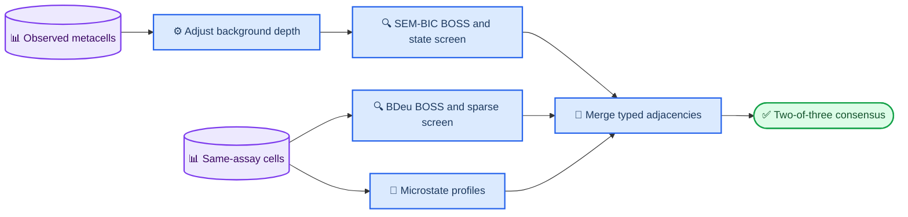

# Channel-aware BOSS simulation results

_Frozen repeated-world validation of a causal-discovery method for independently sampled multimodal assays · 2026-08-20_

---

## 📋 Summary

Channel-Aware Multi-resolution BOSS v3 (`CA-BOSS`) passed the predeclared reliability gate on both the realistic learned-integration arm and the oracle-state ceiling. On 40 untouched biological worlds, three nested metacell runs were collapsed into one graph per world using a two-of-three adjacency rule.

| Validation arm | CA-BOSS success | Production FCI success | Gate |
| --- | ---: | ---: | --- |
| GAPCA learned integration | 37/40 (92.5%) | 0/40 | Pass |
| Oracle state ceiling | 36/40 (90.0%) | 0/40 | Pass |

The GAPCA success-rate Wilson 95% interval is 0.801–0.974. The paired world-level improvement over production FCI is 0.925 with a 20,000-replicate cluster-bootstrap 95% interval of 0.825–1.000. All five primary pairs met the required recovery count, and every individual sentinel-null event remained at or below 3/40.

This is a reliability claim for the **attainable focal adjacency contract**, not for the full counterfactual single-cell DAG. CA-BOSS deliberately abstains from unsupported cross-assay causal directions.

## 🎯 Estimand

The modalities contain different cells. A residual innovation transmitted from a CUT&Tag peak to RNA in one hypothetical cell is therefore absent from the separately sampled RNA cell paired to it. The complete cell-level DAG cannot be identified from the observed cross-modality matrix.

The primary contract was frozen before locked validation:

| Class | Target | Count | Required interpretation |
| --- | --- | ---: | --- |
| Recoverable direct adjacency | slow peak–gene plus two same-mark pairs | 3 | Adjacency present |
| Shared-state adjacency | one pair per chromatin mark | 2 | Adjacency present; no one-way claim |
| Sentinel null | four null–gene plus four cross-mark null pairs | 8 | At most one per world |
| Challenge | fast residual peak–gene | 1 | Report only; excluded from gate |

A world succeeds only when all three recoverable direct adjacencies and both shared-state adjacencies are present, no more than one sentinel null is present, neither same-mark edge is reversed, and neither shared pair receives a definite one-way orientation.

## ⚙️ Algorithm

CA-BOSS preserves the distinction between variables measured in the same cells and variables aligned across different experiments.



The frozen v3 configuration is:

| Component | Configuration |
| --- | --- |
| Matched-state search | rank-Gaussian SEM-BIC BOSS, penalty 1, 20 starts, BES enabled |
| State evidence floor | absolute correlation ≥0.20 and two-sided p≤0.05 |
| Nuisance handling | residualize leave-one-locus-out background library depth |
| Within-assay search | BDeu BOSS, sample prior 5, 20 starts, BES enabled |
| Sparse rescue | Fisher exact odds ratio ≥1.5 and p≤0.25 |
| Microstate profiles | 20 observed-embedding clusters, absolute profile correlation ≥0.60 and p≤0.05 |
| Orientation | circle endpoints; gene arrowhead only from the labeled sink prior |
| Nested consensus | adjacency in at least 2/3 runs; endpoint majority at least 2/3 |

The implementation is in [`channel_aware_boss.py`](../scripts/channel_aware_boss.py). Repeated-world execution, truth-separated scoring, and nested consensus are implemented in [`benchmark_channel_aware_boss.py`](../scripts/benchmark_channel_aware_boss.py), [`score_multimodal_causal_graph.py`](../scripts/score_multimodal_causal_graph.py), and [`consensus_multimodal_causal_runs.py`](../scripts/consensus_multimodal_causal_runs.py).

## 🔬 Validation protocol

The algorithm was developed on seeds 201–208 and then frozen. Locked validation used biological-world seeds 10001–10040. Each world contained 1,800 independently sampled cells per modality, 128 observed features per assay, 100 requested metacells, held-out focal guidance, and metacell seeds 0, 1, and 2.

The biological-world seed is the independent experimental unit. Integration and metacell seeds are nested analyses of the same world and are never counted as additional samples. Discovery receives only the observed metacell matrix, observed same-assay cell tables, and leakage-safe analysis embeddings. The scorer reads focal semantics only after an estimate has been written.

The locked gate required:

- at least 34/40 successful worlds;
- each of the five primary pairs in at least 34/40 worlds;
- each individual sentinel-null event in at most 3/40 worlds;
- no wrong same-mark direction or definite one-way shared-state call.

## 📊 Locked results

### Learned integration

| Metric | CA-BOSS v3 | Production FCI |
| --- | ---: | ---: |
| Successful worlds | 37/40 | 0/40 |
| Mean sentinel F1 | 0.968 | 0.650 |
| Mean sentinel-null rate | 0.0375 | 0.0031 |
| Mean biological edges | 22.7 | 5.7 |
| Mean full matched-skeleton F1 | 0.544 | 0.333 |

| Primary pair | Recovered worlds |
| --- | ---: |
| Slow H3K27ac peak–gene | 40/40 |
| H3K27ac same-mark direct | 40/40 |
| H3K4me3 same-mark direct | 38/40 |
| H3K27ac shared-state pair | 40/40 |
| H3K4me3 shared-state pair | 40/40 |

The three failures were localized: worlds 10005 and 10027 missed the measurement-limited H3K4me3 same-mark edge; world 10012 retained two sentinel-null adjacencies. The fast residual peak–gene challenge appeared in only 4/40 worlds, consistent with abstaining from that severed cell-level effect.

### Oracle ceiling

CA-BOSS succeeded in 36/40 oracle-state worlds. The slow gene edge, both shared-state pairs, and the H3K27ac same-mark edge appeared in 40/40; the sparse H3K4me3 edge appeared in 37/40. Production FCI again succeeded in 0/40. The fast residual peak–gene challenge appeared in 2/40.

The similar GAPCA and oracle results show that v3 is not relying on privileged state coordinates. They also localize the remaining primary error to the sparse H3K4me3 observation layer rather than learned cross-modality alignment.

## 🔍 Interpretation

CA-BOSS solves the failure that ordinary FCI and one-matrix BOSS exhibit on the predeclared focal task: it recovers stable same-assay structure from the cells that actually share measurements, stable cross-assay state relationships from metacells, and does not convert shared-state evidence into an unsupported directed causal claim.

The broader graph is not solved. The theoretical 24-edge matched-state skeleton achieved mean F1 of 0.544 under GAPCA and 0.541 under oracle state, with zero worlds passing the stricter 0.80 precision/recall diagnostic. The algorithm also emits about 22 biological adjacencies per GAPCA consensus graph. Therefore the validated claim is motif-level reliability with calibrated sentinel negatives, not uniformly accurate recovery of every weak inducing-path adjacency.

## ⚠️ Limitations

- The validation covers one compact 13-node focal motif embedded in a larger simulated assay, not a production-sized locus graph.
- GAPCA is a leakage-safe learned integration baseline, but it is not scGLUE. The scGLUE holdout arm produced too few complete metacells and did not pass development testing.
- Gene orientation is prior-constrained. Peak-to-peak orientation is intentionally left unresolved.
- The sparse H3K4me3 direct edge remains the dominant measurement failure at 1,800 cells and current detection depth.
- The 24-edge matched-state skeleton is diagnostic and substantially less reliable than the five-pair primary contract.

## 🔧 Reproduce

Generate one locked-style nested run:

```bash
/home/dgsetiawan/anaconda3/envs/cvbench/bin/python \
  pipelines/simulation/unpaired_multimodal/scripts/multimodal_simulation_pilot.py \
  --integration gapca \
  --guidance-mode holdout \
  --seed 10001 \
  --metacell-seed 0 \
  --n-cells-per-modality 1800 \
  --n-features 128 \
  --n-metacells 100 \
  --run-id causal_gapca_locked_seed10001_mc0
```

Run the frozen candidate and production baseline over cached worlds:

```bash
JAVA_HOME=/home/dgsetiawan/anaconda3/envs/causaldisco \
  /home/dgsetiawan/anaconda3/envs/causaldisco/bin/python \
  pipelines/simulation/unpaired_multimodal/scripts/benchmark_channel_aware_boss.py \
  --runs-glob 'pipelines/simulation/unpaired_multimodal/outputs/multimodal_simulation_pilot/causal_gapca_locked_seed*_mc*' \
  --arm gapca \
  --out-dir pipelines/simulation/unpaired_multimodal/outputs/channel_aware_boss/gapca_locked_v3 \
  --candidates production_fci,channel_final_v3
```

Collapse the three nested estimates into one graph per world:

```bash
/home/dgsetiawan/anaconda3/envs/causaldisco/bin/python \
  pipelines/simulation/unpaired_multimodal/scripts/consensus_multimodal_causal_runs.py \
  --benchmark-candidate-dir pipelines/simulation/unpaired_multimodal/outputs/channel_aware_boss/gapca_locked_v3/channel_final_v3 \
  --simulation-root pipelines/simulation/unpaired_multimodal/outputs/multimodal_simulation_pilot \
  --min-frequency 0.6666666666666667 \
  --out-dir pipelines/simulation/unpaired_multimodal/outputs/channel_aware_boss/gapca_locked_v3_consensus
```

The generated summaries are `candidate_summary.tsv`, `world_consensus_results.tsv`, and `consensus_summary.json`. Per-run outputs are intentionally gitignored; the scripts, frozen configuration, regression tests, and this result record are tracked.

The compact machine-readable record is [`channel_aware_boss_validation_summary.json`](channel_aware_boss_validation_summary.json).
