# CA-BOSS v4 Experiment Log

_Original protocol registered August 21, 2026 · Updated September 6, 2026 · Status: CA-BOSS v4.59 is the recommended cached retrospective cross-assay checkpoint; later adaptive diagnostics do not constitute fresh certification_

---

## 📋 Executive summary

CA-BOSS v3 established that a channel-aware search can recover the simulation's attainable focal motif far more reliably than production FCI. On the untouched `10001–10040` block, frozen v3 passed 37/40 GAPCA worlds and 36/40 oracle-state worlds, while production FCI passed 0/40. Its remaining weaknesses were graph density (22.725 biological edges per GAPCA world on average), two failures of the sparse H3K4me3 within-assay edge, and one world with two sentinel-null edges. The complete frozen result is recorded in [Channel-Aware BOSS results](channel_aware_boss_results.md).

Version 4 is a new algorithmic branch, not another ordinary BOSS-FCI parameter sweep. It explicitly estimates background-only biological state, separates state-explained from residual association, replaces the permissive Fisher rescue with uncertainty-aware sparse-count evidence, calibrates selection against empirical nulls, and returns typed graph layers. Its cross-assay output is now an n-ary latent-axis hypergraph rather than a set of pairwise causal edges.

The six-mark stress test mirrors the existing project panel: RNA plus independently sampled `H3K27ac`, `H3K27me3`, `H3K4me1`, `H3K4me2`, `H3K4me3`, and `H3K9me3` assays.

The first 24-world layered confirmation block, seeds `33001–33024`, completed but failed certification: 15/24 worlds passed the frozen reliability gate. Mean direct recall (`0.96875`) and expanded density (`17.29`) passed, while mean assay-local loading precision (`0.8854`) and recall (`0.6806`) failed their `0.90` and `0.80` block gates. Those worlds are now diagnostic/development history and cannot certify a revised candidate. The failure localized to two separable problems: incomplete observed collider structure and unconstrained loading pairs that confused shared-state association with direct-parent or sentinel relationships. No DEV or LOCKED world has been opened.

## August 30 structure–state revision

The revised candidate makes the layer dependency explicit. First, a background-only assay-local embedding and depth-orthogonal maxT procedure freeze a conservative state-responsive subset. Second, observed residual collider evidence identifies a center and two candidate parents within each assay. Third, only a non-collider feature in the frozen state subset may be considered as a state reporter; its loading response is compared against both collider parents, and the candidate is emitted only when its lower absolute loading cosine is at least `0.85` and its relative advantage over the other parent is at least `0.10`. Parent state membership is diagnostic only, because a weak direct parent can be causally supported without being a strong marginal state reporter. Collider centers and parent–parent pairs remain forbidden as loading groups.

All tuning evidence below is from the already-open `33001–33024` block and is therefore non-certifying:

- a direction-stability gate for borderline feature-global maxT selections removes the single sentinel inclusion while retaining 525/535 previously selected true features, giving a precise confirmed subset in 24/24 diagnostic worlds;
- the observed-only collider completion/competition rule recovers all 288 direct arms with the correct 144 collider orientations, zero false direct edges, and exact direct structure in 24/24 worlds;
- the state-gated parent-choice loading rule selects 119/144 true P/S groups, zero false groups, precision `1.0`, and recall `0.8264`; its complete Phase-A freeze and threshold sensitivity are under `pipelines/simulation/unpaired_multimodal/outputs/ca_boss_v4/structure_state_reporter_gate_train_diagnostic_v1/`;
- a scorer-blind end-to-end smoke run on diagnostic seed `33001` froze the new state→structure dependency, selected four true and zero false loading groups, recovered the exact 12/12 direct motif, emitted one safe shared-state hyperedge, and passed every per-world layered reliability check at expanded density 17. The smoke is plumbing/development evidence, not certification.

That revision registered `36001–36024` as one non-adaptive confirmation block; its failed result is recorded below and is now development history. The successor protocol registers untouched TRAIN seeds `37001–37024` only after the conservative loading and collider repairs, executable dependency closure, all-world truth barrier, and failure denominator are frozen. DEVELOPMENT `34001–34016` and LOCKED `45001–45040` remain unopened. They may be opened in that order only if the new TRAIN block certifies without a source or threshold change.

## August 31 second TRAIN result and development localization

The source-frozen `36001–36024` block was generated and run exactly once. All 24 discovery attempts and all 24 scoring attempts succeeded, every candidate was frozen before the first scorer read, and the executable source map remained unchanged through scoring. The block nevertheless failed certification and is now diagnostic/development history: 20/24 worlds passed the complete reliability gate, below the required 22/24. Mean direct recall was `0.96875` and mean expanded density was `17.5833`, both passing. Assay-local loading precision was `1.0` with zero false groups, but loading recall was `114/144 = 0.791667`, two groups below the predeclared `0.80` gate.

The four reliability failures were localized without opening DEVELOPMENT or LOCKED. Seeds `36009` and `36019` each contained a stable but reversed sparse completion centered on a state-associated parent; seeds `36010` and `36024` each missed both arms in one assay, with `36024` exposing a three-of-six-view competing wedge whose uniquely dual-supported candidate was the true collider. This is a structural-calibration failure rather than a global density or state-subspace failure.

A strict Phase-A-before-label diagnostic then froze an abstention-only loading rescue over all 852 structural candidates and 5,112 view rows. It preserves every baseline selection and adds a group only when exactly one otherwise-abstained candidate passes the existing formal sibling-state and `0.10` parent-margin gates, the same parent wins all six views, and its empirical-null p-value is at most `0.125` in all six views. It adds exactly two true groups and no false groups on `36001–36024`, giving `116/144 = 0.805556` recall and precision `1.0`; on old seeds `33001–33024` it makes zero changes to the existing 119 true, zero false selections. The frozen diagnostic is under `pipelines/simulation/unpaired_multimodal/outputs/ca_boss_v4/formal_train_36001_36024_loading_recall_diagnostic_v1/`. No lower cosine threshold was selected post hoc.

A separate Phase-A freeze produced a four-action observed-only collider repair. It may re-center an incomplete anchor using assay-wide beta centrality, accept a rejected same-center wedge only when it uniquely has two base-supported arms and wins at least half the six views with a positive pairwise margin, or complete a rescue-only anchor only when one and only one state-selected candidate passes six loading-null views and six positive beta contrasts. Exact six-view counts, duplicate-row rejection, and correlated-stability-repeat provenance are enforced in production. On development-history seeds `36001–36024`, the full production replay changes reliability compatibility from 20/24 to 24/24, exact direct recovery from 17/24 to 21/24, false arms from five to three, and strict reverses from two to zero. A full integrated replay on old seeds `33001–33024` changes exact direct recovery from 20/24 to 24/24, false arms from one to zero, and reverses remain zero. These are development/no-regression results, not certification. The content-addressed replays are under `pipelines/simulation/unpaired_multimodal/outputs/ca_boss_v4/formal_train_36001_36024_direct_diagnostic_v7/` and `pipelines/simulation/unpaired_multimodal/outputs/ca_boss_v4/old_train_33001_33024_production_direct_replay_v3/`.

Because the algorithm is being changed, `36001–36024` cannot certify the successor. Any successor must be source-frozen and evaluated on a new disjoint TRAIN block before DEVELOPMENT or LOCKED can be opened.

## August 31 third TRAIN result

The source-frozen successor was then generated and run exactly once on untouched seeds `37001–37024`. All 24 Phase-A discovery attempts and all 24 Phase-B scoring attempts succeeded; all candidates were loaded before the first scorer read; the executable source map remained unchanged; and all failures stayed in the denominator. The block still did not certify. It produced 23/24 reliable worlds, mean direct recall `0.989583`, mean expanded density `17.5`, and mean loading precision `0.989583`, all of which pass their frozen gates. Mean loading recall was only `109/144 = 0.756944`, below the required `0.80`.

The sole unreliable world was `37019`, with direct recall `9/12`, one false direct arm, loading recovery of three true and one false/sentinel-containing group, and two unsupported expanded relations. Across the complete block, however, the dominant failure was conservative loading abstention rather than false selection: 109 true groups and one false group were emitted, while 35 true groups were missed. The existing loading rescue fired only once. Of the 34 missed true pairs that remained structural candidates, 31 still had the correct parent win all six loading views and pass the frozen `0.10` relative-parent margin; 27 also had a formally selected state sibling. The absolute loading-cosine and all-six `p <= 0.125` gates therefore appear miscalibrated for weak but consistently discriminative state responses. These observations are development evidence only and will be frozen before truth-label comparison in any rule diagnostic.

Seeds `37001–37024` are now permanently diagnostic/development history. They may inform a revised loading calibration, but neither they nor the earlier `33001–33024` and `36001–36024` blocks may certify another candidate. DEVELOPMENT and LOCKED remain unopened.

## August 31 layer-separated loading recalibration

Before reading the `37001–37024` role labels, the diagnostic froze 858 observed structural candidates, 5,148 loading-view rows, 144 production assay decisions, and a 242-rule observed-only grid. The Phase-A freeze is `b928ea2c93ac3c49bbf0112d3ebb9068d22944fbda960e114105727830dca553` under `pipelines/simulation/unpaired_multimodal/outputs/ca_boss_v4/formal_train_37001_37024_loading_recall_diagnostic_v1/`. The simplest prelabel-frozen relaxation retains every production selection and, only after abstention, requires a formal state sibling, a `0.10` relative parent margin, the same parent winning 6/6 views, `p <= 0.50` in 6/6 loading-null views, and a unique candidate. It would recover 126 true and one inherited false group on `37001–37024`; retrospective results are 122/144 true with zero false on `36001–36024` and 133/144 true with one false on `33001–33024`.

The production successor makes one further, explicitly post-label development change motivated by the typed estimands rather than by a new data source. It first executes the full existing production selector—formal baseline followed by the legacy all-six `p <= 0.125` rescue—and freezes any selection from those stages unchanged. Only a remaining production abstention reaches the new rule. Feature-global maxT confirmation is a gate for the cross-assay state-membership hyperedge; requiring it for every within-assay loading group conflates two layers. The new rule therefore uses hierarchical state tiers. It first considers formal cross-assay state candidates. Only if that tier is empty does it consider candidates with assay-global maxT admission and 6/6 conditional-Wald support, without promoting them to cross-assay membership. Within the active tier, the candidate must still be unique, win the same collider parent in 6/6 views with at least a `0.10` relative margin, and have loading-null `p <= 0.50` in 6/6 views. Here `p <= 0.50` means only that the observed loading is not null-dominated in a view; it is not called per-view significance, and the six correlated stability views are not treated as six independent experiments.

On retired development evidence, this hierarchical rule yields 135 true/one false groups on `33001–33024`, 124/zero on `36001–36024`, and 131/one on `37001–37024`: pooled recall `390/432 = 0.90278` and precision `390/392 = 0.99490`. The `37001–37024` false group is inherited from its one wrong direct motif; the new rescue adds 22 true and zero false groups there. These comparisons cannot certify the change. The direct-structure algorithm is left unchanged because it was exact in 23/24 third-block worlds and already passed its block guardrail. Protocol v9/layered v5 therefore register untouched seeds `38001–38024` as the only next admissible TRAIN block while leaving DEVELOPMENT `34001–34016`, LOCKED `45001–45040`, and all scoring gates unchanged.

## 🔐 Information boundary

Discovery may read only:

- observed focal variables from each independently sampled assay;
- observed leave-focal-out background library depth;
- assay and cell identifiers;
- background-only integration coordinates inferred without cross-assay feature correspondences;
- analysis-derived metacell membership and its uncertainty;
- known measurement-channel labels such as RNA or histone mark.

Discovery may not read motif roles, focal or background feature links, the generative DAG, true latent coordinates, true cell labels, counterfactual activities, cross-assay cell correspondences, truth tables, scorer labels, or any external dataset. Every assay is embedded independently from its observed background matrix. Cross-assay alignment is inferred from invariant background-microstate geometry, prevalence, and depth. Focal variables are excluded from state estimation in every condition.

Truth and semantic-role files are loaded only after graph selection by a separate scorer. A provenance check is part of the locked gate.

## 🎯 Scientific estimand

The primary target is the attainable typed latent projection, not the counterfactual single-cell DAG and not whole-graph SHD.

| Edge type | Evidence contract | Direction contract |
| --- | --- | --- |
| `within_assay_direct_candidate` | Residual dependence after state and depth adjustment in cells sharing an assay | Collider arrowheads may be credited; otherwise abstain |
| `within_assay_shared_state` | Same-assay state-response match without residual dependence | No one-way causal claim |
| `cross_assay_shared_state_axis` | Two or more assay-local groups share a stable, sign-invariant background-state response axis | N-ary hyperedge; never expanded into pairwise causal edges |
| `cross_assay_shared_state_axis_with_rna` | A stable latent axis also contains the RNA state response | State-pairable support only; no peak-to-gene direction credit |
| `prior_constrained_peak_gene` | A uniquely identifiable sparse peak representative supports the gene state response | Direction is labelled prior-constrained and excluded from orientation recall |
| `unresolved` | Conflicting, unstable, or unsupported evidence | Abstain |

The residual-dominated fast peak-to-gene edge is challenge-only. Independently sampled assays sever its cell-specific innovation covariance, so no observational algorithm can identify it without another information source. Version 4 must not manufacture that direction.

## 🔍 Hypotheses

- **H1 — state decomposition:** replacing marginal feature correlation with explicit background-state response will reduce mean graph density below v3 while retaining state-pairable motifs.
- **H2 — sparse-count model:** a partially pooled Bernoulli model conditioned on state and leave-focal-out depth will improve detection of sparse within-assay collider parents without the v3 Fisher threshold of `p <= 0.25`.
- **H3 — empirical null:** state/depth-preserving permutations, detection-matched sentinels, cell bootstraps, and six aggregation repeats will control null adjacency frequency more reliably than fixed correlation thresholds.
- **H4 — integration robustness:** cross-fitted background embeddings and consensus across resolutions/seeds will remain useful under population divergence and reduced raw-background state observability.

## ⚙️ Algorithm plan

```mermaid
flowchart LR
    accTitle: CA-BOSS v4 Evidence Flow
    accDescr: Observable assay data and held-out background features produce a latent-state decomposition, calibrated residual evidence, and a sparse typed graph without truth leakage

    observed[(Observed assay tables)] --> state[Estimate background state]
    observed --> sparse[Fit sparse-count models]
    state --> loadings[Fit conditional state loadings]
    loadings --> groups[Build assay-local groups]
    groups --> axes[Cluster native latent axes]
    state --> decompose[Decompose pair evidence]
    sparse --> decompose
    decompose --> nulls[Calibrate empirical nulls]
    nulls --> motif[Resolve unique collider motifs]
    motif --> typed[Build within-assay typed graph]
    axes --> typedaxes[Build n-ary state hypergraph]
    typed --> consensus[Form nested consensus]
    consensus --> score([Score truth separately])
    typedaxes --> score

    classDef data fill:#f3f4f6,stroke:#6b7280,stroke-width:2px,color:#1f2937
    classDef process fill:#dbeafe,stroke:#2563eb,stroke-width:2px,color:#1e3a5f
    classDef success fill:#dcfce7,stroke:#16a34a,stroke-width:2px,color:#14532d

    class observed data
    class state,sparse,loadings,groups,axes,decompose,nulls,motif,typed,typedaxes,consensus process
    class score success
```

For cross-assay state structure, v4 clusters coherent assay-local loading groups into sign-invariant latent axes. These are native n-ary hyperedges and are never broadcast into the six nested votes or the ordinary pair skeleton. For within-assay structure, residual evidence is computed at the cell level, where both variables were actually co-observed.

The six loading fits reuse the same observed cells with different deterministic fold/bootstrap seeds. They are correlated algorithmic-stability views, not independent experiments, replicates, or worlds; their support is never used as a sample size. Only a newly generated world seed contributes an independent unit to validation.

## 🧪 Simulation design

The independent experimental unit is a newly generated world seed. Integration, metacell, bootstrap, and resolution repeats are nested measurements and never increase the world count.

### Fixed seed blocks

| Split | World seeds | Purpose |
| --- | ---: | --- |
| Candidate development | `30001–30024` | Historical threshold and candidate development |
| First layered confirmation | `33001–33024` | Completed 15/24; failed and retained as diagnostic/development only |
| Revised TRAIN confirmation | `36001–36024` | Completed 20/24; failed narrowly and retained as diagnostic/development only |
| Successor TRAIN confirmation | `37001–37024` | Completed 23/24 reliable but failed loading recall (`0.756944`); development history only |
| Layer-separated TRAIN confirmation | `38001–38024` | Untouched; pending final source freeze and one non-adaptive run |
| Development | `34001–34016` | Unopened; exact 16/16 gate after TRAIN certification |
| Fresh locked | `45001–45040` | Unopened; one final evaluation without refitting |

The historical v3 locked block `10001–10040` is excluded from v4 selection and certification. Locked truth remains unopened until the source revision, configuration, candidate name, and manifest hash are frozen. Crashes and timeouts remain in the denominator.

### Resolution-IV stress design

Each split uses an eight-cell half-fraction with coded factors `A`, `B`, and `C`, and generator `D = A * B * C`. Seed offsets cycle through `---`, `--+`, `-+-`, `-++`, `+--`, `+-+`, `++-`, and `+++`. Training has three worlds per cell, development two, and locked validation five.

| Factor | Low level | High level |
| --- | --- | --- |
| `A` cells | 1,200 base | 2,400 base |
| `B` detection | 0.07–0.10 | Three marks 0.035–0.055 |
| `C` population | No divergence | Mean-zero divergence 0.15 |
| `D` background observability | Background features report state with no added proxy noise | Assay-private Gaussian proxy noise (`SD=0.20`) is added before background counts |

The simulator constant is now frozen at `SD=0.20` for the next fresh TRAIN block. This value was chosen before any DEV/LOCKED access from paired TRAIN-only observable diagnostics: it reduced synchronization cycle support in three of four worlds and caused two assay abstentions across 28 assay slots, yet every world retained at least five of six chromatin assays. Values `0.35–0.65` collapsed the common frame and were rejected as annihilating stresses. The choice does not assert that the current axis algorithm passes at `0.20`; the zero-noise ceiling already shows that it does not.

Cell counts also receive a balanced assay multiplier from `{0.65, 0.80, 1.00, 1.00, 1.20, 1.35, 1.50}`. At each world, feature detection multipliers are drawn before focal roles, assay population fractions are clipped to `[0.25, 0.90]`, and role locations, coordinates, coefficients, signs, detection rates, and null identities are randomized. Factor `D` acts on the raw whitelisted background matrices through an assay-private noisy state proxy. Focal activities continue to use the true state, and the stress assignment and proxy realization are scorer-only. Supplied-coordinate derangement remains an optional invariance diagnostic, not a DOE factor.

Each mark contains two independent parents `P` and `Q`, a common child `C` with `P -> C <- Q`, a state sibling `S`, and two detection-matched nulls. One rotated mark supplies a state-dominated slow peak–gene relationship; a different mark supplies the challenge-only residual-dominated fast relationship.

### Nested robustness repeats

For each world, v4 uses target aggregation sizes of approximately 24, 14, and 8 retained cells per complete metacell, each with metacell seeds 0 and 1. The six graphs form one world consensus: adjacency support must be at least 4/6, and an endpoint mark needs at least two-thirds agreement among runs containing the edge. Incomplete nested runs remain in the denominator.

## 📊 Selection metrics and locked gate

Primary per-world metrics are macro recall of both within-assay collider parents, recall of data-supported compelled arrowheads into the common child, assay-local P/S loading-group recall, recovery of all scoreable latent dimensions through native n-ary axes, slow RNA-axis support without direction credit, and detection-matched null false-positive rate. Gene-sink arrowheads are always tagged `prior_constrained` and excluded from orientation recall. Exact cross-assay feature pairing, whole-skeleton metrics, graph density, and recovery of the fast challenge are diagnostics.

The historical result field `direct_adjacency_macro_recall` remains the frozen gate alias for a correctly typed `within_assay_direct_candidate`, not merely any skeleton adjacency. Version 4 now also reports `direct_raw_adjacency_macro_recall` and `direct_typed_candidate_macro_recall` separately. This makes a conservative `unresolved` edge visible as “adjacency found, direct layer not established” without weakening the registered gate after seeing TRAIN outcomes.

A locked world succeeds only if:

- direct-adjacency macro recall is at least 0.90;
- collider-arrowhead recall is at least 0.80 with no strict reverse compelled endpoint;
- assay-local loading-group recall is at least 0.80;
- native latent-axis dimension coverage is complete, with no axis mismatch or wrong-layer claim;
- the state-pairable slow RNA axis is recovered;
- within-world matched-null false-positive rate is at most 0.10;
- primary typed-skeleton precision, counting every unsupported estimated focal pair as false, is at least 0.80;
- the provenance audit finds no forbidden input.

Certification requires at least 34/40 successful locked worlds, every motif class succeeding in at least 34/40, a pooled null-event cluster-bootstrap or Wilson upper 95% bound at most 0.10, at least 16/20 successes at every factor level, and no design cell below 3/5. The background-state upper-bound arm must pass first. Frozen v3 and production FCI are evaluated on the same worlds only as baselines; neither may influence v4 tuning.

## 🔒 Formal validation barrier and baselines

The formal validator is now schema `ca_boss_v4.validation.v2` and enforces one all-world, two-phase truth barrier:

1. Run discovery-only execution for every registered world under a killable timeout.
2. Validate each successful frozen handle and bind every success, crash, timeout, or executor failure into one self-hashed `ca_boss_v4.global_pretruth_freeze.v1` manifest.
3. Score only successful frozen handles, requiring every score call to verify the same global manifest. Discovery and scoring failures remain failed rows in the registered denominator.
4. Run the scorer-only upper bound and both diagnostic baselines only after all candidate score attempts have finished.

Before the scorer is allowed to read truth, the parent process verifies the exact candidate file set and hashes, reloads consensus, loading-group, projection, and axis tables, and rejects missing, extra, mutated, or already-scored artifacts. An end-to-end smoke test on a small TRAIN seed `30018` world completed discovery, serialized the frozen handle, wrote and verified the global manifest, and scored the in-memory frozen result. That smoke test validates the barrier plumbing only; it is not a biological pass and is not certification.

The two post-candidate baselines are now real executable diagnostics rather than placeholder hooks:

| Baseline | Frozen observable protocol | Failure policy |
| --- | --- | --- |
| Frozen CA-BOSS v3 | Recorded v3 configuration; exact six v4-prepared views; only an all-true compatibility column is added to the unchanged embedding coordinates | Missing `pytetrad`/Java support, crash, or timeout produces a non-certifying failure row |
| Production FCI | Repository causal-learn FCI with rank-Gaussian transform, Fisher-z at `alpha=0.05`, depth 2, and the registered background/confounder modes | Crash, timeout, malformed endpoints, or incomplete output produces a non-certifying failure row |

Both baselines require adjacency in at least 4/6 views. Each endpoint mark is voted independently and retained only with at least two-thirds agreement among views containing that adjacency; otherwise it becomes `CIRCLE`. The parent process hashes, validates, and reloads every baseline view and the independently recomputed consensus before opening diagnostic truth. Baseline results cannot enter candidate selection, but incomplete preregistered baseline diagnostics block the validator from reporting formal certification.

## 🧩 Current implementation and TRAIN evidence

The discovery path now has four separate evidence layers:

1. soft distributional background alignment with cross-feature-fold uncertainty and multi-assay rotation synchronization;
2. positive hierarchical Bernoulli and stratified beta-binomial residual evidence within each chromatin assay;
3. a unique two-parent collider selector that promotes only an identifiable positive wedge and otherwise abstains;
4. conditional state-loading groups and native n-ary latent-axis hyperedges.

The direct-structure selector was frozen and stress-tested on TRAIN seeds `30001–30024`. Relative to the preliminary hierarchical consensus, it changed 275/288 true direct arms plus 9 false candidates into 284/288 true direct arms with zero false direct or sentinel candidates. Twenty-two of 24 worlds recovered all 12 arms. The two failures were principled abstentions: one observationally symmetric triangle and one competing wedge without a unique center. Rescue-only rejected pairs remain diagnostics and never enter the ordinary skeleton.

On TRAIN seed `30001`, synchronized soft alignment plus observable collider-child exclusion recovered five of six assay-local P/S groups at precision 1.0 and three native axes covering all three latent dimensions. Axis purity and type precision were 1.0, slow RNA-axis support was present, and there were no axis-mismatch or wrong-layer claims. No sparse cross-assay feature edge was emitted because the P/S representatives were not uniquely identifiable.

TRAIN seed `30004` exposed a harder boundary. Partial-soft mode retained the six synchronized assays and abstained only `H3K27ac`, while the frozen direct layer recovered 10/12 arms. An observable-only guard excludes every node in an unidentifiable complete residual triangle from shared-state grouping, preventing unresolved direct structure from being relabelled as state evidence. A subsequently frozen conservative bridge permits at most one high-stability ungrouped singleton to join an otherwise coherent multi-feature axis anchor. It improved this TRAIN world from one to all three latent dimensions with axis/type precision 1.0, slow RNA support, and no mismatch or wrong-layer claim. The world still fails the preregistered direct-recall gate at 10/12; the axis rescue does not conceal that failure. No DEV or LOCKED truth has been opened.

The first partial-soft end-to-end run took 470 seconds on one world. That establishes the present experimentation cost: simulation itself is seconds, while observed-only alignment, six loading fits, empirical-null permutations, and the collider evidence dominate runtime.

An audit found that the original DOE factor D only deranged simulator-supplied alignment artifacts, while the production preparer correctly ignored those artifacts and recomputed from raw counts. That made the old D gate inert. The simulator has therefore been bumped to a raw-observable contract: D-high now adds moderate assay-private noise to scorer-only background-state proxies before background counts are sampled. Focal biology and truth topology remain invariant. Old D-stratified runs are historical diagnostics only and will not be combined with the regenerated TRAIN block.

The exported DAG is a conditional structural template given the sampled `world_parameters.json` and exogenous observation noise. It explicitly records population/state, background proxy, technical-scale, sparse focal observation, co-accessibility, library, and RNA mechanisms; proxy noise and technical-scale realizations are scorer-only. Cohort-wide calibration and negative-binomial dispersion remain parameterized observation mechanisms, so link-scale coefficients must not be interpreted as raw-scale linear SEM effects.

## 📊 Exploratory raw-observability TRAIN block

The first fresh raw-D exploratory evaluation used TRAIN seeds `30017–30024` with the simulator's then-current D-high proxy noise of `SD=0.65`. It produced 0/8 registered world successes. Density fell to 17.125 estimated focal edges per world from the v3 reference mean of 22.725, a 24.6% reduction, while mean primary precision was 0.929, typed-direct recall was 0.927, and matched-null false-positive rate was 0. The density and direct layer therefore improved, but the shared-state recovery required for the user-facing estimand did not.

| Factor-D level | Worlds | Typed-direct recall | Assay-local P/S recall | Native-axis coverage |
| --- | ---: | ---: | ---: | ---: |
| Low, no proxy noise | 4 | 0.875 | 0.750 | 0.833 |
| High, `SD=0.65` | 4 | 0.979 | 0.833 | 0.000 |

| Factor-D level | Slow RNA-axis support | Primary precision | Mean edges |
| --- | ---: | ---: | ---: |
| Low, no proxy noise | 0.750 | 0.887 | 17.00 |
| High, `SD=0.65` | 0.000 | 0.971 | 17.25 |

The D-high collapse is specific to integration: independently observed within-assay direct structure remained strong while the common cross-assay frame disappeared. This run is exploratory only. It began before the stricter training-world source-binding revision, so the current calibrator rejects its manifests by design; its scores cannot be reused as a frozen calibration or certification artifact. The artifacts remain under `pipelines/simulation/unpaired_multimodal/outputs/ca_boss_v4/train_observable_d_v2_fresh_eval_30017_30024/` as a negative development record.

## 📉 Observable-background stress calibration

The next TRAIN-only calibration varied assay-private background-proxy noise while holding seed `30018` fixed. Synchronization counts include RNA, so 1/7 means that every chromatin assay abstained. A residual is shown as unavailable when no cross-assay edge survived; the numerical zero in that empty case is not evidence of a good alignment.

| Proxy-noise SD | Synchronized assays | Accepted synchronization edges | Weighted edge residual |
| ---: | ---: | ---: | ---: |
| 0.00 | 7/7 | 15 | 0.211 |
| 0.15 | 7/7 | 14 | 0.166 |
| 0.20 | 7/7 | 15 | 0.038 |
| 0.25 | 5/7 | 10 | 0.184 |
| 0.35 | 1/7 | 0 | — |
| 0.45 | 1/7 | 0 | — |

`SD=0.20` was then paired against zero noise in four D-high TRAIN worlds:

| Seed | SD 0: assays / edges / residual | SD 0.20: assays / edges / residual | New abstention at 0.20 |
| ---: | --- | --- | --- |
| `30018` | 7 / 15 / 0.211 | 7 / 15 / 0.038 | None |
| `30019` | 7 / 19 / 0.111 | 6 / 13 / 0.089 | `H3K27ac` |
| `30021` | 7 / 17 / 0.039 | 7 / 13 / 0.436 | None |
| `30024` | 7 / 14 / 0.030 | 6 / 12 / 0.201 | `H3K4me2` |

The response is non-monotone across the multistart alignment fits: `SD=0.20` improves the weighted residual in seeds `30018` and `30019`, but worsens it substantially in `30021` and `30024`. It is non-annihilating at the synchronization gate—at least 6/7 assays remain in every paired world—but synchronization alone does not establish correct axes. The paired discovery evidence was frozen before scorer access in `discovery_evidence_freeze_manifest_v4.json` (SHA-256 `ccbcf9fb0adcb94decda96eb6cffce22b2f9974fd9bda37c5aea14775c12627a`).

### Axis-only ceiling check

The complete six-view loading and native-axis path was next run from frozen observable evidence at `SD=0` and `SD=0.20`. Entries below report `selected/pure/axis-compatible` hyperedges, recovered truth dimensions, then `slow-RNA-support/mismatch-count`.

| Seed | SD 0 axis result | SD 0.20 axis result |
| ---: | --- | --- |
| `30018` | `4/3/3`; `{0,1,2}`; `yes/1` | `2/2/1`; `{0}`; `yes/1` |
| `30019` | `3/3/3`; `{0,1,2}`; `yes/0` | `2/2/2`; `{1,2}`; `no/0` |
| `30021` | `3/2/2`; `{0,1}`; `yes/1` | `3/3/2`; `{0,1}`; `yes/1` |
| `30024` | `2/1/0`; `{}`; `no/2` | `3/2/1`; `{0}`; `yes/2` |

At zero noise, 12 axes were selected, of which 9 were pure and 8 axis-compatible; mean dimension coverage was 0.667 and only 2/4 worlds recovered all three dimensions. At `SD=0.20`, 10 axes were selected, 9 were pure, and only 6 were axis-compatible; mean coverage was 0.500 and no world recovered all three dimensions. The `SD=0.15` seed-`30018` arm exactly matched its zero-noise result (`4/3/3`, full coverage, slow support, one mismatch), so that single pair supplies no evidence of cross-world robustness.

This is the decisive ceiling result: the current native-axis algorithm is not reliable even when D adds no proxy noise, and weakening the simulator stress cannot by itself solve the remaining problem. `SD=0.20` is promoted only as the next non-annihilating simulator challenge, not as an algorithm-passing level. The `SD=0.20` axis discovery freeze has SHA-256 `2fa19a28e40ec6fa1290142939d880574c88143531fbbd9384bc3638842cc581`; the zero/`0.15` ceiling freeze has SHA-256 `6d6568d2a932896e1e91059da37f26423a76be72a239e922bbc90a43323658c2`.

### Exact-axis failure localization

Several observed-only coordinate-identification variants were frozen on TRAIN evidence and rejected before changing the production method:

| Variant | Observable result | Scorer-side localization | Decision |
| --- | --- | --- | --- |
| Coarser `K=6` soft coupling | Improved zero-noise seed `30024` from no compatible axis to two of three | Still missed the slow RNA dimension and did not generalize safely | Diagnostic only |
| Ordered-variance PCA | Fold component order and variance gaps passed their observable gates | Biological dimensions were reordered by assay-specific measurement loadings; zero-noise coverage was only 3/12 dimension-worlds | Rejected |
| Global orthogonal/projective clustering | Strict leave-one-assay-out and isotropic-null gates mostly abstained | The few retained axes included false seed-`30024` geometry | Rejected |
| Coarse-mixture registration | Shared distribution shape was often significant | Cross-feature folds selected different reflections/permutations, so strict gates correctly abstained | Rejected |
| FastICA plus exact 48 signed-permutation transports | Exact transport cycles were internally consistent | Seed `30024` still synchronized RNA and `H3K4me1` to the wrong biological permutations | Diagnostic only |

The component experiment separated the remaining failure from local structure. With collider discovery run first, all six observed collider centers were excluded on zero-noise seeds `30021` and `30024`. Assay-local P/S groups then recovered 6/6 at precision 1.0 in both worlds. Seed `30021` recovered all three compatible axes and slow RNA support; seed `30024` retained only the one axis whose component registration was correct. Thus the sparse-count model and local loading groups can be correct while an internally stable cross-assay permutation is biologically wrong.

This is not a threshold problem. Independently sampled assays identify their local latent coordinates only up to transformations allowed by the observed distributions. A method can therefore recover an assay-local state-response subspace without identifying which coordinate in one assay is the same biological axis in another. CA-BOSS v4 will retain exact-axis reconstruction as a challenge diagnostic and move the primary attainable state estimand to a rotation-invariant multi-assay state-responsive set. That set is interpreted conditionally on the common-state integration model; it is not proof of exact cross-assay feature pairing, a common named axis, or causal direction.

### Rotation-invariant state response and null repair

The first dimension-agnostic prototype tested assay-local state response by permuting state rows inside observed-depth neighborhoods. That null is rejected. In pure-depth simulations with no state effect beyond depth, the nominal 0.10 feature test rejected 25%, 25%, and 35% of 20 linear-confounding replicates with neighborhood sizes 6, 8, and 10 cells. Smaller neighborhoods therefore did not restore conditional exchangeability. No result from that permutation selector can support a reliability claim.

The replacement is a cross-fitted orthogonal-score test. Within each assay, flexible train-fold depth splines estimate both the focal response nuisance and the background-state nuisance. The out-of-fold response and state residuals form a heteroskedasticity-robust multivariate score whose Wald statistic is invariant to an assay-specific orthogonal rotation. A synchronized Rademacher multiplier bootstrap uses the same cell weights for every feature within an assay, independent weights across the disjoint assays, and one common repetition index. The maximum statistic over all focal features and assays supplies the strong membership-error gate; the second observed assay maximum is compared with the conservative global-maximum null for the at-least-two-assay claim.

This calibrated estimand is deliberately narrower than total shared-state association: it detects first-moment state response not predictable from observed leave-focal-out library depth. Total state fit remains a descriptive decomposition because depth itself contains biology. The n-ary output is a `multi_assay_state_responsive_set`, represented by a hypothesis-only `cross_assay_shared_state_subspace` hyperedge conditional on the common-state model. It does not expand into pairwise edges or claim a common named axis, exact peak-gene pairing, or cross-assay causal direction. Collider child `C` is eligible for both layers: it may be a within-assay direct child and a state-responsive feature at the same time.

The final error-control hierarchy uses 999 synchronized multiplier replicates. An assay must first pass the world-maxT admission test at 0.10; an eligible feature must then pass within-assay BH at 0.10, at least four of six fixed-fold Wald views, and the feature-global maxT confirmation gate. Binary features require at least 20 events and 20 non-events. Sparse, constant, or single-class-fold features are retained as explicit unresolved rows but are excluded before fitting, BH, assay admission, and the multi-assay conjunction. In a bounded 60-world pure-depth null screen, membership and assay-admission FWER were both 2/60 (0.033; Wilson 95% interval 0.009–0.114), no false hyperedge was selected, and adversarial constant/under-floor rows left all eligible decisions unchanged in 90/90 paired checks. This supports type-I safety, not high power: a 3.5% detection-rate signal was recovered in only 6/30 bounded power worlds.

### Assay-local state coordinates and the oracle ceiling

Because the membership statistic is assay-local and rotation invariant, cross-assay coordinate registration is unnecessary for this layer. A formal background-only embedding now fits two held-out background-feature PCA views within each assay, aligns those views using only the same assay's cells, and forms a rank-three consensus. It never matches cells or feature columns across assays. Parallel analysis is an abstention guard; it does not select a truth-favoured dimension. The existing HARD preparation remains only for the separate local graph.

On the five already-inspected TRAIN worlds `30001`, `30018`, `30019`, `30021`, and `30024`, this assay-local embedding recovered 116/125 state-positive features with one sentinel, and passed the former full-membership world gate in 3/5 worlds. The prior globally registered HARD embedding recovered 108/125 with two sentinels and passed only 1/5. A scorer-only run of the *identical* depth-orthogonal test using true per-assay state recovered 117/125 with two sentinels and also passed only 3/5. The observable method therefore nearly saturates the oracle ceiling; the remaining failures cannot honestly be repaired by tuning the alignment.

The strict full-membership gate is consequently retired as an attainable primary claim. A high-confidence feature-global-maxT subset has precision 1.0, zero sentinels, includes RNA and all six chromatin assays in every one of these five worlds, and contains 12–22 true members per world. Its incomplete recall (mean 0.736) remains reported. It is combined only at the *report* level with separate within-assay evidence, never unioned into state membership:

| Evidence layer | Five-world result | Interpretation |
| --- | --- | --- |
| Confirmed depth-orthogonal state subset | Precision 1.0; zero sentinels; 7/7 assays in 5/5 worlds | Hypothesis-only multi-assay state-responsive set; incomplete membership |
| Within-assay direct motifs | Mean precision 0.983; mean recall 0.967; zero strict reversals | Direct candidates inside a shared-cell assay |
| Assay-local P/S loading groups | Mean pair precision 0.960; mean pair recall 0.800 | Local shared-state support; no cross-assay identity |
| Expanded focal relations | Mean density 17.8; mean unsupported relations 0.4 | Layered graph, not a collapsed skeleton |

All five worlds satisfy the precision/safety definition of layered reliability, while only 3/5 satisfy the old per-world completeness requirement. The fresh-block protocol therefore makes precision, assay coverage, direct recovery, semantics, and density per-world requirements, while guarding P/S and direct completeness across the registered block. This is a predeclared change of estimand supported by the true-state ceiling, not a claim that missing feature memberships were recovered.

## 📈 TRAIN note: symmetric global Bernoulli pseudo-likelihood

The sparse-count layer now supplements its microstate random-effects diagnostics with a symmetric all-cell conditional Bernoulli pseudo-likelihood. For each pair it jointly fits `Y | X` and `X | Y`, uses cross-fitted marginal detection logits as fixed state/depth offsets, and shares one undirected residual log-odds parameter. The declared interaction prior is `Normal(0, 2.5²)`. A one-dimensional Laplace approximation reports the posterior mean, standard deviation, sign probability, and probability of exceeding the practical positive-effect threshold of `0.20`.

The two conditional objectives receive weight `0.5` each. This averages two views of the same binary pair rather than treating them as independent observations. In 80 known-offset synthetic null replicates, the resulting null z-scores had mean `0.012`, standard deviation `0.903`, and 95% interval coverage `0.975`; no null replicate crossed posterior probability `0.95` for an effect above `0.20`. All 80 matched positive-effect replicates crossed that threshold. The unweighted sum was rejected because it double-counted pair information and produced anti-conservative null uncertainty.

Evidence was then fit under six correlated fold/bootstrap stability views from discovery-only inputs and hashed before opening scorer truth for TRAIN worlds `30003`, `30004`, and `30008`. These fits reuse the same cells and do not count as six independent samples. At posterior threshold `0.88`, the comparison was:

| Positive selector | Direct votes | Direct consensus edges | Sentinel false votes / consensus edges | Unlabelled false votes / consensus edges |
| --- | ---: | ---: | ---: | ---: |
| Existing microstate evidence | 186/216 | 31/36 | 0 / 0 | 0 / 0 |
| Global pseudo-likelihood alone | 216/216 | 36/36 | 12 / 2 | 40 / 7 |
| Conservative intersection | 186/216 | 31/36 | 0 / 0 | 0 / 0 |

The global likelihood is therefore a high-power rescue signal, not a safe standalone selector: persistent residual confounding can also be stable across all cells. The default selector is the uncertainty-aware positive intersection, so CA-BOSS does not inherit the global model's false edges. All component probabilities remain in the evidence table for later empirical-null or structure-aware calibration without refitting nuisance models. No DEV or LOCKED world was opened. Frozen evidence hashes and the post-truth comparison are stored under `pipelines/simulation/unpaired_multimodal/outputs/ca_boss_v4/train_global_pseudolikelihood_v4/`.

## ⚠️ Rejected TRAIN-only rescues

Several apparently high-power modifications were retained as diagnostics but rejected from the production selector because their false-positive behavior was not separable from their rescues using observed-only evidence.

| Attempt | Useful signal | Disqualifying evidence | Disposition |
| --- | --- | --- | --- |
| Standalone beta-binomial rescue | Recovered 12/12 direct arms in each of TRAIN seeds `30003`, `30004`, and `30008` | Selected 2, 4, and 3 unlabelled edges, respectively; seed `30008` also selected two sentinels, for world-level sentinel FPR 0.133 and within-assay FPR 0.167. No monotone observed-score threshold separated all rescues from false edges | Diagnostic only; not unioned into the graph |
| Global Bernoulli pseudo-likelihood | Recovered every tested direct vote in seeds `30003`, `30004`, and `30008` | Also produced 2 sentinel and 7 unlabelled consensus edges across the three-world comparison | Retain components; require the conservative intersection |
| Joint predictive collider wedge | Recovered the missing TRAIN seed-`30017` wedge in a posthoc diagnostic | In TRAIN seed `30019`, selected the false `C(P,N2)` wedge under 9/10 cross-validation seedings | Standalone module only; not integrated |
| RNA-reference star fallback | All six RNA-to-chromatin pair transports were individually strong in seed `30018` | Multi-assay geometry had 0/20 consistent cycles and global median cycle inconsistency 0.984; all six chromatin assays correctly failed the global gate, and a forced post-truth audit was wrong | Preserve atomic abstention; never force the star |

These failures reinforce the layer contract: a strong marginal transport, predictive increment, or sparse residual score is insufficient when multi-assay geometry or competing null structure contradicts it. Rejected evidence may explain an `unresolved` decision but may not manufacture a direct or shared-state edge.

## 🔄 Experiment ledger

| Date | Stage | Status | Artifact |
| --- | --- | --- | --- |
| 2026-08-21 | Freeze v3 record | Complete | [v3 validation](channel_aware_boss_results.md) |
| 2026-08-21 | Pre-register v4 | Complete | This document |
| 2026-08-21 | Implement state decomposition | Complete | Conditional state/depth fits, loading groups, native latent axes |
| 2026-08-21 | Implement hierarchical sparse model | Complete | Positive hierarchy plus empirical-null beta-binomial diagnostics |
| 2026-08-21 | Add structure-aware collider selector | Complete | 284/288 TRAIN direct arms, zero false direct candidates |
| 2026-08-21 | Build randomized six-mark simulator | Complete | RNA + six independently sampled marks; explicit conditional DAG |
| 2026-08-21 | Repair DOE D | Complete | Raw background-observability stress; old supplied-derangement D retired |
| 2026-08-21 | Integrate synchronized/partial-soft state layer | Complete | Assay-level confidence gate and native n-ary axes |
| 2026-08-21 | Add conservative singleton-to-axis bridge | Complete | TRAIN 30004 state-axis coverage 1/3→3/3; direct gate still fails honestly |
| 2026-08-21 | Harden precision/provenance gates | Complete | Unsupported focal edges count as false; same-cell stability views cannot be represented as independent worlds |
| 2026-08-21 | Explore former raw-D stress | Complete, rejected | Seeds 30017–30024 passed 0/8 at `SD=0.65`; pre-binding-revision artifact is non-certifying |
| 2026-08-21 | Freeze non-annihilating raw-D stress | Complete | Selected `SD=0.20` from paired TRAIN-only observability evidence; no certification claim |
| 2026-08-21 | Calibrate observable-background stress | Complete, no level promoted | `SD=0–0.45` sensitivity plus four paired zero/`0.20` worlds |
| 2026-08-21 | Measure native-axis ceiling | Complete, failed reliability gate | Full coverage in 2/4 zero-noise worlds and 0/4 `SD=0.20` worlds |
| 2026-08-21 | Reject depth-neighborhood state null | Complete, invalid | Pure-depth false rejection reached 25–35% at nominal 10% in the linear-confounding screen |
| 2026-08-21 | Implement rotation-invariant state-response score | Complete | Cross-fitted spline nuisances, B=999 synchronized wild-bootstrap maxT, explicit sparse-feature abstention, and conservative multi-assay conjunction |
| 2026-08-21 | Replace cross-assay state coordinates for membership | Complete | Background-only assay-local rank-three PCA; five-world observable result nearly matches the exact true-state ceiling |
| 2026-08-21 | Establish exact state-membership ceiling | Complete, former gate unattainable | Identical test with true state passes only 3/5 old TRAIN worlds |
| 2026-08-21 | Freeze layered attainable contract | Complete, fresh confirmation pending | Precise seven-assay state subset plus separately scored direct motifs and assay-local loading groups |
| 2026-08-21 | Reject unsafe direct/alignment rescues | Complete | Beta-binomial union, global pseudo-likelihood, joint predictive wedge, and forced RNA star remain diagnostic-only |
| 2026-08-21 | Implement global truth barrier and baselines | Complete | Validation v2; all-world pretruth freeze; executable v3/FCI diagnostics; two-phase smoke passed |
| 2026-08-21 | Run first content-addressed layered TRAIN benchmark | Complete, failed | Seeds `33001–33024`: 15/24 reliable; direct recall and density passed, loading precision/recall failed |
| 2026-08-30 | Add coordinate-invariant assay-local loading geometry | Complete | Covariance-metric state-response vectors; no cross-assay matching in assay-local coordinates |
| 2026-08-30 | Repair borderline state maxT admission | Complete on diagnostic TRAIN | Removes the one sentinel while preserving nearly all true selections; revised source frozen before new worlds |
| 2026-08-30 | Add observed collider completion and competition | Complete on diagnostic TRAIN | Exact 12/12 direct arms and orientations in 24/24 old TRAIN worlds, zero false direct edges |
| 2026-08-30 | Add formal-state-sibling collider-parent loading selector | Complete on diagnostic TRAIN | 119/144 P/S groups, zero false groups, precision 1.0, recall 0.8264 |
| 2026-08-30 | Harden source closure and truth barrier | Complete | Atomic score publication, exact artifact hashes, protocol v7/layered v3, revised TRAIN seeds `36001–36024` |
| 2026-08-30 | Freeze revised TRAIN candidate | Complete | State membership now freezes before and constrains local loading selection; scorer-blind old-TRAIN smoke passed |
| 2026-08-31 | Run revised content-addressed TRAIN benchmark | Complete, failed narrowly | Seeds `36001–36024`: 20/24 reliable; direct recall and density passed; loading recall `114/144` missed by two groups |
| 2026-08-31 | Freeze empirical-null loading abstention rescue | Complete on development history | `116/144` true and 0 false groups on `36001–36024`; zero changes on old `33001–33024` |
| 2026-08-31 | Freeze observed-only collider repair | Complete on development history | Full production replay gives 24/24 reliability-compatible and 21/24 exact on `36001–36024`; full old-TRAIN replay gives 24/24 exact, with no reverses in either block |
| 2026-08-31 | Freeze successor protocol | Complete | Protocol v8/layered v4 register only untouched TRAIN seeds `37001–37024`; DEV/LOCKED and all gates remain unchanged |
| 2026-08-31 | Run successor content-addressed TRAIN benchmark | Complete, failed | `37001–37024`: 23/24 reliable; direct recall, precision, and density passed; loading recall `109/144 = 0.756944` failed |
| 2026-08-31 | Freeze third-block loading diagnostic | Complete on development history | Phase A and 242-rule grid frozen before labels; simplest formal-state p50 rule gives 126 true/one inherited false group on `37001–37024` |
| 2026-08-31 | Separate cross-assay membership from assay-local loading rescue | Complete on development history | Hierarchical formal→assay-local state tiers; pooled retired-block recall `0.90278`, precision `0.99490`; no direct-structure change |
| 2026-08-31 | Freeze fourth TRAIN protocol | Complete | Protocol v9/layered v5 register only untouched `38001–38024`; 24-file source map `802c3e65…`; 294/294 tests; source-only preflight `bb14b440…`; DEV/LOCKED and scoring gates unchanged |
| 2026-08-31 | Run fourth content-addressed TRAIN benchmark | Complete, failed | `38001–38024`: 18/24 reliable (required 22); block means still passed—direct recall `0.96528`, loading recall `0.88889`, loading precision `0.97639`, density `18.2917`. Failures separated into two state sentinels, three low-recall direct worlds, one strict direct reversal, and two loading sentinels; no gate was relaxed and the block is permanently development-only |
| 2026-08-31 | Freeze redundancy-aware state confirmation audit | Complete on development history | The fixed existing `0.80` direction-stability diagnostic is now applied subtractively within each assay, with one already-maxT-confirmed fallback only when no stable member exists. Phase A froze all 72 observed tables before labels; state-layer reliability is 24/24 on TRAIN360, 24/24 on TRAIN370, and 22/24 on TRAIN380 with zero sentinels in every block |
| 2026-08-31 | Audit direct-repair precision guards | Complete on development history | Observed-only repair guards remove the TRAIN380 strict reversal and all false repair actions, but abstention alone cannot restore the missing motifs. An exhaustive assay-local collider-star fallback is being evaluated from six residual views, beta-binomial arms, and frozen state evidence before the next source freeze |
| 2026-08-31 | Replay redundancy-aware state selection through loading | Complete on development history | An independent exact replay first reproduced the stored TRAIN380 result, then changed only the filtered state membership. Seed `38002` changed from a false `N1–Q` loading group to the true `P–S` group (`5` true, `0` false), removing both unsupported relations and making the world reliable. Assay coverage was unchanged; the filter remains explicitly separate from loading selection because it changed 11 assay decisions across the block |
| 2026-08-31 | Reject exhaustive state-star decoder | Complete, diagnostic only | The observed-only exhaustive decoder enumerated 34,560 assay-local stars across 96 retired worlds before truth access. Its conservative beta-ranked form had pooled precision `0.9909` but recall `0.9462`; the no-abstention form had precision and recall `0.9722`. Neither was safe enough to replace production |
| 2026-08-31 | Reject risk-triggered production/decoder hybrid | Complete, diagnostic only | All formulas preserved complete high-confidence production calls. The best hybrid improved TRAIN380 direct reliability from 19/24 to 21/24 with zero reversals, but reached only 21/24 on TRAIN360 and TRAIN380 and pooled TRAIN360 precision `0.98958`. No preregistered formula attained at least 22/24 reliable worlds in every retired block with precision at least `0.99` and zero strict reversals |
| 2026-08-31 | Reject standalone state-consistent parent swap | Complete, diagnostic only | The frozen observed rule correctly identifies the seed-`38012` `H3K27me3` replacement: the selected null parent has zero conditional-Wald support and negative partial state fit, while the alternative has full support, positive fit, `p=0.02583`, and a `+0.10748` minimum-arm log-odds margin. Across retired blocks, however, no swap/abstention formula attained the 22/24, precision-`0.99`, and zero-reversal deployment gate; the signal may inform generative competition but cannot act as an exception rule |
| 2026-08-31 | Test exhaustive positive-parent generative collider score | Complete on development history | Phase A froze 34,560 stars from 96 retired worlds before truth access. It used assay-local background-only state/depth nuisances, cross-fitted Bernoulli joint and drop-one gains, Laplace coefficient uncertainty, and state/depth-preserving empirical-null residual correlations. The initial Phase-B report was rejected because it used a `0.80` rather than `0.99` precision gate, duplicated one method, and had a vacuous `1/32` outer-null threshold; a separately manifested rescore corrected all three without modifying Phase-A bytes |
| 2026-08-31 | Reject blanket hierarchical-collider replacement | Complete, diagnostic only | Global calibrated replacement recovered the key TRAIN380 motifs but introduced too many false stars and reversals elsewhere. The corrected production baseline was 24/24, 21/24, 23/24, and 19/24 direct-reliable worlds across TRAIN330/360/370/380; neither blanket calibrated nor original two-tier hybrids met every retired-block gate |
| 2026-08-31 | Freeze raw-evidence selective collider rule for implementation | Complete on development history | A transparent three-tier disagreement rule combines cross-fitted Bernoulli gain, drop-one support, Laplace uncertainty, state/Wald consistency, empirical-null arm/outer evidence, uniqueness margins, and one-parent near-tie competition. It selected exactly six assay replacements, all six true, yielding retired direct reliability `24/24`, `22/24`, `23/24`, and `22/24`; pooled `1143 TP / 5 FP / 9 FN`, precision `0.99564`, recall `0.99219`, and zero reversals. One-at-a-time threshold perturbations introduced no false replacement, but the two rare rescue tiers each have only one qualifying TRAIN380 event, so this remains posthoc development evidence pending untouched TRAIN390 |
| 2026-08-31 | Implement production cross-fitted hierarchical collider | Complete | The standalone module is restricted to the existing six assay-local focal tables, the same-world held-out-background embedding, frozen state membership, and observed beta/residual/loading views. It fits once per world, applies the frozen three-tier rule after observed refinement and before child exclusion/loading projection, retains displaced base edges as unresolved, and content-addresses its world fit and every candidate decision. No paired cells, cross-assay coordinate registration, scorer fields, or external data enter the API |
| 2026-08-31 | Verify production raw-fit equivalence | Complete on development history | A two-worker discovery-only replay refit all 96 retired worlds from raw observed focal tables and their frozen assay-local background embeddings. Candidate identities and NaN patterns matched in 96/96 worlds; all numeric differences were at most `3.1086e-15` versus the frozen Phase-A evidence. The world randomization key is the content-addressed world seed, not the candidate configuration seed. DEV/LOCKED and scorer domains remained unopened; artifacts are under `retired_crossfit_raw_fit_equivalence_audit_v1/` |
| 2026-08-31 | Replay the complete layered candidate | Complete on development history | The actual state-v7, raw three-tier direct, current loading-v4, density, and formal world predicates jointly pass `22/24`, `24/24`, `23/24`, and `22/24` on TRAIN330/360/370/380. Direct recovery is `1143 TP / 5 FP / 9 FN`, precision `0.99564`, recall `0.99219`, and zero reversals. Phase A hash-closes 1,999 observed inputs before Phase B opens retired truth; an independent rerun reproduced all 18 outputs byte-for-byte. This is posthoc evidence, not certification; artifacts are under `retired_combined_replay_v1/` |
| 2026-08-31 | Run production pretruth integration smoke | Complete on retired TRAIN38012 | The current benchmark rebuilt all six nested views, froze the once-per-world sparse-count evidence, applied exactly the expected `H3K9me3` tier-2 and `H3K27me3` tier-3 replacements, serialized the layered outputs, and passed frozen reload/tamper validation without opening scorer data. The world seed `38012` is bound in both manifest and evidence provenance before scorer access |
| 2026-08-31 | Freeze and run untouched TRAIN390 Phase A | Aborted pretruth; permanently retired | All 24 worlds `39001–39024` generated and froze successfully under one 25-file source map, and the global pretruth barrier was written with zero failed attempts. The mandatory all-candidate reload then stopped before any scorer-domain read because the unchanged discovery producer emitted candidate/provenance schema v7 while the staged scorer expected v8. No score directory or scorer result was created; the block is retained as an infrastructure-failure audit and is never eligible for certification or reuse |
| 2026-08-31 | Repair producer/loader schema contract and roll successor protocol | Complete; fresh confirmation pending | The scorer now accepts the producer's actual unchanged v7 candidate and provenance schemas. A cross-module regression pins both versions so protocol rollovers cannot relabel producer artifacts. Protocol v11/layered v7 register only untouched `40001–40024`; TRAIN390 is explicitly marked `aborted_pretruth_infrastructure_schema_mismatch_no_scorer_opened`, while DEV `34001–34016`, LOCKED `45001–45040`, the algorithm, and all statistical gates remain unchanged |
| 2026-08-31 | Run untouched TRAIN400 benchmark | Complete, failed scientifically | The exact two-phase run and an independent `--resume` reload completed 24/24 Phase-A and 24/24 Phase-B worlds with unchanged source closure and byte-identical artifact hashes. The block achieved 18/24 reliable worlds (required 22), so `block_certified=false`. Every block-mean gate passed: direct recall `0.975694`, loading recall `0.868056`, loading precision `0.984722`, and expanded density `18.125`. Failures were seeds `40003`, `40008`, `40011`, `40012`, `40019`, and `40023`: two borderline assay-participation misses under low-cell/detection/background-observability stress, two absent sparse H3K4me1 motifs, two strict fallback reversals, and one relaxed loading sentinel. State precision remained at least `0.95`, no state sentinel was selected, and hyperedge semantics remained safe. No DEVELOPMENT or LOCKED path was opened |
| 2026-08-31 | Post-TRAIN400 failure decomposition | Complete on development history | Ordinary direct discovery remained exact in all 134/134 untouched two-arm assay motifs; every direct error arose in exceptional completion/replacement logic. Read-only audits identified three independently testable changes for a fresh successor: an assay-level replicated/partial-conjunction state-participation statistic calibrated by synchronized state/depth-preserving nulls; a state-gated six-view zero-motif wedge with explicit abstention; and a narrow loading-composition guard for relaxed rescue after an overcomplete same-center reselect. One reversal admits a stringent cross-fit override with zero activations in 96 earlier retired worlds; the other has no defensible observable correction and remains an honest failure/abstention. These are development findings only, not a retroactive TRAIN400 rescue |
| 2026-08-31 | Development gate | Not opened | May open unchanged `34001–34016` only after successor TRAIN certification |
| 2026-08-21 | Freeze and open locked block | Locked | Pending |

## ⚠️ Interpretation guardrail

Success will mean reliable recovery of the observable latent-projection contract across unpaired modalities. It will not establish recovery of cross-assay cell-specific causal directions. If the background-state upper-bound fails, the simulator or estimand is invalid at that difficulty; tuning around that failure is prohibited.

At this checkpoint CA-BOSS v4 is not certified, and neither DEV nor LOCKED has been opened. Exact-axis and complete-feature-membership recovery are no longer admissible primary claims because their oracle ceilings fail. The failed `33001–33024`, `36001–36024`, `37001–37024`, `38001–38024`, and `40001–40024` results are retained permanently and may only inform development. TRAIN390 is additionally retired as a pretruth infrastructure failure: all discovery outputs froze, but the schema barrier stopped before scorer access. A fresh successor TRAIN range must be frozen only after the post-TRAIN400 candidate, null calibration, executable closure, and protocol are complete; no earlier block may be reused for certification.

## 2026-09-01 — cached-world CA-BOSS v4.18 iteration

The working protocol was changed to match the explicit compute constraint: do
not create any new world or dataset during algorithm iteration. The new
`replay_existing_world_panel_v4.py` utility inventories only already completed
worlds with all required frozen observable evidence, then performs
block-balanced random sampling without replacement. Its Phase A path refuses
every scorer/truth path; Phase B first verifies the complete selection, source,
input, and output hash closure and only then reads the already existing scorer
snapshots. All results in this section are retrospective development evidence.

The eligible pool contained 152 worlds from seven blocks. Fast iterations used
two concurrent 12-world panels; a 24-world panel was used only for the final
regression checkpoint. No invocation used `--generate-missing`, and every
selection/summary records `new_worlds_or_datasets_created: false`.

Selection-only schemas v4.9–v4.18 added the following observable validators:

1. beta-centrality proposals preserve their pre-centrality provenance and are
   either constrained to the original state-consistent skeleton, reverted to
   the stable pre-completion motif, or subtractively demoted;
2. zero-edge cases may use a unique rescue-anchored completion, a unanimous
   sparse rescue orientation, or a strict two-of-three beta-spoke consensus;
3. full-view dual-anchor completions are checked against residual collider
   separation, and may use a unique state-member completion only with positive
   held-out fold gain;
4. ambiguous retained orientations may be changed only on the same skeleton
   when one candidate uniquely improves conditional collider separation;
5. a state-inconsistent production motif may move to one adjacent star only
   when the candidate restores state/uncertainty support and the production
   residual evidence is weak;
6. two competing rescue-only arms may produce a star only when one arm has a
   large beta-binomial log-odds margin, a frozen direction margin, and exactly
   one uncertainty-qualified sparse completion;
7. a state-loaded production parent may rotate into the center only when the
   candidate retains exactly one adjacency, has two non-state parents, and is
   uniquely supported by residual, fold, posterior, and direction evidence.

The production-strength condition in item 5 was added after v4.17 made the
previously correct world `34007` worse. The original motif had raw score
`0.07065`, joint gain `0.01518`, and drop-one gain `0.00529`, well above the
proposed state-consistent neighbor. V4.18 therefore refuses state-based
replacement when production raw score is at least `0.050`, joint gain exceeds
`0.010`, or drop-one gain exceeds `0.002`. This restored `34007` while
retaining the intended `41019` and `41023` repairs.

Seven final-code random panels used selection seeds `20260908`, `20260910`, and
`20260912–20260916`. They contain 96 panel-world instances representing 77
unique existing worlds across all seven blocks. Every instance and every
unique world was recovered exactly: `1,152 TP / 0 FP / 0 FN`, zero strict
reversals, micro precision and recall `1.0`, and mean direct density `12.0`
adjacencies per world. The difficult seed-`20260908` panel was 24/24 exact;
each of the six fast panels was 12/12 exact. The focused direct/observed suite
passed 115 tests. The full Evaluation suite initially exposed one stale
rank-fusion audit assertion that incorrectly pinned the entire evolving
selector module to schema v4.4. It was repaired to pin the unchanged frozen
model version and payload instead. The complete suite then passed 436/436
tests; the only output was 62 scikit-learn deprecation warnings from the frozen
derivation audit.

The final selector source SHA-256 bound by the 24-world Phase-A manifest is
`946a032bb6c602363d0bc909a6ffebcb28b7ff381fa7af109fc25e2edc96dffb`.
The Phase-A manifest SHA-256 is
`3538e5302f763363abf34ff932981728099c2435d0b34475c06d38ed2277e602`;
the Phase-B summary SHA-256 is
`8c4547a76b06f6ad2bfc434cde9e40299c8fe8bb182baa326b6731102420928e`.

This checkpoint supports reliable recovery of the simulated within-assay
direct motifs while keeping shared-state cross-assay structure in a separate
layer. It does not change the identifiability boundary: direct cross-assay
effects carried only by cell-specific residuals cannot be recovered from the
agreed disjoint-cell variables, and the algorithm does not label shared-state
association as such a direct effect.

## 2026-09-01 — cached-world CA-BOSS v4.22 checkpoint

Iteration continued under the same compute boundary: no new world, dataset,
modality, paired measurement, intervention, or external variable was created
or consumed. Every direct-structure probe used a reproducible block-balanced
12-world sample from the 152 cached-evidence worlds. Known-failure selections
were replayed for A/B regression, then new selection seeds were opened. The
last six seeds were chosen from candidate random selections using only world
identifiers and block membership to maximize previously unseen coverage; no
observable statistic or scorer outcome entered that choice.

Four successive failures led to four selection-only changes:

1. V4.19 repaired seed 49003 H3K27ac with a loading-equivalent sibling
   rotation. The displaced production parent and the new parent had minimum
   six-view loading cosine 0.962 and maximum loading empirical p-value 0.102;
   the replacement improved beta log odds, empirical p-value, and residual
   collider separation together. A retrospective 392-decision audit found no
   already-correct production decision satisfying the complete conjunction.
2. V4.20 repaired seed 46004 H3K4me1 with a unique same-center substitution.
   It retained the production center and stable arm, replaced the one
   state-inconsistent parent, and required cross-resolution fold, posterior,
   outer-null, and collider-separation support. The qualifying candidate was
   unique in the accumulated audit.
3. V4.21 repaired seed 39019 H3K9me3 by adding an empirical-null topology mode
   to the existing state-loaded-parent rotation. The candidate's minimum and
   median collider-separation improvements were 0.069 and 0.179; the mode
   requires uniqueness and an outer-null p-value inconsistent with a marginal
   state-surrogate explanation.
4. V4.22 repaired seed 40019 H3K4me1 with a final all-state topology
   completion. It is ineligible whenever a direct or unresolved adjacency
   already exists or any higher-priority route acts. Frozen rank fusion must
   have abstained specifically for missing all-fold practical support. All
   three nodes must be held-out state/Wald positive, the complete 60-star
   universe must be present, and exactly one candidate must pass residual
   topology, hierarchical Bernoulli, beta-binomial, fold, and two empirical-
   null gates. The selected star was the exact P,Q-to-C motif; no other
   distinct cached world activated the route.

Nineteen v4.22 panels were then scored. All 228/228 panel instances were exact,
representing 142/142 exact distinct worlds and 93.4% of the eligible cache.
The panel aggregate was 2,736 directed true positives, zero false positives,
zero false negatives, and zero reversals. Deduplicating worlds gave 1,704 true
directed arms with no error. The mean direct density was exactly 12 per world.
The 142 worlds comprised all 16 development340, all 16 development470, 22/24
TRAIN390, all 24 TRAIN400, 20/24 TRAIN410, 23/24 TRAIN460, and 21/24 TRAIN490
worlds. Ten untested cached identities are recorded rather than silently
treated as successes.

The shared-state cross-assay object was audited separately. Reapplying the
current predeclared single-feature/partial-conjunction omnibus with Holm across
assays to the 142 hash-bound membership tables selected 994/994 assay calls:
all six chromatin marks plus RNA in every world. The resulting decision-frame
SHA-256 was
`c01d1ad8bb070926b93f7e5c52afeb12a8be33e10723c151b9e8270b5c1cce46`.
Because these simulation worlds contain no wholly null assay, assay-level
precision is not identified directly. The existing sentinel pseudo-assay
audit supplies the negative-control evidence: 6/720 false pseudo-assay calls
and 5/120 worlds with any false call, a 4.17% familywise rate against the
nominal 10% target.

Assay participation remains independent of strict feature membership. Applying
the current subtractive strong-core guard to the same cached membership tables
demoted the one historical DEV470 sentinel and produced 2,793 true and zero
false selected state-responsive features, precision 1.000 and recall 0.787.
Role recalls were P 0.668, Q 0.817, C 0.762, S 0.865, and RNA 1.000. This is a
conservative feature annotation, not complete cross-assay feature recovery and
not exact cross-assay pairing.

The complete collider test file passed 105/105 tests. The full Evaluation
suite passed 444/444 tests in 118.57 seconds; its 62 warnings were unchanged
scikit-learn deprecations from the frozen rank-fusion derivation audit.
Compilation and `git diff --check` were clean. Exact panel paths, hashes,
untested identities, action counts, state-layer scores, and interpretation are
recorded in
`pipelines/simulation/unpaired_multimodal/results/ca_boss_v4_cached_random_v422_summary.json`.

This remains retrospective development evidence. What is now reliable on the
sampled cache is the estimable layered contract: one shared-state assay
participation/subspace hypothesis plus separate within-assay direct candidate
stars. The algorithm still does not claim exact peak-to-peak or peak-to-gene
correspondence across assays, a common named latent coordinate, or direct
cell-specific cross-assay causal direction. Those quantities remain
unidentified from the agreed disjoint-cell variables.

## 2026-09-01 — complete cached-pool v4.22 audit

Iteration remained inside the existing-world-only boundary. Four additional
block-balanced 12-world panels used selection seeds `20260943`, `20261007`,
`20261971`, and `20262971`. Candidate seeds were screened using only block and
world identifiers to maximize previously unseen coverage; measurements and
outcomes were not inspected during selection. Every panel was exact. Together
with the prior checkpoint, 23 panels contain 276/276 exact panel-world
instances and cover all 152/152 eligible cached worlds.

The new `audit_cached_layered_contract_v4.py` utility verifies every current-
source Phase-A panel manifest, rejects scorer/truth paths, deduplicates repeated
predictions, and replays assay participation plus the strong-core membership
guard from all observable membership tables. Only after writing a global
Phase-A hash closure does Phase B open existing scorer snapshots. The direct
layer has 1,824 true directed arms, zero false positives, zero false negatives,
zero reversals, and density 12.0 in all 152 worlds.

The independently typed shared-state layer selects 1,064/1,064 assay calls:
all six chromatin marks plus RNA in every world. Strict feature membership has
2,990 true selections, zero false selections, and 810 misses (precision 1.000,
recall 0.7868). The pre-existing sentinel pseudo-assay audit remains 6/720
false calls and 5/120 worlds with any false call, a 4.17% familywise rate
against the nominal 10% target.

The cache already spans the requested stress axes: six chromatin marks plus
RNA; 152 unique focal layouts, null layouts, and state-loading layouts; assay
cell counts from 780 to 3,600; focal detection probabilities from 0.0270 to
0.13; population fractions from 0.45 to 0.75; coefficients from 0.650 to
1.199; and a balanced eight-cell fractional factorial with 19 worlds per cell.
Detection, population-divergence, and background-observability stress are each
active in 76/152 worlds.

The authoritative compact record is
`pipelines/simulation/unpaired_multimodal/results/ca_boss_v4_cached_full_pool_v422_summary.json`, and the
roadmap audit is `pipelines/simulation/unpaired_multimodal/results/ca_boss_v4_roadmap_status.md`. The audit
Phase-A manifest SHA-256 is
`357733ca5dc852dabfa92a9576a79059d881f84f0a629449aec8e84892effd2b`;
the Phase-B summary SHA-256 is
`abccc9c8b0a04824295eefdfc691ed0499958a1feeb21933d7c88b7c4d0ef1e8`.
The complete Evaluation suite passed 447/447 tests; its 62 warnings remain the
unchanged scikit-learn deprecations from the frozen rank-fusion audit.

This is complete-cache retrospective development evidence, not fresh locked
certification. It supports within-assay direct structure and an n-ary shared-
latent-state participation set. It still does not identify exact cross-assay
feature pairing or cell-specific cross-assay causal directions.

## 2026-09-01 — CA-BOSS v4.23 state-equivalence layer

The complete-cache audit localized the remaining incompleteness to strict
feature representation rather than assay participation or direct structure.
Many true P/Q/C/S features had passed the pre-redundancy state selector but
were removed because another feature represented the same assay-local state
direction more stably. Treating that outcome as absence of state association
discarded useful structure.

V4.23 therefore adds a separate
`within_assay_shared_state_equivalence_class`. It retains an equivalence-only
reporter if and only if the reporter passed pre-redundancy selection, was
demoted specifically by redundancy handling, and passes the existing frozen
world-maxT strong-core threshold `p <= 0.01`. The rule was not tuned to a new
outcome threshold. Strict membership, assay participation, direct edges, and
the cross-assay hyperedge are unchanged; pairwise expansion is prohibited.

Across all 152 cached worlds, the new tier adds 256 true reporters and zero
sentinels. The union of strict and equivalence-supported reporters contains
3,246 TP, 0 FP, and 554 FN, raising recall from 0.7868 to 0.8542 while retaining
precision 1.000. Role recalls become P 0.7456, Q 0.8816, C 0.8421, S 0.9232,
and RNA 1.000. Leave-one-source-block-out replay has zero false members in all
seven blocks and recall from 0.8225 to 0.8700.

The two-phase full-pool audit remains cached-only and truth-closed in Phase A.
Its v4.23 Phase-A manifest SHA-256 is
`e3442601aa5c9b93c5cd80fd54f0bda7ab6165af5ed0a8426258f3987edea148`;
the Phase-B summary SHA-256 is
`48b6759995c9f6289711fd3c9f4f76e28969fb829ded2f8f2f6845afd0749119`.
The compact result is
`pipelines/simulation/unpaired_multimodal/results/ca_boss_v4_cached_full_pool_v423_summary.json`.
The complete Evaluation suite passed 450/450 tests; its 62 warnings are the
unchanged scikit-learn deprecations from the frozen rank-fusion audit.

This is an uncertainty-aware feature-set improvement, not evidence for exact
feature correspondence across assays. The direct selector remains v4.22 and
the identifiability boundary is unchanged.

## 2026-09-01 — CA-BOSS v4.24 production integration and fast cached replay

V4.23 was initially a standalone/audit annotation. V4.24 wires the same frozen
strong-equivalence rule into `layered_state_evidence_v4.py`, adds it to the
formal executable source closure, validates it in
`score_layered_state_evidence_v4.py`, and advances the layered candidate,
provenance, scorer, and block-runner schemas. The production feature table now
contains strict, equivalence-only, supported, and unresolved tiers. Typed
`within_assay_shared_state_equivalence_class` rows are set-valued: they carry
strict and equivalence-only member lists but explicitly prohibit pairwise
expansion, exact cross-assay pairing, direction, and direct causal claims.
The direct table and strict shared-state hyperedge remain separate.

The new `replay_cached_layered_state_v4.py` command implements the requested
fast loop. It samples block-balanced random panels from existing worlds only,
reuses the frozen full-pool v4.22 direct table by default, upgrades older
observable membership schemas by replaying the current subtractive strong-core
guard, and rebuilds the production layer. Phase A refuses scorer/truth paths
and hash-closes sources, inputs, and outputs. Phase B is a separate command
that verifies that closure before opening the existing scorer snapshot. There
is no world-generation or missing-data-generation option.

Five final source-complete panels used selection seeds `20260909` through
`20260913`. All 60/60 panel-world instances succeeded and passed the v4.24
reliability contract, spanning 52 distinct worlds from the 103 cached worlds
that retain all required production-layer inputs. Direct precision and recall
were both 1.000 with zero reversals. State-supported precision was 1.000, mean
recall was 0.866 (world range 0.60–0.96), and there were zero sentinel members
and zero equivalence pairwise relations. The production path emits 12 direct
edges per world; shared state remains represented by typed sets rather than a
dense marginal skeleton.

Two earlier derived panels exposed replay-harness defects before any valid
algorithm score: selection seed `20260902` omitted the `world_seed…` component
of the scorer path, and `20260903` did not canonicalize older membership-column
order. Both outputs remain as an audit trail and are excluded. Successful
panels `20260904`–`20260908` were also superseded after the Phase-A source
closure was expanded to include both scorer files. The authoritative compact
record is
`pipelines/simulation/unpaired_multimodal/results/ca_boss_v4_cached_random_v424_summary.json`.

This closes the production-wiring gap and demonstrates a roughly five-second
12-world edit-to-score loop without new simulation. It does not close the
remaining completeness gap or create fresh locked evidence. The next safe
algorithmic target is improved uncertainty-calibrated feature recall; direct
structure, assay participation, and false-structure control are no longer the
observed cached-world bottlenecks.

A follow-up analysis of the 554 remaining full-pool false negatives did not
justify another threshold relaxation. Of the unsupported features that had
passed pre-redundancy selection, 120 were true state reporters and three were
sentinel nulls. Extending support to `feature_global_maxT_p <= 0.05` would add
all 120 true reporters but also all three false reporters. A pooled
maxT-plus-direction-stability grid contained zero-false rules, but nested
leave-one-source-block-out rule selection still produced two held-block false
members. That candidate was therefore not promoted; it would trade away the
false-structure guarantee for a post-hoc completeness gain.

The complete Evaluation suite passed 454/454 tests. Its 62 warnings are the
unchanged scikit-learn deprecations from the frozen rank-fusion derivation
audit.

## 2026-09-01 — CA-BOSS v4.25 nested empirical-null state calibration

The failed loose-threshold follow-up showed that maxT significance and
direction stability alone could not safely distinguish the remaining true
reporters from three rare state-like sentinels. V4.25 therefore uses a
different calibration target rather than relaxing the existing `p` cutoff. It
combines two observable quantities: cross-fitted marginal background-state
fit and conditional Wald excess above the feature-specific permutation-null
95th percentile. Both quantities are median/IQR standardized on simulation
nulls from training blocks. The cutoff is placed one source-block-maximum
spacing beyond the largest training-null composite score, explicitly
extrapolating past the observed between-environment extreme shift.

The entire training procedure was evaluated with nested leave-one-source-
block-out prediction. For each outer block, the conditional-evidence weight
was selected only through inner held-block predictions; the null distribution,
block-max extrapolation, and final threshold were then fitted on the other six
blocks. The outer block's labels were used only after its predictions had been
formed. The predeclared weight grid was `1.25, 1.5, 1.75, 2.0, 2.5, 3.0`, with
selection by maximum true additions subject to zero inner false additions.

Across all 152 cached worlds, the nested predictions added 155 true reporters
and zero null reporters. The supported union moved from `3246 TP / 0 FP / 554
FN` to `3401 TP / 0 FP / 399 FN`: precision remained 1.000 and recall increased
from 0.8542 to 0.8950. All seven outer blocks had zero false additions; block
recall ranged from 0.8650 to 0.9083. Role recall was P 0.7928, Q 0.9342, C
0.8783, S 0.9572, and RNA 1.000. Strict and equivalence membership were never
removed, and the new tier created no direct edge or pairwise cross-assay edge.

Five block-balanced Phase-A random panels used selection seeds `20260914`
through `20260918`, totaling 60 existing-world evaluations. Every panel had
zero false additions. Mean recall rose from 0.8587 under v4.24 support to
0.8953 under the nested calibrated union, with panel recall from 0.8767 to
0.9300. No simulation, world, modality, missing artifact, or external dataset
was generated.

Phase B also froze a full-data calibrator with weight `1.5` and application
threshold `10.535246436840787`. Applying that numeric artifact requires only
the two observable evidence columns and the existing membership flags; it
does not require truth. The artifact is explicitly marked future-application
only, and its training rows are not counted as validation. The nested outer
predictions, not the full-fit artifact's in-sample behavior, support the
reported development result.

The compact record is
`pipelines/simulation/unpaired_multimodal/results/ca_boss_v4_cached_nested_empirical_null_v425_summary.json`.
The Phase-A manifest SHA-256 is
`81ce1f1fe184f8a93009a0276f7d0c3da8b6bed74854c42d87ae1570609bfeaa`;
the Phase-B summary SHA-256 is
`abb342ebe3c1f798711376c2335fcfd4eb49c50425aa81bb342600bb24582e1c`;
and the future calibrator SHA-256 is
`adc8de2aae1b698c4d46899b7f5ca8137fd881bbd829e54b405aa064bc40cd87`.
The complete Evaluation suite passed 459/459 tests with the same 62 unrelated
frozen rank-fusion warnings.

This is the first nested empirical-null candidate to improve reporter recall
without an observed held-block false addition. It remains cached development
evidence, not fresh locked certification, and it does not identify exact
cross-assay feature correspondence or cell-specific cross-assay direction.

## 2026-09-01 — CA-BOSS v4.25 production integration

The nested calibrator is now part of the executable layered path rather than a
standalone audit annotation. `layered_state_evidence_v4.py` accepts and verifies
the self-hashed numeric artifact, emits an additive
`within_assay_empirical_null_state_member` feature tier, and preserves the
strict and equivalence tiers verbatim. The feature table records the robust
null-standardized component scores, composite score, frozen cutoff, schema,
and threshold method. It emits no new pairwise hyperedge, direct relation,
direction, or exact cross-assay match.

`score_layered_state_evidence_v4.py` now reproduces the calibrated candidate,
threshold decision, additive union, and tier labels. A formal v4.25 reliability
record requires an active calibrator, calibrated precision at least 0.95, zero
sentinel members, and zero pairwise/direct relations. Recall remains a reported
completeness diagnostic rather than a per-world reliability gate. The formal
runner content-addresses both the calibrator file and its self-hashed payload,
includes the calibration module in the executable source closure, and reloads
the artifact before crossing the scorer boundary. The relevant contracts are
layered candidate/provenance v5, scorer v9, validation protocol v13, block
validation v7, and formal runner v8.

Five new block-balanced production replays used selection seeds `20260919`
through `20260923`. All 60/60 existing-world evaluations succeeded and passed
the v4.25 reliability contract, spanning 49 unique worlds. Mean base
state-supported recall was 0.8620 and mean calibrated recall was 0.8973; panel
means ranged from 0.8567 to 0.9333. The frozen tier added 53 true reporters and
zero sentinels across the 60 panel instances. Calibrated precision, direct
precision, and direct recall were all 1.000. It created zero pairwise
relations, zero direct relations, and zero direct-edge changes.

These five full-calibrator panels are production wiring/regression checks, not
independent scientific validation, because the artifact was fit from the same
cached development pool. The nested seven-block audit remains the evidence for
held-block generalization. No world, dataset, modality, paired observation,
intervention, external variable, or missing artifact was generated. The
machine-readable record is
`pipelines/simulation/unpaired_multimodal/results/ca_boss_v4_cached_random_v425_summary.json`; individual
Phase-A manifests and Phase-B summaries live under
`pipelines/simulation/unpaired_multimodal/outputs/ca_boss_v4/cached_layered_v425_random_seed20260919`
through `...20260923`.

The complete Evaluation suite passed 461/461 tests. Its 62 warnings are the
unchanged scikit-learn deprecations from the frozen rank-fusion derivation
audit. The next cached-only iteration targets the 399 remaining missed state
reporters with nested source-block predictions and a zero-false-addition
constraint; it will not relax the current calibrated cutoff or alter the exact
direct selector merely to increase recall.

## 2026-09-01 — CA-BOSS v4.26 familywise multievidence calibration

The next cached-only iteration kept the v4.22 direct selector, v4.23
state-equivalence set, and v4.25 empirical-null tier frozen. Rather than loosen
any existing threshold, v4.26 combined the remaining observable residual-
evidence routes under a familywise maximum null. Candidate membership required
state support and calibrated agreement across the already available
cross-fitted, state/depth-adjusted evidence. The calibration used source-block
held-out predictions and sentinel-null control; it did not add a cross-assay
pair, a direction, or a direct relation.

Across all 152 cached worlds, the nested v4.26 union contained 3,490 true state
reporters, zero false reporters, and 310 misses. It added 89 true reporters and
zero sentinels beyond v4.25, raising recall from 0.8950 to 0.9184 while
retaining precision 1.000. All seven held source blocks had zero false
additions. This was a real completeness improvement, but it did not yet meet
the desired per-world reliability floor everywhere.

Five production-path panels used selection seeds `20260929`, `20260930`,
`20261001`, `20261002`, and `20261003`. The 60 evaluations had precision
1.000 and mean state recall 0.9107. Full layered reliability passed in 57/60
evaluations: the same cached world, `train_41001_41024:41019`, appeared in
three panels and had v4.26 state recall 0.76 each time. No world, dataset,
modality, paired observation, intervention, external variable, or missing
artifact was generated. This checkpoint motivated a final precision-preserving
search for observable evidence specific to the still-unresolved reporters.

## 2026-09-01 — CA-BOSS v4.27 topology-consensus state membership

Analysis of the remaining v4.26 misses identified a fixed observable
conjunction: a reporter must still be unresolved, have positive cross-fitted
marginal state fit, have positive cross-fitted partial state fit, and be an
endpoint of a frozen v4.22 `within_assay_direct_candidate`. The endpoint signal
is not used as proof of shared state. It is a separately typed residual-
structure channel that may add support only after both state-evidence signs are
positive; direct topology alone is explicitly insufficient. The resulting
`within_assay_topology_consensus_state_member` tier changes only membership in
the n-ary shared-state set. It creates no pairwise cross-assay relation, direct
edge, direction, or exact feature correspondence.

The two-phase audit freezes the observable feature table, frozen direct table,
v4.26 outer predictions, fixed conjunction, and five random panels before
opening truth. Nested leave-one-source-block-out sentinel certification across
all 152 eligible cached worlds added 147 true reporters and zero null
reporters. The final union contains 3,637 TP, 0 FP, and 163 FN: precision
1.000, recall 0.9571, and minimum per-world recall 0.84. Every one of the 152
worlds has precision 1.000 and recall at least 0.80; all seven outer blocks are
sentinel-certified. Role recalls are 0.9814 for C, 0.8695 for P, 0.9956 for Q,
1.0000 for RNA, and 0.9748 for S. Five nested random panels selected with
seeds `20261004` through `20261008` produced 60 zero-false evaluations with
mean recall 0.9533 and panel means from 0.9400 to 0.9633.

The nested Phase-A manifest SHA-256 is
`8e1be654894693f6834a913235ecc7dc6b75dc8075964a5354b4f7bfc729f1dc`;
the Phase-B summary file SHA-256 is
`e083cfefe9a851e41934db7bca7719c835ad4eef55aa08859ed4dbdb8c5e8276`;
its payload SHA-256 is
`98d592bf69079e79c3b81953eb2fef327b45169063bf2548fd110d2589a4eb36`;
and the future-application calibrator SHA-256 is
`ad3e0ef8ffaef95ff9dbde75716a5ade187d6cedb860c5f2f634ab433be86efb`.
An incomplete first Phase-A derived directory exposed a bookkeeping defect
before publication and was moved recoverably to
`/tmp/ca_boss_v427_phase_a_pre_fix_20260901`; it is excluded from every result.

This remains retrospective development evidence. Both the v4.27 conjunction
and the upstream v4.22 direct selector were informed by the cached development
pool, so source-block nesting does not turn the result into a fresh locked
claim. It supports reliable recovery of the attainable shared-latent-state
participation set from the agreed unpaired variables. It does not identify
which peak in one assay corresponds to which peak in another or the direction
of cell-specific residual effects between disjoint assays.

## 2026-09-01 — CA-BOSS v4.27 production integration and final cached replays

The topology artifact is now content-addressed through the layered producer,
independent scorer reconstruction, fast cached replay, formal registration,
global pretruth barrier, per-world candidate manifest, and executable source
closure. The producer fails closed if the artifact is not sentinel-certified.
The scorer independently reconstructs endpoint degree from the frozen direct
table and checks the exact candidate, state gates, additive union, typed tier,
null controls, and prohibition on topology-created pairs or directions. The
current contracts are layered candidate/provenance v7, scorer v11, validation
protocol v15, block validation v9, and formal runner v10.

Five final production panels selected only existing cached worlds with seeds
`20261009` through `20261013`. All 60 Phase-A and 60 Phase-B executions
succeeded, covering 49 unique worlds. The v4.27 state layer contained 1,429 of
1,500 true reporters, zero false reporters, and 71 misses: precision 1.000,
mean recall 0.9527, and minimum world recall 0.84. Its 65 topology-consensus
additions were all true, and it emitted zero sentinel members, cross-assay
pairwise relations, or direct relations. State-layer reliability passed 60/60
times.

Whole-layer reliability passed 59/60 times. The sole failure was
`train_41001_41024:41019`, whose v4.27 state set passed at precision 1.000 and
recall 0.84 but whose older assay-local loading-group layer failed
`loading_pair_precision_at_least_0_80` and
`loading_zero_sentinel_or_member_conflation`. This is not a topology-state
failure and is retained rather than hidden. The compact machine-readable
record is `pipelines/simulation/unpaired_multimodal/results/ca_boss_v4_cached_random_v427_summary.json`.
These final panels are production wiring/regression checks on the same cached
development pool, not independent scientific validation. No simulation or
new world was run during this iteration. The complete Evaluation suite passed
473/473 tests. Its 62 warnings are the unchanged scikit-learn deprecations from
the frozen rank-fusion derivation audit.

## 2026-09-01 — CA-BOSS v4.28 state-certified loading-group guard

The sole v4.27 whole-layer failure was traced to the assay-local loading-group
projection rather than to state recovery. In cached world
`train_41001_41024:41019`, a structure-anchor route selected a two-feature
H3K9me3 group containing one sentinel even though the group had zero ordinary
shared-state coherence score, zero top-rank support, and zero margin. Supplying
a structure-permitted pair bypassed the ordinary loading-group coherence gates.
This showed that residual structure was being allowed to stand in for shared-
state evidence in one auxiliary layer.

V4.28 adds a fixed, truth-free, one-way guard. A proposed assay-local loading
group is retained only if every member already has
`state_v427_supported_member = true`. The guard cannot add or remove state
members, alter the direct table, create a cross-assay pair, or claim a
direction. Rejected groups are emitted as typed `unresolved` hyperedges rather
than silently removed. The layered manifest now content-addresses the guard
module, the scorer independently reconstructs every decision from the frozen
v4.27 state set and typed group membership, and the formal all-world source
closure verifies the rule and its one-way semantics. The formal runner is v11,
its layered global extension is v9, and the shared-state scorer/source freeze
is v11; the unchanged base subspace candidate remains v10.

Five source-current, block-balanced cached panels used the same selection seeds
`20261009` through `20261013` for an exact before/after regression. All 60
Phase-A attempts and all 60 truth-separated Phase-B evaluations succeeded,
covering 49 unique existing worlds. Whole-layer reliability improved from
59/60 to 60/60. State membership was unchanged: 1,429/1,500 true reporters,
zero false reporters, precision 1.000, mean recall 0.9527, and minimum world
recall 0.84. The loading layer went from 329 proposed groups to 293 retained
groups and 36 explicit abstentions. Mean loading-pair precision was 0.9972,
mean recall was 0.8111, minimum world precision was 0.8333, and no retained
group contained a sentinel. The original `41019` panel now retains three of
four groups, has loading precision 1.000 and recall 0.50, and passes all gates.

This is a precision-first improvement: it eliminates the observed sentinel
conflation at the cost of abstaining on weak groups. It does not turn disjoint
cells into paired observations or identify exact cross-assay feature matches.
No world, dataset, modality, variable, missing artifact, paired observation,
intervention, or external information was generated. These are retrospective
cached-pool regression results, not fresh locked validation. The authoritative
machine-readable record is
`pipelines/simulation/unpaired_multimodal/results/ca_boss_v4_cached_random_v428_summary.json`.

The complete Evaluation suite passed 477/477 tests. Its 62 warnings are the
unchanged scikit-learn deprecations from the frozen rank-fusion derivation
audit.

## 2026-09-01 — CA-BOSS v4.29 leave-one-group-out axis consensus

V4.28 removed the sentinel-containing loading group but also rejected true
assay-local groups whenever one member missed the conservative v4.27
state-membership set. A diagnostic over every cached world with complete
loading and latent-axis artifacts showed that the already frozen cross-assay
axis projection supplied an independent, group-level check. Among 87 groups
rejected by v4.28, 20 joined a selected cross-assay axis when that axis was
estimated without the candidate group. All 20 were true shared-state loading
groups; none was false or sentinel-containing.

V4.29 therefore keeps the v4.28 all-members-state route and adds one bounded
alternative. A proposed group must have at least one v4.27 state-supported
member and must pass its frozen member cosine, multi-view support, relative
axis-margin, and modality-consistency gates against a selected axis estimated
leave-one-group-out. The selected axis must contain at least two loading groups
and two modalities. The route only certifies the assay-local loading group. It
does not add the unresolved member to the v4.27 state set, expand the axis into
an exact cross-assay feature pair, alter direct structure, or claim direction.

The final two-phase audit reused 151 existing worlds across seven source
blocks. Phase A froze only observable loading-group and latent-axis tables and
five block-balanced panels; Phase B verified those hashes before opening the
existing v4.27 predictions and scorer snapshots. V4.28 selected 746 groups
with 736 TP, 10 FP, and 170 FN (precision 0.9866, recall 0.8124). V4.29 added
20 TP, 0 FP, and 0 sentinel groups, yielding 756 TP, 10 FP, and 150 FN
(precision 0.9869, recall 0.8344). Every source block had zero false and zero
sentinel axis-route additions. One pre-existing baseline world remains below
0.80 loading precision; v4.29 neither introduced nor repaired its false local
proposal.

Five source-current production replays used the same cached selections as the
v4.28 comparison (20261009 through 20261013). All 60 Phase-A and 60 Phase-B
evaluations succeeded, covering 49 unique worlds, and all 60 complete layer
gates passed. The v4.27 state layer remained unchanged at 1,429/1,500 true
reporters, zero false reporters, mean recall 0.9527, and minimum recall 0.84.
Of 329 proposed loading groups, 293 used the state route, seven used the new
axis route, and 29 abstained. Loading-pair recovery improved from 292 TP, 1 FP,
and 68 FN under v4.28 to 299 TP, 1 FP, and 61 FN under v4.29. Mean precision
stayed 0.9972 while mean recall rose from 0.8111 to 0.8306; no retained group
contained a sentinel.

The production builder, independent scorer, cached replay, and formal
all-world runner now byte-bind both group_axis_evidence.tsv and
axis_candidates.tsv to the earlier world pretruth manifest. Current contracts
are layered candidate/provenance v9, layered scorer v13 and protocol v17,
formal runner v12 with global layered extension v10, and shared-state
scorer/global freeze v12. The complete Evaluation suite passed 480/480 tests;
the 62 warnings remain the unchanged scikit-learn deprecations.

No world, dataset, modality, variable, paired observation, intervention, or
external information was created. This is a strict cached-development Pareto
improvement, not fresh locked validation. The authoritative record is
pipelines/simulation/unpaired_multimodal/results/ca_boss_v4_cached_random_v429_summary.json, and the final
nested audit is under
pipelines/simulation/unpaired_multimodal/outputs/ca_boss_v4/cached_nested_loading_axis_consensus_v429_full_pool_final

## 2026-09-01 — CA-BOSS v4.30 structure/uncertainty separation

The ten false groups inherited by v4.29 all entered through its
all-members-state route; the leave-one-group-out axis route contributed none.
The failures separated into two observable ambiguity classes. Two groups
conflicted with a complete directed collider motif: one contained the collider
child and one contained both parents of the same child. Three additional false
groups had weak minimum member-to-centroid coherence below 0.90. Treating the
direct and shared-state layers as interchangeable would be scientifically
incorrect, so v4.30 downgrades collider-overlapping groups to `unresolved`
rather than calling them false biological associations.

The fixed v4.30 rule is applied only after v4.29. A v4.29 state-route group
must have `minimum_member_centroid_cosine >= 0.90`; the independent axis route
bypasses that floor. Both routes are downgraded when a complete local collider
overlap is present. The rule changes no v4.27 feature membership, direct edge,
cross-assay pair, or direction. The 0.90 boundary is a retrospective cached-
development choice: it is the highest round threshold that removed false
groups without losing a cached true group. A leave-one-source-block-out
diagnostic selected 0.905 or 0.910 in every fold and produced 755 TP, 4 FP,
and 151 FN (precision 0.9947, recall 0.8333), but it is not a fresh locked
estimate.

The two-phase audit bound the existing v4.29 Phase-A observable tables and the
truth-closed v4.22 direct cache before opening any v4.27 predictions or scorer
truth. Across 151 existing worlds, v4.29 had 756 TP, 10 FP, and 150 FN. V4.30
had 756 TP, 5 FP, and 150 FN: precision increased from 0.9869 to 0.9934,
recall remained 0.8344, no sentinel was selected, and all 151 worlds met the
loading reliability gate. Two false groups were downgraded for direct overlap
and three for loading uncertainty.

Five production-path panels selected with seeds `20261020` through `20261024`
replayed 60 cached instances spanning 44 unique worlds. All Phase-A and
truth-separated Phase-B runs succeeded and all 60 whole-layer gates passed.
On the exact same panel rows, v4.29 recovered 302 TP/5 FP/58 FN and v4.30
recovered 302 TP/2 FP/58 FN, improving micro precision from 0.9837 to 0.9934
at unchanged 0.8389 recall. Direct precision and recall remained 1.000;
state-member precision was 1.000 with mean recall 0.9613; no sentinel was
selected.

The production builder and independent scorer now bind and reconstruct the
cosine floor and collider-overlap rule. Contracts are layered candidate and
provenance v10, layered scorer v14 and protocol v18, formal runner v13 with
global layered extension v11, and shared-state scorer/global freeze v13. The
complete Evaluation suite passed 489/489 tests; the 62 warnings are unchanged
dependency deprecations. The authoritative record is
`pipelines/simulation/unpaired_multimodal/results/ca_boss_v4_cached_random_v430_summary.json`; the full audit
is under
`pipelines/simulation/unpaired_multimodal/outputs/ca_boss_v4/cached_nested_loading_structure_uncertainty_v430_full_pool/`.

No world, dataset, modality, variable, paired observation, intervention, or
external information was created. This is a reused-cache development and
wiring result, not fresh locked validation. Cell-specific residual
cross-assay direction remains unidentified from disjoint cells.

## 2026-09-01 — CA-BOSS v4.31 fair competing-parent comparison

The five false loading groups remaining after v4.30 were inspected without
using feature roles in the discovery rule. The useful distinction was not a
new continuous cutoff. For a state-route group constructed from a two-parent
collider, the selected parent had sometimes been compared against a competing
parent that was not itself observably eligible under the already frozen v4.27
conjunction. V4.31 therefore binds the exact original structure-anchor record
and retains that route only when the unselected parent is formally eligible,
has positive marginal and partial state fits, and participates in at least one
within-assay direct relation. The independent leave-one-group-out cross-assay
axis route bypasses this gate. Failure is an `unresolved` fair-comparison
abstention, not absence. No state member, direct candidate, numeric threshold,
exact cross-assay pair, or direction changes.

The valid two-phase audit loaded and froze every exact selected structure
competition before opening the existing group labels. Across 151 cached worlds
and seven source blocks, v4.30 had 756 TP/5 FP/150 FN and v4.31 had 754 TP/3
FP/152 FN. Precision rose from 0.99343 to 0.99604, recall changed from 0.83444
to 0.83223, no sentinel was selected, and all 151 worlds met the per-world
precision gate. The four downgrades comprise two false and two true groups,
all preserved as unresolved. Five block-balanced audit panels covered 60
world evaluations and had mean precision 1.000 and recall 0.850. A provisional
audit that reconstructed the competition from the later repaired direct graph
was rejected; only the exact original structure-anchor result is authoritative.

Five production replays reused the v4.30 selections for seeds `20261020`
through `20261024`, so the paired comparison contains no newly chosen world.
All 60 Phase-A, Phase-B, guard, and whole-layer checks passed. V4.30 recovered
302 TP/2 FP/58 FN on these rows; v4.31 recovered 302 TP/0 FP/58 FN. Micro
precision is therefore 1.000 at unchanged recall 0.83889, with zero loading
sentinels and direct precision/recall 1.000. Contracts are layered candidate
and provenance v11, layered scorer v15 and protocol v19, formal runner v14 with
global layered extension v12, and shared-state scorer v13. The complete
Evaluation suite passed 498/498 tests; the 62 warnings are unchanged
scikit-learn deprecations.

The three full-cache false groups remaining after v4.31 are not cleanly
separable by response-space, cell-space, raw-coefficient, or six-view vote
scores: the same proposed cutoffs also discard true groups. Consequently no
additional threshold is promoted. They are retained as observational
shared-state/parent-equivalence ambiguity and are not interpreted as direct
cross-assay causal structure. The next defensible iteration is to audit the
already implemented state/depth-conditioned hierarchical Bernoulli and
stratified beta-binomial empirical-null evidence as a joint within-assay
direct-edge selector using cached artifacts only.

The authoritative machine record is
`pipelines/simulation/unpaired_multimodal/results/ca_boss_v4_cached_random_v431_summary.json`. The valid
full-pool audit is under
`pipelines/simulation/unpaired_multimodal/outputs/ca_boss_v4/cached_nested_loading_parent_observability_v431_full_pool_final/`.
No world, dataset, modality, variable, paired observation, intervention, or
external information was created. This is reused-cache development evidence,
not fresh locked validation.

## 2026-09-01 — CA-BOSS v4.32 set-valued loading structure

The three remaining v4.31 full-cache false point pairs were revisited as an
identifiability problem rather than another threshold search. In each affected
state-route group, the observable record supports one loading relationship but
does not identify which of the selected or competing parents pairs with which
of the noncollider sibling or collider child. V4.32 therefore preserves the
complete v4.31 selector and represents that result as one typed
`within_assay_state_structure_equivalence` hypothesis with four joint
alternatives. It never expands those alternatives into four edges. A retained
leave-one-group-out axis-route result remains one exact assay-local loading
group because that route does not depend on the local collider choice. State
membership, direct candidates, state/axis evidence, and all numerical gates
are unchanged.

The valid truth-separated audit froze this transformation before opening the
existing labels. Across 151 cached worlds and 906 truth groups, all 757
selected hypotheses matched distinct truth groups: 737 state-route equivalence
hyperedges plus 20 exact axis groups, coverage precision 1.000, coverage recall
0.83554, 149 uncovered truth groups, and zero sentinel-contaminated
hypotheses. The unchanged nominal v4.31 point diagnostic is 754 TP/3 FP/152 FN
(precision 0.99604, recall 0.83223). Thus v4.32 does not discover three new
relationships; it replaces three claims that were more specific than the
observations permit with uncertainty sets that contain the supported
relationship. Improper expansion would create 2,968 candidate pairs and is a
contract violation. Five block-balanced audit panels covered 60 cached-world
evaluations with mean coverage precision 1.000 and mean recall 0.850.

Five source-current production replays reused exactly the v4.31 selections for
seeds `20261020` through `20261024`: 60 evaluations spanning the same 44 unique
worlds. All Phase-A, Phase-B, structure-equivalence, and whole-layer checks
passed. The 302 selected hypotheses all covered distinct truth groups at
precision 1.000 and recall 0.83889; 296 are state-route equivalence hyperedges
and six are exact axis groups. Their 1,190 candidate alternatives were never
expanded. Nominal v4.31 diagnostics remain 302 TP/0 FP/58 FN on those rows,
direct precision and recall remain 1.000, and no loading sentinel was selected.

The production builder, independent scorer, replay, shared-state global
scorer, formal runner registration, global pretruth barrier, and per-world
manifest all bind the new source, schema, fixed rule, and no-expansion
semantics. Contracts are layered candidate/provenance v12, layered scorer v16
and validation protocol v20, formal runner v15 with global layered extension
v13, shared-state scorer/global freeze v14, replay v9, and world reliability
v10. The complete Evaluation suite passed 508 tests; the 62 warnings are
unchanged scikit-learn deprecations.

The authoritative machine record is
`pipelines/simulation/unpaired_multimodal/results/ca_boss_v4_cached_random_v432_summary.json`, with payload
SHA-256
`de0471f2590ba8844cc4d9268916bb75c104b4d4b9930fe31415b58ccacdab7c`.
The valid full-cache audit is under
`pipelines/simulation/unpaired_multimodal/outputs/ca_boss_v4/cached_nested_loading_structure_equivalence_v432_full_pool_final/`;
the directory without `_final` is provisional and must not be cited. No world,
dataset, modality, variable, paired observation, intervention, or external
information was created. This remains reused-cache development evidence, not
fresh locked validation, and it makes no exact cross-assay feature-pair or
cell-specific residual-direction claim.

## CA-BOSS v4.33–v4.42 — component-conditioned cross-assay equivalence

This branch addresses a different estimand from the v4.32 assay-local loading
equivalence layer: which cross-assay shared-state relationships can be
recovered when every assay contains different cells. It obeys the
existing-world-only constraint. All fitting uses the six chromatin modalities,
RNA/background variables, and cached worlds already in the repository. It
creates no new world, paired observation, external feature, guidance edge,
intervention, or literature-derived prior.

### Published-method starting point

The main algorithmic precedent is Sturma, Squires, Drton, and Uhler,
[Unpaired Multi-Domain Causal Representation
Learning](https://papers.nips.cc/paper_files/paper/2023/hash/6c8985579293e0209bdaa4f21bb1d237-Abstract-Conference.html)
(NeurIPS 2023). Its component-matching perspective motivated an observed-only
rank-three ICA/KS baseline. The baseline is diagnostic rather than a theorem
application: the paper assumes noiseless injective linear mixing and ICA-style
identifiability, whereas these worlds use sparse Poisson/count observations,
depth effects, and imperfect background-state proxies. Silva et al.'s
[linear latent-variable measurement
model](https://jmlr.org/papers/v7/silva06a.html), COmbINE's
[overlapping-dataset equivalence reasoning](https://jmlr.org/beta/papers/v16/triantafillou15a.html),
and CD-MiNi's
[multiple-dataset latent/selection-variable equivalence
classes](https://ojs.aaai.org/index.php/AAAI/article/view/6575) support the
decision to report ambiguity classes instead of manufacturing exact edges.
None of these publications contributes data to CA-BOSS.

### Iteration record

V4.33 first established the assay-local ceiling: it recovered 888 of 912
reporter groups across 152 cached worlds with precision 1.000 and recall
0.9737. The remaining error was therefore dominated by cross-assay component
registration, not by finding a state-responsive reporter inside an assay.

The cross-assay changes were evaluated on preselected cached panels. A failure
on a panel was retained in the record and informed only later versions:

| Version | Fixed change and result |
| --- | --- |
| v4.34.2 | Exact full-plus-fold axis signatures and direct component pairs. Panel 02 retained 16/16 true hypotheses; panel 03 retained 19 true and one false. |
| v4.35 | Required local resolution or an every-context clique guard. Retrospective panels 02–03 became 33/33 true; clean panels 04 and 05 retained 15/15 and 13/13 true. |
| v4.36 | Replaced transitive clique expansion with connected components of stable direct pair matches. Retrospective panel 04 became 17/17; clean panel 06 retained 10 true and one false. |
| v4.37 | Required a strictly positive row-and-column runner-up KS margin in the full fit and both folds. Panel 06 replay became 10/10; clean panel 07 retained 12/12, while clean panel 08 retained 14 true and one false. |
| v4.38 | Required reporter-component agreement in the full fit and two disjoint background-feature folds. It removed the known panel-08 false call but abstained on seven true hypotheses; clean panel 09 retained 14 true and one false. |
| v4.39 | Represented context-majority pair matches through an ambiguity graph. Panel 09 replay became 23/23, clean panel 10 retained 18/18, and clean panel 11 retained 22 true and three false. |
| v4.40 | Added a full-fit, within-assay cell bootstrap and required all three contexts plus both reporter bootstraps for an exact two-assay component. Retrospective panels 09–11 retained 38/38 true hypotheses. Clean panel 12 still retained 11 true and one false. |
| v4.41 | Repeated the 128-resample, Bonferroni runner-up component-assignment test in each background-feature fold. On all 103 available cached worlds, retrospectively, it retained 112/112 correct shared-state hyperedges of 309 truths. |
| v4.42 | Added one bounded alternative-set rule: a two-assay majority pair with exactly one statistically disagreeing context and bootstrap support in all contexts is combined with directly matched, non-core partners from that context. A singleton alternative abstains. On the same 103 cached worlds it retained 135/135 correct hyperedges of 309 truths. |

The repeated clean-panel failures are why v4.42 is not called independently
validated. There are no unused cached worlds left after the disjoint
panel-09–12 and remaining-57 partition, and the user explicitly prohibited new
world generation. V4.41 and v4.42 are therefore retrospective development
audits even though their observed precision is 1.000.

### V4.42 output and benchmark contract

V4.42 emits exact assay participation only when the direct component match,
positive runner-up margin, and both reporters' bootstrap assignments agree in
the full fit and two feature folds. The new rescue emits
`cross_assay_shared_state_ambiguity`, not a pairwise edge. Its candidate assay
pairs and reporter-feature pairs are stored explicitly, exact participation is
false, direction is false, and `candidate_pairs_may_be_expanded_as_edges` is
false. Twenty-three such bounded ambiguity hypotheses add true coverage over
v4.41. Together with the earlier multi-assay ambiguity objects, the campaign
contains 31 set-valued participation hypotheses.

The benchmark now reports the four requested families under schema
`ca_boss_v4.cross_assay_benchmark_metrics.v1`:

1. shared-state hyperedge precision and recall after deterministic maximum
   one-to-one hypothesis/truth matching;
2. exact assay-participation precision/recall and sentinel feature FPR, with
   set-valued participation counted as a point abstention;
3. equivalence-class coverage and coverage precision plus mean/maximum
   ambiguity-set size; and
4. exact feature-pair and direction recovery labeled
   `identifiability_stress_test_not_expected_success_criterion` and excluded
   from the reliability gate.

Across 103 non-overlapping cached worlds, the hash-verified campaign contains
309 truth hyperedges. V4.42 selects 135 hypotheses, all matched to different
truth hyperedges: precision 1.000 and recall 0.4369. Exact assay participation
is 208/208 correct of 618 truth participation units, for precision 1.000 and
recall 0.3366. No sentinel feature is selected in 1,236 sentinel-null feature
opportunities. Equivalence-class coverage is 0.4369 at precision 1.000; 195
feature-pair alternatives over 135 selected hypotheses give a mean ambiguity
size of 1.444 and a maximum of 6. Alternatives are never expanded.

The deliberately non-gating exact-pair stress test has 104 true positives in
104 exact claims against 309 truth pairs, for precision 1.000 and recall
0.3366. It makes zero direction claims. Because shared-state truth does not
define a direct cross-assay direction, direction recovery is recorded as null,
not as an achieved zero-error causal-orientation result.

The compact tracked record is
`pipelines/simulation/unpaired_multimodal/results/ca_boss_v4_component_conditioned_v442_summary.json`. The
content-addressed campaign is under
`pipelines/simulation/unpaired_multimodal/outputs/ca_boss_v4/component_conditioned_bridge_v442_all103_retrospective_campaign_summary/`;
its summary payload SHA-256 is
`0cec843986bf95790950f72983ae6152436f16b138bf29c1f8e225d1a9d6776d`.
The scorer, panel summarizer, and campaign summarizer verify upstream payload
and table hashes, reject mixed schemas, require exact panel world sets, and
reject cross-panel world overlap. The complete Evaluation suite passes 550
tests; the 62 warnings are unchanged scikit-learn deprecation warnings.

This is reliable cached evidence for a conservative shared-state
equivalence-class estimator. It is not evidence that cell-specific residual
effects, exact cross-assay feature identity in general, or causal direction can
be identified from disjoint cells. The next algorithmic work should target
recall while preserving the current no-expansion and zero-sentinel contract,
using only new observable decompositions of the already cached inputs.

## CA-BOSS v4.43–v4.44 — extended alternatives and global assignment

These iterations reuse exactly the same 103 cached worlds and the same five
disjoint panel memberships as v4.42. They create no world, dataset, assay,
feature, paired cell, guidance edge, intervention, or external prior. Because
all cached worlds had already participated in development, both results remain
retrospective and cannot be promoted to fresh locked validation.

V4.43 expands only the ambiguity candidate pool. A modality whose reporter
component is identified in the full fit and both held-out background-feature
folds, but whose within-assay parent pair is unresolved, may enter a
one-context alternative set only when its reporter bootstrap passes in every
context. It cannot enter the primary stable graph, become an exact
participation claim, or be expanded as a pairwise edge. This added six covered
truth hyperedges without a false call: 141 TP, 0 FP, and 168 FN of 309.

V4.44 targets a different failure mode in the published-method diagnostic:
mutual row/column KS minima can leave a reporter unmatched when several local
component choices collide, even though the globally best one-to-one component
assignment is clear. For every assay pair and context, v4.44 minimizes the
total scaled-KS cost over complete component bijections and records its
runner-up margin. The route is deliberately downstream of v4.43 ambiguity:
it is considered only for a still-unresolved primary two-assay component for
which no alternative set was emitted. Completion additionally requires:

1. ordinary statistical-plus-bootstrap support in a strict majority of the
   full and two fold contexts;
2. reporter bootstrap support in all three contexts;
3. the global bijection to map the two reporter components in all contexts;
4. a strictly positive global runner-up margin in every context; and
5. every component pair assigned by the chosen bijection to lie inside the
   existing Bonferroni KS bound in every context.

The fifth guard rejected one of 14 candidates from the looser diagnostic
prototype. The retained 13 were all true after the frozen bridges were hashed
and truth was opened. V4.44 therefore raises shared-state coverage from
141/309 to 154/309 without adding a false hyperedge or sentinel selection.

| Requested benchmark family | V4.44 all-103 cached campaign |
| --- | ---: |
| Shared-state hyperedges | 154 TP, 0 FP, 155 FN; precision 1.000, recall 0.4984 |
| Assay participation | 234/234 correct of 618 truth units; precision 1.000, recall 0.3786 |
| Sentinel false-positive rate | 0/1,236 feature opportunities |
| Equivalence-class coverage | 154/309 = 0.4984 at coverage precision 1.000 |
| Ambiguity-set size | 223 feature-pair candidates over 154 hypotheses; mean 1.448, maximum 6 |
| Exact-pair stress test | 117/117 correct of 309 truths; precision 1.000, recall 0.3786 |
| Direction stress test | 0 claims; recovery null because shared-state truth has no direct direction |

The exact pair and direction metrics are labeled
`identifiability_stress_test_not_expected_success_criterion` and remain
outside the reliability gate. Thirty-seven set-valued hypotheses are counted
as exact-participation abstentions; their 106 assay-pair alternatives and 223
feature-pair alternatives are never expanded into predictions.

The tracked record is
`pipelines/simulation/unpaired_multimodal/results/ca_boss_v4_component_conditioned_v444_summary.json`. The
content-addressed campaign is under
`pipelines/simulation/unpaired_multimodal/outputs/ca_boss_v4/component_conditioned_bridge_v444_source_current_v16_all103_retrospective_campaign_summary/`.
Its summary payload SHA-256 is
`66b2e9ed56f7b43e9ebf491ee1e27d919d2ac3b925cbe9d5ca939c058121133c`,
the summary file SHA-256 is
`4025d315e8875fe68482654ad19d4c4ea8d5704c04cc81494bb07910d7cf42b5`,
and the world-metric table SHA-256 is
`21021dc1a1107fdc5b8e15d441e745ca632eb93afe31069c3bc9669abd52756c`.
Scorer schema v16 additionally binds each world score summary to the exact
verified bridge provenance file, bridge payload hash, and bridge output hashes.

## CA-BOSS v4.45 — exact multi-assay permutation synchronization

V4.45 tests whether the remaining cross-assay registration problem is better
treated as a global multiway-matching problem than as independent assay-pair
decisions. It takes the rank-three assay-local components already fitted from
held-out background features and exactly enumerates their permutations. For
each full or held-out feature-fold context, it minimizes the sum of pairwise
scaled KS costs across all eligible assays and records the globally best and
runner-up assignments. The reporter pair must be coassigned in the full fit
and both folds, retain ordinary statistical support, and remain absent from
the v4.44 output.

This adapts permutation synchronization from Pachauri, Kondor, and Singh
([NeurIPS 2013](https://proceedings.neurips.cc/paper_files/paper/2013/hash/3df1d4b96d8976ff5986393e8767f5b2-Abstract.html))
and multiway matching from Tang and Jebara
([AISTATS 2017](https://proceedings.mlr.press/v54/tang17a.html)). It does not
assume a simulator-specific perfect matching and uses no biological prior.
Across the 103 cached worlds, 90 candidate groups were inspected; 87 were
already represented by v4.44, two new groups were selected, and one lacked
ordinary support. Both selected groups were true. The combined campaign was
156 TP, 0 FP, and 153 FN of 309 shared-state truths: precision 1.000 and recall
0.5049. This modest gain showed that global consistency was useful but that
the all-context eligibility rule remained the main recall bottleneck.

## CA-BOSS v4.46 — held-out synchronized strict-majority rescue

V4.46 keeps ordinary pair support strict-majority rather than unanimous but
requires the reporters to coassign in at least one of the two held-out
background-feature global synchronization solutions. The route is
truth-blind, operates only after v4.44 abstains, emits shared-state structure
only, and never expands a reporter pair into a direct or directed edge.

Thirteen hypotheses passed before truth access. All thirteen were true. Seven
overlapped the incremental evidence already reached by other routes and the
combined v4.44+v4.46 campaign contained 167 TP, 0 FP, and 142 FN of 309:
precision 1.000 and recall 0.5405. Assay-participation recall rose to 0.4207,
sentinel FPR remained 0/1,236, equivalence-class coverage was 0.5405, and the
non-gating exact-pair stress recall was 0.4207 with zero direction claims.

## CA-BOSS v4.47 — reporter-only evidence and cross-block empirical null

V4.47 explicitly separates assay-local direct-structure resolution from
cross-assay reporter registration. A reporter component may participate in a
context whenever its own context-specific bootstrap supports it, even if the
assay's local direct parent pair remains unresolved. The Phase-A evidence
table records global coassignment and the smallest held-out pair-exclusion
relative margin but makes no selection and opens no scorer truth.

For each of the five cached seed blocks, a second pre-truth stage then uses
only the other four blocks' simulation truth to identify eligible null assay
pairs. Its threshold is the largest such null margin, and a target pair must
strictly exceed it. Target-block truth is never opened during calibration.
The calibrated pairs are unioned with v4.46 and any selected pairs that share
an assay are merged into one connected ambiguity hyperedge. There is no
perfect-matching prior, pair expansion, direct claim, or direction claim.

The relaxed table contained 79 eligible pair rows. Retrospective labeling
found 62 true and 17 null rows. Cross-fit point selection retained 25 true and
one null pair. The null pair occurs in target block `train_46001_46024`, whose
own largest null is excluded from its calibration set; it shares an assay
with a selected true pair, so the conflict is represented as one two-pair
ambiguity hyperedge instead of two edges. After union with v4.46 there are 32
assay-pair alternatives in 31 incremental hyperedges: 30 singleton and one
two-alternative ambiguity. All 31 hyperedges cover distinct truth objects and
none is scored as a false hyperedge. This does not imply that every candidate
alternative is true.

The hash-verified all-103 campaign reports:

| Requested benchmark family | V4.47 cached cross-fit campaign |
| --- | ---: |
| Shared-state hyperedges | 185 TP, 0 FP, 124 FN; precision 1.000, recall 0.5987 |
| Assay participation | 294/294 correct of 618 truth units; precision 1.000, recall 0.4757 |
| Sentinel false-positive rate | 0/1,236 feature opportunities |
| Equivalence-class coverage | 185/309 = 0.5987 at coverage precision 1.000 |
| Ambiguity-set size | 255 feature-pair alternatives over 185 hypotheses; mean 1.378, maximum 6 |
| Exact-pair stress test | 147/147 correct of 309 truths; precision 1.000, recall 0.4757 |
| Direction stress test | 0 claims; recovery null because shared-state truth has no direct direction |

The exact-pair and direction family remains
`identifiability_stress_test_not_expected_success_criterion` and is excluded
from reliability gating. The tracked record is
`pipelines/simulation/unpaired_multimodal/results/ca_boss_v4_crossfit_empirical_null_v447_summary.json`.
The campaign summary payload SHA-256 is
`5c6b142c248f13a10424930a276dadae564cf2ba3d08bd0852a15f1c6cdba926`;
the campaign file SHA-256 is
`2bb6af58ea82828cabf58ef602c3198437a89264277cb75bf028cf75d9dc8b85`.

No new world, dataset, modality, feature, paired observation, intervention, or
external biological input was created. This is stronger leakage-controlled
internal evidence than an in-sample threshold, but it is still retrospective:
all five source blocks had already informed algorithm development, and the
calibrator explicitly consumes other-block simulation truth. It cannot be
reported as fresh locked validation. The observed recall of 0.5987 also means
the project goal is not complete; the next iteration should target the 124
remaining abstentions without relaxing the hyperedge precision, sentinel, or
no-expansion contracts.

## CA-BOSS v4.48 — nested multivariate reporter rescue

The first follow-up tested a more ambitious upstream idea: select one
state-bearing component per assay from all depth-adjusted focal-feature
loadings, synchronize those component choices globally, and group assays that
land on the same latent axis. This was rejected before implementation. Across
the 103 cached worlds, variants recovered 149–166 true assay pairs but emitted
307–319 false pairs. A shared latent axis can legitimately contain many assays,
so axis membership alone cannot identify the designated reporter relationship.
This negative result rules out unrestrained component grouping as a route to
higher precision-preserving recall.

V4.48 instead combines evidence already present in the v4.47 reporter table.
The four fixed features are statistical-context support count, global
reporter-coassignment count, maximum scaled reporter-pair KS ratio, and mean
coassigned-pair exclusion margin. For each target seed block, four standardized
balanced ridge-logistic models are fit. Model `j` excludes both the target
block and calibration block `j`; it scores the held-out calibration nulls and
the target. A target pair's score is the minimum of its four probabilities,
and its threshold is the maximum null probability across the corresponding
out-of-fold calibration blocks. Selection is strict (`score > threshold`).
Every model must also have the predeclared standardized coefficient signs
`+,+,-,+`; otherwise the new layer abstains and returns the v4.47 baseline.
All 20 fitted models passed this guard.

An indirect leakage trap was found and removed during implementation. If each
non-target block's own v4.47 selection were removed from the supervised
training universe, that selection could have been calibrated using truth from
the current target block. The frozen implementation therefore removes only
truth-blind v4.44 and v4.46 selections when constructing model-training and
calibration residuals. The current target block's v4.47 output is used only as
the final baseline union, where its calibration is target-safe. Modality names
are never model features, and the target scorer partition is not opened until
the full hash chain is verified.

The five target-block calibrations selected five new assay pairs after the
v4.47 union: one in each development block, none in `train_41001_41024`, two
in `train_46001_46024`, and one in `train_49001_49024`. All five cover
previously missed truth hyperedges. The hash-verified all-103 campaign reports:

| Requested benchmark family | V4.48 cached cross-fit campaign |
| --- | ---: |
| Shared-state hyperedges | 190 TP, 0 FP, 119 FN; precision 1.000, recall 0.6149 |
| Assay participation | 304/304 correct of 618 truth units; precision 1.000, recall 0.4919 |
| Sentinel false-positive rate | 0/1,236 feature opportunities |
| Equivalence-class coverage | 190/309 = 0.6149 at coverage precision 1.000 |
| Ambiguity-set size | 260 feature-pair alternatives over 190 hypotheses; mean 1.368, maximum 6 |
| Exact-pair stress test | 152/152 correct of 309 truths; precision 1.000, recall 0.4919 |
| Direction stress test | 0 claims; recovery null because shared-state truth has no direct direction |

The exact-pair and direction family remains
`identifiability_stress_test_not_expected_success_criterion` and is not a
reliability gate. The compact record is
`pipelines/simulation/unpaired_multimodal/results/ca_boss_v4_crossfit_multivariate_v448_summary.json`.
The campaign summary payload SHA-256 is
`07a17d2ba64ea6fea428dc73a0288df66d5c9ebf83e1daffe4d9f12e0a7a7ef3`;
the campaign file SHA-256 is
`3283c0481cd29825e3c23455d89560afc9bc4085819f88f80e2a10b3e47e38da`.

No new world, dataset, modality, feature, paired observation, intervention, or
external biological input was created. V4.48 improves shared-state coverage by
five true hyperedges without changing the false-hyperedge or sentinel counts,
but 119/309 truth hyperedges remain abstentions. It is therefore another
precision-preserving retrospective checkpoint, not a completed reliable-
recovery claim or fresh locked certification.

## CA-BOSS v4.49 — sparse unresolved-reporter completion

V4.49 targets the remaining assay-local reporter ambiguity without using
modality or feature identity as a predictor. Its truth-blind evidence stage
defines the three noncollider focal candidates in each assay from the observed
direct-collider result and records seven fixed signals: detected fraction,
full-fit strength and margin, minimum feature-fold strength and margin,
component stability, and parent-component match count. Candidate reporters are
tested against every already supported assay reporter in all three exact
permutation-synchronization contexts.

For each target seed block, v4.49 trains on S versus N1/N2 roles from the other
blocks. At both `C=0.1` and `C=0.3`, a standardized degree-two balanced
logistic model is nested over four out-of-fold calibration blocks. The target
score is the minimum fold probability and the cutoff is the maximum
corresponding out-of-fold sentinel-null probability. Both models must pass,
exactly one reporter can pass within the unresolved assay, and exactly one
partner can pass the all-context synchronization, exclusion-margin, and KS
guards. Target truth is not opened during selection.

The full-fit all-103 campaign produced 193 TP, 0 FP, and 116 FN shared-state
hyperedges (recall 0.6246), 310/618 assay participations, zero sentinel features
among 1,236 opportunities, mean ambiguity-set size 1.363 (maximum 6), and
155/309 exact-pair stress recovery. Three new pairs were proposed: worlds
47011, 47012, and 46011. World 47003 correctly abstained because both the true
reporter and a sentinel candidate cleared the envelopes. These three gains
were subsequently treated as proposals rather than final selections.

## CA-BOSS v4.50 — exploratory interaction rescue, not promoted

V4.50 tested degree-two interactions among the four v4.48 pair-evidence
signals at `C=0.02` and `C=0.03`, requiring both nested maximum-null envelopes.
Its single full fit reached 196 TP, 0 FP, and 113 FN (recall 0.6343), 316/618
assay participations, zero sentinel features, mean ambiguity-set size 1.357,
and 158/309 exact-pair stress recovery. Its three additional cached truths were
worlds 46007, 49006, and 49014.

Whole-training-world bootstrap refits showed that those additions were
selected in only 0.12, 0.02, and 0.00 of 50 refits. A heterogeneous diagnostic
using support-vector classification and regularized/quadratic discriminant
models found three other full-fit cached truths, but their frequencies were
only 0.02–0.04. The relevant published starting points were Cortes and
Vapnik's [support-vector networks](https://doi.org/10.1007/BF00994018) and
Friedman's [regularized discriminant
analysis](https://doi.org/10.1080/01621459.1989.10478752). The instability,
not the cached truth labels, controls the decision: neither diagnostic is
promoted.

## CA-BOSS v4.51 — whole-world bootstrap stability gate

The reliability failure above motivated a dedicated stability-selection layer,
following the principle of Meinshausen and Bühlmann's [Stability
Selection](https://doi.org/10.1111/j.1467-9868.2010.00740.x) while preserving
the existing CA-BOSS cross-fit and empirical-null boundaries. V4.51 considers
only target-safe v4.49 new pairs as proposals. For a target block with a
proposal, it resamples complete training worlds with replacement within their
original source blocks 100 times. Every replicate reruns both v4.49
regularizations and all four corresponding out-of-fold sentinel-null
envelopes. The proposal reporter must remain the unique dual-model pass in at
least 0.80 of the refits.

The frozen selection frequencies were:

| V4.49 proposal | Whole-world selection frequency | V4.51 decision |
| --- | ---: | --- |
| `development_47001_47016__world_seed47011`, H3K4me2 | 1.00 | retain |
| `development_47001_47016__world_seed47012`, H3K4me1 | 0.95 | retain |
| `train_46001_46024__world_seed46011`, H3K4me3 | 0.46 | reject |

V4.51 unions the two stable pairs with target-safe v4.47. It deliberately does
not carry forward the five unstable v4.48 additions or the three unstable
v4.50 additions. The hash-verified all-103 campaign reports:

| Requested benchmark family | V4.51 cached stability-gated campaign |
| --- | ---: |
| Shared-state hyperedges | 187 TP, 0 FP, 122 FN; precision 1.000, recall 0.6052 |
| Assay participation | 298/298 correct of 618 truth units; precision 1.000, recall 0.4822 |
| Sentinel false-positive rate | 0/1,236 feature opportunities |
| Equivalence-class coverage | 187/309 = 0.6052 at coverage precision 1.000 |
| Ambiguity-set size | 257 feature-pair alternatives over 187 hypotheses; mean 1.374, maximum 6 |
| Exact-pair stress test | 149/149 correct of 309 truths; precision 1.000, recall 0.4822 |
| Direction stress test | 0 claims; recovery null because shared-state truth has no direct direction |

The exact-pair/direction family remains
`identifiability_stress_test_not_expected_success_criterion` and is excluded
from reliability gating. The v4.51 campaign summary payload SHA-256 is
`5be4a42f7f608d95094c0500e6263261078b7fca29700a9a80adeed08f972e57`;
the file SHA-256 is
`bebf38e31c107cbe922ee77237129dc07bf8b06c55d15c5302f2875f6ce44f37`.
The machine record is
`pipelines/simulation/unpaired_multimodal/results/ca_boss_v4_bootstrap_stable_sparse_completion_v451_summary.json`.

No world, dataset, modality, paired observation, intervention, simulator state,
external feature, or biological prior was added. V4.51 is the recommended
cached retrospective checkpoint because its incremental calls are stable under
the chosen resampling audit, even though its recall is lower than the
exploratory single-fit variants. It is not fresh locked certification, does
not recover all shared-state structure, and makes no direct or directional
cross-assay claim.

## CA-BOSS v4.52 — bootstrap-stable empirical-copula pair rescue

The next iteration asked whether the four fixed v4.48 reporter-pair signals
could be combined without fitting positive labels. Inspired by the empirical-
copula tail construction in Li et al.'s
[COPOD](https://doi.org/10.1109/ICDM50108.2020.00135), v4.52 transforms each
signal to a favorable training-fold percentile and multiplies the four ranks.
The directions are fixed as positive statistical-context support, positive
global reporter coassignment, negative maximum scaled KS ratio, and positive
mean exclusion margin. This is an adaptation of the rank idea, not a direct
COPOD implementation.

For every target block, four nested folds each exclude the target and one
calibration block. A target pair receives its minimum fold score and must
strictly exceed the largest corresponding score among other-block eligible
null pairs. Positive labels are never used to fit the score; other-block truth
is used only to identify the empirical nulls. A nominal proposal absent from
target-safe v4.51 must then survive at least 80 of 100 whole-training-world
bootstrap refits. The five nominal proposals and decisions were:

| Pair | Nominal score / null envelope | Bootstrap frequency | Decision |
| --- | ---: | ---: | --- |
| `34007`, H3K27me3–H3K4me3 | 0.943749 / 0.897740 | 0.99 | retain |
| `41018`, H3K4me1–H3K4me3 | 0.905052 / 0.893093 | 0.39 | reject |
| `46003`, H3K27me3–H3K9me3 | 0.925176 / 0.894965 | 1.00 | retain |
| `46005`, H3K4me1–H3K4me3 | 0.895782 / 0.894965 | 0.28 | reject |
| `49002`, H3K4me1–H3K9me3 | 0.941708 / 0.912488 | 0.98 | retain |

After target truth was opened, all three stable additions were true and no
null pair had bootstrap frequency at least 0.80; the largest null frequency
was 0.19. The hash-verified 103-world campaign was 190 TP, 0 FP, and 119 FN
(shared-state hyperedge recall 0.6149), 304/618 correct assay participations,
0/1,236 sentinel-null feature opportunities, 260 alternatives over 190
hypotheses (mean ambiguity size 1.368, maximum 6), and 152/309 exact-pair
stress recovery. Direction remained undefined and unclaimed.

The campaign payload SHA-256 is
`68238714044d6839b8af0d5e44d1728e09494269de55b41ba3e4c24fa6e8df38`;
the campaign file SHA-256 is
`1f98a6d8a199e9e3535c13ac699e60af7801ef19179e5b92b754295e9e5bd874`.
The machine record is
`pipelines/simulation/unpaired_multimodal/results/ca_boss_v4_bootstrap_empirical_copula_pair_rescue_v452_summary.json`.

## CA-BOSS v4.53 — bootstrap-stable mutual-nearest absolute margin

A bounded post-truth diagnostic compared 35 predefined rank aggregations over
global and held-out synchronization summaries. Most variants reproduced or
weakened v4.52. Held-out-only mean-margin variants stabilized a null pair, and
relative/log local margins each stabilized a null at frequency 0.94; those
routes were rejected. The useful separation came from an absolute local
margin combined with reciprocal endpoint competition.

Following the local reciprocity principle in Haghverdi et al.'s
[mutual-nearest-neighbour method](https://doi.org/10.1038/nbt.4091), v4.53
compares each pair's v4.52 copula score with every other eligible pair incident
to either endpoint. A pair must be the strict unique mutual nearest neighbour
in all four nested folds. Its minimum absolute score advantage over the larger
endpoint-specific competitor maximum must strictly exceed the largest
analogous mutual-neighbour null margin in the other blocks. The entire rule is
rerun in 100 whole-world bootstraps and the 0.80 stability gate is unchanged.
This is a partial local matching constraint: it does not force every assay to
match, impose a perfect matching, or assume three relationships per world.

Eight pairs absent from target-safe v4.52 passed nominally. The true `41018`
pair survived only 0.30 and was rejected. The null `46004` pair survived 0.48
and was also rejected. Six additions survived:

| Stable v4.53 addition | Bootstrap frequency |
| --- | ---: |
| `46005`, H3K4me1–H3K4me3 | 0.99 |
| `46007`, H3K27ac–H3K9me3 | 0.93 |
| `46014`, H3K27me3–H3K4me2 | 0.96 |
| `49006`, H3K27ac–H3K27me3 | 1.00 |
| `49016`, H3K27ac–H3K4me2 | 0.82 |
| `49023`, H3K4me3–H3K9me3 | 0.98 |

All six were true after scoring. The complete 103-world campaign reports 196
TP, 0 FP, and 113 FN shared-state hyperedges (precision 1.000, recall 0.6343),
316/618 exact assay participations, 0/1,236 sentinel false positives, 266
feature-pair alternatives over 196 hypotheses (mean ambiguity size 1.357,
maximum 6), and 158/309 exact-pair stress recovery. It makes no direction
claim. V4.53 therefore reaches v4.50's exploratory raw coverage with a
different, world-bootstrap-stable set of additions.

The campaign payload SHA-256 is
`9f136ce087ac509866e8df7c3e4bf1a30bb55b8142c51cee82f51695c6ce1525`;
the campaign file SHA-256 is
`01527111e8cb2d0a8a87ff2541236eb44ad7c2cc28e1a2f76d856cb55bcc1cf0`.
The machine record is
`pipelines/simulation/unpaired_multimodal/results/ca_boss_v4_bootstrap_mutual_nearest_margin_rescue_v453_summary.json`.

No new world, dataset, modality, paired observation, intervention, simulator
state, external feature, or biological prior was added in v4.52 or v4.53.
Both are retrospective because all five cached blocks and the rule diagnostic
informed development. V4.53 is now the recommended cached checkpoint, but 113
truth hyperedges remain abstentions and no fresh generalization claim is made.

## Post-v4.53 multi-view MNN diagnostic — not promoted

Five fixed alternative evidence views were rerun under the same nested
absolute mutual-neighbour margin and 100-world-bootstrap rule. Held-out-mean,
held-out-minimum, and six-KS-summary views produced only subsets of the v4.53
stable additions. A seven-signal view retained seven truths and one null. A
six-context view retained nine truths and one null: its two apparent gains were
worlds `46008` and `46017`, but the null pair in world `46004` was selected in
1.00 of refits. The null also had all-context statistical/coassignment support,
a lower maximum KS ratio than both gains, and overlapping exclusion margins.
No identity-free observed guard in the cached reporter table separates it
without post-label tuning. The multi-view extension is therefore rejected;
v4.53 remains the recommended checkpoint. Bootstrap frequency alone also adds
nothing, because every non-baseline pair at or above 0.80 already passes the
v4.53 full-data rule.

## CA-BOSS v4.54 — sign-invariant W2 distribution geometry

The next method iteration tested whether the KS-only reporter comparison was
discarding useful shape information. This follows the problem structure in
Sturma et al.'s [unpaired multi-domain causal representation
learning](https://proceedings.neurips.cc/paper_files/paper/2023/hash/6c8985579293e0209bdaa4f21bb1d237-Abstract-Conference.html),
Liu et al.'s [MMD-MA](https://doi.org/10.4230/LIPIcs.WABI.2019.10), and
Demetci et al.'s [SCOT](https://doi.org/10.1089/cmb.2021.0446): separately
sampled domains can be compared through their distribution geometry without
observed cell correspondence. Unlike SCOT, v4.54 constructs no cell-to-cell
transport coupling. It compares only assay-local latent-component
distributions and preserves the resulting uncertainty as shared-state
equivalence hypotheses.

For every cached world, the evidence freezer reused the exact hash-bound v4.53
inputs. Assay-local ICA scores still derive only from held-out background
features. In the full fit and two disjoint feature folds, v4.54 evaluated 99
quantiles per component, minimized the W2 quantile cost over the two possible
ICA signs, median-normalized each rank-three assay-pair matrix, and ran the
existing exact multi-assay permutation synchronizer. The frozen pretruth table
contains 1,194 assay-pair rows across all 103 worlds and no truth or label
column. It matched the earlier diagnostic feature table to a maximum absolute
difference of `4.440892098500626e-16`.

Two preliminary existing-world diagnostics were deliberately separated. The
first random 40-world panel (`seed=454000`) gave seven true and zero false
stable additions for the global W2 mirror. A second, disjoint random 40-world
panel (`seed=454001`) gave four true and one false addition: world `41019`,
H3K27ac–H3K4me3. The smaller calibration pool therefore did not justify a
small-panel production rule. The five leave-one-block-out all-cache
calibrations use all available existing nulls and remain explicitly
retrospective.

The independent evidence freeze exposed a second issue before scoring. The
unquantized all-103 diagnostic reported 17 true and zero false additions, but
machine-precision differences in theoretically tied features changed four
borderline bootstrap frequencies after TSV serialization. The production
calibrator now rounds its four input signals to 12 decimals before empirical
ranking. With the diagnostic's recorded `454002` seed schedule, the
deterministic rule retains 13 additions at frequency at least 0.80. All 13 were
true after target truth was opened; the 20 nominal proposals were also true,
but the seven unstable proposals remain abstentions. Three stable additions
occur in the 23 worlds used by neither random diagnostic panel.

The final rule uses statistical context support, W2 global reporter
co-assignment count, negative maximum normalized W2 reporter cost, and mean W2
global exclusion margin. It multiplies their other-training-block empirical
percentiles, requires strict unique mutual-nearest-assay status in every nested
fold, requires a minimum endpoint margin above every other-block null margin,
and repeats the full decision in 100 whole-world bootstrap refits. It neither
forces a matching nor assumes a relationship count.

The hash-verified 103-world campaign reports:

| Metric family | V4.54 result |
| --- | ---: |
| Shared-state hyperedges | 209 TP, 0 FP, 100 FN; precision 1.000, recall 0.6764 |
| Assay participation | 342/342 correct of 618 truth participations; precision 1.000, recall 0.5534 |
| Sentinel false-positive rate | 0/1,236 |
| Equivalence coverage | 209/309 = 0.6764 at precision 1.000 |
| Ambiguity size | 279 feature-pair alternatives over 209 hypotheses; mean 1.335, maximum 6 |
| Exact-pair identifiability stress | 171/171 correct claims of 309 truth pairs; recall 0.5534 |
| Direction identifiability stress | 0 claims; not a reliability gate |

The campaign payload SHA-256 is
`2206bea56204df06cd67f2148533334a8dbda6003bca86a0cf17c10236fc2562`;
the campaign file SHA-256 is
`d01c3fae960e7555838583417a67608e2e974c570469a4945f6ea03d34f0afba`.
The machine record is
`pipelines/simulation/unpaired_multimodal/results/ca_boss_v4_bootstrap_wasserstein_geometry_rescue_v454_summary.json`.

No world, dataset, cell, modality, pairing, intervention, simulator state,
external feature, or biological prior was added. V4.54 is the recommended
cached checkpoint because it improves v4.53 by 13 true and zero false
hyperedges under deterministic whole-world resampling. It still leaves 100
shared-state truths unresolved, has no fresh locked certification, and does
not identify direct cross-assay effects or their directions from disjoint
cells.

## CA-BOSS v4.55 — empirical-null-calibrated stability

V4.54's fixed 0.80 bootstrap threshold was conservative but not tied to the
edge-specific null stability actually observed in each target-separated fit.
V4.55 keeps the frozen v4.54 W2 evidence and nominal proposals and changes only
the incremental stability decision. It creates no world or dataset and opens
no target-block truth during selection.

For a sealed target block (T), each of the other four blocks is treated in
turn as a candidate null block (C). Every labelled null pair in (C) is
rescored in three folds whose null labels exclude both (T) and (C). Target
evidence may enter those folds only as unlabelled empirical-rank training data.
The largest null selection count across all four (C) blocks becomes the
target's empirical-null stability floor. A nominal v4.54 proposal is admitted
only if it recurs in strictly more than 50 of 100 whole-world refits, strictly
exceeds that worst-null count, and has at least 0.975 working Beta(1,1)
probability of a larger selection probability. Because bootstrap refits share
worlds and are dependent, this Beta comparison is an uncertainty-aware working
score, not a calibrated Bayesian posterior or 100 independent trials.

The five target-block worst-null frequencies were 0.21, 0.27, 1.00, 1.00, and
0.43. The two frequency-1.00 nulls in the TRAIN410 and TRAIN460 target fits
force complete incremental abstention. In the other targets, four pairs pass:

| World | Assay pair | Target frequency | Worst-null frequency |
| --- | --- | ---: | ---: |
| `34012` | H3K4me2–H3K9me3 | 0.72 | 0.21 |
| `47009` | H3K4me2–H3K9me3 | 0.52 | 0.27 |
| `49008` | H3K27me3–H3K4me3 | 0.78 | 0.43 |
| `49014` | H3K4me3–H3K9me3 | 0.78 | 0.43 |

After the target-specific calibrations were frozen and hash-bound, the scorer
verified the v4.44 bridge, v4.54 geometry evidence, target-safe v4.53 and v4.54
parents, the v4.55 diagnostic, and the v4.55 production calibration before
opening each target world's truth. The 103 scores were assigned back to the
same four random panels and 57-world remainder; the campaign summarizer
verified exact Phase-A membership and cross-panel disjointness.

| Metric family | V4.55 result |
| --- | ---: |
| Shared-state hyperedges | 213 TP, 0 FP, 96 FN; precision 1.000, recall 0.6893 |
| Assay participation | 350/350 correct of 618 truth participations; precision 1.000, recall 0.5663 |
| Sentinel false-positive rate | 0/1,236 |
| Equivalence coverage | 213/309 = 0.6893 at precision 1.000 |
| Ambiguity size | 283 feature-pair alternatives over 213 hypotheses; mean 1.329, maximum 6 |
| Exact-pair identifiability stress | 175/175 correct claims of 309 truth pairs; recall 0.5663 |
| Direction identifiability stress | 0 claims; not a reliability gate |

The campaign payload SHA-256 is
`349afaca40f14824fa089bf6f42abfe6ecd748d73e4b0d810226652c630e0e7a`;
the campaign file SHA-256 is
`01f3ff1d5a7a656dd2db846510b90918a86bf63ca94dec93922633d4b465c2c5`.
The machine record is
`pipelines/simulation/unpaired_multimodal/results/ca_boss_v4_bootstrap_null_calibrated_stability_rescue_v455_summary.json`.

V4.55 is promoted over v4.54 because it recovers four additional true
shared-state hypotheses with no cached false hyperedge or sentinel call while
using a stricter edge-specific null comparison. It is still retrospective:
all five cached blocks informed method development, the empirical-null role is
known from non-target simulation truth, and no fresh block was opened. The 96
remaining truth hyperedges are abstentions. Direct residual effects and their
directions remain unidentified from the agreed disjoint-cell variables and
are not claimed.

## 2026-09-03 — CA-BOSS v4.56 joint sliced-geometry diagnostic (rejected)

The next diagnostic asked whether a joint distributional comparison could
recover signal missed by the v4.54 marginal W2 summaries. It used the same
held-out assay-local component scores and no cell correspondence, new world,
simulator state, modality identity, feature identity, or biological prior. A
raw four-signal joint-rank product and an empirical-copula form were evaluated
on two random 40-world subsets drawn from the existing 103-world pool.

The raw route added 8 true/3 false hypotheses on the first subset and 7 true/1
false on the second. The copula route added 3 true/0 false and 3 true/2 false,
respectively. Requiring agreement between routes admitted no proposal in the
remaining 23 worlds. Joint geometry therefore contained useful signal but the
candidate rules were not precision-safe. V4.56 was not promoted.

The independently frozen pretruth evidence contains 1,194 assay-pair rows for
all 103 worlds. Its values reproduce the two earlier diagnostic caches exactly
to numerical precision. The evidence payload SHA-256 is
`64206628bcf60d78d51602887569e452d267c72c7e67a1df79efb8eff6f412d6`;
the evidence source SHA-256 is
`49a325b6624d5f13f7b5e816024432a94e4bee066539f937bef735fda23e4c79`.

## 2026-09-03 — CA-BOSS v4.57 global joint-null stability (rejected)

V4.57 applied 100 whole-world bootstrap refits to the raw joint four-feature
rank product and compared each target proposal with the most stable eligible
null in the other blocks. The target block remained sealed. The five worst-null
selection counts were 99, 96, 100, 97, and 96 of 100. Consequently no proposal
could strictly exceed the global null floor and the method selected zero new
hypotheses. This was the correct conservative result: merely lowering a global
threshold would have admitted nearly deterministic null structure. V4.57 was
not promoted.

## 2026-09-03 — CA-BOSS v4.58 local-context-stratified stability

Inspection of the frozen v4.57 evidence identified an observable source of the
global-null failure. Among 30 nominal raw-joint proposals absent from v4.55,
27 were true and three were false after scoring. All three false proposals
failed strict local mutual-nearest agreement across the full component-score
fit and both disjoint held-out-background-feature folds: their context counts
were 2, 1, and 2. Twenty-six of the 27 true proposals had agreement in all
three contexts; the remaining true proposal had two-context agreement.

V4.58 therefore defines a local-consensus stratum before target scoring. A
proposal must have three-of-three local mutual-nearest agreement. Its null
floor is the maximum bootstrap count among non-target null pairs in that same
stratum, rather than among structurally different pairs. It must recur in
strictly more than 50 of 100 refits, strictly exceed the same-stratum null
count, and reach at least 0.975 working Beta(1,1) dominance probability. The
Beta quantity remains a dependent-bootstrap working score, not a calibrated
posterior. The target-safe v4.55 union is unchanged, connected additions are
one unexpanded ambiguity hyperedge, and no exact feature identity or direction
is asserted.

The five same-stratum worst-null counts were 0, 1, 78, 0, and 0. The target
blocks admitted 6, 3, 6, 5, and 5 additions. After hash verification and target
truth opening, all 25 additions were true:

| Metric family | V4.58 result |
| --- | ---: |
| Shared-state hyperedges | 238 TP, 0 FP, 71 FN; precision 1.000, recall 0.7702 |
| Assay participation | 400/400 correct of 618 truth participations; precision 1.000, recall 0.6472 |
| Sentinel false-positive rate | 0/1,236 |
| Equivalence coverage | 238/309 = 0.7702 at precision 1.000 |
| Ambiguity size | 308 feature-pair alternatives over 238 hypotheses; mean 1.294, maximum 6 |
| Exact-pair identifiability stress | 200/200 correct claims of 309 truth pairs; recall 0.6472 |
| Direction identifiability stress | 0 claims; not a reliability gate |

The campaign payload SHA-256 is
`7b2324fcef4483388b6887859d1e8a24e9ea8f9be0100f5905381482ca478d4b`;
the campaign file SHA-256 is
`a4d4d6a2797b733cdad45c8c54da1b04065313fcfca24604e352a109700575e0`.
The machine record is
`pipelines/simulation/unpaired_multimodal/results/ca_boss_v4_bootstrap_joint_context_stratified_stability_rescue_v458_summary.json`.

At this checkpoint, v4.58 was the strongest cached result, improving shared-state recall
by 0.0809 over v4.55 without a cached false hyperedge or sentinel call. It is
still explicitly retrospective. The three-context stratum was chosen after
truth-separated inspection of these cached proposals, all 103 worlds have
informed development, and no fresh locked-world claim is made. Seventy-one
truth hyperedges remain abstentions. The result supports shared-state
equivalence structure only; direct cross-assay residual effects and directions
remain unidentified from disjoint cells.

## 2026-09-06 — CA-BOSS v4.59 dual-null disagreement child stage

The exactly-two-context diagnostic was formalized as a separate child of the
v4.58 checkpoint. A nominal proposal must recur in more than 50/100 calibration-
world refits, strictly exceed both the two-context maximum null count and the
unstratified global maximum null count, and pass working Beta(1,1) dominance
of at least 0.975 over the two-context null. The global ceiling prevents
context stratification from admitting a previously observed catastrophic
null. The working Beta value is not a calibrated posterior.

Target selections were 0, 0, 0, 0, and 1 across the five cached blocks. Only
H3K4me1–H3K4me3 in world 49011 passes: 100/100 against a same-stratum ceiling
of 88 and global ceiling of 96. The retained v4.44 core and connected
ambiguity semantics are verified before the child union is constructed.
No feature-pair alternative is expanded into a separate edge.

All 103 prediction tables were frozen before new target scoring. Independent
review caught a missing scorer-selection field before the freeze; the
implementation agent corrected it and all targeted tests passed. Independent
review then checked every calibration, the pretruth barrier, source/input and
output hashes, the metric arithmetic, and the only changed world. A separate
scoring replay reproduced all 207 bound score/table artifacts and the campaign
summary exactly.

| Requested metric family | V4.59 result |
| --- | ---: |
| Shared-state hyperedges | 239 TP, 0 FP, 70 FN; precision 1.000, recall 0.7735 |
| Assay participation | 402/402 correct of 618 truth participations; recall 0.6505 |
| Sentinel false-positive rate | 0/1,236 |
| Equivalence coverage | 239/309 = 0.7735 at precision 1.000 |
| Ambiguity size | 309 alternatives over 239 hypotheses; mean 1.293, maximum 6 |
| Exact-pair identifiability stress | 201/201 correct claims of 309 truth pairs |
| Direction identifiability stress | Zero claims; excluded from reliability gate |

The campaign is
`pipelines/simulation/unpaired_multimodal/outputs/ca_boss_v4/bootstrap_dual_null_disagreement_rescue_v459_source_current_all103_retrospective_scores`.
Its payload SHA-256 is
`d6255ab037e1fae5e228784082742d8959d56ba3f494d2062cb8a10e0c42897e`.
The permanent [machine record](ca_boss_v4_bootstrap_dual_null_disagreement_rescue_v459_summary.json)
contains the method, provenance, and metric details. This is a one-hypothesis
retrospective improvement over v4.58; it is not fresh certification and does
not complete the recovery goal.

## 2026-09-06 — CA-BOSS v4.60 depth-conditioned geometry (rejected)

The diagnostic conditions component-distribution fingerprints on four
rank-balanced strata of observed background library depth. Each context
compares conditional quantiles with sign-invariant W2 and repeats exact
multi-assay synchronization. A random 25-world panel with 30 calibration-world
bootstrap refits produced 0 true/3 false stable additions for either the raw
or standardized conditional geometry; the combined joint/depth score produced
0 true/1 false. The method was rejected without another expensive panel.

The valid artifact is
`pipelines/simulation/unpaired_multimodal/outputs/ca_boss_v4/depth_conditioned_geometry_diagnostic_v460_random25_seed460000_run2`.
The earlier directory without `run2` is an incomplete infrastructure run that
failed on a missing joined evidence column and is not a model result.

## 2026-09-06 — CA-BOSS v4.61 ECF geometry (unpromoted)

The empirical characteristic-function (ECF) diagnostic compares 32 fixed
frequencies per component with Gaussian-shaped frequency weights and sign
invariance. It is a finite distribution summary inspired by kernel-mean
matching; it does not uniquely characterize every possible distribution.
The frozen ICA scores are already standardized, so the raw/z ECF variants
agree to numerical precision and are not independent evidence.

Two disjoint random panels contain 25 and 40 existing worlds. The combined
ECF/joint score has 5 true/1 false nominal additions and 2 true/0 false stable
additions in the first panel; the second has 4 true/1 false nominal and
3 true/1 false stable additions. Stability here means 30 resamples of
calibration training worlds with target ICA and reporter assignments held
fixed. Standalone ECF has one stable true addition and no stable false
addition across the two panels. The combined rule is not promoted.

Independent review verified that the five combined stable true additions
were absent from v4.58, while the false world 41009 proposal is also new.
All five true additions have joint global agreement in three contexts; the
false proposal has only one. This possible guard was identified after seeing
the outcomes and remains a post hoc lead. ECF itself has incomplete local
agreement for several true proposals. Both distances also depend on the same
ICA representation and reporter estimates.

Valid artifacts are
`ecf_geometry_diagnostic_v461_random25_seed461000` and
`ecf_geometry_diagnostic_v461_random40_seed461001` under the v4 output root.
The attempted second 25-world panel stopped because a nested fold contained
no mutual-nearest null; its partial artifacts are not a scored model result.

## 2026-09-06 — CA-BOSS v4.62 representation uncertainty

Separate statistical and published-method reviews identified an uncertainty
missing from the recent calibration-world bootstrap: target normalization,
ICA, and reporter assignments remained fixed. Following the repeated-fit
principle of [ICASSO](https://doi.org/10.1016/j.neuroimage.2004.03.027), the new
module refits background normalization and ICA on independently resampled
assay cells, varies initialization, and reassigns reporters after adjusting
for depth. Cross-assay geometry still uses the existing joint sliced-W2
and exact permutation synchronizer. Focal features never train the embedding.

The independent reviewer identified a sample-size confound in the initial
design. Before the scored experiment, all variants were changed to use the
same evaluation subset within each assay/replicate, with a cached-reference
control. The four modes are cached-reference subset, initialization only,
cell resampling only, and both changes. The subset is out of bag for the
cell-refitted models; cached-reference and initialization-only models have
seen those rows. The same assay sample is shared across feature contexts,
and assay samples are independent. Failed fits remain in the frequency
denominator. Every source in the loaded local helper closure, all consumed
inputs, and all evidence/scoring artifacts are hash-bound.

The first random ten-world panel, seed 462000, used eight replicates:

| Mode | Global all-context diagnostic TP / FP | Mean true frequency |
| --- | ---: | ---: |
| Cached-reference subset | 17 / 0 | 0.6000 |
| Initialization only | 19 / 0 | 0.6292 |
| Cell resampling only | 11 / 0 | 0.4583 |
| Both changes | 14 / 0 | 0.5000 |

The rule was fixed before scoring: all-context frequency greater than 0.5
and strictly above the maximum other-block null frequency. These are
assay-pair sensitivity results, not the four-family production benchmark.
Independent review found no new truth beyond v4.59 in any selected mode.
It reaggregated all 14,400 pair/context rows, verified all 29 source hashes
and input/output hashes, and checked that no failed fit disappeared from
the denominator.

Nonconvergence was uncommon: 0/480 initialization-only, 3/480 cell-only, and
1/480 combined assay refits. Against the same-subset reference, reporter
winners changed in 1.9%, 7.3%, and 7.8% of successful context fits. The tenth
percentile of matched-axis correlation was 0.9993 for initialization changes,
0.9225 for cell-only refits, and 0.8878 for both. The losses therefore mostly
reflect representation, reporter, and alignment variation rather than solver
failure. Eight replicates offer coarse diagnostic evidence only.

The valid artifact is
`pipelines/simulation/unpaired_multimodal/outputs/ca_boss_v4/representation_bootstrap_diagnostic_v462_random10_seed462000`;
its evidence payload is
`5e77a8a610adfe4e8098f8199600164a0bf4437a4bb6a42a13504d22d62c5fb5`.
The earlier five-world/two-replicate smoke run is unscored and superseded.
The next model experiment propagates soft reporter-component evidence
through complete representation refits. Independent review is required
before any promotion; a sensitivity gain alone is insufficient.

A second random ten-world panel, seed 462001, used 16 replicates. It shares
two worlds with the first panel, so the two panels cover 18 unique worlds.
Global diagnostic TP/FP were 12/0 for cached-reference, 16/0 for initialization,
12/0 for cell-only, and 11/0 for both. Only 28 of the 30 world-level truth
relationships are in this panel's declared-reporter candidate universe;
two worlds each lack one selected reporter assay. Those omitted truths are
not successes or removed from the full benchmark denominator.

One previously unrepresented relationship, H3K27me3–H3K9me3 in world 41014,
passes in every mode: 13/16 reference, 13/16 initialization, 11/16 cell-only,
and 10/16 combined. This is a lead from changed subset-level evaluation,
not an initialization-specific recovery. Independent review verified all
26,880 pair/context rows and the source/input/output hashes. There were no
fit failures among 928 assay refits per mode. The second artifact is
`representation_bootstrap_diagnostic_v462_random10_seed462001_reps16` under
the v4 output root; its evidence payload is
`ad9295c1d287252fc1faf4ec0fd3318e42950a4d58cc6aa5dbe0c16f648945f6`.

## 2026-09-06 — Core-algorithm research direction

The user clarified that future gains should primarily come from modifying
the underlying learning algorithm or latent model, supported by theory and
benchmark evidence. Bug fixes and combinations of rescue rules remain
necessary implementation work in some cases, but they should not drive the
research agenda or be presented as the main conceptual advance.

The v4.63 candidate changes hard reporter-to-component assignment into
a vector of depth-adjusted squared-correlation evidence and propagates that
vector through representation refits and global component alignment. Its
signed pair score is the dot product of centered association vectors; weights
are not posterior probabilities. Statistical review required preserving
negative evidence, matching null calibration by assay count, and averaging
within each feature context before taking the weakest context. Its completed
cached-world diagnostic and the controlled v4.64 comparison are recorded
below. V4.59 remains the strongest scored checkpoint. Any next improvement
must demonstrate new recovery beyond that checkpoint and a defensible change
to the learning rule, rather than a new stack of post hoc rescue conditions.

## 2026-09-06 — Soft reporter evidence (v4.63; not promoted)

For each reporter, squared correlations are computed after adjusting both
reporter and component scores for observed background depth. Raw squared
correlations are averaged across reporter alternatives before normalizing.
The signed pair statistic is the dot product of the two raw association
vectors after subtracting each vector's component mean. Negative evidence is
retained; weights are not posterior probabilities. Only background scores
enter global joint sliced-distribution alignment.

The fixed primary statistic averages all 16 representation replicates within
each of three feature contexts, then takes the minimum context mean. A
proposal must be positive and exceed the maximum other-block null statistic
with the same declared reporter-assay count. A missing null stratum causes
abstention. An incomplete representation context contributes zero and stays
in the denominator. The ten-world panel uses seed 463000, two cached worlds
per block:

| Representation mode | True / false diagnostic pairs |
| --- | ---: |
| Both initialization and cell refits (primary) | 21 / 1 |
| Cached-reference subset | 21 / 1 |
| Cell refits only | 20 / 1 |
| Initialization only | 21 / 2 |

There are 29 true pairs in the declared-reporter candidate universe and 30
truths across the complete panel; the omitted truth is not a success. Ten
candidate rows per mode abstain for lack of a comparable null stratum. Two
primary true pairs are new beyond complete v4.59 outputs: H3K27ac–H3K4me1
in world 47006 and H3K4me2–H3K4me3 in world 49004. False H3K27ac–H3K4me3
in world 49004 is also new. Both new truths appear with cached references,
so this does not demonstrate a recovery benefit from refitting.

Independent review verified source/input/output hashes and reaggregated all
27,840 context rows. A post hoc strength-weighted hard-assignment comparison
also selects 21 true and one false pair, exchanging one true pair with the
soft rule. That is a mechanism diagnostic, not a promoted alternative.
V4.63 is not unioned into v4.59.

Artifact directory:
`pipelines/simulation/unpaired_multimodal/outputs/ca_boss_v4/soft_reporter_representation_diagnostic_v463_random10_seed463000`.
Evidence payload:
`04307f4b95cfca5bfe21e3bdf5ae30bc8f91386073d313ca759db103a2b26db3`.
Scoring-summary payload:
`6c0ea2def661342e0bb883353b678b04f2c4a39eda3578765ba15e398af9a2f7`.

## 2026-09-06 — Controlled joint reporter regression (v4.64; no gain)

V4.64 changes the reporter estimator, not calibration. Each log-count reporter
is regressed jointly on all three components after adjustment for intercept
and log background depth. Component j receives unique linear-effect energy
`beta_j^2 * Var(Z_j | Z_-j, depth) / Var(Y | depth)`. This is a semipartial
explained-variance increment, not a causal coefficient, posterior probability,
or additive variance decomposition. Its sum can exceed full-model explained
variance under suppression. Rank-deficient designs abstain; full-rank
conditioning and unique component variances remain explicit diagnostics.

The motivating algebraic example is valid: conditioning initially independent
components on depth influenced by several components can spread a single
reporter's marginal association across components. This was a hypothesis,
not an established diagnosis of the actual cached failures.

Both estimators share every ICA fit, evaluation subset and global alignment.
Source/input hashes are frozen before scoring; aggregation and model-separated,
assay-count-matched other-block null calibration are unchanged. The comparison
reuses the same ten worlds, seed 463000 and 16 replicates as v4.63.

| Reporter estimator | Representation | True / false pairs |
| --- | --- | ---: |
| Joint unique-effect energy (primary) | Both refits | 21 / 1 |
| Marginal squared correlation | Both refits | 21 / 1 |
| Joint unique-effect energy | Cached reference | 21 / 1 |
| Marginal squared correlation | Cached reference | 21 / 1 |

Primary selected pairs are exactly unchanged. Cached-reference scoring
exchanges one false pair for another with no true gain. Independent review
verified all 33 source hashes, input/output/truth hashes, paired contexts and
denominators. The marginal control exactly reproduces 13,920 v4.63 context
rows and 290 aggregate/scored rows. All 5,646 successful joint reporter fits
are identified; residual-design condition number has median 1.079 and maximum
1.353. Serious predictor collinearity therefore does not explain this panel's
failure. The combined targeted regression suite passes 25 tests independently
and in the main process.

Artifact directory:
`pipelines/simulation/unpaired_multimodal/outputs/ca_boss_v4/paired_reporter_learning_diagnostic_v464_random10_seed463000`.
Evidence payload:
`a6c6ff8ed79866b3326581cb88e37bacc897186f01a27e9d5ab874ba0ae00d00`.
Scoring-summary payload:
`d5b7d2d979a6b4682581c87eaefe4c00e17ba274574c961a7ae69e58b329283e`.
This is a retrospective pair diagnostic, not a production four-family
benchmark or a checkpoint promotion.

The next underlying-model experiment targets background representation:
replace the log-normalized low-rank fit with a raw-count likelihood, retaining
the existing independent-component rotation criterion and downstream evidence
rule. Count noise distorting source distributions is a falsifiable hypothesis,
not an observed improvement. Only existing background counts and observed
depth may enter the fit; no new world, paired cell or simulator state is
authorized. V4.59 remains recommended and the overall goal is incomplete.
