# Multimodal simulation pilot

_Closed-loop ground-truth benchmark for independently sampled single-cell modalities._

---

**Status:** explicit generative DAG, leakage-safe observed-cell exports, and three integration arms. Script:
[`pipelines/simulation/unpaired_multimodal/scripts/multimodal_simulation_pilot.py`](../scripts/multimodal_simulation_pilot.py).

## 🎯 Why this exists

The earlier aggregation and count-realistic simulations begin with a shared or oracle biological
state and then study disjoint assays, count sparsity, and metacell aggregation. They do not run the
step that produces the real pipeline's matching geometry: modality-specific observations are
preprocessed separately and aligned by a learned scGLUE model before label transfer and metacell
construction.

This pilot closes that loop for one synthetic RNA experiment and two independently sampled CUT&Tag
experiments (`H3K27ac` and `H3K4me3`). Every cell retains an unobserved three-dimensional biological
state, so learned integration and pairing can be scored against truth.

## 🧪 What is planted

The focal locus includes:

- one state-dominated chromatin cause of the target gene;
- one residual-dominated chromatin cause of the target gene;
- a direct same-mark child in each CUT&Tag experiment;
- two shared-driver pairs with no direct edge;
- state-associated non-causes and null peaks.

The contrast between the state-dominated and residual-dominated gene causes is deliberate. Cells are
sampled independently by modality, so a state-level effect can survive approximate matching while a
cell-specific innovation should not be assumed recoverable.

## ⚙️ Pipeline arms

All arms use the same generated world, RNA-label transfer, target-cell filtering, complete
cross-modality metacells, and the repository's production rank-Gaussian FCI implementation.

1. `oracle` clusters the planted biological state. It is the ceiling after independent sampling and
   aggregation but before integration error.
2. `scglue` builds a learned joint embedding from sparse modality-specific counts and a synthetic
   guidance graph.
3. `gapca` performs guidance-aligned PCA on non-focal background features, then aligns the
   modality-specific loading spaces with an orthogonal Procrustes transform. It is a fast,
   leakage-safe learned-integration arm used for repeated-world causal-discovery development.

The guidance graph has three modes: `perfect` includes the planted focal links, `holdout` excludes
the focal locus from integration, and `shuffled` links the target gene to planted null peaks. These
make integration leakage directly testable.

## 🔗 Generative truth and observed data

The simulator now separates the true data-generating variables from the quantities available to the
real analysis. Independent innovations remain implicit noise terms, while every non-noise parent is
represented in the exported DAG.

```mermaid
flowchart LR
    accTitle: Simulation truth and observation layers
    accDescr: Biological state and technical depth generate modality-specific measurements; raw measurements produce realistic library-size proxies, while truth is exported separately from the FCI analysis matrix.

    latent_state[🧠 Cell type and state] --> molecular_activity[🧪 Molecular activities]
    molecular_activity --> assay_counts[📊 Modality-specific counts]
    true_depth[⚙️ True sampling depth] --> assay_counts
    assay_counts --> library_proxy[📊 Observed library proxy]
    assay_counts --> observed_matrix[(💾 Observed metacell matrix)]
    library_proxy --> observed_matrix
    latent_state --> truth_tables[(💾 Ground-truth tables)]
    true_depth --> truth_tables
    observed_matrix --> analysis_covariates[⚙️ Build confounder proxies]
    analysis_covariates --> fci_matrix[(💾 FCI analysis matrix)]

    classDef latent fill:#ede9fe,stroke:#7c3aed,stroke-width:2px,color:#3b0764
    classDef process fill:#dbeafe,stroke:#2563eb,stroke-width:2px,color:#1e3a5f
    classDef output fill:#dcfce7,stroke:#16a34a,stroke-width:2px,color:#14532d

    class latent_state,true_depth latent
    class molecular_activity,assay_counts,library_proxy,analysis_covariates process
    class observed_matrix,truth_tables,fci_matrix output
```



The observed and truth artifacts have deliberately different contracts:

| Artifact | Contents | Analysis visibility |
| --- | --- | --- |
| `generative_dag.json` | Full seed-specific DAG, attributes, and coefficients | Evaluation only |
| `generative_dag_{nodes,edges}.tsv` | Tabular DAG representation | Evaluation only |
| `observation_parameters.tsv` | Seed-specific feature intercepts, detection targets, dispersion | Evaluation only |
| `cell_ground_truth.tsv` | State, depth, and counterfactual focal activities for every cell | Evaluation only |
| `observed_cells__*.tsv` | Focal counts and observed full/background library sizes in original assay cells | Realistically observed |
| `{arm}_analysis_embeddings.tsv` | Integration coordinates, cell ID, modality, retained-target flag | Realistically observed |
| `{arm}_observed_metacell_matrix.tsv` | Expression, focal peaks, `libsize__*`, `libsize_background__*` | Realistically observed |
| `{arm}_metacell_ground_truth.tsv` | State centroids, true depth, purity, mismatch | Evaluation only |
| `{arm}_metacell_membership.tsv` | Cell-to-metacell provenance and cell truth | Evaluation only |
| `{arm}_fci_analysis_matrix.tsv` | Biological variables plus derived `conf__*` proxies | Exact FCI input |

The true lognormal depth factor is an upstream cause of assay counts. In contrast, `libsize__*` is a
downstream sum of observed counts and therefore only a proxy for that nuisance. The
`libsize_background__*` columns exclude the focal locus and support nuisance adjustment without
directly reusing the outcome variables. The production FCI behavior is also reproduced explicitly:
`libsize__*` is log-transformed into `conf__*` and constrained as a root. Keeping all representations
makes oracle-depth, full-library, and leave-locus-out adjustment testable without leaking truth into
the realistic matrix.

## 🔧 Run

Use the pinned `scrna_r` environment. The script supplies writable defaults for numba and plotting
caches, so the short form is sufficient:

```bash
/home/dgsetiawan/anaconda3/envs/scrna_r/bin/python \
  pipelines/simulation/unpaired_multimodal/scripts/multimodal_simulation_pilot.py --smoke --integration all
```

The default pilot is larger but still CPU-oriented:

```bash
/home/dgsetiawan/anaconda3/envs/scrna_r/bin/python \
  pipelines/simulation/unpaired_multimodal/scripts/multimodal_simulation_pilot.py \
  --integration both \
  --run-id first_full_pilot
```

Outputs are written below `pipelines/simulation/unpaired_multimodal/outputs/multimodal_simulation_pilot/<run-id>/` and include the
configuration, planted truth, focal-feature semantics, arm-specific metacell matrices and FCI edges,
integration, metacell, and discovery metrics, plus phase timings.

For CPU-only repeated-world work that does not require scGLUE, the `gapca` arm can run in the lighter
`cvbench` environment. The frozen causal-discovery validation built on these exports is reported in
[`channel_aware_boss_results.md`](channel_aware_boss_results.md).

## 📊 First runtime and sanity check

On the available CPU-only machine (10 physical cores, 11.7 GB RAM), the default-sized seed-0 run
used 600 cells per modality, 128 features per modality, 36 requested metacells, and a 40-epoch cap
with early stopping. It took 22.0 seconds inside the pipeline and 25.4 seconds wall-clock including
Python imports before the explicit-DAG export was added. The corresponding explicit-DAG run took
23.3 seconds inside the pipeline and 26.8 seconds wall-clock. A two-arm, three-epoch smoke run took
15.5 seconds inside the pipeline and 21.1 seconds wall-clock in the latest check.

| Arm | State error / oracle floor | Complete metacells | Direct recall | Shared-driver recall |
|---|---:|---:|---:|---:|
| Oracle state | 1.04 | 36/36 | 0.50 | 0.50 |
| scGLUE, 40-epoch cap | 5.54 | 23/36 | 0.50 | 0.50 |

These are implementation checks from one generated world, not performance estimates. They establish
that parameter sweeps are cheap enough to run locally and that the benchmark exposes a real gap:
even when modality mixing looks superficially acceptable, the learned cross-modal neighbors can be
far apart in the known biological state. The oracle also misses half the planted relationships,
which correctly separates information lost to independent sampling and aggregation from additional
loss caused by learned integration. The state-dominated gene edge was recovered in both arms; the
residual-dominated gene edge was recovered in neither.

## 🧪 Experimental unit

`--seed` creates a new biological world and is the independent replicate. `--integration-seed` and
`--metacell-seed` repeat analysis of the same world; they are nested sensitivity runs, not independent
replicates. Comparisons between oracle and scGLUE are paired within a world.

## 📋 Current scope

The current benchmark uses two histone marks, K-means metacells, and a compact background
feature universe. It is designed to establish runtime and expose integration-specific failure modes
before scaling to six marks, production-sized feature spaces, Leiden metacells, population-support
sweeps, coordinated perturbations, or multi-environment experiments. The compact RNA matrix is correspondingly much denser than a
production transcriptome, so absolute performance should not yet be treated as calibrated to the
real datasets.
