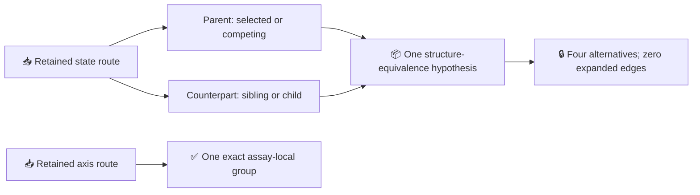

# Evaluation

↑ [Central README](../../README.md) · [MISSION](../research/MISSION.md) (why) · [ROADMAP](../research/ROADMAP.md) (plan) — for evaluation *framing / methodology* see [results/evaluation_overview.md](../../pipelines/empirical/evaluation/results/evaluation_overview.md).

Validation of the graphs produced by [`Analysis/`](../../pipelines/empirical/analysis/README.md): do the
discovered edges hold up against orthogonal evidence?

The current proposed simulation is
[integration recoverability before aggregation](../../pipelines/simulation/integration_recoverability/design.md).
Its scope and execution status are in the
[September 23 roadmap entry](../research/ROADMAP.md#integration-recoverability-design-2026-09-23).

For the separate **unpaired-multimodal simulation track**, the September 6
documentation summary has this reading order:

1. [Project progress summary](../../pipelines/simulation/unpaired_multimodal/results/ca_boss_v4_roadmap_status.md#project-progress-summary-2026-09-06)
   — completed algorithm changes, current achievement, and data boundary.
2. [Cross-assay benchmark metrics](../../pipelines/simulation/unpaired_multimodal/results/ca_boss_v4_roadmap_status.md#cross-assay-benchmark-metrics)
   and [how to read accuracy](../../pipelines/simulation/unpaired_multimodal/results/ca_boss_v4_roadmap_status.md#reading-cross-assay-accuracy)
   — exact results, denominators, and ambiguity-set interpretation.
3. [Experiment log](../../pipelines/simulation/unpaired_multimodal/results/channel_aware_boss_v4_experiment_log.md)
   — dated trials through v4.64, including rejected models, controls, reviews,
   and source/artifact hashes.
4. [Claim boundaries](../research/LIMITATIONS.md#l16-ca-boss-cached-shared-state-recovery-is-not-directed-causal-certification)
   — what cached performance does and does not establish.

External biological validation elsewhere in this directory belongs to the
real-data track; those resources are not additional inputs to CA-BOSS's
observed-only simulation discovery.

## Layout

```
pipelines/empirical/evaluation/
├── scripts/   validators and external-evidence builders
│   ├── peak_peak_validator.py     element<->element axes w/ distance-matched null
│   ├── coaccess_contrast.py       Cicero-style co-accessibility contrast (the novelty comparison)
│   ├── build_chip_occupancy.py    ChIP-Atlas TF occupancy (shared-TF axis)
│   ├── scan_peak_motifs.py        JASPAR motif scan (shared-TF axis, presence)
│   ├── build_{re2g,eqtl,pchic}_gene_link_support.py   the 3 peak->gene support axes
│   ├── liftover.py                UCSC chain staging used by the PCHi-C builder
│   ├── null_calibration.py        false-positive calibration of the discovery step
│   ├── simulate_aggregation_identifiability.py   controlled sim: does aggregation preserve identifiability?
│   ├── multimodal_simulation_pilot.py   closed-loop RNA + two-mark multimodal simulation
│   ├── multimodal_simulation_v4.py      randomized RNA + six-mark unpaired simulation
│   ├── prepare_ca_boss_v4_inputs.py     raw-only, leakage-safe background-state preparation
│   ├── channel_aware_boss.py            matched-state + within-assay causal discovery
│   ├── channel_aware_boss_v4.py         explicit state decomposition + typed calibrated graph
│   ├── soft_distributional_alignment.py observed-only multi-assay state synchronization
│   ├── structure_aware_collider_motif.py uncertainty-aware direct collider selection
│   ├── observed_collider_structure.py   observed-only collider completion/competition
│   ├── shared_state_subspace_v4.py      background-only depth-orthogonal state membership
│   ├── state_equivalence_membership_v4.py set-valued strong redundant state reporters
│   ├── empirical_null_state_calibration_v4.py block-extrapolated calibrated state tier
│   ├── multievidence_empirical_null_state_calibration_v4.py familywise residual-evidence tier
│   ├── topology_consensus_state_calibration_v4.py state-plus-residual-topology tier
│   ├── structure_anchored_loading_groups_v4.py state-sibling/collider-parent group selection
│   ├── loading_group_projection_v4.py   constrained assay-local state-response groups
│   ├── loading_group_state_guard_v4.py  v4.29 state/LOO-axis loading-group guard
│   ├── loading_group_structure_uncertainty_guard_v4.py v4.30 precision guard
│   ├── loading_group_competing_parent_observability_guard_v4.py v4.31 fair-comparison guard
│   ├── loading_group_structure_equivalence_v4.py v4.32 set-valued structure representation
│   ├── latent_axis_clustering_v4.py     native n-ary cross-assay state axes
│   ├── unpaired_mdcr_ks_baseline_v4.py  published unpaired-domain ICA diagnostic
│   ├── component_conditioned_cross_assay_equivalence_v4.py v4.44 guarded component hyperedges
│   ├── multi_assay_permutation_synchronization_v4.py v4.45 global reporter registration
│   ├── heldout_synchronized_majority_rescue_v4.py v4.46 held-out majority rescue
│   ├── relaxed_reporter_synchronization_evidence_v4.py v4.47 reporter-only evidence
│   ├── crossfit_empirical_null_reporter_synchronization_v4.py v4.47 block-cross-fit null calibration
│   ├── crossfit_multivariate_reporter_rescue_v4.py v4.48 nested four-signal cross-fit rescue
│   ├── sparse_reporter_completion_evidence_v4.py v4.49 truth-blind sparse-reporter evidence
│   ├── crossfit_sparse_reporter_completion_v4.py v4.49 nested sparse-reporter proposal model
│   ├── crossfit_interaction_reporter_rescue_v4.py v4.50 exploratory interaction rescue
│   ├── bootstrap_stable_sparse_completion_v4.py v4.51 whole-world stability gate
│   ├── bootstrap_empirical_copula_pair_rescue_v4.py v4.52 rank-product stability rescue
│   ├── bootstrap_mutual_nearest_margin_rescue_v4.py v4.53 reciprocal local-margin rescue
│   ├── diagnose_quantile_geometry_rescue_v4.py cached-only W1/W2 method diagnostic
│   ├── quantile_geometry_synchronization_evidence_v4.py v4.54 truth-blind W1/W2 evidence freezer
│   ├── bootstrap_wasserstein_geometry_rescue_v4.py v4.54 W2 global-geometry stability rescue
│   ├── diagnose_null_calibrated_stability_v4.py v4.55 target-separated null-stability diagnostic
│   ├── bootstrap_null_calibrated_stability_rescue_v4.py v4.55 empirical-null stability rescue
│   ├── joint_sliced_geometry_synchronization_evidence_v4.py v4.56/v4.57 truth-blind joint-geometry freeze
│   ├── diagnose_joint_sliced_null_stability_v4.py v4.57 global-null stability diagnostic
│   ├── diagnose_joint_context_stratified_stability_v4.py v4.58 local-context diagnostic
│   ├── bootstrap_joint_context_stratified_stability_rescue_v4.py v4.58 same-stratum null calibration
│   ├── bootstrap_dual_null_disagreement_rescue_v4.py v4.59 two-context dual-null child stage
│   ├── bootstrap_background_ica_representation_v4.py v4.62 background-only ICA refitting
│   ├── diagnose_representation_bootstrap_v4.py matched-subset representation sensitivity experiment
│   ├── cross_assay_benchmark_metrics_v4.py four cross-assay metric families
│   ├── score_component_conditioned_cross_assay_equivalence_v4.py truth-separated v4.44 scorer
│   ├── score_crossfit_empirical_null_reporter_synchronization_v4.py truth-separated v4.47 scorer
│   ├── score_crossfit_multivariate_reporter_rescue_v4.py truth-separated v4.48 scorer
│   ├── score_crossfit_sparse_reporter_completion_v4.py truth-separated v4.49 scorer
│   ├── score_crossfit_interaction_reporter_rescue_v4.py truth-separated v4.50 scorer
│   ├── score_bootstrap_stable_sparse_completion_v4.py truth-separated v4.51 scorer
│   ├── score_bootstrap_empirical_copula_pair_rescue_v4.py truth-separated v4.52 scorer
│   ├── score_bootstrap_mutual_nearest_margin_rescue_v4.py truth-separated v4.53 scorer
│   ├── score_bootstrap_wasserstein_geometry_rescue_v4.py truth-separated v4.54 scorer
│   ├── score_bootstrap_null_calibrated_stability_rescue_v4.py truth-separated v4.55 scorer
│   ├── score_bootstrap_joint_context_stratified_stability_rescue_v4.py truth-separated v4.58 scorer
│   ├── score_bootstrap_dual_null_disagreement_rescue_v4.py truth-separated v4.59 scorer
│   ├── summarize_cross_assay_benchmark_{panel,campaign}_v4.py hash-verified aggregation
│   ├── replay_cached_layered_state_v4.py fast random replay of existing worlds only
│   ├── audit_nested_empirical_null_state_calibration_v4.py nested cached-only v4.25 audit
│   ├── audit_nested_multievidence_state_calibration_v4.py nested cached-only v4.26 audit
│   ├── audit_nested_topology_consensus_state_v4.py nested cached-only v4.27 audit
│   ├── audit_nested_loading_group_axis_consensus_v4.py cached-only v4.29 audit
│   ├── audit_nested_loading_group_structure_uncertainty_v4.py cached-only v4.30 audit
│   ├── audit_nested_loading_group_competing_parent_observability_v4.py cached-only v4.31 audit
│   ├── audit_nested_loading_group_structure_equivalence_v4.py cached-only v4.32 audit
│   ├── benchmark_ca_boss_v4.py          truth-separated TRAIN/DEV benchmark harness
│   ├── run_shared_state_subspace_block_v4.py all-world pretruth barrier and formal runner
│   ├── validate_ca_boss_v4.py           split/provenance/certification gate
│   ├── benchmark_channel_aware_boss.py  repeated-world frozen-candidate benchmark
│   ├── consensus_multimodal_causal_runs.py  nested-run graph consensus
│   └── score_multimodal_causal_graph.py truth-separated attainable-motif scorer
├── outputs/   evidence tables + run artifacts
│   ├── peak_peak_pairs.tsv, peak_tf_chip.tsv, peak_tf_motifs.tsv, *_summary.json  (tracked)
│   ├── external/cache/            download cache (gitignored)
│   └── bootstrap_stability/, graph_stability/, null_calibration/  (run outputs, gitignored)
└── results/   the write-ups — what the numbers mean
```

The curated evidence tables in `outputs/` are tracked deliberately: they are what the claims in
`results/` rest on. The per-run search outputs and the download cache are not.

## Key results

- [results/peak_peak_validation_results.md](../../pipelines/empirical/evaluation/results/peak_peak_validation_results.md) — the four element↔element axes and the co-accessibility contrast.
- [results/expanded_panel_confounder_results.md](../../pipelines/empirical/evaluation/results/expanded_panel_confounder_results.md) — the confounder-conditioned 15-gene panel.
- **[results/same_mark_finding.md](../../pipelines/empirical/evaluation/results/same_mark_finding.md) — ⚠️ the one significant element↔element signature, and it is probably technical. Blocks the four-negative endpoint.**
- **[results/simulation_identifiability_results.md](../../pipelines/simulation/aggregation_identifiability/results/simulation_identifiability_results.md) — the pivotal sim: cell-level identifiable, aggregation collapses it (the mechanism).**
- [results/multimodal_simulation_pilot.md](../../pipelines/simulation/unpaired_multimodal/results/multimodal_simulation_pilot.md) — closed-loop simulator with an explicit generative DAG and leakage-safe observed matrices: independent experiments → oracle/scGLUE embedding → metacells → production FCI.
- **[results/channel_aware_boss_results.md](../../pipelines/simulation/unpaired_multimodal/results/channel_aware_boss_results.md) — frozen 40-world validation: channel-aware BOSS passes the attainable five-pair recovery gate in 37/40 learned-integration worlds and 36/40 oracle worlds; production FCI passes 0/40.**
- [results/channel_aware_boss_v4_experiment_log.md](../../pipelines/simulation/unpaired_multimodal/results/channel_aware_boss_v4_experiment_log.md) — living record through the v4.59 checkpoint and v4.60–v4.64 diagnostics. The branch adapts published unpaired representation learning, distribution matching, synchronization, empirical-null calibration, stability selection, and ICA reliability analysis. Current work prioritizes changes to the learning estimator over additional rescue combinations. Conflicts remain unexpanded ambiguity hyperedges. The authoritative metrics and limitations are in the [roadmap status](../../pipelines/simulation/unpaired_multimodal/results/ca_boss_v4_roadmap_status.md).
- [results/ca_boss_v4_detailed_technical_report.md](../../pipelines/simulation/unpaired_multimodal/results/ca_boss_v4_detailed_technical_report.md) — detailed v4.58 technical snapshot dated September 3; use the live roadmap above for the current checkpoint.
- **[results/partition_bootstrap_results.md](../../pipelines/empirical/evaluation/results/partition_bootstrap_results.md) — ⚠️ DEFINITIVE partition test (K=10): no edge in all 10 partitions; the stable-edge list; same-mark enrichment is partition-fragile (4/10). Read before citing any edge.**
- **[results/pairing_artifact_findings.md](../../pipelines/simulation/unpaired_multimodal/results/pairing_artifact_findings.md) — is the cross-assay pairing manufacturing our bidirected edges? multi-channel sim: same-channel structure survives the construction, cross-channel does not (-44 to -57%); and only FCI produces bidirected edges (0 from every score-based search).**
- [results/partition_stability_findings.md](../../pipelines/empirical/evaluation/results/partition_stability_findings.md) — how the partition-instability was found (3-seed controls + pilot); background for the K=10 result.
- [results/run_audit_report.md](../../pipelines/empirical/evaluation/results/run_audit_report.md) — saved-run audit and rigor tiers.
- [results/evaluation_overview.md](../../pipelines/empirical/evaluation/results/evaluation_overview.md) — framing, validation layers, honesty rules.

## Bootstrap-stable cross-assay benchmark (v4.59)

The current cross-assay benchmark is designed for unpaired modalities sharing
latent biological state. It uses only the 103 existing cached simulation
worlds. It generates no replacement worlds, adds no paired cells, does not read
simulator state during discovery, and introduces no external biological
features or priors.

V4.44 remains the conservative core. V4.45 globally synchronizes reporter
permutations, v4.46 requires held-out synchronization support, and v4.47 sets
an edge-specific exclusion threshold from sentinel nulls in other seed blocks.
V4.49 then proposes sparse unresolved-assay reporters with a seven-feature,
degree-two balanced logistic model at two regularizations. Both conservative
scores must clear their own nested out-of-fold sentinel-null envelopes, exactly
one candidate may pass within the assay, and exactly one supported-assay
partner must pass every synchronization guard.

Full-fit cached gains were not stable enough to promote on their own. The five
v4.48 additions survived 50 whole-world bootstrap refits only 0.10–0.44 of the
time. V4.50 added three more cached true pairs with no cached false pairs, but
their frequencies were 0.12, 0.02, and 0.00. A heterogeneous SVC/QDA diagnostic
likewise found three full-fit truths whose frequencies were only 0.02–0.04.
These variants are recorded as exploratory, not reliable checkpoints.

V4.51 therefore treats only target-safe v4.49 additions as proposals and
resamples complete training worlds, with replacement inside each source block,
100 times. Every replicate reruns both reporter models and all corresponding
out-of-fold null envelopes. Two sparse-reporter proposals survived at 1.00 and
0.95; the fragile H3K4me3 proposal survived at 0.46 and was rejected.

V4.52 then replaces supervised pair scoring with a parameter-free directional
empirical-copula product over the four fixed reporter-pair signals. Each target
score is the minimum over four nested folds and must exceed the largest
corresponding other-block sentinel-null score. Three additions survived the
same 100-refit, 0.80 stability gate at 0.99, 1.00, and 0.98.

V4.53 adds local competition without assuming the simulator-specific perfect
matching. In every fold, a proposal must be the strict mutual nearest neighbour
of both assays under the v4.52 score. Its minimum absolute advantage over the
strongest pair incident to either endpoint must exceed the maximum analogous
other-block null margin. Six new pairs survived whole-world bootstrap at 0.82–
1.00. The only nominal null survived at 0.48 and was rejected. The rule does
not force every assay into a pair or assume a fixed number of relationships.
Connected selected pairs remain one unexpanded ambiguity hyperedge.

V4.54 replaces the KS-only component comparison in the incremental route with
full distribution geometry. In the full fit and both disjoint background-
feature folds, it evaluates 99 empirical quantiles per assay-local component,
takes the smaller W2 cost under the two possible ICA signs, median-normalizes
each rank-three pairwise cost matrix, and solves the existing exact multi-assay
permutation synchronization problem. The production score mirrors v4.53 with
four fixed signals: statistical context support, W2 global co-assignment
count, maximum normalized reporter cost, and mean global exclusion margin.
Features are quantized to 12 decimals before empirical ranking so tied ranks do
not depend on serialization noise. The same strict reciprocal, other-block
null-margin, and 100-bootstrap/0.80 guards remain in force.

V4.55 keeps the v4.54 nominal W2 proposals and replaces the one-size-fits-all
0.80 incremental stability cutoff. For each sealed target block, every null
pair in each of the four non-target candidate blocks is rescored in folds that
exclude both its own labels and the target labels. A target proposal must recur
in strictly more than 50 of 100 whole-world refits, strictly exceed the largest
null selection count, and have at least 0.975 working Beta(1,1) probability of
a larger selection probability. Bootstrap refits are dependent, so this Beta
quantity is an uncertainty-aware working score rather than a calibrated
posterior. The rule unions only newly admitted pairs with target-safe v4.54;
connected conflicts remain one unexpanded equivalence hyperedge.

V4.56 next tested a raw joint sliced-distribution geometry and an empirical-
copula version. Both carried additional signal, but both admitted false pairs
on at least one of two random 40-world panels; their intersection admitted no
pair in the remaining 23 worlds. V4.57 therefore froze the raw joint evidence
independently and tested global empirical-null stability. That route selected
nothing because the worst null recurred in 96--100 of 100 refits in every
target block. These variants are rejected diagnostics, not checkpoints.

V4.58 preserves the v4.57 joint proposals but separates their observable
context. A proposal must be the strict local mutual nearest neighbour in all
three component-score contexts: the full fit and both disjoint held-out-
background-feature folds. Its empirical-null floor is then formed only from
non-target null pairs in that same three-of-three stratum. It must still recur
in more than 50 of 100 refits, strictly beat the stratum-specific worst null,
and pass the 0.975 working-Beta dominance guard. This changes neither the
v4.55 base nor the no-expansion/no-direction contract.

V4.59 adds a small child stage for exactly two-context local agreement. A
proposal must exceed both the same-stratum null count and the unstratified
global null count, in addition to the strict majority and working-Beta guard.
All five target calibrations and all 103 prediction tables were frozen before
new target scoring. Independent review checked selection, core overlap,
source/input hashes, and the four metric families; a separate scoring replay
reproduced the 207 output artifacts and campaign summary exactly.

The benchmark exposes four metric families:

1. shared-state hyperedge precision and recall, with one ambiguity set scored
   as one hypothesis;
2. exact assay-participation precision/recall plus sentinel false-positive
   rate, while set-valued participation is recorded as a point abstention;
3. equivalence-class coverage, coverage precision, and average/maximum
   ambiguity-set size; and
4. exact cross-assay pair and direction recovery under the label
   `identifiability_stress_test_not_expected_success_criterion`. This fourth
   family is never included in the reliability gate.

The [authoritative metric table](../../pipelines/simulation/unpaired_multimodal/results/ca_boss_v4_roadmap_status.md#cross-assay-benchmark-metrics)
owns the current campaign totals and checkpoint increments. Its
[accuracy interpretation](../../pipelines/simulation/unpaired_multimodal/results/ca_boss_v4_roadmap_status.md#reading-cross-assay-accuracy)
separates exact pairs, covered ambiguity sets, and missed truths, and explains
why shared-state pair recovery is not a direct causal-edge claim. V4.59 is
still retrospective development evidence; see
[LIMITATIONS L16](../research/LIMITATIONS.md#l16-ca-boss-cached-shared-state-recovery-is-not-directed-causal-certification).

`cross_assay_benchmark_metrics_v4.py` owns the metric definitions. The scorer
verifies the hash-bound v4.44 bridge, v4.56/v4.57 joint evidence, target-safe
v4.55 parents, the v4.57/v4.58 diagnostics, and the target-specific v4.58
calibration before opening target truth. V4.59 additionally verifies both null
ceilings and its parent union, then freezes all target predictions before its
separate campaign scorer reads target truth. Panel and
campaign summarizers reject world mismatches/overlap, and candidate alternatives
can never become separate edge predictions. See the
[roadmap status](../../pipelines/simulation/unpaired_multimodal/results/ca_boss_v4_roadmap_status.md), the
[v4.59 machine record](../../pipelines/simulation/unpaired_multimodal/results/ca_boss_v4_bootstrap_dual_null_disagreement_rescue_v459_summary.json),
[v4.58 machine record](../../pipelines/simulation/unpaired_multimodal/results/ca_boss_v4_bootstrap_joint_context_stratified_stability_rescue_v458_summary.json),
[v4.55 machine record](../../pipelines/simulation/unpaired_multimodal/results/ca_boss_v4_bootstrap_null_calibrated_stability_rescue_v455_summary.json),
[v4.54 machine record](../../pipelines/simulation/unpaired_multimodal/results/ca_boss_v4_bootstrap_wasserstein_geometry_rescue_v454_summary.json),
[v4.53 machine record](../../pipelines/simulation/unpaired_multimodal/results/ca_boss_v4_bootstrap_mutual_nearest_margin_rescue_v453_summary.json),
[v4.52 machine record](../../pipelines/simulation/unpaired_multimodal/results/ca_boss_v4_bootstrap_empirical_copula_pair_rescue_v452_summary.json),
and the explicitly non-promoted
[v4.50 record](../../pipelines/simulation/unpaired_multimodal/results/ca_boss_v4_interaction_reporter_rescue_v450_summary.json).

The subsequent depth-conditioned geometry diagnostic (v4.60) introduced only
false additions and was rejected. The ECF-plus-joint geometry diagnostic
(v4.61) found five stable true additions and one false addition across two
disjoint cached panels; it remains unpromoted. Its raw and standardized ECF
views are numerically identical because ICA scores are already standardized.
Both geometries also share the same representation, so agreement is dependent
evidence. A post hoc global three-context guard is only an exploratory lead.

V4.62 follows [ICASSO's repeated-fit reliability principle](https://doi.org/10.1016/j.neuroimage.2004.03.027).
It refits background normalization and ICA, recomputes depth-adjusted reporter
assignments, and repeats joint-distribution synchronization. A cached-reference
control, changed initialization, resampled cells, and both perturbations use
the same evaluation subset within each assay. These are sensitivity diagnostics,
not production four-family benchmark scores. Reference fits and reporter
identities already used the full data; the experiment does not create an
independent validation set. See the experiment log for measured results and
the next model decision.

V4.63 replaces hard reporter-component assignment with signed, strength-aware
soft association evidence propagated through those refits. On ten cached
worlds it selected 21 true and one false diagnostic relationship, including
two truths and one false addition beyond v4.59; it is not promoted. V4.64
replaces marginal correlations with joint-regression unique-effect energy,
holding each representation fit, evaluation subset and alignment identical.
Its primary selected set is unchanged at 21 true and one false pair. The
marginal control exactly reproduces v4.63, and independent review plus 25
targeted tests verifies the paired comparison. These are core-estimator
experiments, not improvements to the production benchmark. Current work
therefore moves upstream to the background count-likelihood representation.

The controlled comparison lives in
[`compare_reporter_learning_rules_v4.py`](../../pipelines/simulation/unpaired_multimodal/scripts/compare_reporter_learning_rules_v4.py)
and the estimator in
[`joint_reporter_regression_evidence_v4.py`](../../pipelines/simulation/unpaired_multimodal/scripts/joint_reporter_regression_evidence_v4.py).
The [experiment log](../../pipelines/simulation/unpaired_multimodal/results/channel_aware_boss_v4_experiment_log.md) records
frozen artifact locations, hashes, negative results and interpretation limits.

## CA-BOSS v4.27 calibration audit (cached only)

Current algorithm work must reuse existing worlds; these commands have no
world-generation or missing-data-generation path. The v4.27 audit first freezes
the observable state evidence, the prior v4.26 outer predictions, the v4.22
within-assay direct-candidate endpoints, and random world selections. Only a
separate Phase B opens the existing labels for source-block-held-out sentinel
certification:

```bash
/home/dgsetiawan/anaconda3/envs/scrna_r/bin/python \
  pipelines/simulation/unpaired_multimodal/scripts/audit_nested_topology_consensus_state_v4.py \
  --phase a \
  --out-dir pipelines/simulation/unpaired_multimodal/outputs/ca_boss_v4/cached_nested_topology_consensus_v427_full_pool \
  --selection-seed 20261004 --panels 5 --panel-size 12

/home/dgsetiawan/anaconda3/envs/scrna_r/bin/python \
  pipelines/simulation/unpaired_multimodal/scripts/audit_nested_topology_consensus_state_v4.py \
  --phase b \
  --out-dir pipelines/simulation/unpaired_multimodal/outputs/ca_boss_v4/cached_nested_topology_consensus_v427_full_pool
```

Across seven outer source blocks, the fixed v4.27 conjunction added 147 true
state reporters and zero null reporters beyond v4.26. The typed union therefore
reached precision 1.000 and recall 0.9571; all 152 cached worlds reached recall
at least 0.80. The rule requires positive marginal and partial state fit plus
endpoint status in the separately typed within-assay direct table. Direct
topology alone is insufficient. The full-data calibrator consumes no truth
when applied, but its training rows are not counted as fresh validation. Exact
cross-assay feature matching and cell-specific cross-assay direction remain
outside the identifiable claim. The nested audit and production-wiring hashes
are recorded in
[ca_boss_v4_cached_random_v427_summary.json](../../pipelines/simulation/unpaired_multimodal/results/ca_boss_v4_cached_random_v427_summary.json).

## CA-BOSS v4.28 loading-group guard replay (cached only)

V4.28 leaves v4.27 shared-state membership and the v4.22 direct layer frozen.
It changes only assay-local loading-group admission: every member of a proposed
group must already have `state_v427_supported_member = true`. Direct structure
cannot substitute for state evidence. A rejected proposal is retained as a
typed `unresolved` hyperedge so abstention is auditable.

Five block-balanced panels selected with seeds `20261009` through `20261013`
replayed 60 existing-world instances spanning 49 unique worlds. Whole-layer
reliability passed 60/60, compared with 59/60 before the guard. The state layer
was unchanged at precision 1.000, mean recall 0.9527, minimum recall 0.84, and
zero sentinels. The guard reduced 329 proposed loading groups to 293 retained
groups and 36 explicit abstentions. Mean loading-pair precision was 0.9972,
mean recall was 0.8111, and no retained group contained a sentinel. No world,
dataset, modality, variable, paired observation, or external information was
created. The source-bound record is
[ca_boss_v4_cached_random_v428_summary.json](../../pipelines/simulation/unpaired_multimodal/results/ca_boss_v4_cached_random_v428_summary.json).

## CA-BOSS v4.29 loading-axis consensus replay (cached only)

V4.29 keeps v4.27 state membership, the v4.22 direct layer, and the v4.28
all-members-state loading route frozen. A group rejected by that route can be
retained only if it has at least one v4.27 state-supported member and joins a
selected cross-assay axis under evidence calculated without the candidate
group. The axis must contain at least two groups and two modalities, and every
frozen member-cosine, view-support, relative-margin, and modality-consistency
gate must pass. This is group-level support, not exact feature pairing.

The final two-phase audit reused 151 existing worlds. It added 20 true groups,
zero false groups, and zero sentinel groups beyond v4.28, raising aggregate
loading-group recall from 0.8124 to 0.8344 while precision changed from 0.9866
to 0.9869. All seven source blocks had zero false axis-route additions. On the
same five production panels used for v4.28, seven additional true loading
pairs raised mean recall from 0.8111 to 0.8306 while mean precision remained
0.9972; all 60 evaluations passed and no sentinel was retained.

Reproduce the final nested audit without generating data:

```bash
python pipelines/simulation/unpaired_multimodal/scripts/audit_nested_loading_group_axis_consensus_v4.py \
  --phase a \
  --out-dir pipelines/simulation/unpaired_multimodal/outputs/ca_boss_v4/cached_nested_loading_axis_consensus_v429_replay
python pipelines/simulation/unpaired_multimodal/scripts/audit_nested_loading_group_axis_consensus_v4.py \
  --phase b \
  --out-dir pipelines/simulation/unpaired_multimodal/outputs/ca_boss_v4/cached_nested_loading_axis_consensus_v429_replay
```

The source-bound result is
[ca_boss_v4_cached_random_v429_summary.json](../../pipelines/simulation/unpaired_multimodal/results/ca_boss_v4_cached_random_v429_summary.json).
It records the ten false local-group proposals that v4.29 inherits; the new
axis route contributes none of them. This remains cached development evidence,
not a fresh locked-world result.

## CA-BOSS v4.30 structure/uncertainty guard (cached only)

V4.30 is a conservative post-v4.29 precision guard. The all-members-state
route must have `minimum_member_centroid_cosine >= 0.90`; the independently
supported cross-assay-axis route bypasses that floor. Either route is
downgraded to `unresolved` when its members overlap the child of a complete
direct collider candidate or contain two parents of the same child. The
downgrade separates direct-layer ambiguity from shared-state support; it is not
evidence that the biological association is absent. Feature-level v4.27 state
membership and the direct-candidate table are unchanged.

The two-phase full-cache audit reused 151 worlds and seven source blocks. It
reduced v4.29's 10 false groups to 5 while retaining all 756 true groups:
precision rose from 0.9869 to 0.9934, recall stayed 0.8344, all 151 worlds met
the 0.80-precision/zero-sentinel gate, and no sentinel group was selected.
Two false groups were downgraded for direct-layer overlap and three for loading
uncertainty. Leave-one-source-block-out calibration selected thresholds
0.905–0.910 and produced pooled outer precision 0.9947 and recall 0.8333; that
calibration is diagnostic because every world belongs to the reused
development cache. The fixed production value remains the more conservative
round 0.90 boundary, chosen to incur zero cached true-group loss.

Reproduce the audit without creating data:

```bash
python pipelines/simulation/unpaired_multimodal/scripts/audit_nested_loading_group_structure_uncertainty_v4.py \
  --phase a \
  --out-dir pipelines/simulation/unpaired_multimodal/outputs/ca_boss_v4/cached_nested_loading_structure_uncertainty_v430_replay
python pipelines/simulation/unpaired_multimodal/scripts/audit_nested_loading_group_structure_uncertainty_v4.py \
  --phase b \
  --out-dir pipelines/simulation/unpaired_multimodal/outputs/ca_boss_v4/cached_nested_loading_structure_uncertainty_v430_replay
```

Five additional production-path panels (seeds `20261020`–`20261024`) replayed
60 cached instances spanning 44 unique worlds. All 60 passed. Against the exact
same panel rows, v4.29 had 302 TP/5 FP and v4.30 had 302 TP/2 FP, so micro
precision improved from 0.9837 to 0.9934 at unchanged 0.8389 recall. The
source-bound record is
[ca_boss_v4_cached_random_v430_summary.json](../../pipelines/simulation/unpaired_multimodal/results/ca_boss_v4_cached_random_v430_summary.json).
This remains retrospective development evidence, not fresh locked-world
certification or recovery of cell-specific cross-assay direction.

## CA-BOSS v4.31 competing-parent observability guard (cached only)

V4.31 adds a fixed fair-comparison prerequisite after the complete v4.30
selector. The independent cross-assay-axis route is unchanged. A retained
state-route group must instead match the exact selected two-parent collider in
the original structure-anchor evidence, and the parent that lost the local
competition must satisfy the already frozen v4.27 observability conjunction:
formal eligibility, positive marginal and partial state fits, and at least one
within-assay direct relation. Failure is typed `unresolved`, never biological
absence. The rule fits no new numeric threshold and changes neither the v4.27
feature-membership set nor the direct graph.

The correct two-phase audit first froze every exact selected structure
competition across all 151 cached worlds, then opened the existing labels. It
changed v4.30's 756 TP/5 FP/150 FN into 754 TP/3 FP/152 FN: precision 0.9960,
recall 0.8322, zero sentinels, and 151/151 worlds at or above 0.80 precision.
The two lost true groups and two removed false groups are all explicit
abstentions. Five source-block-balanced audit panels had mean precision 1.000
and recall 0.850. A provisional audit that reconstructed competition from the
later repaired direct graph is invalid and is not used by v4.31.

Reproduce the valid audit without creating data:

```bash
python pipelines/simulation/unpaired_multimodal/scripts/audit_nested_loading_group_competing_parent_observability_v4.py \
  --phase a \
  --out-dir pipelines/simulation/unpaired_multimodal/outputs/ca_boss_v4/cached_nested_loading_parent_observability_v431_replay
python pipelines/simulation/unpaired_multimodal/scripts/audit_nested_loading_group_competing_parent_observability_v4.py \
  --phase b \
  --out-dir pipelines/simulation/unpaired_multimodal/outputs/ca_boss_v4/cached_nested_loading_parent_observability_v431_replay
```

The five unchanged production selections (seeds `20261020`–`20261024`) again
covered 60 cached evaluations and 44 unique worlds. V4.30 had 302 TP/2 FP/58
FN on those exact rows; v4.31 had 302 TP/0 FP/58 FN, for precision 1.000 and
unchanged recall 0.8389. All Phase-A, Phase-B, guard, and whole-layer checks
passed. The source-bound record is
[ca_boss_v4_cached_random_v431_summary.json](../../pipelines/simulation/unpaired_multimodal/results/ca_boss_v4_cached_random_v431_summary.json).
The three false groups remaining in the complete cache are observationally
overlapped with true groups under the role-blind cached scores, so no further
fixed cutoff is promoted. They remain shared-state/parent-equivalence
ambiguities rather than direct cross-assay causal claims.

## 📊 CA-BOSS v4.32 set-valued structure equivalence (cached only)

V4.32 resolves the remaining v4.31 point-claim mismatch without changing a
selection. A retained state-route group now denotes one assay-local structural
hypothesis with two parent alternatives (selected or competing) and two
counterpart alternatives (noncollider sibling or collider child). Its four
candidate pairs are joint alternatives, not four emitted edges. A retained
cross-assay-axis route is already independent of the local collider choice and
therefore remains one exact assay-local loading group. Neither route asserts an
exact pair or causal direction between disjoint assays.



The truth-separated full-cache audit reused 151 existing worlds and 906 truth
groups. It retained the same 757 v4.31 selections, represented them as 737
structure-equivalence hyperedges plus 20 exact axis groups, and matched all 757
to distinct truth groups. Coverage precision is 1.000 and recall is 0.8355,
with 149 false-negative truth groups and zero sentinel-contaminated
hypotheses. The unchanged nominal v4.31 point baseline remains 754 TP, 3 FP,
and 152 FN. The apparent improvement is therefore better-calibrated uncertainty
representation, not extra information or a new selector. Expanding the
hypotheses would manufacture 2,968 candidate pairs and is explicitly forbidden.

Reproduce the valid two-phase audit without generating data:

```bash
python pipelines/simulation/unpaired_multimodal/scripts/audit_nested_loading_group_structure_equivalence_v4.py \
  --phase a \
  --out-dir pipelines/simulation/unpaired_multimodal/outputs/ca_boss_v4/cached_nested_loading_structure_equivalence_v432_replay
python pipelines/simulation/unpaired_multimodal/scripts/audit_nested_loading_group_structure_equivalence_v4.py \
  --phase b \
  --out-dir pipelines/simulation/unpaired_multimodal/outputs/ca_boss_v4/cached_nested_loading_structure_equivalence_v432_replay
```

The five production replays reused exactly the v4.31 selections for seeds
`20261020`–`20261024`: 60 evaluations of 44 unique worlds. Their 302 selected
hypotheses all covered distinct truth groups (precision 1.000, recall 0.8389),
comprising 296 structure-equivalence hyperedges and six exact axis groups.
All 60 whole-layer checks passed, direct precision and recall stayed 1.000,
and zero sentinels were selected. The 1,190 serialized alternatives were never
expanded. The source-bound record is
[ca_boss_v4_cached_random_v432_summary.json](../../pipelines/simulation/unpaired_multimodal/results/ca_boss_v4_cached_random_v432_summary.json),
and the authoritative audit is under
`pipelines/simulation/unpaired_multimodal/outputs/ca_boss_v4/cached_nested_loading_structure_equivalence_v432_full_pool_final/`.
The full Evaluation suite passes 508 tests. These are retrospective cached-pool
development and wiring results, not fresh locked-world certification.

## The two evaluation questions

Graph variables are **uncurated** nearby CUT&Tag peaks; curated promoter/enhancer regions are never
graph inputs, only evaluation annotations. That separation is what keeps validation independent of
discovery. Two distinct questions, with different machinery:

**1. peak → gene — "is this element a real regulator *of this gene*?"**
Triangulated across three orthogonal, cell-type + target-gene aware axes; an edge counts as validated
when the support is target-gene-aware (≥2 axes agreeing is the gold standard).

| axis | source | builder |
| --- | --- | --- |
| prediction | ENCODE-rE2G | `build_re2g_gene_link_support.py` |
| physical | BLUEPRINT PCHi-C | `build_pchic_gene_link_support.py` |
| genetics | eQTL Catalogue SuSiE | `build_eqtl_gene_link_support.py` |

**2. peak ↔ peak — "what explains the latent common cause behind a bidirected edge?"**
This is the project's novel object and has **no accepted community null**, so we built one: a
distance-matched permutation test (`peak_peak_validator.py`) against which each candidate driver is
tested. Current scope: 15-gene panel, confounder-conditioned metacell PAGs.

Status of both lives in [results/](../../pipelines/empirical/evaluation/results) — see **Key results** above.

## Evidence Sources

External evidence can include:

- `ePerturbDB`: stronger perturbation-based support when available.
- `ENCODE Portal`: PBMC or monocyte peak-file support from released GRCh38 ENCODE BED files.
- `ENCODE SCREEN`: broader regulatory annotation support, especially cCREs and enhancer-like elements.
- `JASPAR`: online motif support for peak nodes using JASPAR matrices plus UCSC hg38 sequence retrieval.
- Curated project locus configs under `Analysis/configs/loci/`.
- Nearby peak metadata emitted by dataset generation.

See [external_sources.md](../../pipelines/empirical/evaluation/results/external_sources.md) for the supported online source
formats, default ENCODE SCREEN URLs, and plotting semantics.

## Evidence table format

Column templates for external evidence tables live in `outputs/templates/`. The key template is:

```text
pipelines/empirical/evaluation/outputs/templates/external_support_regions_template.tsv
```

Expected columns:

- `chrom`
- `start`
- `end`
- `gene`
- `support_label`
- `external_id`
- `biosample`
- `notes`

Only `chrom`, `start`, and `end` are required for interval overlap, but the other columns make reports easier to interpret.

## Nearby-Peak Overlap Checks

For the current datasets, start by reading each gene's nearby peak metadata:

```text
pipelines/empirical/analysis/outputs/datasets/joint_v2/monocyte_cuttag_peak_genes_300kb/<gene>/nearby_peaks/<GENE>_nearby_peak_metadata.tsv
pipelines/empirical/analysis/outputs/datasets/joint_v2/monocyte_cuttag_peak_genes_300kb_rawcounts/<gene>/nearby_peaks/<GENE>_nearby_peak_metadata.tsv
```

Useful columns include:

- `gene`
- `mark`
- `signed_distance_to_tss`
- `overlaps_curated_region`
- `overlapping_curated_region_names`

These columns let us evaluate graph edges without injecting curated biology into the graph-learning matrix.

## External Support Workflow

For the downloaded ePerturbDB files, place the database TSV, enhancer-gene BED,
and enhancer-TF overlap BED in `Data/raw/external/eperturbdb/`, then annotate a
saved graph:

```bash
python3 pipelines/empirical/analysis/scripts/causal_cli.py support \
  --graph-dir pipelines/empirical/analysis/outputs/methods/pc/joint_v2_monocyte_cuttag_peak_genes_300kb/cd14/pc_kci_alpha_0_05_depth_2_bg_tiered_distal_promoter_expr \
  --support-preset local_eperturbdb
```

To rebuild support and render the graph in one plotting command:

```bash
python3 pipelines/empirical/analysis/scripts/causal_cli.py plot \
  --graph-dir pipelines/empirical/analysis/outputs/methods/pc/joint_v2_monocyte_cuttag_peak_genes_300kb/cd14/pc_kci_alpha_0_05_depth_2_bg_tiered_distal_promoter_expr \
  --online-support \
  --support-preset local_eperturbdb
```

You can also prepare locus-focused template TSVs from `ePerturbDB` and/or
`ENCODE SCREEN`, then annotate a saved graph:

```bash
python3 pipelines/empirical/analysis/scripts/causal_cli.py support \
  --graph-dir pipelines/empirical/analysis/outputs/methods/pc/joint_v2_monocyte_cuttag_peak_genes_300kb/cd14/pc_kci_alpha_0_05_depth_2_bg_tiered_distal_promoter_expr \
  --locus-config pipelines/empirical/analysis/configs/loci/cd14_regions678.tsv \
  --eperturbdb-tsv pipelines/empirical/evaluation/outputs/external/cd14_eperturbdb.tsv \
  --encode-screen-tsv pipelines/empirical/evaluation/outputs/external/cd14_encode_screen.tsv
```

This writes support tables into the graph directory:

- `node_support.tsv`
- `node_support_matches.tsv`
- `edge_support.tsv`
- `support_report.md`

The local ePerturbDB adapter writes three source labels when matching records
are present:

- `eperturbdb`: perturbation database rows with `Gene (literature)` target-gene support.
- `eperturbdb_enhancer_gene`: enhancer interval/nearest-gene annotation.
- `eperturbdb_tf_overlap`: enhancer interval/TF overlap context.

You can also fetch ENCODE SCREEN directly:

```bash
python3 pipelines/empirical/analysis/scripts/causal_cli.py support \
  --graph-dir pipelines/empirical/analysis/outputs/methods/pc/joint_v2_monocyte_cuttag_peak_genes_300kb/cd14/pc_kci_alpha_0_05_depth_2_bg_tiered_distal_promoter_expr \
  --fetch-encode-screen
```

For PBMC- or monocyte-context ENCODE peak evidence, query ENCODE Portal files:

```bash
python3 pipelines/empirical/analysis/scripts/causal_cli.py support \
  --graph-dir pipelines/empirical/analysis/outputs/methods/pc/joint_v2_monocyte_cuttag_peak_genes_300kb/cd14/pc_kci_alpha_0_05_depth_2_bg_tiered_distal_promoter_expr \
  --fetch-encode-pbmc \
  --encode-biosample-term "CD14-positive monocyte" \
  --encode-assay-term DNase-seq \
  --max-encode-files 10
```

For motif-level regulatory support, query JASPAR and UCSC sequences:

```bash
python3 pipelines/empirical/analysis/scripts/causal_cli.py support \
  --graph-dir pipelines/empirical/analysis/outputs/methods/pc/joint_v2_monocyte_cuttag_peak_genes_300kb/cd14/pc_kci_alpha_0_05_depth_2_bg_tiered_distal_promoter_expr \
  --fetch-jaspar \
  --jaspar-matrix-id MA0139.1 \
  --jaspar-min-score 0.75
```

Re-plot the graph:

```bash
python3 pipelines/empirical/analysis/scripts/causal_cli.py plot \
  --graph-dir pipelines/empirical/analysis/outputs/methods/pc/joint_v2_monocyte_cuttag_peak_genes_300kb/cd14/pc_kci_alpha_0_05_depth_2_bg_tiered_distal_promoter_expr \
  --layout local
```

Or build external support and plot in one step:

```bash
python3 pipelines/empirical/analysis/scripts/causal_cli.py plot \
  --graph-dir pipelines/empirical/analysis/outputs/methods/pc/joint_v2_monocyte_cuttag_peak_genes_300kb/cd14/pc_kci_alpha_0_05_depth_2_bg_tiered_distal_promoter_expr \
  --online-support \
  --fetch-encode-pbmc \
  --encode-biosample-term "CD14-positive monocyte" \
  --encode-assay-term DNase-seq \
  --layout local
```

New graph runs can also build support before rendering their final plot:

```bash
python3 pipelines/empirical/analysis/scripts/causal_cli.py graph \
  --matrix-tsv pipelines/empirical/analysis/outputs/datasets/joint_v2/monocyte_cuttag_peak_genes_300kb/cd14/nearby_peaks/CD14_nearby_peak_matrix.tsv \
  --method fci \
  --online-support \
  --fetch-encode-pbmc \
  --encode-biosample-term "CD14-positive monocyte" \
  --encode-assay-term DNase-seq \
  --plot-layout local
```

Add `--fetch-jaspar --jaspar-matrix-id <ID>` to the same `graph` or `plot`
commands when motif-level peak support should be included.

For the current monocyte/PBMC analysis, the compact preset is:

```bash
python3 pipelines/empirical/analysis/scripts/causal_cli.py plot \
  --graph-dir pipelines/empirical/analysis/outputs/methods/fci/joint_v2_monocyte_cuttag_peak_genes_300kb/cd14/fci_kci_alpha_0_05_depth_5_bg_tiered_distal_promoter_expr \
  --online-support \
  --support-preset monocyte_regulatory \
  --layout local
```

This expands to ENCODE SCREEN, ENCODE Portal `CD14-positive monocyte`
`DNase-seq`, and JASPAR CTCF (`MA0139.1`) support.

## Matching Logic

Support annotation uses:

- Expression nodes: exact gene-symbol matching.
- Coordinate peak nodes such as `chr5:140612011-140612339__H3K27ac`: genomic interval overlap.
- Named curated regions: coordinates resolved from the locus config, then interval overlap.
- Peak-expression edges: interval evidence on the peak endpoint validates the
  edge only when the external target gene matches the expression endpoint. This
  keeps ePerturbDB-style target-gene evidence edge-specific and prevents
  ENCODE/JASPAR interval-only context from validating peak-to-gene edges.

## How To Interpret Support

`ePerturbDB` is the stronger causal-support layer. It is most useful when graph-adjacent peaks overlap experimentally perturbed enhancers.

`ENCODE Portal` peak files provide cell-context support when the chosen biosample term matches the analysis, for example `peripheral blood mononuclear cell` or `CD14-positive monocyte`.

`ENCODE SCREEN` is a broader regulatory-plausibility layer. It is useful for checking whether graph-adjacent peaks overlap cCREs, enhancer-like signatures, promoter-like signatures, or cCRE-target gene links.

`JASPAR` is motif-level regulatory plausibility. It helps prioritize peak nodes
with TF motif support, especially for peak-peak or TF-centered follow-up, but it
is not perturbation evidence by itself.

The strongest first-pass evidence is:

$$
\text{graph-adjacent peak}
\cap
\text{curated/literature region}
\cap
\text{external regulatory evidence}
$$

This is still validation, not proof of causality. It tells us whether the uncurated graph learner is rediscovering plausible biology before we move to stronger perturbation-based claims.

## Graph Stability Pipeline

Saved `PC`, `FCI`, and `DAGMA` graph runs can now be compared directly with:

```bash
python3 pipelines/empirical/analysis/scripts/causal_cli.py \
  --python-bin /home/dgsetiawan/anaconda3/bin/python \
  evaluate \
  --methods pc,fci \
  --datasets joint_v2_monocyte_cuttag_peak_genes_300kb \
  --genes cd14 \
  --out-dir pipelines/empirical/evaluation/outputs/graph_stability/cd14_pc_fci_300kb
```

The evaluator writes:

- `graph_runs.tsv`
- `normalized_edges.tsv`
- `edge_stability.tsv`
- `pairwise_graph_similarity.tsv`
- `group_summary.tsv`
- `evaluation_report.md`

See [graph_evaluation_pipeline.md](../../pipelines/empirical/evaluation/results/graph_evaluation_pipeline.md) for usage and metric definitions. See [literature_review_graph_evaluation.md](../../pipelines/empirical/evaluation/results/literature_review_graph_evaluation.md) for the citation-backed rationale.

## Fast CA-BOSS v4 cached-world iteration

Algorithm changes should currently be tested only on randomly sampled existing
worlds. Do not generate replacement worlds or datasets during this loop. A
12-world panel is the fast default working cadence; use 24 worlds for a wider
regression checkpoint.

Phase A loads only frozen observable evidence and refuses scorer/truth paths:

```bash
python pipelines/simulation/unpaired_multimodal/scripts/replay_cached_layered_state_v4.py \
  --phase a \
  --out-dir pipelines/simulation/unpaired_multimodal/outputs/ca_boss_v4/layered_random_panel_<name> \
  --panel-size 12 \
  --selection-seed <new-random-selection-seed>
```

Phase A applies the content-addressed v4.25 empirical-null, v4.26 familywise
multievidence, and v4.27 topology-consensus calibrators by default. Their
artifacts live under `cached_nested_empirical_null_v425_full_pool`,
`cached_nested_multievidence_v426_full_pool`, and
`cached_nested_topology_consensus_v427_full_pool`, respectively. The runner
verifies every self-hash and fails closed if any artifact changes. The three
calibrator flags are only for testing other already frozen artifacts. V4.29
first applies its fixed, truth-free two-route loading-group guard to the frozen
v4.27 membership calls and leave-one-group-out group-axis tables. V4.30 then
applies the frozen 0.90 loading-uncertainty floor and direct-collider-overlap
downgrade without changing the state or direct layers. V4.31 finally binds the
exact original structure-anchor competition and applies the competing-parent
observability prerequisite to the state route; the axis route still bypasses
that prerequisite. V4.32 then converts each retained state-route point pair
into one two-by-two structure-equivalence hypothesis while leaving each
axis-route result exact. This step changes representation only: the four
alternatives must never be expanded into four graph edges.

After Phase A completes, Phase B verifies the complete source/input/output hash
closure before scoring against the already existing truth snapshot:

```bash
python pipelines/simulation/unpaired_multimodal/scripts/replay_cached_layered_state_v4.py \
  --phase b \
  --out-dir pipelines/simulation/unpaired_multimodal/outputs/ca_boss_v4/layered_random_panel_<name>
```

The layered runner samples block-balanced panels without replacement from the
103 cached worlds that retain the current membership fields plus the frozen
local loading-group projection. It reuses the source-bound v4.22 full-pool
direct table by default and never simulates, copies, or modifies a world. It
records `new_worlds_or_datasets_created: false`. Use `--recompute-direct` only
when the direct selector itself changed; that still replays cached evidence
and does not generate a world. The lower-level
`replay_existing_world_panel_v4.py` direct-only pool remains 152 worlds. These
replays are retrospective development evidence, not fresh locked-world
certification. Use the same selection seed for algorithm A/B regression and a
new seed for the next random probe.

The current v4.32 production layer retains the exact v4.22 direct selector and
the v4.23–v4.27 additive state tiers. The v4.27 tier admits an unresolved
reporter only when positive cross-fitted state evidence agrees with separate
within-assay residual topology. Nested source-block evaluation reached recall
0.9571 at precision 1.000 across all 152 cached worlds. Five subsequent
production-path panels covered 60 evaluations of 49 unique cached worlds: the
state layer passed 60/60 times with mean recall 0.9527 and zero false, sentinel,
pairwise, or direct additions. V4.28 rejects a loading group unless all of its
members are in that state set. V4.29 adds only the leave-one-group-out
cross-assay-axis route described above. On the exact five v4.28 panels it
retains seven additional true groups, producing 60/60 whole-layer passes, zero
loading sentinels, mean loading-pair precision 0.9972, and mean recall 0.8306.
V4.30 subsequently removed five false and zero true groups in the 151-world
full-cache audit. On five new 12-world production panels it improved the exact
v4.29-panel micro precision from 0.9837 to 0.9934 at unchanged 0.8389 recall;
all 60 evaluations passed and direct precision/recall remained 1.000.
V4.31 then removed two further false and two true groups in the complete cache,
reaching precision 0.9960 and recall 0.8322. More importantly, on the same five
production selections as v4.30 it removed both false groups and no true group,
reaching 302 TP/0 FP/58 FN (precision 1.000, recall 0.8389) with 60/60 complete
checks passing. V4.32 leaves those 302 selections unchanged but represents 296
state-route results as set-valued equivalence hyperedges and six axis-route
results as exact groups. All 302 hypotheses cover distinct truth groups, and
their 1,190 alternatives remain unexpanded. In the complete 151-world audit,
all 757 selected hypotheses cover distinct truth groups, raising calibrated
coverage recall to 0.8355 at precision 1.000 without selecting anything new.
Because all three calibrators, all loading guards, and this representation were developed on this cache,
these panels are wiring/regression checks rather than independent validation.
Exact cross-assay feature pairing and direct residual cross-assay effects are
not claimed. The narrative,
roadmap audit, and machine-readable evidence are in
[ca_boss_v4_current_repaired_train_replay.md](../../pipelines/simulation/unpaired_multimodal/results/ca_boss_v4_current_repaired_train_replay.md),
[ca_boss_v4_roadmap_status.md](../../pipelines/simulation/unpaired_multimodal/results/ca_boss_v4_roadmap_status.md), and
[ca_boss_v4_cached_random_v432_summary.json](../../pipelines/simulation/unpaired_multimodal/results/ca_boss_v4_cached_random_v432_summary.json),
with the v4.31 point-selection checkpoint in
[ca_boss_v4_cached_random_v431_summary.json](../../pipelines/simulation/unpaired_multimodal/results/ca_boss_v4_cached_random_v431_summary.json),
with the v4.30 structure/uncertainty checkpoint in
[ca_boss_v4_cached_random_v430_summary.json](../../pipelines/simulation/unpaired_multimodal/results/ca_boss_v4_cached_random_v430_summary.json),
with the v4.29 recall checkpoint in
[ca_boss_v4_cached_random_v429_summary.json](../../pipelines/simulation/unpaired_multimodal/results/ca_boss_v4_cached_random_v429_summary.json),
with the v4.28 precision-first checkpoint in
[ca_boss_v4_cached_random_v428_summary.json](../../pipelines/simulation/unpaired_multimodal/results/ca_boss_v4_cached_random_v428_summary.json),
with the v4.27 state checkpoint in
[ca_boss_v4_cached_random_v427_summary.json](../../pipelines/simulation/unpaired_multimodal/results/ca_boss_v4_cached_random_v427_summary.json)
and prior production checkpoints in
[ca_boss_v4_cached_random_v425_summary.json](../../pipelines/simulation/unpaired_multimodal/results/ca_boss_v4_cached_random_v425_summary.json)
and
[ca_boss_v4_cached_random_v424_summary.json](../../pipelines/simulation/unpaired_multimodal/results/ca_boss_v4_cached_random_v424_summary.json).

The complete-cache two-phase audit can be reproduced without rerunning any
world:

```bash
python pipelines/simulation/unpaired_multimodal/scripts/audit_cached_layered_contract_v4.py \
  --phase a \
  --out-dir pipelines/simulation/unpaired_multimodal/outputs/ca_boss_v4/cached_layered_contract_v424_full_pool_replay
python pipelines/simulation/unpaired_multimodal/scripts/audit_cached_layered_contract_v4.py \
  --phase b \
  --out-dir pipelines/simulation/unpaired_multimodal/outputs/ca_boss_v4/cached_layered_contract_v424_full_pool_replay
```
