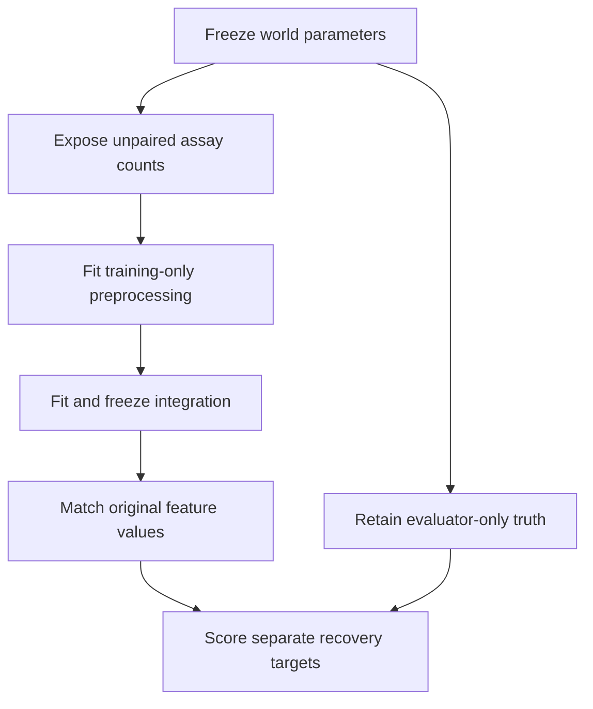

# Integration recoverability: extended benchmark design

_Extended protocol, 2026-09-23; implementation authorized from 2026-10-03_

---

## Status and purpose

This document preserves the expanded benchmark proposed before the decision to
start with a simpler experiment. It is a design record, not a performance report
or a verbatim conversation transcript. The current goal authorizes implementing
and running both designs. See the
[execution record](../../pipelines/simulation/integration_recoverability/IMPLEMENTATION_STATUS.md)
for stage completion, validation evidence, and pending runs.

The active starting point is the
[simple first-pass plan](../../pipelines/simulation/integration_recoverability/README.md).
That plan uses one saturating chain, realistic counts, both integration
methods, and a transductive matching evaluation. Its initial documentation-only
restriction has been superseded by the implementation goal. The scMRDR comparator
is now the paper-consistent adapter, not the earlier local approximation.

The earlier [discussion draft](../../pipelines/simulation/integration_recoverability/design.md)
is preserved separately. It includes the initial two-assay proposal and local
Tetrad inventory. This document records the later three-assay expanded proposal,
with links to the current layout.

The original question remains: can integration preserve, and a permitted
unpaired readout recover, structure among measured biological features before
we add pseudobulk aggregation? Keep four outcomes separate:

1. Alignment of biological states across assays.
2. Retention of information about named biological variables.
3. Recovery by a specified unpaired inference procedure.
4. Unsupported or falsely certain structure introduced by the procedure.

Use only RNA and histone modalities already in the project. Hidden paired
synthetic measurements, states, and activities are evaluator references, never
extra inputs to the deployable method. Do not add perturbations, donors,
time points, paired real cells, or other information not available to the
agreed empirical workflow.

## Biological mechanisms and measurement truth

### Three distinct graphical targets

Preserve separate truth objects:

| Truth object | What it describes |
| --- | --- |
| Biological activity DAG | The simulated structural mechanisms |
| Observed-activity projection | Relationships after hiding state or other causes |
| Count measurement graph | Activities, exposures, and their noisy observed descendants |

Where appropriate, compare discoveries with the corresponding CPDAG or PAG,
not automatically with the complete biological DAG. A shared-state-only pair
can be legitimately adjacent in a latent projection even when there is no
direct regulatory edge. A count-level relationship caused by technical depth
is not a new biological mechanism.

The [latent-space aggregation note](theory/06_latent_space_aggregation.md)
and [limitations record](LIMITATIONS.md) provide the interpretation background.

### Assays, focal motifs, and background

The initial expanded benchmark uses RNA, H3K27ac, and H3K4me3 so that both
mark-to-RNA and mark-to-mark relationships are evaluated.

Use nine scored candidates: one core variable, one state-associated decoy,
and one independent biological sentinel per assay. Shuffle feature identities
and keep the role labels hidden from inference.

Include two three-node core motifs:

- A chain connecting both histone marks and RNA. Balance the two histone orders
  across draws rather than assuming one universal ordering.
- A collider with the two histone variables as parents of RNA.

Use shared-state-only worlds as controls for unsupported direct-regulation
claims. They are not automatically adjacency-null controls.

Draw a two-dimensional hidden state, with an asymmetric two-component Gaussian
mixture for one program and an independent Gaussian second program. Freeze
distribution parameters and normalization across all cohorts in a world.

The proposed broad background was approximately 2,000 RNA features and 15,000
bins per mark: 60% shared-state reporters, 20% assay-private reporters, and 20%
biological nulls. Include both linear and smooth nonlinear state responses.
Background reporters must never encode a focal innovation or hidden partner ID.

These feature counts are deferred design choices, not a claim of reproducing
the full real input. The empirical workflow uses a 30,000-bin LSI panel before
its 15,000-bin reconstruction cap. Any implementation must state which panel
it reproduces and calibrate to that same feature universe. The
[existing audit](../../pipelines/empirical/data/results/biological_investigation_2026-09-11.md)
documents how little chromatin signal remains after these caps.

### Three mechanism families

For each biological node, use a structural equation with fixed mechanisms and
independent nonzero innovations:

$$
V_{ij}=f_j\left(V_{i,\operatorname{pa}(j)},S_i;\vartheta_j\right)
       +\sigma_j\epsilon_{ij}.
$$

| Family | Proposed mechanism | Purpose |
| --- | --- | --- |
| Linear | Weighted parents plus additive noise | Transparent control |
| Constrained nonlinear | One hidden layer of 32 bounded monotone/sigmoid units; declared cooperative terms | Interpretable nonlinearity |
| Unrestricted nonlinear | One hidden layer of 32 tanh units with additive noise | Generic nonlinear comparison |

Validate the constrained implementation against an explicit saturating toy
function. Permit a positive cooperative interaction in the multi-parent motif,
rather than making every mechanism an arbitrary interaction.

Freeze every mechanism's weights within a world. Independently generating an
assay must not resample its mechanism. Calibrate effect sizes using an
independent simulation-calibration draw, with a proposed residual explained
variance of 0.5 after accounting for state. Reject only predefined numerical
degeneracies before freezing a world, not poor integration or graph recovery.

Network width, noise, effect size, and motif direction are experimental choices.
Published examples motivating nonlinear chromatin regulation do not establish
this universal histone DAG or a particular endogenous single-cell count curve.
Maintain an evidence record separating the biological motivation from the
assumptions imposed for identifiability tests.

### Count observation

Simulate activities before counts. Use negative-binomial RNA measurements and
mark-specific negative-binomial measurements with the Poisson limit available.
For an activity-dependent positive mean, a proposed link is

$$
\mu_{ij}^{(m)}
=L_i^{(m)}\operatorname{softplus}
  \left(\alpha_j^{(m)}+\kappa_j^{(m)}V_{ij}^{(m)}\right),
\qquad
C_{ij}^{(m)}\mid V,L\sim\operatorname{NB}(\mu_{ij}^{(m)},\theta_j^{(m)}).
$$

Here $\operatorname{Var}(C\mid V,L)=\mu+\mu^2/\theta$, with the Poisson
limit as $\theta$ increases. Freeze calibration parameters before drawing any
training or assessment cohort.

Conditional on complete biological activities and technical exposures, count
noise is independent across cells, features, and assays. These conditional
distributions do not assert marginal independence of biological variables.

Match detection, positive-count magnitudes, depth variation, and mean–variance
summaries using existing data only. Separate assay exposures; initially draw
them independently of biology and of each other. True exposure remains
evaluator-only, distinct from an observed library-total proxy. Matching
marginal summaries does not identify a unique biological/technical variance
decomposition.

Preserve two observation regimes for the same biological cohorts:

- An existing-data-calibrated sparse regime.
- A deliberately informative diagnostic regime, proposed as RNA exposure
  multiplied by 5 and mark exposure multiplied by 20.

Do not recalibrate intercepts separately for those regimes, which would erase
the intended depth change. These boosts are diagnostic choices, not realistic
measurements. They are not part of the active first-pass plan.

Keep genuine zero rows and record filtering. Do not force a background count
of one, use row-wise softmax coupling across feature means, or introduce zero
inflation without a separate measurement-model justification.

## Fixed bank, splits, and ambiguity controls

### Thirty specifications, generated once

The proposed fixed bank contains:

| Component | Number |
| --- | ---: |
| Three families × two motifs × four independent draws | 24 |
| Shared-state-only controls | 4 |
| One two-member ambiguity pair | 2 |
| Total specifications | 30 |

Development contains one draw from each family–motif combination, one
shared-state-only control, and both ambiguity specifications: nine in total.
Assessment contains the remaining 18 causal worlds and three shared-state
controls: 21 in total.

Randomize motif locations, coefficients, and null-feature identities across
worlds. Freeze feature annotations, guidance, mechanisms, measurement parameters,
and seeds within each world. Generate the bank once and cache it; do not replace
worlds after a failed algorithm iteration.

The ambiguity pair does not contribute two independent biological trials.
Neither count regimes nor integration seeds are independent worlds.

### Cached cohorts per world

| Cohort | Proposed size | Access |
| --- | ---: | --- |
| Training pool | 4,000 cells per assay; initially use 2,000 | Unpaired learner |
| Validation cohort | 500 cells per assay | Unpaired validation |
| Discovery pool | 2,000 cells per assay; initially use 1,000 | Unpaired readout |
| Probe-calibration cohort | 1,000 complete synthetic cells | Evaluator only |
| Paired assessment cohort | 2,000 complete synthetic cells | Evaluator only |

Draw these cohorts independently from the same frozen mechanisms. The larger
training/discovery samples are nested cached subsets, not new datasets produced
after seeing results. Sample sizes are proposed diagnostic budgets, not
demonstrated power minima.

Split before feature selection and preprocessing. Neither the paired cohort nor
probe-calibration labels may influence model selection, integration, or the
deployable unpaired readout.

### An exact ambiguity pair

Use an analytic control in which the state-conditioned assay distributions
remain unchanged while their hidden residual coupling differs. For example,

$$
A=aS+U,\qquad
R=bS+\rho U+\sqrt{1-\rho^2}V,
$$

with independent standard-normal $U,V$, independent of $S$. A third assay can
remain an independent noisy reporter of $S$. Varying $\rho$ changes the
residual relationship without changing either marginal distribution conditional
on $S$. Applying the same assay-specific observation models preserves the
corresponding unpaired count distributions.

At nonzero $\rho$, the RNA equation can be rewritten as

$$
R=\rho A+(b-\rho a)S+\sqrt{1-\rho^2}V.
$$

This gives an explicit contrast with the zero-residual-dependence specification.
It tests false certainty, not the expectation that an unpaired method should
distinguish observationally indistinguishable inputs.

Make the learner-visible arrays, feature IDs, annotations, guidance, metadata,
and split membership identical across the pair. Reuse the same fitted models
and seeds. Only evaluator-side joint truth differs; separate paired assessment
draws can represent those distinct truths.

If a state-only control is constructed by resampling biological innovations,
independently resample each assay's entire ancestral innovation chain given
state. Resampling only the final noise term, or only counts, leaves inherited
residual dependence in place.

## Integration inputs, frozen transformations, and readout

### Separate inference from evaluation



Learner-visible inputs are counts, assay identity, opaque cell/feature IDs,
allowed annotations, and observable depth/QC summaries. Strip true states,
activities, technical exposures, roles, partner IDs, and planted edges from
every training-facing object.

Synthetic proximity guidance must not read the planted causal edge table.
Preserve nearby noncausal candidates and record supplied versus withheld causal
links. Guidance is an integration prior, not directed causal truth.

### Native methods and configurations

Implementation update: the local scMRDR-style configuration below is a
historical comparison, not the current benchmark configuration. The current
[paper-consistent adapter and fidelity audit](../../pipelines/empirical/integration/methods/scmrdr/paper_faithful/README.md)
use the authors' unified gene-aligned architecture with explicit paper/source
choices. scGLUE retains its native pipeline. All actual run manifests record
their configurations; no result from the earlier approximation is relabeled.

Reuse the current
[scGLUE trainer](../../pipelines/empirical/integration/methods/scglue/train_joint_scglue.py)
and
[local scMRDR-style trainer](../../pipelines/empirical/integration/methods/scmrdr/train_joint_jianle.py)
through isolated adapters. The archived local inspection identified the
following defaults:

| Setting | scGLUE | Local scMRDR-style |
| --- | --- | --- |
| Encoder input | RNA PCA; chromatin LSI, 50 dimensions | Total-normalized counts, then log1p |
| Reconstruction | NB per assay | Native-feature ZINB |
| Latent dimensions | 30 shared | 20 shared and 20 private |
| Hidden layers | Two, width 256 | Two, width 128 |
| Dropout | 0.2 | 0.1 |
| Batch size | 128 | 128 |
| Epoch limit | 120 | 200 |
| Other defaults | Data 1, KL 1, graph 0.02, alignment 0.05; validation 0.1 | KL multiplier 2, alignment 1, preservation 1 |

Pin the configuration and library versions at implementation time; the table is
a record of inspected local defaults, not a promise about later versions.
Report unequal capacities rather than silently retuning them to improve a
leaderboard. An equal-latent-dimension sensitivity can be deferred.

scGLUE's documented workflow combines count reconstruction, encoder
representations, and guidance.[^1] The local native-feature scMRDR-style model
is not an author-package reproduction. Preserve the distinctions in the
[local comparison](../../pipelines/empirical/integration/results/jianle_scMRDR_method_and_repo_comparison.md)
and the authors' implementation.[^2]

### Frozen preprocessing and held-out encoding

Persist the training-selected feature identities and order, normalization
policy, scaling statistics, clipping, PCA projection, IDF, and LSI factors.
Transform evaluation cells using these frozen objects; do not independently
fit an assessment embedding or concatenate assessment cells into preprocessing.

The inspected native scGLUE LSI path uses the SVD's $U$ followed by per-row
standardization. An equivalent held-out extension requires the fitted
right-singular vectors and singular values:

$$
U_{\mathrm{new}}=X_{\mathrm{new,transformed}}V D^{-1}.
$$

Projecting only to $X_{\mathrm{new,transformed}}V$ is not the same representation.
Pin native versus fallback LSI and its random seed; the inspected sklearn
fallback uses different TF–IDF/SVD conventions.

Save model checkpoints and complete feature/transform manifests. scGLUE supports
model reloading and encoding new cells.[^1] The local model's encoder returns
shared and private posterior parameters, whereas its existing embedding export
keeps only shared means. Validate feature order explicitly for both methods.

Never change likelihoods as an implicit fallback. In the inspected local model,
native-feature auto mode selects ZINB; its Gaussian/shared-gene path requires
different inputs and training-derived statistics.

Record all zero-cell exclusions and align oracle comparisons to the retained
population. No hidden labels may select a favorable evaluation subset.

### Input ablations

The primary arm is focal-inclusive: focal candidates are eligible for native
selection and reconstruction, not force-selected.

The proposed development ablations are:

- Background-only integration, removing focal candidates before normalization
  denominators, selection, PCA/LSI, reconstruction, guidance, and gene scoring.
- Focal-guidance masking, explicitly distinct from complete background-only
  integration.
- Shuffled guidance, with a declared shuffle rule and preserved relevant graph
  properties.
- A guidance-only baseline, to expose performance available from priors alone.

Do not call a guidance-edge holdout a background-only experiment.

### Evaluator-only retention diagnostics

Encode independent evaluation assay views with frozen models. Train a ridge
probe and a shallow boosted-tree probe on the separate private calibration
cohort, then evaluate on private assessment cells.

Measure state, same-assay activity, cross-assay activity, and prediction beyond
true state. Separate shared-embedding from shared-plus-private diagnostics for
the local scMRDR-style model.

Residual activity means $V-\mathbb{E}[V\mid S]$. In a nonlinear SCM, computing
the structural equations with all innovations set to zero does not generally
give $\mathbb{E}[V\mid S]$.

These probes receive hidden supervision solely for diagnosis. They are not
permitted unpaired causal-discovery methods. A failed probe is not proof that
all recoverable information has vanished; a successful probe is not proof of
causal identifiability.

Decoder-based reconstruction of true-paired evaluation views is a possible
later diagnostic, not required for the first original-value matching readout.
Cross-assay decoding in a shared/private model needs an explicit target-private
latent policy; using the true partner's private code is evaluator-only.

### Fixed unpaired matching

Use RNA-anchored, minimum-total-cost, one-to-one Euclidean assignments to each
histone assay separately. Return the actual original named-feature values from
those cells, with no averaging or replacement by embedding coordinates.

Compare random assignments and oracle-state assignments with the same cohort
sizes and no-reuse constraints. Alternative anchors are a predeclared secondary
diagnostic, not a way to choose the best result retrospectively.

An RNA anchor can induce mark-to-mark dependence. One-to-one competition also
couples rows. The resulting matrix is an imposed coupling, not an observed
paired joint distribution; nominal IID tests do not acquire validity merely
because the output is rectangular.

## Discovery, scoring, and uncertainty

### Discovery controls

Use PC with a nonlinear CI test for causally sufficient activity controls and
FCI for hidden-state/count-proxy settings. The proposed primary test is RCIT,
with $\alpha=0.01$, a fixed test seed, and no depth restriction for the
nine-variable candidate panel. Use KCI on a preselected development subset as
a secondary check; reserve Fisher-Z for a labeled linear control.[^3]

Record the actual backend/class behind RCIT or RCoT aliases. Do not inherit
the old pilot's expression-sink directions or switch tests on numerical
failure. Failed tests, missing features, and unsupported comparisons must
remain failed or not applicable, not be encoded as empty graphs.

Use a fixed log1p transform of original counts for the count readout, retaining
the raw arrays. Count-proxy graphs and activity graphs require different
references. The paired-count pipeline is a measurement diagnostic, not a
universal performance ceiling.

### Stage-by-stage results

Preserve separate results for:

1. Complete activities with and without state supplied to the oracle.
2. True-paired counts.
3. Preprocessing representations.
4. Shared and, where available, private integration representations.
5. Oracle-state matching of original features.
6. Learned matching of original features.

Split all cross-assay metrics into H3K27ac–RNA, H3K4me3–RNA, and
H3K27ac–H3K4me3. Report within-assay results separately.

### Graph and information metrics

Report biological direct-edge precision/recall separately from latent-projection
adjacency and endpoint recovery. Include state prediction, feature prediction,
state-residual prediction, state-matching distance, feature/cell retention,
and numerical failures.

False-positive reporting must distinguish:

- Independent biological sentinels.
- Technical count associations through shared library depth.
- Shared-state associations that do not license direct regulation.
- Direct or oriented edges unsupported by the permitted observations.

Exact pair and direction recovery is an identifiability stress test, not an
expected universal success criterion.

The previously requested additional metrics remain part of the extended
benchmark, subject to their output contracts:

| Metric | Required interpretation |
| --- | --- |
| Shared-state hyperedge precision and recall | Score actual returned hyperedges against a declared truth definition |
| Assay participation and sentinel false-positive rate | Score membership independently of unsupported direct regulation |
| Equivalence-class coverage and ambiguity-set size | State the candidate model family and compatibility criterion |
| Exact cross-assay pair and direction recovery | Label as an identifiability stress test |

Do not manufacture a hyperedge from a clique or embedding cluster. If a method
does not return hyperedges or a justified ambiguity set, report those metrics
as not applicable.

For a causally sufficient three-node activity oracle, one can enumerate the
25 labeled DAGs and evaluate the appropriate observational equivalence class.
That enumeration does not cover hidden-confounding or noisy-measurement models.
For those targets, coverage and set size remain not applicable until an
explicit bounded candidate family and compatibility rule are implemented.
Coverage of the two-member ambiguity control is only coverage of that declared
pair, not of all models compatible with the unpaired distributions.

### Empirical calibration and replication

Use full-pipeline null controls and repeat integration/readout randomness, not
an IID row bootstrap of one selected matching. Nominal $\alpha=0.01$ is a
test setting, not a demonstrated false-adjacency rate or formal FDR guarantee.

Compare methods within the same world and count regime. Use worlds as the
units of mechanism-generalization analysis, with paired method differences
and world-level uncertainty summaries where justified. Show individual
outcomes rather than pooling edges, cells, seeds, or count regimes as
independent biological replicates.

The assessment set has only three independent draws per family–motif
combination. It supports a compact diagnosis, not a strong guarantee of
reliability. For context, zero failures in 20 independent trials still gives
a one-sided 95% binomial upper failure bound of approximately 14%:

$$
1-0.05^{1/20}\approx0.139.
$$

Approximately 59 independent zero-failure trials would be needed to move that
bound below 5%, under the binomial assumptions. Repeated fits of one world
do not supply those trials.

## Implementation architecture and execution gates

### Future home and interfaces

The deferred implementation belongs under
`pipelines/simulation/integration_recoverability/`, not inside the older
CA-BOSS benchmark. The former proposal to use an Evaluation subdirectory is
superseded by the new repository organization.

The intended stage interfaces are:

| Stage | Output contract |
| --- | --- |
| Freeze world and sample cohorts | Immutable observed inputs plus separate evaluator truth |
| Fit/transform preprocessing | Feature order, fitted transformations, and provenance |
| Fit/encode integration | Checkpoint, frozen configuration, and embeddings |
| Match original variables | Assignment records and original-feature matrices |
| Run discovery | Canonical endpoints, test settings, and explicit failure status |
| Score | Target-specific metrics, uncertainty summaries, and audit record |

Potential modules cover world generation, bank generation, preprocessing,
integration adapters, readout, discovery, scoring, and a cached stage runner.
These are responsibilities, not files created by the documentation task.

Keep observed artifacts and truth in distinct locations. Record hashes,
versions, seeds, input masks, parameter manifests, and evaluation access.
Refuse silent overwrites of a frozen bank.

### Reuse components without inheriting old assumptions

The earlier
[multimodal pilot](../../pipelines/simulation/unpaired_multimodal/scripts/multimodal_simulation_pilot.py)
contains count sampling and integration orchestration, but should not be reused
unchanged. Its reviewed implementation used linear focal biology, a row-wise
RNA softmax, forced background detections, truth-bearing metadata, incomplete
feature holdout, and Fisher-Z with an expression-sink prior.

The
[count simulator](../../pipelines/simulation/aggregation_identifiability/scripts/crossmark_count_simulator.py)
provides calibration components, but its hard-coded real-data summaries describe
a particular panel and its observation routine recalibrates on the supplied
cohort. Freeze calibration once per world instead of carrying that behavior
into independent evaluation.

The
[v4 simulator](../../pipelines/simulation/unpaired_multimodal/scripts/multimodal_simulation_v4.py)
offers useful independent random-stream, manifest, and refuse-overwrite
patterns. Its motif-specific scorer does not define truth for this experiment.
Reuse canonical graph endpoint parsing and generic assignment kernels without
hard-coded assay roles or mandatory true-label inputs.

Keep training in separate subprocesses/environments to avoid collisions among
existing modules named `_common`. Pin Python packages and any Tetrad JAR by
hash rather than treating a local checkout and installed wrapper as identical.

The earlier local inventory recorded py-tetrad 0.1.2 and a bundled
7.6.11-SNAPSHOT JAR, distinct from the separate checkout:

```text
Installed JAR SHA-256:
e2073ae80f6bb2fe33e531153575427e3570f2695dd71cbe558d4c086d8adc9e

Separate checkout JAR SHA-256:
ed4b4e3da97c3bd0b1d1685d992b2116c65f10dd5800f273a16a24d90bff3d36
```

These are historical inspection values, not checks rerun by saving this file.
The reviewed Generalized SEM and neural simulation interfaces provide
structural mechanisms, not a complete histone CUT&Tag observation model.[^4]
Any neural simulator must be audited to ensure weights are frozen across
cohorts rather than resampled for each data-generation call.

### Proposed execution sequence

| Phase | Work | Gate |
| --- | --- | --- |
| A | Unit-test mechanisms, truth objects, observations, and information boundaries | Valid simulator and no truth leakage |
| B | Calibrate and freeze the bank once | Count realism and immutable manifests |
| C | Smoke-test linear and constrained chains in the informative regime | Both native model adapters execute |
| D | Develop on the declared development split | Fixed settings and visible failures |
| E | Freeze code, configurations, scorers, and inference inputs | No assessment-driven selection |
| F | Run the 21-specification assessment block once | Report every outcome |

For phase D, preselect a four-world sentinel panel: a linear chain, a constrained
chain, an unrestricted chain, and a shared-state-only world. Use it for the
background/guidance ablations and two additional integration seeds. Begin the
main development and assessment runs with one integration seed.

Cache counts, transformations, models, embeddings, matching, CI results, and
scores using content/configuration/version/seed provenance. Once assessment
results have influenced an algorithm change, further reuse is exploratory,
not a fresh locked test. Do not generate replacement worlds automatically.

The inspected workstation has an approximately 8 GB GPU and 11 GiB system RAM.
Treat these as planning observations to recheck before execution. Run one GPU
training job at a time, retain sparse count storage, and avoid materializing
all worlds in memory. Measure a smoke run before promising throughput. An
out-of-memory failure must not silently change model capacity or inputs.

### Acceptance and failure classification

Software acceptance requires valid integer counts, stable feature identities,
disjoint cohorts, reproducible frozen transformations, protected truth,
deterministic ambiguity-pair outputs, visible failures, and preservation of
the earlier CA-BOSS work.

Scientific checks are stage-specific. Verify that the activity-level oracle
and its CI procedure detect the stipulated informative relationships before
interpreting downstream drops. Investigate count-model calibration separately.
Do not select worlds or thresholds for favorable recovery.

Classify outcomes as supported under the stated target, shared-state information
retained with direct structure unresolved, measurement/learner limited,
integration/readout degradation, numerical failure, or observational ambiguity.
A failed pipeline is not a proof of information-theoretic impossibility; a
successful pipeline is not proof of unique causal identification.

Independent reviews of simulation design, implementation feasibility, and
identifiability motivated these safeguards. They did not validate the proposed
benchmark empirically.

## Deferred extensions and references

After the small experiment is understood, this design provides a place to
reconsider additional motifs, lower detection, different numbers of cells,
population shifts, shuffled guidance, integration seeds, and broader
equivalence-class diagnostics.

Any expansion still uses only agreed data and modalities. The existing histone
set is H3K27ac, H3K27me3, H3K4me1, H3K4me2, H3K4me3, and H3K9me3; specify
whether a future assay count includes RNA rather than calling six marks
six total modalities.

Aggregation comparisons remain a separate next question. Do not interpret
this design as a completed solution to missing residual coupling or as a
restart of an unconstrained tuning campaign.

[^1]: scGLUE documentation. Stage 2: Model training. https://scglue.readthedocs.io/en/latest/training.html

[^2]: scMRDR authors' implementation. https://github.com/sjl-sjtu/scMRDR

[^3]: Tetrad manual. Tests and scores by type. https://tetrad-manual.readthedocs.io/en/latest/tests-and-scores-catalog.html . Backend names and assumptions must be verified for the selected local discovery interface.

[^4]: CMU Philosophy. py-tetrad source and interface. https://github.com/cmu-phil/py-tetrad . Generalized parametric models: https://tetrad-manual.readthedocs.io/en/latest/tetrad-interface/detail-callouts/detail-generalized-parametric-model.html . Additive-noise simulator source: https://github.com/cmu-phil/tetrad/blob/development/tetrad-lib/src/main/java/edu/cmu/tetrad/algcomparison/simulation/AdditiveNoiseSimulation.java
