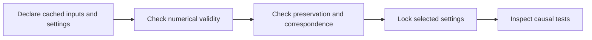

# Integration validation evidence and proposed endpoints

_Focused narrative evidence review, 2026-10-25. Supplemental to the main OpenAlex discovery; no training, simulations, new datasets, or frozen configuration changes._

The defensible next step is a separate integration-validation supplement for both methods. Evaluate biological preservation and cross-modality correspondence before examining causal-test outcomes. Treat trained-objective diagnostics as supporting evidence. An integration result cannot establish the missing same-cell joint distribution merely by mixing assay labels.

## Evidence that changes the validation plan

| Primary source | Relevant evidence | Application here |
| --- | --- | --- |
| Cao and Gao, GLUE (2022), DOI `10.1038/s41587-022-01284-4` | Extended Data Fig. 3 varies eight parameters one at a time; failures occur with insufficient alignment weight or no hidden layers. The consistency diagnostic compares integrated metacell feature correlations with guidance edges. | Investigate capacity, representation, graph strength and optimization as well as alignment weight. Keep consistency as guidance agreement. |
| Sun et al., scMRDR, NeurIPS 2025, DOI `10.52202/085713-5170`; arXiv v2 dated 2026-01-17 | Shared/private latent model, adversarial alignment, learned full-to-shared geometry, masked likelihood; primary empirical metrics are biological-label conservation, modality integration and batch correction. | Inspect shared/private information retention separately. Paper success is evidence about integration tasks, not recovered residual pairing or causal structure. |
| Luecken et al., scIB (2022), DOI `10.1038/s41592-021-01336-8` | Separates batch removal, label conservation and label-free biological conservation; computes batch ASW and kBET within cell identities to accommodate composition. | Report preservation and conditional mixing separately; use independent labels only where available. |
| Naqing et al. (2026), DOI `10.1186/s13059-026-04071-5` | Includes paired RNA–H3K27ac and RNA–H3K4me3 benchmarks. Examines cross-modal neighbor concentration. Its contrastive similarity and label-neighborhood consistency require true barcode pairing. | Evaluate each histone assay separately and add neighbor hubness. Do not use its pairing metrics on these disjoint cohorts. |
| Yi et al. (2025), DOI `10.1186/s13059-025-03869-z` | Shows that broad cell-label conservation can improve while within-label biological variation deteriorates. | Include continuous state, fine annotations or within-assay neighbor retention rather than relying on coarse cell-type scores. |
| Sturma et al., NeurIPS 2023, DOI `10.52202/075280-1496` | Establishes unpaired joint-distribution identification under particular linear mixing, error-distribution and structural assumptions. | A generic nonlinear aligned embedding does not inherit those identification guarantees. |

Sources are linked in the reference list below.[^glue][^mrdr][^scib][^histone][^intra][^theory]

## Hyperparameters with a research basis

The following are published settings or grids, not a recommendation to run their Cartesian product.

| Method | Published values |
| --- | --- |
| GLUE latent dimension | 10, 30, **50**, 100, 200 |
| GLUE preprocessing dimension | 30, 50, **100**, 200, 400 |
| GLUE hidden depth / width | depth 0, 1, **2**, 3, 4; width 64, 128, **256**, 512, 1024 |
| GLUE dropout | 0, 0.1, **0.2**, 0.3, 0.5 |
| GLUE graph / alignment weights | graph 0.001, 0.005, **0.02**, 0.1, 0.5; alignment 0.002, 0.01, **0.05**, 0.2, 1 |
| GLUE negative edge samples | 2, 5, **10**, 20, 50 |
| scMRDR two-assay / three-assay reference | beta/gamma/lambda = 2/5/5 versus 5/10/10 |
| scMRDR paper optimization | 20 shared + 20 private dimensions; batch 128; up to 200 epochs; Adam starting at 0.001 with cosine scheduling; 10% optimization validation |
| scMRDR published ablations | beta=1; gamma=0; lambda=0; baseline 1/0/0; nearby nonzero beta/gamma/lambda settings in Table 1 |

GLUE grid values and bold defaults come from its pinned released evaluation configuration.[^glue-grid] scMRDR values come from Appendix A.1, Table 2 and Table 1.[^mrdr] These specify transferable questions, not guaranteed optimal settings for sparse histone assays.

Start with a small, declared, one-factor screening around the frozen native baseline, then examine only the relevant interactions. For GLUE, prioritize latent/preprocessing dimension, graph weight and network capacity after alignment strength. For scMRDR, prioritize beta, gamma, shared/private dimensions and network capacity alongside lambda. Treat learning rate, training cap, early stopping, batch size and seed variability as convergence checks. These priorities are recommendations from the objective structure, not a published optimal search strategy.

The current upstream scMRDR README reports that its original default adversarial weight of 0.01 was erroneous. At upstream commit `e79f69a7057a2073d102b466281174d8409e3d17`, the package default is 5.[^mrdr-current] This is a provenance issue: the local [paper-consistent adapter](../../../../pipelines/empirical/integration/methods/scmrdr/paper_faithful/README.md) already explicitly uses 5/10/10 for three assays, with pinned source `7280e64ae19f7391c6f5adf00d9d353f79e96603`. It is not evidence that frozen runs used 0.01.

The native scMRDR geometry reduction divides the within-assay pair sum by minibatch size, rather than the number of pairs; batch composition therefore changes its scale. Changing gamma and batch size together would confound interpretation. Numeric weights also cannot be compared directly to the old local approximation, which used different loss reductions.

## What each check can establish

| Check | Testable endpoint | Interpretation boundary |
| --- | --- | --- |
| Technical and optimization validity | Finite embeddings/components; count and feature-mask contracts; stopping epoch; per-assay held-out likelihood and predictive count summaries | Generalization of reconstruction and numerical validity; no alignment truth |
| Input geometry preservation | Fixed-k within-assay neighbor overlap/Jaccard against frozen RNA PCA or mark LSI; compare shared and full spaces for scMRDR | Retains measured geometry, including possible technical variation; not independent biological truth |
| Independent biological preservation | Macro-F1/ASW for prespecified annotations never used to train or transfer labels; continuous-state probe performance in cached simulations | Measures retained biology at the annotation resolution; coarse labels cannot validate fine variation |
| Cross-modal correspondence | Cross-assay probe transfer or neighbor state error in cached worlds, separately for RNA–H3K27ac, RNA–H3K4me3 and mark–mark | Evaluator state is valid only as hidden scoring information; successful state recovery does not recover individual innovations |
| Mixing conditional on biology | Assay ASW/kBET or assay-prediction accuracy within prespecified supported state/type strata; use correct conditional assay proportions | A nuisance-removal diagnostic; unrestricted global mixing may erase differing state composition |
| Neighbor hubness | Cross-assay nearest-neighbor indegree Gini, top-share and candidate coverage, both directions and each assay pair | Detects concentration/collapse; low hubness is not correctness |
| GLUE consistency | Entire metacell curve at 10/20/50/100/200, by assay pair, with edge counts and null controls | Same-graph consistency is self-consistency; official 0.05 reference is empirical, not a calibrated universal histone threshold |
| Run stability | Neighbor and biological-score changes across seeds; convergence failures and caps retained | Measures optimization stability; repeated seeds are not independent biological worlds |

Run hubness on cross-modal neighbor searches before the fixed one-to-one assignment. Assignment makes incoming degree one by construction and hides this failure mode. The motivation is directly supported by the histone benchmark.[^histone]

GLUE consistency uses signed weighted metacell correlations on supplied guidance edges, with count-layer preprocessing determined by model configuration.[^glue-dx] Evaluating withheld graph edges helps reduce direct reuse, but edges sharing genes, loci and training counts remain dependent. Stronger evaluation reserves whole gene/locus blocks and, if claiming feature-held-out validation, removes their contribution from encoder preprocessing, likelihood and guidance before fitting. Do not label an edge-only split fully independent.

scMRDR preservation is also internal. Mathematically, squared full distance equals squared shared distance plus squared private distance. Thus equal full/shared distances can follow from constant private posterior means without proving biological fidelity to the input. This is an implication of its objective; it is not evidence that a particular run collapsed.

## Information boundary and execution sequence

Use the existing cached development worlds and allowed annotations. Preserve frozen simulation source, assessment protocols and baseline outputs; write any new sensitivity runs into a separate supplement. A validation set used for early stopping is an optimization holdout. A score used for selecting hyperparameters is development evidence. Neither is a final untouched assessment.

The current [recoverability protocol](../../../../pipelines/simulation/integration_recoverability/README.md) explicitly gives different visible cells to the three assays. No true partner exists among the other visible cohorts, so FOSCTTM, barcode pairing accuracy and the histone benchmark's paired contrastive metric are inapplicable. Use the cached evaluator state and hidden scored measurements under their declared boundaries. Never expose them as training features, graph edges or covariates.

For empirical data, transferred RNA labels cannot validate the embedding that produced them. Existing annotations are useful only with their lineage stated and with an independent basis. If no independent per-cell or held-out feature reference exists, report cross-assay biological validity as unestablished. Do not turn mixing, same-graph agreement or within-assay retention into a claim of correct same-cell covariance.

Prespecify pass criteria relative to random/no-alignment controls and the fixed native baseline; report raw endpoints and failures. The literature does not supply universal cutoffs for this particular histone/RNA task. Use causal tests only after this review, and retain the possibility that good integration still fails to identify the missing joint distribution.[^theory]

## Source and retrieval record

Primary DOI/title metadata was verified against official proceedings, publisher papers, PMC/PubMed records or official repositories. The saved tool responses in [sources/](sources/) include successful retrievals and access failures. Public web and GitHub tools were used; no credentials were requested or printed.

Follow-up provenance checks used the supplied literature-review citation verifier: all six unique DOI handles resolved and all six Crossref title/year records matched this memo. The [verification record](citation_verification.json) preserves metadata and exact endpoints. A one-page unauthenticated OpenAlex query for `single-cell multi-omics integration`, sorted by relevance with `per_page=100`, succeeded on 2026-10-25 and returned 100 records. The [OpenAlex record](openalex_unauthenticated_network_attempt.json) retains the exact query, selected fields, timestamp and results. This follow-up search does not imply exhaustive coverage; initial sandbox DNS failures are retained separately.

The cached `IntegrationJianLe.pdf` was read using installed `pdftotext` because LiteParse was unavailable. Its SHA-256 is `fdf2ffa1506959f045e1cbfd64dfe493d1055075f09241ba0c276119cef0cd1c`. The versioned arXiv v2 HTML independently confirmed the relevant paper settings. No new experimental data were acquired.

[^glue]: Cao, Z.-J. and Gao, G. (2022). *Multi-omics single-cell data integration and regulatory inference with graph-linked embedding*. Nature Biotechnology 40, 1458–1466. https://www.nature.com/articles/s41587-022-01284-4.pdf
[^mrdr]: Sun, J. et al. *scMRDR: A Scalable and Flexible Framework for Unpaired Single-Cell Multi-Omics Data Integration*. NeurIPS 2025. Official title and DOI: https://proceedings.nips.cc/paper_files/paper/2025/hash/e34d214dfb5b80212ac1b565aa41af55-Abstract-Conference.html . Version examined: https://arxiv.org/html/2510.24987v2
[^scib]: Luecken, M. D. et al. (2022). *Benchmarking atlas-level data integration in single-cell genomics*. Nature Methods 19, 41–50. https://doi.org/10.1038/s41592-021-01336-8
[^histone]: Naqing, F., Yuan, Q. and Duren, Z. (2026). *Benchmarking component choices for unpaired single cell RNA and epigenomic integration*. Genome Biology 27, 176. https://pmc.ncbi.nlm.nih.gov/articles/PMC13192178/
[^intra]: Yi, C. et al. (2025). *Benchmarking deep learning methods for biologically conserved single-cell integration*. Genome Biology 26, 398. https://genomebiology.biomedcentral.com/counter/pdf/10.1186/s13059-025-03869-z
[^theory]: Sturma, N., Squires, C., Drton, M. and Uhler, C. (2023). *Unpaired Multi-Domain Causal Representation Learning*. NeurIPS 36. https://proceedings.neurips.cc/paper_files/paper/2023/file/6c8985579293e0209bdaa4f21bb1d237-Paper-Conference.pdf
[^glue-grid]: GLUE official evaluation configuration, commit `5a30146c6148a52210f547c9e9c330ecfbdf1090`: https://github.com/gao-lab/GLUE/blob/5a30146c6148a52210f547c9e9c330ecfbdf1090/evaluation/config/config.yaml
[^mrdr-current]: scMRDR official README, commit `e79f69a7057a2073d102b466281174d8409e3d17`: https://github.com/sjl-sjtu/scMRDR/blob/e79f69a7057a2073d102b466281174d8409e3d17/README.md ; setup signature: https://github.com/sjl-sjtu/scMRDR/blob/e79f69a7057a2073d102b466281174d8409e3d17/src/scMRDR/module.py
[^glue-dx]: Official scGLUE diagnostic implementation and tutorial (0.4.1): https://scglue.readthedocs.io/en/latest/_modules/scglue/models/dx.html and https://scglue.readthedocs.io/en/latest/training.html
