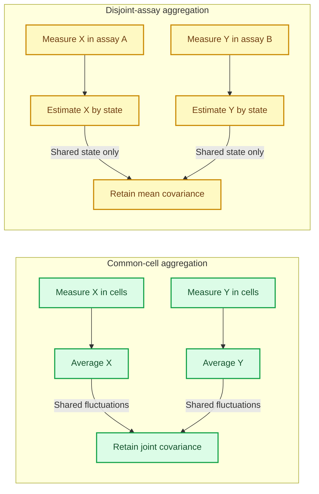
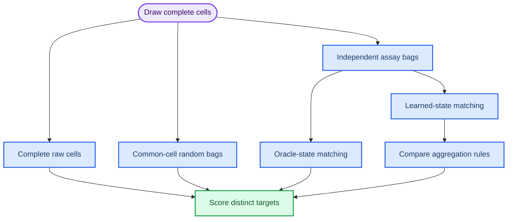

# Latent-space aggregation across unpaired assays

_Working identifiability note · updated 2026-09-16 · separates what integration aligns from what aggregation can identify_

---

## Main conclusion

The [2026-11-01 companion proof](07_unpaired_integration_nonidentifiability.md)
formalizes the information limit using faithful models with identical full
assay-block laws. It also distinguishes direct edges from PAG adjacencies and
strictly disjoint samples from shuffled paired cells.

A shared latent representation can help identify cells with similar biological
state across assays. It does not turn separately measured cells into paired
observations, recreate their missing same-cell covariance, or prove that the
conditional independences of the cell-level system survive aggregation.

For this project, the defensible object recovered by state-matched aggregation is
initially

$$
\operatorname{Cov}_{S}\!\left(
  \mathbb{E}[X_A\mid S],
  \mathbb{E}[X_B\mid S]
\right),
$$

the covariance of assay-specific conditional means across biological state $S$.
That is a **between-state association**. It equals the full cell-level
cross-assay covariance only under an additional assumption about the missing
within-state residual covariance.

This distinction is now the starting point for the
[aggregation-first restart](../aggregation_restart_plan.md). The operational
caveat is owned by [LIMITATIONS L18](../LIMITATIONS.md#l18-latent-space-aggregation-does-not-reconstruct-the-missing-joint-distribution).

## Same distribution is not the same observation

Suppose a complete cell-level vector obeys an acyclic linear SEM

$$
X_i = B X_i + \varepsilon_i.
$$

If every variable is averaged over the **same cells with the same fixed
weights**,

$$
\bar X_b = \sum_i w_{bi} X_i,
\qquad
\sum_i w_{bi}=1,
$$

then linearity gives

$$
\bar X_b
= \sum_i w_{bi}(B X_i+\varepsilon_i)
= B\bar X_b+\bar\varepsilon_b.
$$

For equal-size, non-overlapping random groups of $m$ independent cells,

$$
\operatorname{Cov}(\bar X_b)=\frac{1}{m}\Sigma.
$$

All covariance entries scale together. For a Gaussian SEM, population
correlations and partial correlations are therefore unchanged. This is the
correct positive control for aggregation, although the number of independent
rows still falls as group size increases.[^1]

The real multi-assay setting is different. Let assay $A$ measure $X$ in cell set
$I_A$ and assay $B$ measure $Y$ in an independently sampled set $I_B$. Even if
both sample exactly the same biological population,

$$
\bar X_A=\frac{1}{|I_A|}\sum_{i\in I_A}X_i,
\qquad
\bar Y_B=\frac{1}{|I_B|}\sum_{j\in I_B}Y_j
$$

do not share cell-specific fluctuations. Arbitrarily pairing independently
formed aggregates gives

$$
\operatorname{Cov}(\bar X_A,\bar Y_B)=0
$$

conditional on a fixed population distribution. Both aggregates converge to
their population means, but neither reveals whether unusually high $X$ and
unusually high $Y$ occurred in the same cell.

### Why observing the same population is not enough

Assume that every biological cell really does have both an $X$ value and a $Y$
value, even though the assays measure them in different cells. The underlying
joint biological distribution therefore exists. The problem is that the two
assays observe only separate views of it:

- assay $A$ reveals how $X$ is distributed;
- assay $B$ reveals how $Y$ is distributed;
- neither assay reveals which $X$ value occurred with which $Y$ value in the
  same cell.

The missing pairing is exactly where cross-assay covariance and much of the
cross-assay graph structure live. This is similar to receiving one shuffled
list of people's heights and a separate shuffled list of people's weights. The
two lists reveal the population distribution of height and the population
distribution of weight. They do not reveal whether taller people tended to be
heavier, lighter, or unrelated to weight because the person-level pairing has
been removed.

Three very different biological worlds can therefore look identical to the
separate assays:

| Biological world | Same-cell relationship | Assay $A$ sees | Assay $B$ sees |
| --- | --- | --- | --- |
| Positive coupling | High $X$ occurs with high $Y$ | Same $X$ distribution | Same $Y$ distribution |
| No coupling | $X$ and $Y$ vary independently | Same $X$ distribution | Same $Y$ distribution |
| Negative coupling | High $X$ occurs with low $Y$ | Same $X$ distribution | Same $Y$ distribution |

More cells make the two separate distributions more precise, but do not restore
the deleted pairing. Likewise, arbitrarily pairing cells or pseudobulks does not
recover the pairing; it adds a coupling chosen by the analyst.

Latent-state integration can recover an important part of the relationship. If
both $X$ and $Y$ change systematically across a state such as differentiation,
matching aggregates by that state can reveal their shared state-dependent
pattern. However, cells in the same state still have residual differences.
Because those residuals are measured in different cells, integration cannot
determine whether the residual part of $X$ and the residual part of $Y$ moved
together within a cell.

The practical consequence is that unpaired assays can support recovery of
**shared-state structure**. Recovery of a direct cross-assay relationship also
requires a model assumption that determines or removes the unobserved
within-state relationship. The data cannot test that assumption on their own.

<strong>Optional mathematical example</strong>

Let both variables have a standard normal distribution when examined
separately. The following three joint populations all satisfy

$$
X\sim N(0,1),
\qquad
Y\sim N(0,1),
$$

but have different same-cell relationships:

$$
\begin{aligned}
Y &= X &&\Longrightarrow &&\operatorname{Cov}(X,Y)=1,\\
Y &\perp X &&\Longrightarrow &&\operatorname{Cov}(X,Y)=0,\\
Y &= -X &&\Longrightarrow &&\operatorname{Cov}(X,Y)=-1.
\end{aligned}
$$

An assay that observes only $X$ and another that observes only $Y$ see the same
two marginal distributions in all three worlds. They therefore cannot choose
among the three covariance structures without an additional restriction on how
the two marginals are coupled.

---

## What state-matched aggregation recovers

Let $S$ denote biological state. The law of total covariance gives

$$
\operatorname{Cov}(X,Y)
=
\underbrace{\operatorname{Cov}\!\left(
  \mathbb{E}[X\mid S],
  \mathbb{E}[Y\mid S]
\right)}_{\text{between-state covariance}}
+
\underbrace{\mathbb{E}\!\left[
  \operatorname{Cov}(X,Y\mid S)
\right]}_{\text{within-state covariance}}.
$$

If integration correctly aligns $S$, independently sampled pseudobulks can
estimate the first term. They do not observe the second term. This gives three
different targets that must not be scored as if they were interchangeable:

| Target | Observable from disjoint state-matched cells? | Interpretation |
| --- | --- | --- |
| Between-state conditional-mean covariance | Yes, under correct alignment | Shared-state association |
| Within-state residual covariance | No, without extra restrictions | Missing same-cell dependence |
| Cell-level joint covariance | Only under an explicit completion model | Model-dependent reconstruction |

### When a linear coefficient can survive state aggregation

For one proposed equation

$$
Y=\beta^\top X+\varepsilon,
$$

suppose the aligned state satisfies

$$
\mathbb{E}[\varepsilon\mid S]=0.
$$

Then

$$
\mathbb{E}[Y\mid S]
=\beta^\top\mathbb{E}[X\mid S].
$$

The coefficient $\beta$ is estimable from state means if the parent-mean
covariance has full rank and the mechanism is invariant across states. This is
a positive result for a **specified equation and parent set**. It is not, by
itself, discovery of the parent set.

For example, these models can have the same state-mean relationship:

$$
\begin{aligned}
X &= S+u,
&Y &= \beta X+v,
\\
X &= S+u,
&Y &= \beta S+w.
\end{aligned}
$$

The first contains $X\to Y$; the second contains only a shared cause $S$. A
mean curve alone cannot distinguish them. Calling the relationship direct
requires an exclusion, residual-independence, or other identifying assumption.

> **Whole-graph boundary:** Imposing
> $\mathbb{E}[\varepsilon_j\mid S]=0$ on every centered equation of a complete
> acyclic SEM leaves no state-dependent mean variation. State must enter roots,
> explicit inputs, or higher-level innovations. The equation-level argument is
> not a blanket whole-DAG recovery theorem.

## Problems introduced by a learned latent space

Representing cells in a latent space is useful, but it adds a second inference
layer before aggregation. The downstream graph is therefore conditional on both
the latent representation and the aggregation rule.

### Alignment is weaker than joint-distribution recovery

An integration objective may align assay-specific embedding marginals or local
neighborhoods. That does not guarantee recovery of the original joint
distribution, cell-level covariance, or conditional independences. scGLUE, for
example, combines assay-specific reconstruction, guidance-graph coupling, and
adversarial alignment; its adversarial term aligns embedding distributions, not
causal graphs.[^2]

### Neighborhoods are estimated, not observed matches

Nearest neighbors, Leiden communities, optimal-transport matches, and
RNA-anchored averages are alternative couplings imposed after integration.
Different valid couplings can preserve the same assay marginals while producing
different cross-assay covariances. Embedding distance is therefore evidence of
state similarity, not evidence that two cells share residual biological noise.

### Integration error and aggregation error are entangled

When the learned state is imperfect, a downstream failure can come from:

- distorted within-assay geometry;
- incorrect cross-assay alignment;
- unmatched or assay-specific states forced together;
- aggregation that removes or mixes causal variation;
- finite-cell sampling noise inside each aggregate.

A benchmark that changes integration and aggregation simultaneously cannot
attribute an improvement to either one.

### Guidance can leak candidate structure

The current scGLUE guidance graph contains gene–chromatin proximity edges,
including focal genes and nearby chromatin bins later considered by causal
discovery. This makes the embedding scientifically informed, but it also means a
downstream peak–gene recovery is not independent of the prior. Held-out-target,
background-only, and shuffled-guidance controls are necessary to separate
learned state alignment from reuse of candidate structure.

### Complete-metacell filtering changes the population

Keeping only latent-space groups represented in every assay conditions on assay
availability. If completeness depends on state, depth, detection, or cell
composition, the retained rows are a selected population. That selection can
change associations or induce collider-like dependence.

### Unequal counts and overlapping neighborhoods change uncertainty

Aggregates with different cell counts are heteroskedastic. Reusing a cell in
several nearest-neighbor aggregates correlates the resulting rows, so their row
count overstates independent information. Both the weight matrix and row-overlap
matrix belong in the statistical model.

### Multiple histone modifications have asymmetric covariance

Variables from the same histone-mark assay are averaged over the same cells;
variables from different marks are averaged over disjoint cells. The same-mark
covariance therefore includes within-cell sampling covariance that cross-mark
covariance cannot contain. This is derived and measured in
[01 — aggregation algebra](01_aggregation_algebra.md) and owned as a caveat by
[LIMITATIONS L14](../LIMITATIONS.md#l14-same-mark-and-cross-mark-covariances-are-not-on-the-same-scale).

### Nonlinear preprocessing may not commute with averaging

Mean of logs, log of means, normalized counts, sums with offsets, and decoder
expectations are different operators. Even with common cells, a nonlinear
mechanism need not survive mean aggregation. For example,

$$
Y=aX^2+\varepsilon
$$

implies

$$
\mathbb{E}[Y\mid S]
=a\left(
  \mathbb{E}[X\mid S]^2
  +\operatorname{Var}(X\mid S)
\right)
$$

when $\mathbb{E}[\varepsilon\mid S]=0$. Mean-only aggregation discards a
required conditional variance term. Published aggregation theory similarly
finds that causal consistency depends on the functional mechanism and
aggregation operator.[^1]

## Recovery models worth testing

### Covariance-preserving state aggregation

Instead of treating pseudobulk means as artificial cells, estimate:

1. within-assay covariance blocks from original assay cells;
2. cross-assay between-state covariance from aligned conditional means;
3. uncertainty from finite cell counts, memberships, weights, and overlap.

If the model additionally assumes

$$
\operatorname{Cov}(X_A,X_B\mid S)=0,
$$

then the conditional-mean cross block equals the complete cross-assay covariance
block. Combining it with directly estimated within-assay blocks yields a
model-based covariance completion.

This is a substantive estimator change, not just another matching heuristic.
Its central assumption must remain explicit: disjoint cells do not test that the
missing residual cross-assay covariance is zero. Sensitivity analysis should vary
that missing block over positive-semidefinite-compatible alternatives.

### Conditional-independent multi-view model

Under the stronger assumption

$$
X_1\perp X_2\perp\cdots\perp X_K\mid S,
$$

and identifiable state-conditionals, the joint distribution is defined by

$$
p(x_1,\ldots,x_K)
=\int p(s)\prod_{k=1}^{K}p(x_k\mid s)\,ds.
$$

This permits nonlinear and count-valued observations. It identifies a joint
distribution because the model assumes away every residual cross-assay link.
It is therefore appropriate for shared-state structure, not for claiming that
an unobserved residual regulatory edge was discovered.

### Hierarchical mean-level SEM

If genuine matched experimental units existed and their means satisfied

$$
M=BM+U,
$$

with independent, nondegenerate unit-level innovations $U$, assay-specific
aliquots could estimate the same mean-level SEM. The current data do not provide
a verified RNA–chromatin donor or biological-sample crosswalk, so this is a
simulation model, not a justified description of the present real-data rows.

### Restricted unlinked regression

Unlinked regression can be identifiable under strong restrictions. For example,
unlinked monotone regression has consistency results under monotonicity and
noise-distribution assumptions.[^3] Such results show that missing pairs are not
universally fatal, but they identify a restricted regression function rather
than an arbitrary multivariate causal DAG.

### Moment-aware aggregation

For nonlinear mechanisms closed under a finite collection of moments, retain
means, variances, and prespecified higher moments. This can repair information
discarded by a mean-only operator. It cannot recreate mixed moments between
parents measured only in disjoint cells.

## Required benchmark separation

The first benchmark should keep the SEM and cell draw fixed while changing one
observation operator at a time:

Score at least four objects separately:

1. **State alignment:** whether corresponding biological states are recovered.
2. **Covariance recovery:** distortion of within- and cross-assay covariance and partial covariance.
3. **Equivalence-class recovery:** CPDAG or PAG recovery under the matching model assumptions.
4. **Exact direction recovery:** an identifiability stress test, not an expected success criterion.

The controls should also hold focal variables out of integration, corrupt or
shuffle guidance, vary integration seeds, compare multiple non-overlapping
resolutions, record cell reuse, and use row permutation to estimate associations
created by the construction itself.

## Current claim boundary

The current workflow can support claims about **state-associated cross-assay
structure** when that structure is stable to integration, aggregation, and null
controls. It cannot yet support a general claim that latent-space matching has
recovered the missing cell-level joint distribution or direct regulation among
different unpaired modifications.

The next algorithmic target is therefore not a more elaborate pseudo-pairing
rule. It is an aggregation-aware estimator that states which missing covariance
block it completes, how the completion is identified, and how sensitive the
resulting graph is to alternative admissible completions.

## References

[^1]: Fan, S., Gong, M., & Zhang, K. (2024). “On the Recoverability of Causal Relations from Temporally Aggregated I.I.D. Data.” _Proceedings of the 41st International Conference on Machine Learning_. https://proceedings.mlr.press/v235/fan24a.html

[^2]: Cao, Z.-J., & Gao, G. (2022). “Multi-omics single-cell data integration and regulatory inference with graph-linked embedding.” _Nature Biotechnology_, 40, 1458–1466. https://doi.org/10.1038/s41587-022-01284-4

[^3]: Balabdaoui, F., Doss, C. R., & Durot, C. (2021). “Unlinked Monotone Regression.” _Journal of Machine Learning Research_, 22(172), 1–60. https://jmlr.org/papers/v22/20-689.html
