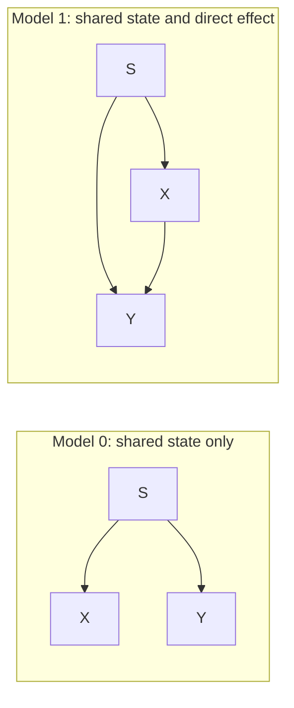

# Why unpaired integration cannot generally identify cross-assay causality

_2026-11-01. A population argument, with explicit assumptions and exceptions._

## The claim in plain language

Even perfect biological-state alignment can leave two explanations of the data
indistinguishable: in one, a histone activity directly affects expression; in
the other, both respond to state and there is no direct effect. If every assay
has exactly the same observable distribution in those two explanations, an
integration algorithm receives no evidence that distinguishes them.

**The result is a failure of general identification of the original cross-assay
direct structure from genuinely disjoint observational cells.** It is not a
claim that integration is useless, that all graph features are unknowable, or
that no restricted structural model can work. It applies to any model class
containing the indistinguishable models below. More cells, a wider neural
network, raw-count inputs, or a different optimizer do not resolve that
particular ambiguity.

The proof does not use our benchmark failures. It is a concrete version of the
missing-joint-distribution problem in statistical matching; no novelty claim
is made. The [focused literature review](../integration_identifiability_2026_11_01/literature/FOCUSED_REVIEW.md)
records primary sources, positive results, and exact searches. The preceding
[aggregation note](06_latent_space_aggregation.md) gives the covariance intuition.

## 1. What is observed, and what we want to identify

Let $S$ be biological state, $X$ a biological variable measured by assay A, and
$Y$ one measured by assay B. For example, $X$ could be a histone activity and
$Y$ expression. These are mathematical countermodels, not fitted mechanisms
for a particular gene or histone mark.

Give integration an unusually favorable starting point: **the true, aligned
state $S$ is observed without error in every cell**. Assay A observes independent
draws of $(S,X)$ and assay B observes independent draws of $(S,Y)$, from the
same population, on disjoint cells. Thus even infinite data supply

$$
O(M)=\{P_M(S,X),\ P_M(S,Y),\ G\},
$$

where $G$ denotes fixed, permitted feature annotations or guidance. The two
models must agree on $G$, and both must satisfy its restrictions. A prior that
asserts the missing edge or effect would change the information available.

Targets include whether $X\to Y$ is a direct edge, its intervention effect,
and whether $X\perp Y\mid S$ in the original same-cell population. A target
$T$ is identifiable over a model class only if

$$
O(M_0)=O(M_1)\quad\Longrightarrow\quad T(M_0)=T(M_1)
$$

for every two models in that class. Finding two models that violate this
implication disproves identification. It does not show that every particular
data distribution has the same ambiguity.

## 2. Two faithful models with identical assay observations

Let $S,U,V$ be mutually independent standard normal variables. For
$0\leq\rho<1$, define the acyclic structural equations

$$
S=\varepsilon_S,\qquad X=S+U,
$$

$$
Y=(1-\rho)S+\rho X+\sqrt{1-\rho^2}\,V.
$$

Substituting the equation for $X$ gives

$$
Y=S+\rho U+\sqrt{1-\rho^2}\,V.
$$

For every value of $\rho$, both assays see exactly

$$
X\mid S=s\sim\mathcal N(s,1),\qquad
Y\mid S=s\sim\mathcal N(s,1).
$$

The mean is unchanged and the conditional variance of $Y$ is
$\rho^2+(1-\rho^2)=1$. Consequently, the entire laws of $(S,X)$ and $(S,Y)$
are unchanged, not just their means or variances.

Compare two members of this family:

| Property | Model 0: $\rho=0$ | Model 1: $\rho=1/2$ |
| --- | --- | --- |
| Equation for $Y$ | $Y=S+V$ | $Y=\tfrac12S+\tfrac12X+\tfrac{\sqrt3}{2}V$ |
| State effects | $S\to X$, $S\to Y$ | $S\to X$, $S\to Y$ |
| Direct cross-assay edge | Absent | $X\to Y$ |
| $\operatorname{Cov}(X,Y\mid S)$ | $0$ | $1/2$ |
| $X\perp Y\mid S$ | Yes | No |
| Observations in either assay | Identical between models | Identical between models |

In Model 1, a cell's deviation in $X$ from its state-specific mean propagates
to $Y$. Assay B sees the resulting variation, but cannot tell which portion
came from the unmeasured $X$ deviation and which from $Y$'s own noise. The two
sources have the same total variance in both models.

### This is not an unfaithfulness or zero-noise trick

In the order $(S,X,Y)$, the joint covariance is

$$
\Sigma_\rho=
\begin{pmatrix}
1&1&1\\
1&2&1+\rho\\
1&1+\rho&2
\end{pmatrix},\qquad
\det\Sigma_\rho=1-\rho^2>0.
$$

All marginal covariances are nonzero. The three possible pairwise conditional
covariances are

$$
\operatorname{Cov}(X,Y\mid S)=\rho,
$$

$$
\operatorname{Cov}(S,X\mid Y)
=\operatorname{Cov}(S,Y\mid X)=\frac{1-\rho}{2}.
$$

At $\rho=0$, the only pairwise conditional independence is the one implied by
the fork. At $0<\rho<1$, none holds, as required by the complete triangle.
Both Gaussian distributions are faithful to their respective DAGs and all
exogenous variances are positive. Changing the direct state coefficient and
noise variance between models maintains the same observed laws; this is not
a cancellation of a conditional dependence within either graph.

### The intervention effect changes too

Replacing the equation for $X$ by $X=x$ gives

$$
\mathbb E[Y\mid\operatorname{do}(X=x),S=s]=(1-\rho)s+\rho x.
$$

Increasing $X$ by $\Delta$ therefore changes the mean of $Y$ by
$\rho\Delta$: zero in Model 0 and $\Delta/2$ in Model 1. The unpaired data
do not distinguish these causal effects.

## 3. Why no integration algorithm can distinguish them

For sample sizes $n_A,n_B$, genuinely disjoint independent sampling gives

$$
P_\rho(D_A,D_B,G)
=P_A^{\otimes n_A}\otimes P_B^{\otimes n_B}\otimes\delta_G.
$$

The right-hand side is independent of $\rho$. An entire procedure—embedding,
optimal transport, imputation, matching, aggregation, and causal discovery—can
be represented by a possibly randomized rule $K(dz\mid D_A,D_B,G)$. Its output
law is

$$
P_\rho(Z\in E)
=\int K(E\mid d_A,d_B,G)\,
  dP_\rho(d_A,d_B,G),
$$

which is the same under Models 0 and 1. Algorithmic randomization or independent
training seeds do not change this equality.

For a procedure forced to decide whether the direct edge exists, let $q$ be
its probability of reporting the edge under this common observed-data law.
Then

$$
P_0(\text{error})=q,\qquad
P_1(\text{error})=1-q,
$$

so

$$
\max\{P_0(\text{error}),P_1(\text{error})\}\geq\tfrac12
$$

at every sample size. No procedure can consistently recover the direct graph
in both models. The same argument applies to deciding $X\perp Y\mid S$.
This is a worst-case two-model bound, **not a claim of 50% error on every
dataset**. A procedure may instead report an honest unresolved set containing
both models; that is partial identification, not unique graph recovery.

The argument covers scGLUE, scMRDR, scConfluence, or any replacement using only
the stated inputs. It does not depend on how they optimize their objectives.
A correct additional restriction that excludes one model changes the problem.

## 4. Background features, depth, guidance, and more assays

Equality of two focal marginals alone would be insufficient if other measured
features distinguished the models. The construction can preserve the complete
within-assay blocks. Append identical local conditional kernels

$$
K_A(W_A,d_A\mid S,X),\qquad K_B(W_B,d_B\mid S,Y)
$$

for backgrounds $W$ and library depths $d$. The full laws
$P(S,X,W_A,d_A)$ and $P(S,Y,W_B,d_B)$ remain identical across models. These
features can be informative about state and their own assay's residuals.
Simple independent noisy state reporters suffice; no claim is needed that
every possible appended kernel preserves faithfulness of an enlarged DAG.

Additional disjoint assays with the same kernels $K_m(W_m\mid S)$ in both
models also preserve ambiguity, including a three- or six-assay example.
Adding modalities is therefore not, by itself, a general identification
guarantee. A shared residual bridge variable with appropriate restrictions
could help; that is different from merely adding more state reporters.

Fixed proximity annotations or a graph of candidate links can be identical in
both models. A method that selects one coupling because of those priors has
made a model-dependent choice. Guidance computed only from the allowed data
is also part of the same rule $K$. Independent biological knowledge that
actually rules out a model must be stated as an identifying assumption.

## 5. Nonlinearity and integer counts do not remove the general ambiguity

The Gaussian construction already disproves identification for any broad
class that contains it. To give a genuinely nonlinear example, apply smooth
invertible transformations $A=g_X(X)$ and $B=g_Y(Y)$, such as logistic maps:

$$
A=g_X(S+U),
$$

$$
B=g_Y\!\left((1-\rho)S+\rho g_X^{-1}(A)
             +\sqrt{1-\rho^2}V\right).
$$

The observed assay laws are still equal across models. Invertibility preserves
conditional independences, and $A$ directly affects $B$ exactly when
$\rho\ne0$. This is a nonlinear structural family, but **not necessarily an
additive-noise model on the transformed scale**. It does not refute every
restricted nonlinear identification theorem. A flexible neural network that
represents these alternatives likewise does not select the true one from
identical inputs.

An observation model can then produce counts. For a direct example on the
original activities, let, at fixed positive depths $d_X,d_Y$,

$$
C_X\mid X,d_X\sim\operatorname{Poisson}(d_X e^X),\qquad
C_Y\mid Y,d_Y\sim\operatorname{Poisson}(d_Y e^Y),
$$

with independent measurement noise. The observed laws of $(S,C_X)$ and
$(S,C_Y)$ are identical for every $\rho$. Yet in a hypothetical jointly
measured cell,

$$
\operatorname{Cov}(C_X,C_Y\mid S=s,d_X,d_Y)
=d_Xd_Y e^{2s+1}(e^\rho-1).
$$

At $\rho=0$ the counts are conditionally independent; at $\rho>0$ they are
dependent. Thus even a count-level conditional independence can be missing.
Applying identical local negative-binomial or dropout measurement kernels also
preserves equality of the separate assay laws, although this particular
covariance formula is for the Poisson example. Known measurement noise alone
does not identify unknown biological residual coupling. Interventions above
are on biological activity, not on the resulting count measurement.

## 6. What state matching and CI tests actually recover

The law of total covariance separates the two sources:

$$
\operatorname{Cov}(X,Y)=
\underbrace{\operatorname{Cov}_S(\mu_X(S),\mu_Y(S))}_{\text{between-state association}}
+\underbrace{\mathbb E_S[\operatorname{Cov}(X,Y\mid S)]}_{\text{same-cell residual association}},
$$

where $\mu_X(s)=\mathbb E[X\mid S=s]$ and similarly for $Y$. In our family,

$$
\operatorname{Cov}_S(\mu_X(S),\mu_Y(S))=1,\qquad
\mathbb E_S[\operatorname{Cov}(X,Y\mid S)]=\rho.
$$

Perfect state alignment identifies the first term under the stated sampling
assumptions. It leaves the second unspecified. Summing or averaging over all
states cannot identify that missing term: all family members have exactly the
same conditional means and state distribution.

In the ideal population limit, independently matching cells conditional only
on state constructs

$$
Q(s,x,y)=p(s)p(x\mid s)p(y\mid s).
$$

It sets the within-state coupling to independence. In the example this is
correct for Model 0 and wrong for Model 1. Feature-dependent matching or
transport can choose a different coupling; not every method constructs this
product. The common limitation is that the true coupling has not been
identified from the input laws.

A CI test on integrated pseudo-pairs tests their constructed distribution
$Q$, subject to its own calibration and row-dependence conditions. Even an
ideal CI oracle for $Q$ need not return the CIs of the biological joint $P$.
The missing biological query $X\perp Y\mid S$ has different answers in the
two models while every disjoint-assay observation has the same law. This
prevents general reconstruction of the original CI oracle; it is not a claim
that CI tests on genuine within-assay joint observations cannot work.

Aggregation is another transformation of the same inputs and obeys the same
indistinguishability result. Averaging all variables over genuinely common
cells is a different observation design, treated in
[the preceding note](06_latent_space_aggregation.md).

## 7. Be precise about DAGs, PAGs, and direction

The state-loaded example proves nonidentification of a **direct biological
edge/effect** and of the conditional independence given $S$. On the joint
variable set $\{S,X,Y\}$, its fork and triangle have different skeletons and
different equivalence classes.

If $S$ is hidden and the target contains only $X,Y$, both of those examples
have nonzero marginal dependence. Their two-variable PAGs both have an
unoriented adjacency, conventionally $X\mathbin{\circ\!\! -\!\!\circ}Y$.
That example alone does **not** prove the two-variable PAG differs. A
biological direct edge and a PAG adjacency are different targets.

For a separate measured-adjacency counterexample, let $S$ be independent of
the focal pair and define

$$
X=U,\qquad Y=\rho X+\sqrt{1-\rho^2}V.
$$

Add arbitrarily informative state backgrounds in both assays. Every observed
assay block can still have the same law for $\rho=0$ and $\rho=1/2$. However,
the first model has $X\perp Y$, while the second has $X\not\perp Y$. The
measured pair graph is empty versus adjacent. Both focal models are faithful.
Therefore a class allowing residual-only cross-assay effects also lacks a
universal measured-PAG recovery guarantee. This does not assert that every
state-dependent pair has an ambiguous adjacency.

Direction has a further, separate obstacle. At a fixed positive $\rho$, the
reverse structural model

$$
Y=S+V,\qquad
X=(1-\rho)S+\rho Y+\sqrt{1-\rho^2}U
$$

has the same **full joint Gaussian law** as the forward model. Even paired
observations would not resolve that direction without more structural
assumptions. Missing cross-assay joint information and observational causal
equivalence are two distinct problems.

Nonidentifiability also does not force an integration algorithm to output a
bidirected edge or no arrow. Stable wrong arrows are possible. The older
matched-pairing note has been corrected on this point.

## 8. Strictly disjoint cells versus shuffled paired cells

The product-law proof in Section 3 assumes independent disjoint samples.
Merely shuffling rows from a jointly measured cohort is a different experiment.
If the same $n$ cells supply both assay multisets, permutations leave sample
means unchanged and

$$
\operatorname{Cov}(\bar X,\bar Y)=\frac{1+\rho}{n},\qquad
\operatorname{Cov}(\overline{X-S},\overline{Y-S})=\frac{\rho}{n}.
$$

The law of the two multisets can therefore depend on $\rho$ even when pair
identities are hidden. Giving exact continuous $S$ in this same-cell design
would almost surely allow the rows to be rejoined by their state values.
This observation does not establish consistent recovery from one shuffled
cohort; it establishes that the exact indistinguishability proof above does
not apply to that design.

Our scMTR-seq pilot has disjoint training pools but a paired-reference holdout
whose assay rows were shuffled. Its complete experimental design is therefore
not the strict-disjoint theorem's observation model. The paired reference can
evaluate an inferred coupling; its poor recovery is not a proof of
nonidentifiability. Likewise, genuinely matched biological samples, shared
environments, overlap, or finite-population sampling need their own observation
model. See the [data record](../../../pipelines/empirical/data/scmtr_seq/README.md)
and [pilot results](../scconfluence_scmtr_pilot_2026_11_01/README.md).

## 9. When recovery could still be possible

| Additional condition or narrower target | What it can support |
| --- | --- |
| True aligned state, common population, and adequate support | Conditional assay means and between-state associations, plus the observed within-assay joint laws |
| A specified conditional copula, including an assumed $X\perp Y\mid S$ | A joint completion under that assumption; not discovery of the assumption from unpaired data |
| Every relevant variable deterministic given a sufficiently informative known $S$ | The joint is fixed by those functions and $P(S)$; causal orientation may still be ambiguous |
| A specified parent set, an invariant equation $Y=a+\beta^\top X+\epsilon$, $\mathbb E[\epsilon\mid S]=0$, and full-rank variation of $\mu_X(S)$ | Identification of $\beta$ from state means; this excludes an unconstrained direct state effect in the response equation |
| Monotone unlinked regression with known independent structural noise and its regularity conditions | A restricted, fixed-direction mechanism from unpaired samples; not an unrestricted DAG |
| A correctly specified identifiable causal model applied to an identified joint law | More causal information than a Gaussian equivalence class, under that model's assumptions |
| Reporting all admissible couplings/graphs instead of selecting one as truth | Partial identification and explicit ambiguity |

For the linear exclusion case, center the conditional means. If
$V=\operatorname{Cov}_S(\mu_X(S))$ is invertible, then

$$
\beta=V^{-1}\operatorname{Cov}_S(\mu_X(S),\mu_Y(S)).
$$

This is a real positive possibility using the same observed variables, but
the exclusion and parent-set assumptions do the identifying work. Our negative
family permits a direct $S\to Y$ term to change with $\rho$, so it is not in
that restricted response model. Do not impose zero conditional noise means on
an entire homogeneous graph and simultaneously assume unexplained state-driven
variation in all its roots; the state inputs must be specified.

The positive unlinked-regression result is established by
[Balabdaoui, Doss and Durot (2021)](https://www.jmlr.org/papers/v22/20-689.html).
The nonlinear additive-noise DAG identification theorem of
[Peters et al. (2014)](https://www.jmlr.org/papers/v15/peters14a.html) starts
from an observational **joint** law and additional model restrictions.
Known assay count noise is not automatically known structural noise.

## 10. What this changes for the project

The current objective is to establish the information boundary before further
integration tuning. State alignment, a reconstructed measurement graph, the
original biological graph, and an observed-variable PAG must remain distinct
targets. Empirical graph stability cannot substitute for the identifying
assumption connecting them.

scGLUE's official regulatory-inference documentation defines symmetric feature
similarity scores; these are not themselves causal directions. scConfluence
supplies a transport-based alignment objective. Our inference from the proof
is that neither kind of objective alone certifies the missing biological joint;
this is not a claim that their published alignment objectives were intended
to prove causal identification. See the official
[scGLUE regulatory-inference definition](https://scglue.readthedocs.io/en/latest/reginf.html)
and [scConfluence article](https://www.nature.com/articles/s41467-024-51382-x).
The [focused review](../integration_identifiability_2026_11_01/literature/FOCUSED_REVIEW.md)
also distinguishes our adaptation from the published scConfluence protocol.

The established literature already treats this missing dependence as an
identification problem: see D'Orazio, Di Zio and Scanu's
[statistical-matching author manuscript, p. 2](https://www.istat.it/en/files/2013/12/Old-and-new-approaches-in-statistical-matching.pdf).
The [research record](../integration_identifiability_2026_11_01/README.md)
contains independent mathematical and scope reviews and an exact symbolic
algebra check. That check verifies identities used here; the written
indistinguishability argument is the proof. No new worlds or fitted models are
needed for this result.
